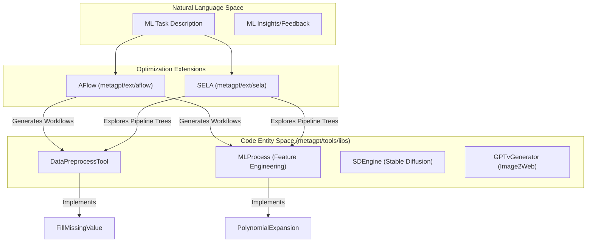
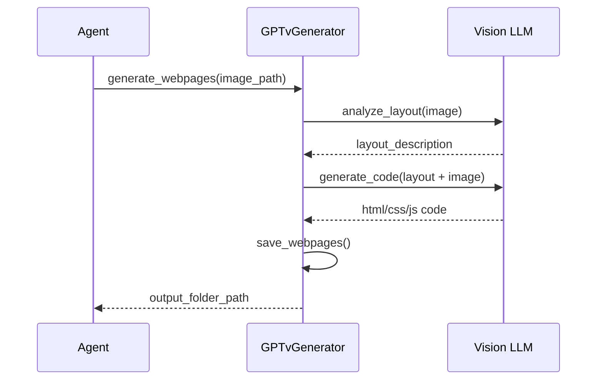

<!-- source: DeepWiki mcp.deepwiki.com · repo geekan/MetaGPT · page 7.1 Machine Learning Engineering · fetched 2026-10-26 -->

# Machine Learning Engineering

Relevant source files

The following files were used as context for generating this wiki page:

- [examples/aflow/README.md](examples/aflow/README.md)
- [examples/aflow/optimize.py](examples/aflow/optimize.py)
- [metagpt/ext/aflow/scripts/evaluator.py](metagpt/ext/aflow/scripts/evaluator.py)
- [metagpt/ext/aflow/scripts/optimizer.py](metagpt/ext/aflow/scripts/optimizer.py)
- [metagpt/ext/aflow/scripts/optimizer_utils/convergence_utils.py](metagpt/ext/aflow/scripts/optimizer_utils/convergence_utils.py)
- [metagpt/ext/aflow/scripts/optimizer_utils/data_utils.py](metagpt/ext/aflow/scripts/optimizer_utils/data_utils.py)
- [metagpt/ext/aflow/scripts/optimizer_utils/experience_utils.py](metagpt/ext/aflow/scripts/optimizer_utils/experience_utils.py)
- [metagpt/ext/aflow/scripts/workflow.py](metagpt/ext/aflow/scripts/workflow.py)
- [metagpt/ext/sela/README.md](metagpt/ext/sela/README.md)
- [metagpt/ext/sela/data/custom_task.py](metagpt/ext/sela/data/custom_task.py)
- [metagpt/ext/sela/run_experiment.py](metagpt/ext/sela/run_experiment.py)
- [metagpt/ext/sela/runner/README.md](metagpt/ext/sela/runner/README.md)
- [metagpt/ext/sela/runner/__init__.py](metagpt/ext/sela/runner/__init__.py)
- [metagpt/ext/sela/runner/aide.py](metagpt/ext/sela/runner/aide.py)
- [metagpt/ext/sela/runner/autogluon.py](metagpt/ext/sela/runner/autogluon.py)
- [metagpt/ext/sela/runner/autosklearn.py](metagpt/ext/sela/runner/autosklearn.py)
- [metagpt/ext/sela/runner/custom.py](metagpt/ext/sela/runner/custom.py)
- [metagpt/ext/sela/runner/mcts.py](metagpt/ext/sela/runner/mcts.py)
- [metagpt/ext/sela/runner/mle_bench/instructions.py](metagpt/ext/sela/runner/mle_bench/instructions.py)
- [metagpt/tools/libs/data_preprocess.py](metagpt/tools/libs/data_preprocess.py)
- [metagpt/tools/libs/feature_engineering.py](metagpt/tools/libs/feature_engineering.py)
- [metagpt/tools/libs/gpt_v_generator.py](metagpt/tools/libs/gpt_v_generator.py)
- [metagpt/tools/libs/sd_engine.py](metagpt/tools/libs/sd_engine.py)
- [metagpt/tools/libs/web_scraping.py](metagpt/tools/libs/web_scraping.py)
- [metagpt/tools/tool_convert.py](metagpt/tools/tool_convert.py)
- [metagpt/tools/tool_data_type.py](metagpt/tools/tool_data_type.py)
- [metagpt/tools/tool_registry.py](metagpt/tools/tool_registry.py)
- [metagpt/utils/parse_docstring.py](metagpt/utils/parse_docstring.py)
- [tests/metagpt/tools/libs/test_gpt_v_generator.py](tests/metagpt/tools/libs/test_gpt_v_generator.py)
- [tests/metagpt/tools/libs/test_sd_engine.py](tests/metagpt/tools/libs/test_sd_engine.py)
- [tests/metagpt/tools/test_tool_convert.py](tests/metagpt/tools/test_tool_convert.py)
- [tests/metagpt/tools/test_tool_registry.py](tests/metagpt/tools/test_tool_registry.py)

## Purpose and Scope

Machine Learning (ML) Engineering in MetaGPT extends the core multi-agent framework to handle specialized data science and research tasks. It encompasses automated data preprocessing, feature engineering, and advanced optimization frameworks like **AFlow** (for agentic workflow optimization) and **SELA** (for tree-search enhanced AutoML). These tools allow agents to move beyond simple code generation into autonomous experimentation, model selection, and workflow refinement.

For information about the base roles using these tools, see [Data Interpreter](#5.3).

## Architecture Overview

The ML Engineering system bridges the gap between natural language requirements and executable code entities by providing a structured library of tools and specialized optimization extensions.

Sources: [metagpt/ext/aflow/README.md:1-20](), [metagpt/ext/sela/README.md:1-8](), [metagpt/tools/libs/data_preprocess.py:60-89](), [metagpt/tools/libs/feature_engineering.py:27-46]()

## Automated ML (AutoML) and Optimization

MetaGPT provides two primary extensions for high-level ML engineering optimization: **AFlow** and **SELA**.

### AFlow: Agentic Workflow Optimizer
AFlow automates the generation of agentic workflows using Monte Carlo Tree Search (MCTS) in a code-represented space. It treats workflows as sequences of `ActionNode` objects connected by execution logic.

*   **Optimizer**: Located in `metagpt/ext/aflow/scripts/optimizer.py`, it iteratively selects, expands, and updates workflows based on performance [examples/aflow/README.md:16-16]().
*   **Operators**: Predefined units like `Ensemble`, `Programmer`, and `Test` that encapsulate common ML operations [examples/aflow/README.md:14-14]().
*   **Workflow**: Represented as code, allowing for complex execution structures [examples/aflow/README.md:15-15]().

### SELA: Tree-Search Enhanced AutoML
SELA focuses on traditional AutoML tasks (model selection, ensembling) by representing pipeline configurations as trees. It uses MCTS to intelligently explore the solution space and refine strategies based on experimental feedback [metagpt/ext/sela/README.md:7-7]().

Sources: [examples/aflow/README.md:11-17](), [metagpt/ext/sela/README.md:4-7]()

## Data Preprocessing and Feature Engineering

MetaGPT includes a robust library of ML tools registered via the `TOOL_REGISTRY` [metagpt/tools/tool_registry.py:91-91](). These tools follow the `MLProcess` interface, providing `fit`, `transform`, and `fit_transform` methods [metagpt/tools/libs/data_preprocess.py:24-58]().

### Data Preprocessing Tools
Located in `metagpt/tools/libs/data_preprocess.py`, these tools handle common data cleaning tasks:

| Tool Class | Purpose | Implementation Detail |
| :--- | :--- | :--- |
| `FillMissingValue` | Imputation | Uses `sklearn.impute.SimpleImputer` [metagpt/tools/libs/data_preprocess.py:89-108]() |
| `MinMaxScale` | Scaling | Scales features to (0, 1) range [metagpt/tools/libs/data_preprocess.py:112-120]() |
| `OneHotEncode` | Encoding | Categorical to binary vectors; drops original columns [metagpt/tools/libs/data_preprocess.py:167-182]() |
| `LabelEncode` | Encoding | In-place integer encoding for categories [metagpt/tools/libs/data_preprocess.py:186-218]() |

### Feature Engineering Tools
Located in `metagpt/tools/libs/feature_engineering.py`, these tools generate new signals for models:

| Tool Class | Purpose | Implementation Detail |
| :--- | :--- | :--- |
| `PolynomialExpansion` | Interaction | Adds polynomial features; caps at top 10 by correlation [metagpt/tools/libs/feature_engineering.py:27-56]() |
| `CatCount` | Frequency | Adds value counts of a categorical column [metagpt/tools/libs/feature_engineering.py:70-91]() |
| `TargetMeanEncoder` | Target Encoding | Encodes categories by label mean [metagpt/tools/libs/feature_engineering.py:95-118]() |
| `KFoldTargetMeanEncoder` | Robust Encoding | K-fold mean encoding to prevent leakage [metagpt/tools/libs/feature_engineering.py:122-158]() |

Sources: [metagpt/tools/libs/data_preprocess.py:89-218](), [metagpt/tools/libs/feature_engineering.py:27-158]()

## Multimodal ML Capabilities

Beyond tabular data, the ML engineering suite includes tools for image generation and vision-to-code tasks.

### Stable Diffusion Integration
The `SDEngine` class provides a wrapper for text-to-image generation via the Stable Diffusion API [metagpt/tools/libs/sd_engine.py:59-63](). It handles payload construction (e.g., negative prompts, model checkpoints) and asynchronous execution [metagpt/tools/libs/sd_engine.py:77-103]().

### Vision-to-Webpage Generation
The `GPTvGenerator` utilizes vision models (e.g., `gpt-4-vision-preview`) to analyze UI/UX sketches and generate corresponding HTML, CSS, and JavaScript [metagpt/tools/libs/gpt_v_generator.py:33-46]().

Sources: [metagpt/tools/libs/sd_engine.py:59-135](), [metagpt/tools/libs/gpt_v_generator.py:33-74]()

## Tool Registration and Conversion

ML tools are integrated into the agent's action space through the `tool_registry`. The system automatically converts Python code into schemas that LLMs can understand using docstring parsing [metagpt/tools/tool_convert.py:9-28]().

*   **`register_tool`**: A decorator that captures the file path, source code, and tags of a class/function and adds it to the `TOOL_REGISTRY` [metagpt/tools/tool_registry.py:94-118]().
*   **`convert_code_to_tool_schema`**: Uses `inspect` to extract function signatures and Google-style docstrings to build JSON schemas for the LLM [metagpt/tools/tool_convert.py:41-65]().

Sources: [metagpt/tools/tool_registry.py:94-118](), [metagpt/tools/tool_convert.py:9-65]()

---

