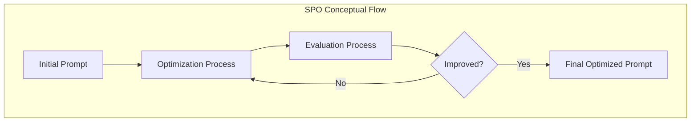
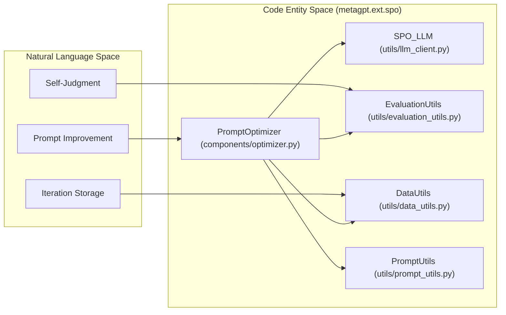
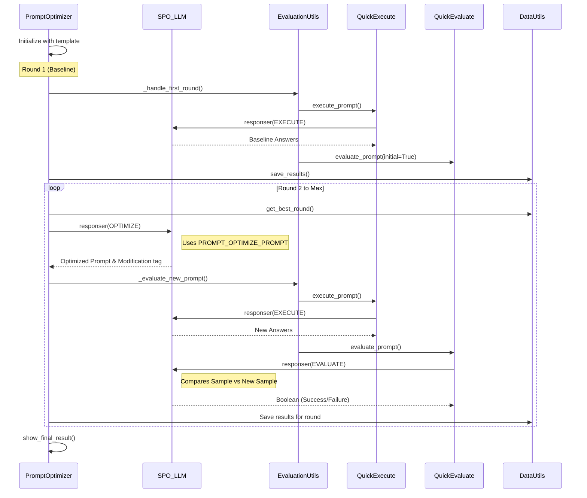

<!-- source: DeepWiki mcp.deepwiki.com · repo geekan/MetaGPT · page 7.2 Self-Supervised Prompt Optimization · fetched 2026-10-26 -->

# Self-Supervised Prompt Optimization

<details>
<summary>Relevant source files</summary>

The following files were used as context for generating this wiki page:

- [examples/spo/README.md](examples/spo/README.md)
- [examples/spo/optimize.py](examples/spo/optimize.py)
- [metagpt/ext/spo/app.py](metagpt/ext/spo/app.py)
- [metagpt/ext/spo/components/evaluator.py](metagpt/ext/spo/components/evaluator.py)
- [metagpt/ext/spo/components/optimizer.py](metagpt/ext/spo/components/optimizer.py)
- [metagpt/ext/spo/prompts/evaluate_prompt.py](metagpt/ext/spo/prompts/evaluate_prompt.py)
- [metagpt/ext/spo/prompts/optimize_prompt.py](metagpt/ext/spo/prompts/optimize_prompt.py)
- [metagpt/ext/spo/settings/Navigate.yaml](metagpt/ext/spo/settings/Navigate.yaml)
- [metagpt/ext/spo/settings/Poem.yaml](metagpt/ext/spo/settings/Poem.yaml)
- [metagpt/ext/spo/utils/data_utils.py](metagpt/ext/spo/utils/data_utils.py)
- [metagpt/ext/spo/utils/evaluation_utils.py](metagpt/ext/spo/utils/evaluation_utils.py)
- [metagpt/ext/spo/utils/llm_client.py](metagpt/ext/spo/utils/llm_client.py)
- [metagpt/ext/spo/utils/load.py](metagpt/ext/spo/utils/load.py)
- [metagpt/ext/spo/utils/prompt_utils.py](metagpt/ext/spo/utils/prompt_utils.py)

</details>


Self-Supervised Prompt Optimization (SPO) is an automated prompt engineering system within MetaGPT that optimizes prompts for Large Language Models (LLMs) without requiring human feedback or labeled data. This system uses LLMs themselves as judges to iteratively improve prompts through a self-evolving optimization process.

## Core Concepts and Advantages

SPO offers several key advantages over traditional prompt engineering approaches:

- **Zero Supervision Required**: No ground truth or human feedback needed [examples/spo/README.md:18-18]().
- **Ultra-Low Cost**: Approximately $0.15 per task optimization [examples/spo/README.md:17-17]().
- **Universal Adaptation**: Supports both closed-ended and open-ended tasks [examples/spo/README.md:19-19]().
- **Self-Evolution**: Automatically improves prompts through an LLM-as-judge mechanism [examples/spo/README.md:20-20]().


Sources: [examples/spo/README.md:7-21]()

## System Architecture

The SPO system consists of several interconnected components organized around the central `PromptOptimizer` class. It bridges the natural language optimization goal with code entities that manage data, LLM requests, and evaluation logic.

### Code Entity Mapping
The following diagram maps high-level SPO components to their specific class implementations in the codebase.



### Class Definitions and Roles
- **`PromptOptimizer`**: The main controller that orchestrates the optimization rounds [metagpt/ext/spo/components/optimizer.py:19-38]().
- **`SPO_LLM`**: A singleton client managing three distinct LLM instances for optimization, evaluation, and execution [metagpt/ext/spo/utils/llm_client.py:17-28]().
- **`PromptUtils`**: Handles file I/O for prompt text and round directories [metagpt/ext/spo/utils/prompt_utils.py:6-8]().
- **`DataUtils`**: Manages the results JSON, score tracking, and formatting lists to Markdown [metagpt/ext/spo/utils/data_utils.py:11-14]().
- **`EvaluationUtils`**: High-level wrapper for executing and judging prompts [metagpt/ext/spo/utils/evaluation_utils.py:21-23]().
- **`QuickExecute`**: Performs the actual inference of a prompt against test questions [metagpt/ext/spo/components/evaluator.py:15-22]().
- **`QuickEvaluate`**: Implements the LLM-as-judge logic using `EVALUATE_PROMPT` [metagpt/ext/spo/components/evaluator.py:42-48]().

Sources: [metagpt/ext/spo/components/optimizer.py:19-48](), [metagpt/ext/spo/utils/llm_client.py:17-77](), [metagpt/ext/spo/utils/prompt_utils.py:6-34](), [metagpt/ext/spo/utils/data_utils.py:11-44](), [metagpt/ext/spo/utils/evaluation_utils.py:21-81](), [metagpt/ext/spo/components/evaluator.py:15-75]()

## Optimization Process Flow

The optimization process iterates through `max_rounds` [metagpt/ext/spo/components/optimizer.py:41-45](). Each round consists of generating a new prompt based on previous best results, executing it, and evaluating the output.



Sources: [metagpt/ext/spo/components/optimizer.py:40-137](), [metagpt/ext/spo/utils/evaluation_utils.py:25-81](), [metagpt/ext/spo/components/evaluator.py:15-75](), [metagpt/ext/spo/utils/data_utils.py:25-32]()

## Multi-LLM Configuration

SPO leverages `SPO_LLM` to route requests to specific models configured for different behaviors. This is initialized via `SPO_LLM.initialize()` [metagpt/ext/spo/utils/llm_client.py:68-70]().

| Phase | Purpose | Default Model | Temp | `RequestType` |
|-------|---------|---------------|------|---------------|
| **Optimization** | Rewrite the prompt to meet requirements | `claude-3-5-sonnet-20240620` | 0.7 | `OPTIMIZE` |
| **Evaluation** | Compare two outputs and pick the better one | `gpt-4o-mini` | 0.3 | `EVALUATE` |
| **Execution** | Generate answers for test questions | `gpt-4o-mini` | 0.0 | `EXECUTE` |

Sources: [metagpt/ext/spo/utils/llm_client.py:11-65](), [examples/spo/optimize.py:11-16]()

## Template Configuration

SPO uses YAML files located in `metagpt/ext/spo/settings/` to define the task. These are loaded by `load_meta_data` [metagpt/ext/spo/utils/load.py:15-48]().

### YAML Structure
- **`prompt`**: The starting system instruction [metagpt/ext/spo/settings/Navigate.yaml:1]().
- **`requirements`**: Qualitative goals (e.g., "more humorous", "XML format") [metagpt/ext/spo/settings/Navigate.yaml:6]().
- **`count`**: Word count constraint for the optimizer [metagpt/ext/spo/utils/load.py:41-44]().
- **`qa`**: A list of `question` and `answer` pairs. The `answer` can be a "Golden Answer" or a description of the desired thinking process [metagpt/ext/spo/settings/Navigate.yaml:12-24]().

Sources: [metagpt/ext/spo/utils/load.py:15-48](), [examples/spo/README.md:53-82]()

## Execution Methods

### 1. Python API
Users can instantiate the `PromptOptimizer` directly. The `SPO_LLM` must be initialized before calling `optimize()` [metagpt/ext/spo/components/optimizer.py:38]().

```python
from metagpt.ext.spo.components.optimizer import PromptOptimizer
from metagpt.ext.spo.utils.llm_client import SPO_LLM

SPO_LLM.initialize(
    optimize_kwargs={"model": "gpt-4o", "temperature": 0.7},
    evaluate_kwargs={"model": "gpt-4o-mini", "temperature": 0.3},
    execute_kwargs={"model": "gpt-4o-mini", "temperature": 0}
)

optimizer = PromptOptimizer(optimized_path="workspace", name="TaskName", template="Task.yaml")
optimizer.optimize()
```
Sources: [metagpt/ext/spo/components/optimizer.py:20-40](), [examples/spo/README.md:89-111]()

### 2. Command-Line Interface
The `examples/spo/optimize.py` script provides a CLI for all parameters [examples/spo/optimize.py:7-25]().

```bash
python -m examples.spo.optimize --template "Poem.yaml" --max-rounds 5
```
Sources: [examples/spo/optimize.py:28-46]()

### 3. Streamlit Web Interface
A GUI for managing templates and viewing results in real-time is available via `metagpt/ext/spo/app.py` [metagpt/ext/spo/app.py:75-137](). It uses `st.session_state` to track optimization progress and `st.expander` to display round-by-round results [metagpt/ext/spo/app.py:38-62]().

Sources: [metagpt/ext/spo/app.py:1-301](), [examples/spo/README.md:138-152]()

## Output and Results

Results are persisted in the `optimized_path` (default: `workspace`) [metagpt/ext/spo/components/optimizer.py:29]().

- **`results.json`**: A list of dictionaries containing `round`, `answers`, `prompt`, `succeed`, `tokens`, and `time` [metagpt/ext/spo/utils/data_utils.py:37-39]().
- **`round_n/prompt.txt`**: The specific prompt used in round $n$ [metagpt/ext/spo/utils/prompt_utils.py:32-34]().
- **`round_n/answers.txt`**: The model responses for that round's test questions [metagpt/ext/spo/utils/prompt_utils.py:24-30]().

Sources: [examples/spo/README.md:154-177](), [metagpt/ext/spo/utils/data_utils.py:34-44]()

---

