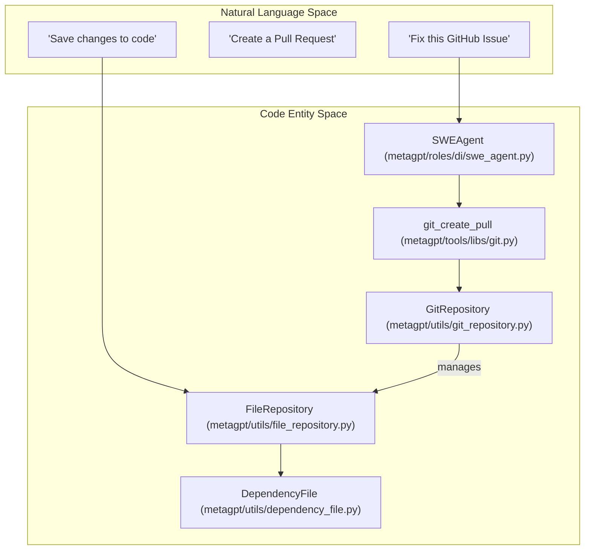
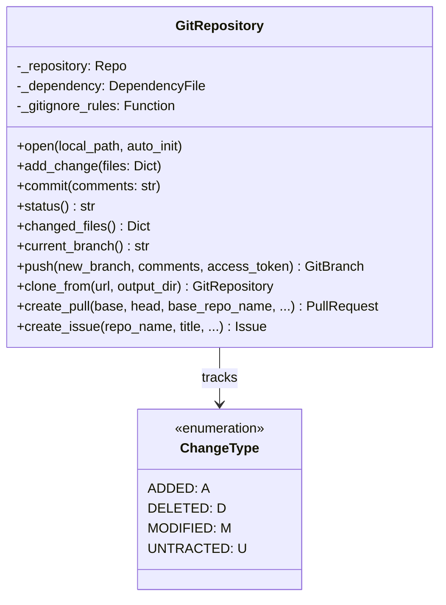
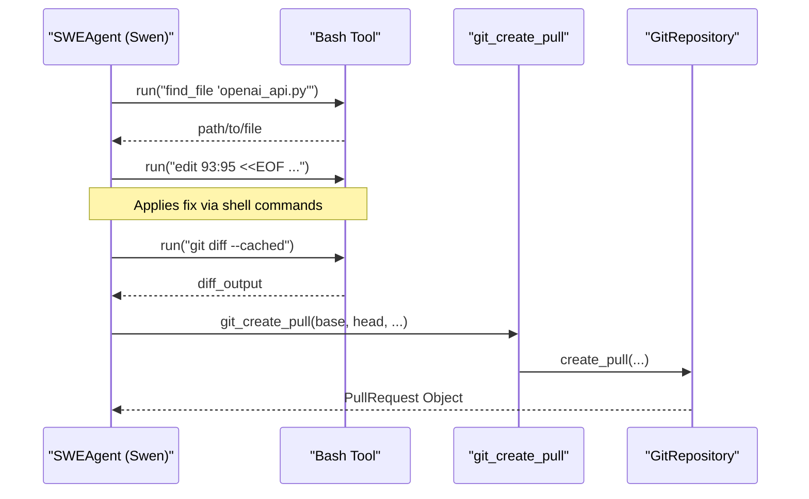

<!-- source: DeepWiki mcp.deepwiki.com · repo geekan/MetaGPT · page 7.3 Git Repository Management · fetched 2026-10-26 -->

# Git Repository Management

Relevant source files

The following files were used as context for generating this wiki page:

- [metagpt/actions/prepare_documents.py](metagpt/actions/prepare_documents.py)
- [metagpt/actions/rebuild_class_view.py](metagpt/actions/rebuild_class_view.py)
- [metagpt/actions/rebuild_sequence_view.py](metagpt/actions/rebuild_sequence_view.py)
- [metagpt/prompts/di/swe_agent.py](metagpt/prompts/di/swe_agent.py)
- [metagpt/repo_parser.py](metagpt/repo_parser.py)
- [metagpt/roles/di/swe_agent.py](metagpt/roles/di/swe_agent.py)
- [metagpt/startup.py](metagpt/startup.py)
- [metagpt/tools/libs/git.py](metagpt/tools/libs/git.py)
- [metagpt/utils/dependency_file.py](metagpt/utils/dependency_file.py)
- [metagpt/utils/di_graph_repository.py](metagpt/utils/di_graph_repository.py)
- [metagpt/utils/file_repository.py](metagpt/utils/file_repository.py)
- [metagpt/utils/git_repository.py](metagpt/utils/git_repository.py)
- [metagpt/utils/graph_repository.py](metagpt/utils/graph_repository.py)
- [metagpt/utils/visual_graph_repo.py](metagpt/utils/visual_graph_repo.py)
- [tests/metagpt/actions/test_rebuild_class_view.py](tests/metagpt/actions/test_rebuild_class_view.py)
- [tests/metagpt/actions/test_rebuild_sequence_view.py](tests/metagpt/actions/test_rebuild_sequence_view.py)
- [tests/metagpt/roles/di/run_swe_agent_for_benchmark.py](tests/metagpt/roles/di/run_swe_agent_for_benchmark.py)
- [tests/metagpt/roles/di/run_swe_agent_open_source_issue.py](tests/metagpt/roles/di/run_swe_agent_open_source_issue.py)
- [tests/metagpt/test_document.py](tests/metagpt/test_document.py)
- [tests/metagpt/test_incremental_dev.py](tests/metagpt/test_incremental_dev.py)
- [tests/metagpt/test_repo_parser.py](tests/metagpt/test_repo_parser.py)
- [tests/metagpt/tools/libs/test_git.py](tests/metagpt/tools/libs/test_git.py)
- [tests/metagpt/tools/libs/test_image_getter.py](tests/metagpt/tools/libs/test_image_getter.py)
- [tests/metagpt/utils/test_git_repository.py](tests/metagpt/utils/test_git_repository.py)
- [tests/metagpt/utils/test_visual_graph_repo.py](tests/metagpt/utils/test_visual_graph_repo.py)

This page documents the Git repository management system in MetaGPT, which provides a comprehensive set of tools and classes for managing Git repositories, tracking changes, and interacting with GitHub. This system enables MetaGPT's agents to work with code repositories, implement changes, create pull requests, and resolve issues programmatically.

## Overview

The Git Repository Management system forms a key part of MetaGPT's specialized capabilities, providing the foundation for code management and version control operations. It enables agents to perform Git operations and interact with GitHub programmatically, facilitating automated software development workflows.

### System Architecture: Natural Language to Code Entity Space

The following diagram bridges the gap between the high-level Git management concepts and the specific classes and functions implemented in the codebase.

Sources: [metagpt/roles/di/swe_agent.py:17-31](), [metagpt/tools/libs/git.py:16-25](), [metagpt/utils/git_repository.py:61-70](), [metagpt/utils/file_repository.py:23-32](), [metagpt/utils/dependency_file.py:20-24]()

## Core Components

### GitRepository Class
The `GitRepository` class is the central component, encapsulating operations for managing Git repositories via `GitPython`. It handles initialization, cloning, and interaction with GitHub's API via `PyGithub`.

Sources: [metagpt/utils/git_repository.py:61-167](), [metagpt/utils/git_repository.py:39-47](), [metagpt/utils/git_repository.py:417-440](), [metagpt/utils/git_repository.py:451-518]()

### FileRepository and Dependency Tracking
The `FileRepository` class manages files within a specific sub-directory of a `GitRepository`. It includes a `DependencyFile` mechanism (tracking `.dependencies.json`) to map relationships between source files, which is critical for incremental development.

| Method | Role | Source |
| :--- | :--- | :--- |
| `save` | Writes content and updates `.dependencies.json` | [metagpt/utils/file_repository.py:46-64]() |
| `get_changed_dependency` | Identifies which dependent files need updates based on git diff | [metagpt/utils/file_repository.py:76-89]() |
| `update` (DependencyFile) | Persists dependency sets to JSON | [metagpt/utils/dependency_file.py:48-78]() |

## Autonomous Issue Resolution: SWEAgent

The `SWEAgent` (Software Engineering Agent) is a specialized `RoleZero` implementation designed to resolve GitHub issues autonomously. It combines a terminal (`Bash`), a browser, and Git tools to navigate a codebase and apply patches.

Sources: [metagpt/roles/di/swe_agent.py:17-31](), [metagpt/roles/di/swe_agent.py:62-81](), [metagpt/prompts/di/swe_agent.py:7-113]()

### SWEAgent Key Features
- **Tool Map**: Overrides `_update_tool_execution` to map "Bash.run" to its internal terminal and "git_create_pull" to the Git utility. [metagpt/roles/di/swe_agent.py:38-44]()
- **Evaluation Support**: Includes `_parse_commands_for_eval` which uses `extract_patch` to generate clean unified diffs for benchmarks like SWE-bench. [metagpt/roles/di/swe_agent.py:62-81]()
- **Instruction Template**: Uses `NEXT_STEP_TEMPLATE` and `CURRENT_BASH_STATE` to maintain context of the current shell directory and open files. [metagpt/roles/di/swe_agent.py:6-10](), [metagpt/roles/di/swe_agent.py:46-54]()

## GitHub Integration Tools

MetaGPT provides high-level tools registered for agent use to interact with remote repositories.

### Pull Request Creation
The `git_create_pull` function attempts to find credentials in `~/.git-credentials` before calling the underlying `GitRepository.create_pull` method.
Sources: [metagpt/tools/libs/git.py:16-92]()

### Issue Creation
The `git_create_issue` tool allows agents to report bugs or request features programmatically using a GitHub access token.
Sources: [metagpt/tools/libs/git.py:96-131]()

## Incremental Development & Repository Initialization

During the initial phase of a software project, the `PrepareDocuments` action initializes the workspace as a Git repository.

1. **Initialization**: `PrepareDocuments._init_repo()` creates the directory and calls `ProjectRepo(path)`. [metagpt/actions/prepare_documents.py:40-51]()
2. **Git Init**: `GitRepository._init()` initializes the `.git` folder and creates a default `.gitignore`. [metagpt/utils/git_repository.py:99-113]()
3. **Requirement Tracking**: The user's requirement is saved into `docs/requirement.txt` using the `FileRepository` associated with the project. [metagpt/actions/prepare_documents.py:72-75]()

## Reverse Engineering and Visualization

The system can reconstruct sequence and class views from an existing Git repository using `RepoParser` and `RebuildSequenceView`.

- **RepoParser**: Parses source code into `CodeBlockInfo` and `RepoFileInfo` to build a symbol repository. [metagpt/repo_parser.py:30-66]()
- **RebuildSequenceView**: An action that searches for the `__main__` entry in a `GraphRepository` and uses LLM to translate code flows into Mermaid sequence diagrams. [metagpt/actions/rebuild_sequence_view.py:76-105]()
- **Graph Storage**: Relationships are stored in a `DiGraphRepository` (backed by JSON) located within the repository's `.graph_repo` directory. [metagpt/actions/rebuild_sequence_view.py:95-96]()

Sources: [metagpt/repo_parser.py:1-11](), [metagpt/actions/rebuild_sequence_view.py:7-9]()

---

