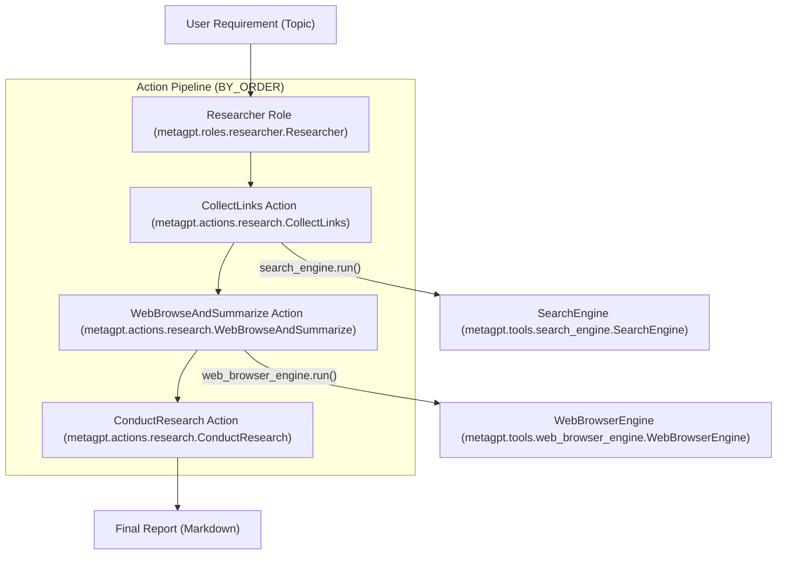
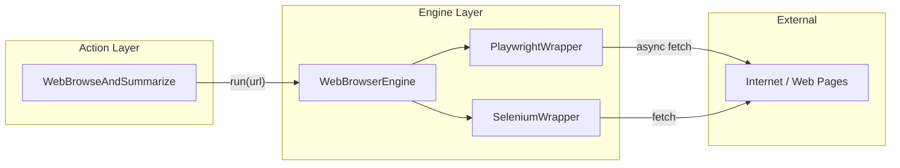

<!-- source: DeepWiki mcp.deepwiki.com · repo geekan/MetaGPT · page 7.4 Web Research and Search · fetched 2026-10-26 -->

# Web Research and Search

Relevant source files

The following files were used as context for generating this wiki page:

- [.dockerignore](.dockerignore)
- [examples/agent_creator.py](examples/agent_creator.py)
- [examples/build_customized_agent.py](examples/build_customized_agent.py)
- [examples/build_customized_multi_agents.py](examples/build_customized_multi_agents.py)
- [examples/debate.py](examples/debate.py)
- [examples/debate_simple.py](examples/debate_simple.py)
- [examples/search_enhanced_qa.py](examples/search_enhanced_qa.py)
- [examples/search_with_specific_engine.py](examples/search_with_specific_engine.py)
- [metagpt/actions/research.py](metagpt/actions/research.py)
- [metagpt/actions/search_enhanced_qa.py](metagpt/actions/search_enhanced_qa.py)
- [metagpt/configs/browser_config.py](metagpt/configs/browser_config.py)
- [metagpt/configs/search_config.py](metagpt/configs/search_config.py)
- [metagpt/prompts/product_manager.py](metagpt/prompts/product_manager.py)
- [metagpt/provider/azure_openai_api.py](metagpt/provider/azure_openai_api.py)
- [metagpt/roles/researcher.py](metagpt/roles/researcher.py)
- [metagpt/roles/searcher.py](metagpt/roles/searcher.py)
- [metagpt/tools/__init__.py](metagpt/tools/__init__.py)
- [metagpt/tools/search_engine.py](metagpt/tools/search_engine.py)
- [metagpt/tools/search_engine_ddg.py](metagpt/tools/search_engine_ddg.py)
- [metagpt/tools/search_engine_googleapi.py](metagpt/tools/search_engine_googleapi.py)
- [metagpt/tools/search_engine_serpapi.py](metagpt/tools/search_engine_serpapi.py)
- [metagpt/tools/search_engine_serper.py](metagpt/tools/search_engine_serper.py)
- [metagpt/tools/web_browser_engine.py](metagpt/tools/web_browser_engine.py)
- [metagpt/tools/web_browser_engine_playwright.py](metagpt/tools/web_browser_engine_playwright.py)
- [metagpt/tools/web_browser_engine_selenium.py](metagpt/tools/web_browser_engine_selenium.py)
- [metagpt/utils/make_sk_kernel.py](metagpt/utils/make_sk_kernel.py)
- [tests/metagpt/roles/di/run_architect.py](tests/metagpt/roles/di/run_architect.py)
- [tests/metagpt/roles/di/run_product_manager.py](tests/metagpt/roles/di/run_product_manager.py)
- [tests/metagpt/roles/di/run_project_manager.py](tests/metagpt/roles/di/run_project_manager.py)
- [tests/metagpt/roles/di/test_routing.py](tests/metagpt/roles/di/test_routing.py)
- [tests/metagpt/roles/test_product_manager.py](tests/metagpt/roles/test_product_manager.py)
- [tests/metagpt/tools/test_search_engine.py](tests/metagpt/tools/test_search_engine.py)
- [tests/metagpt/tools/test_web_browser_engine.py](tests/metagpt/tools/test_web_browser_engine.py)
- [tests/metagpt/tools/test_web_browser_engine_playwright.py](tests/metagpt/tools/test_web_browser_engine_playwright.py)
- [tests/metagpt/tools/test_web_browser_engine_selenium.py](tests/metagpt/tools/test_web_browser_engine_selenium.py)

MetaGPT provides a comprehensive web research and search suite that enables autonomous agents to interact with the live internet. This capability is built upon a layered architecture: high-level roles for research orchestration, specialized actions for search and synthesis, and a modular engine layer for multi-provider search and browser-based scraping.

## Researcher Role and Workflow

The `Researcher` role [metagpt/roles/researcher.py:28-34]() is a specialized agent designed to conduct in-depth, objective research on a given topic. It operates using a linear `RoleReactMode.BY_ORDER` pipeline [metagpt/roles/researcher.py:39](), executing three primary actions in sequence to produce a final Markdown report.

### Data Flow and Action Sequence

1.  **CollectLinks**: The role identifies search keywords and gathers relevant URLs from search engines.
2.  **WebBrowseAndSummarize**: It scrapes the content of the gathered URLs and generates concise summaries for each.
3.  **ConductResearch**: It synthesizes all summaries into a structured, APA-style research report.

The following diagram illustrates the transition from the user's natural language request to the internal code execution flow of the `Researcher`.

**Researcher Execution Flow**

Sources: [metagpt/roles/researcher.py:38-43](), [metagpt/actions/research.py:80-113](), [metagpt/actions/research.py:592-613](), [metagpt/actions/research.py:734-754]()

## Search Engine Integrations

The `SearchEngine` class [metagpt/tools/search_engine.py:18]() acts as a unified interface for multiple search providers. It abstracts the underlying API complexities, allowing agents to switch between providers via configuration without changing action logic.

### Supported Search Engines
MetaGPT supports several search providers defined in `SearchEngineType` [metagpt/tools/search_engine.py:57-75]():

| Engine Type | Implementation Class | Description |
| --- | --- | --- |
| `SERPER_GOOGLE` | `SerperWrapper` | Google search via Serper.dev API. |
| `SERPAPI_GOOGLE` | `SerpAPIWrapper` | Google search via SerpAPI. |
| `DIRECT_GOOGLE` | `GoogleAPIWrapper` | Official Google Custom Search API. |
| `DUCK_DUCK_GO` | `DDGAPIWrapper` | Free search via DuckDuckGo. |
| `BING` | `BingAPIWrapper` | Microsoft Bing Search API. |
| `CUSTOM_ENGINE` | User-defined | Supports passing a custom coroutine. |

### Configuration and Initialization
The `SearchEngine` is typically initialized using `SearchConfig` [metagpt/tools/search_engine.py:79-89](). It dynamically loads the required wrapper using `importlib` based on the configured `engine` type [metagpt/tools/search_engine.py:57-75]().

Sources: [metagpt/tools/search_engine.py:18-77](), [metagpt/configs/search_config.py:1-20]()

## Web Browsing and Scraping

To extract data from search results, MetaGPT utilizes the `WebBrowserEngine` [metagpt/tools/web_browser_engine.py:15](). This component handles the complexities of modern web pages, including JavaScript rendering and proxy management.

### Browser Drivers
The engine supports two primary drivers through `WebBrowserEngineType` [metagpt/tools/web_browser_engine.py:67-77]():
1.  **Playwright**: Recommended for high-performance, asynchronous headless browsing [metagpt/tools/web_browser_engine.py:68]().
2.  **Selenium**: Supported for legacy requirements or specific browser compatibility [metagpt/tools/web_browser_engine.py:71]().

### WebBrowseAndSummarize Action
This action [metagpt/actions/research.py:592]() bridges search and research. It takes a URL, uses the `WebBrowserEngine` to fetch the `WebPage` object [metagpt/utils/parse_html.py](), and then applies LLM prompts to summarize the content based on its relevance to the research topic [metagpt/actions/research.py:660-685]().

**Browser Engine Architecture**

Sources: [metagpt/tools/web_browser_engine.py:15-77](), [metagpt/actions/research.py:592-620]()

## SearchEnhancedQA

The `SearchEnhancedQA` action [metagpt/actions/search_enhanced_qa.py:62]() is a specialized tool for RAG (Retrieval-Augmented Generation) over the live web. Unlike the `Researcher` role which produces long-form reports, `SearchEnhancedQA` is optimized for providing concise, cited answers to specific questions.

### Key Components
*   **Query Rewriting**: Uses `REWRITE_QUERY_PROMPT` to transform user questions into optimized search queries [metagpt/actions/search_enhanced_qa.py:18-44]().
*   **Context Building**: Aggregates summaries from multiple search results into a single context window [metagpt/actions/search_enhanced_qa.py:192-219]().
*   **Thought Reporting**: Uses `ThoughtReporter` to provide telemetry on the search and synthesis stages [metagpt/actions/search_enhanced_qa.py:127-134]().

### Implementation Details
The `run` method [metagpt/actions/search_enhanced_qa.py:114-134]() orchestrates the process:
1.  **Validate**: Checks if the query is empty [metagpt/actions/search_enhanced_qa.py:136-147]().
2.  **Process**: Optionally rewrites the query for better engine performance [metagpt/actions/search_enhanced_qa.py:149-180]().
3.  **Build Context**: Executes `CollectLinks` and `WebBrowseAndSummarize` to gather information [metagpt/actions/search_enhanced_qa.py:192-219]().
4.  **Generate**: Uses `SEARCH_ENHANCED_QA_SYSTEM_PROMPT` to produce the final answer with internal citations [metagpt/actions/search_enhanced_qa.py:46-58]().

Sources: [metagpt/actions/search_enhanced_qa.py:62-134](), [metagpt/actions/search_enhanced_qa.py:192-219]()

---

