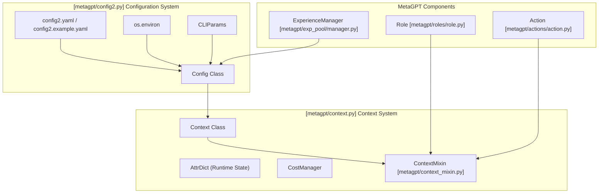
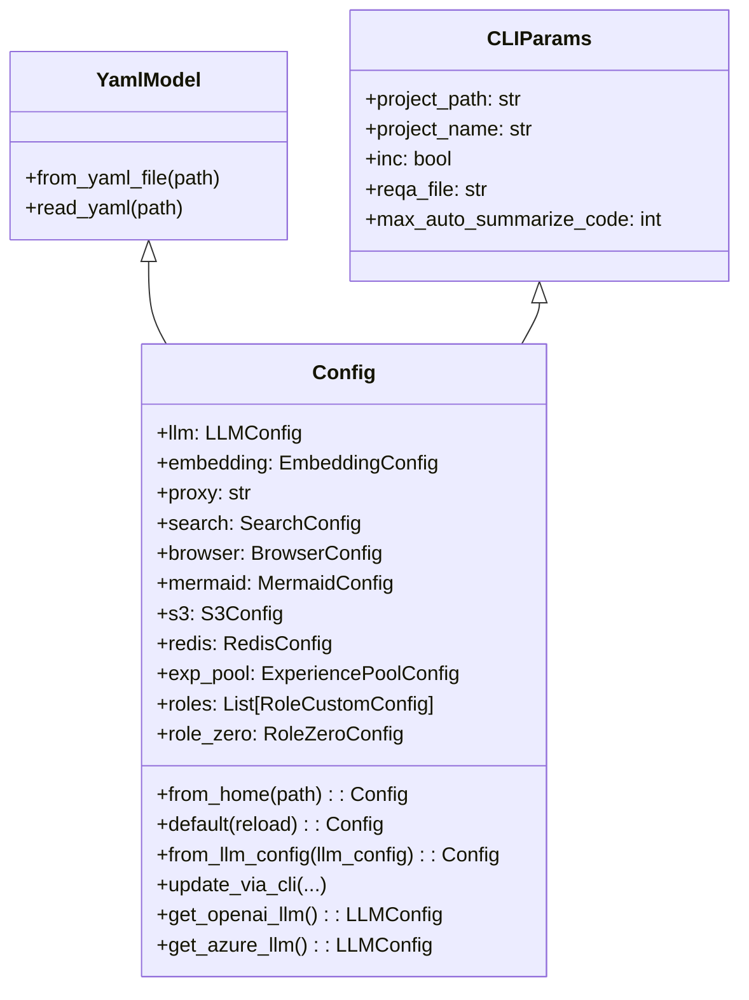
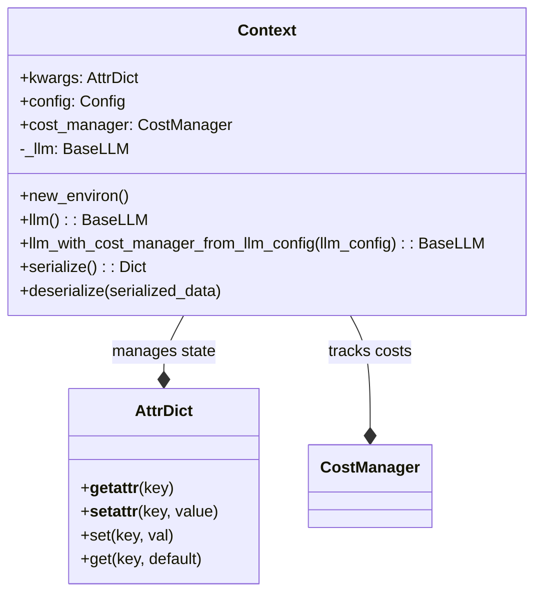
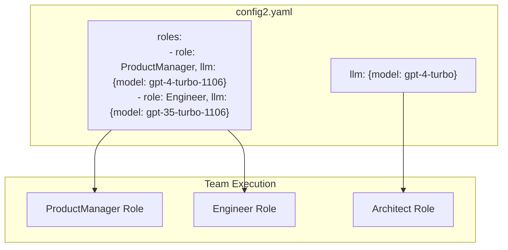

<!-- source: DeepWiki mcp.deepwiki.com · repo geekan/MetaGPT · page 8 Configuration and Context · fetched 2026-10-26 -->

# Configuration and Context

Relevant source files

The following files were used as context for generating this wiki page:

- [config/config2.example.yaml](config/config2.example.yaml)
- [config/config2.yaml](config/config2.yaml)
- [examples/di/crawl_webpage.py](examples/di/crawl_webpage.py)
- [examples/di/data_visualization.py](examples/di/data_visualization.py)
- [examples/di/email_summary.py](examples/di/email_summary.py)
- [examples/di/imitate_webpage.py](examples/di/imitate_webpage.py)
- [examples/di/machine_learning_with_tools.py](examples/di/machine_learning_with_tools.py)
- [examples/di/sd_tool_usage.py](examples/di/sd_tool_usage.py)
- [examples/di/solve_math_problems.py](examples/di/solve_math_problems.py)
- [examples/di/use_browser.py](examples/di/use_browser.py)
- [examples/exp_pool/decorator.py](examples/exp_pool/decorator.py)
- [metagpt/config2.py](metagpt/config2.py)
- [metagpt/configs/embedding_config.py](metagpt/configs/embedding_config.py)
- [metagpt/configs/exp_pool_config.py](metagpt/configs/exp_pool_config.py)
- [metagpt/context.py](metagpt/context.py)
- [metagpt/context_mixin.py](metagpt/context_mixin.py)
- [metagpt/exp_pool/__init__.py](metagpt/exp_pool/__init__.py)
- [metagpt/exp_pool/decorator.py](metagpt/exp_pool/decorator.py)
- [metagpt/exp_pool/manager.py](metagpt/exp_pool/manager.py)
- [metagpt/exp_pool/schema.py](metagpt/exp_pool/schema.py)
- [metagpt/llm.py](metagpt/llm.py)
- [metagpt/software_company.py](metagpt/software_company.py)
- [metagpt/utils/recovery_util.py](metagpt/utils/recovery_util.py)
- [metagpt/utils/reflection.py](metagpt/utils/reflection.py)
- [tests/metagpt/exp_pool/test_manager.py](tests/metagpt/exp_pool/test_manager.py)
- [tests/metagpt/test_config.py](tests/metagpt/test_config.py)
- [tests/metagpt/test_context.py](tests/metagpt/test_context.py)
- [tests/metagpt/tools/libs/test_browser.py](tests/metagpt/tools/libs/test_browser.py)

This page documents MetaGPT's configuration system and context management, which are essential components for customizing the framework and maintaining state during execution. The configuration system allows users to specify LLM settings, tool configurations, and various other parameters, while the context system provides runtime state management and access to resources.

## Overview

MetaGPT uses a hierarchical configuration system that loads settings from multiple sources and a context management system that maintains runtime state. These systems enable components to share configuration and state across the framework.

### System Interaction Diagram
The following diagram bridges the natural language concepts of "Settings" and "State" to the specific code entities that implement them.

Sources: [metagpt/config2.py:1-183](), [metagpt/context.py:1-128](), [metagpt/context_mixin.py:1-102]()

## Configuration System

### Config Class Structure

The `Config` class located in `metagpt/config2.py` is the foundation of MetaGPT's configuration system. It inherits from `CLIParams` for command-line parameters and `YamlModel` for YAML file parsing [metagpt/config2.py:49-50]().

Sources: [metagpt/config2.py:30-47](), [metagpt/config2.py:49-170]()

### Configuration Sources and Merging

MetaGPT loads configuration from multiple sources with a clear precedence order defined in `Config.default` [metagpt/config2.py:110-124]():

1. Environment variables (`os.environ`)
2. Repository default (`METAGPT_ROOT / "config/config2.yaml"`)
3. User custom config (`CONFIG_ROOT / "config2.yaml"`)
4. Explicit `kwargs` passed during initialization

The configuration sources are merged using the `merge_dict` function, where the latter dict overwrites the former [metagpt/config2.py:173-178]().

Sources: [metagpt/config2.py:102-123](), [metagpt/config2.py:173-178]()

### Key Configuration Sections

The configuration contains various sections for different components:

| Section | Purpose | Code Reference |
|---------|---------|---------------|
| `llm` | Primary LLM provider configuration | [metagpt/config2.py:53]() |
| `embedding` | Vector embedding settings | [metagpt/config2.py:56]() |
| `roles` | Per-role LLM overrides | [metagpt/config2.py:96]() |
| `exp_pool` | Experience pooling settings | [metagpt/config2.py:82]() |
| `role_zero` | RoleZero memory settings | [metagpt/config2.py:99]() |
| `proxy` | Global proxy for tools | [metagpt/config2.py:62]() |
| `search`, `browser` | Tool-specific configurations | [metagpt/config2.py:65-67]() |

Sources: [metagpt/config2.py:52-98](), [config/config2.example.yaml:1-130]()

## Context System

### Context Class as Service Locator

The `Context` class acts as a service locator and container for runtime state. It manages the lifecycle of the `BaseLLM` and `CostManager` instances [metagpt/context.py:58-68]().

The `Context` class provides:
- **LLM Factory**: The `llm()` method initializes a `BaseLLM` using `create_llm_instance` and attaches a `CostManager` [metagpt/context.py:86-92]().
- **State Storage**: `kwargs` (an `AttrDict`) allows storing arbitrary runtime data like `project_path` [metagpt/context.py:63]().
- **Cost Management**: Automatically selects between `FireworksCostManager`, `TokenCostManager`, or standard `CostManager` based on `LLMType` [metagpt/context.py:77-85]().

Sources: [metagpt/context.py:26-128](), [metagpt/llm.py:15-20]()

### ContextMixin: Dependency Injection Pattern

`ContextMixin` (defined in `metagpt/context_mixin.py`) is the primary mechanism for injecting `Context` into `Role` and `Action` objects. It ensures that every component has access to the global or specific `Config` and `LLM`.

- **Component-Specific LLM**: If a `Role` is initialized with a specific `llm_config`, `ContextMixin` allows that role to use its own LLM while sharing the global `CostManager` via `llm_with_cost_manager_from_llm_config` [metagpt/context.py:94-100]().
- **Hierarchy**: Roles pass their `Context` down to the `Action` objects they execute.

Sources: [metagpt/context_mixin.py:17-102](), [metagpt/context.py:94-100]()

## Using Configuration and Context

### Per-Role LLM Configuration

MetaGPT supports assigning different LLM models to different roles within the same team. This is configured in the `roles` section of `config2.yaml` [config/config2.example.yaml:24-52]().

Sources: [config/config2.example.yaml:23-52](), [metagpt/config2.py:96]()

### Experience Pool Configuration

The `ExperienceManager` uses the `Config` object to determine if retrieval is enabled and which backend (`BM25` or `CHROMA`) to use [metagpt/exp_pool/manager.py:135-143]().

- **Decorator Pattern**: The `@exp_cache` decorator reads `config.exp_pool.enabled` to decide whether to intercept function calls [metagpt/exp_pool/decorator.py:63-65]().
- **Persistence**: Storage paths for experiences are resolved via `config.exp_pool.persist_path` [metagpt/exp_pool/manager.py:165]().

Sources: [metagpt/exp_pool/manager.py:18-190](), [metagpt/exp_pool/decorator.py:29-94]()

### CLI Initialization Flow

When `metagpt` is run from the command line, `software_company.py` handles the setup of the global context [metagpt/software_company.py:40-41]().

1. **Update Config**: CLI arguments are applied to the `config` singleton via `update_via_cli` [metagpt/software_company.py:40]().
2. **Context Creation**: A new `Context` is instantiated with the updated config [metagpt/software_company.py:41]().
3. **Team Injection**: The `Team` is initialized with this `Context`, which is then propagated to all hired roles [metagpt/software_company.py:44]().

Sources: [metagpt/software_company.py:14-74](), [metagpt/config2.py:139-150]()

---

