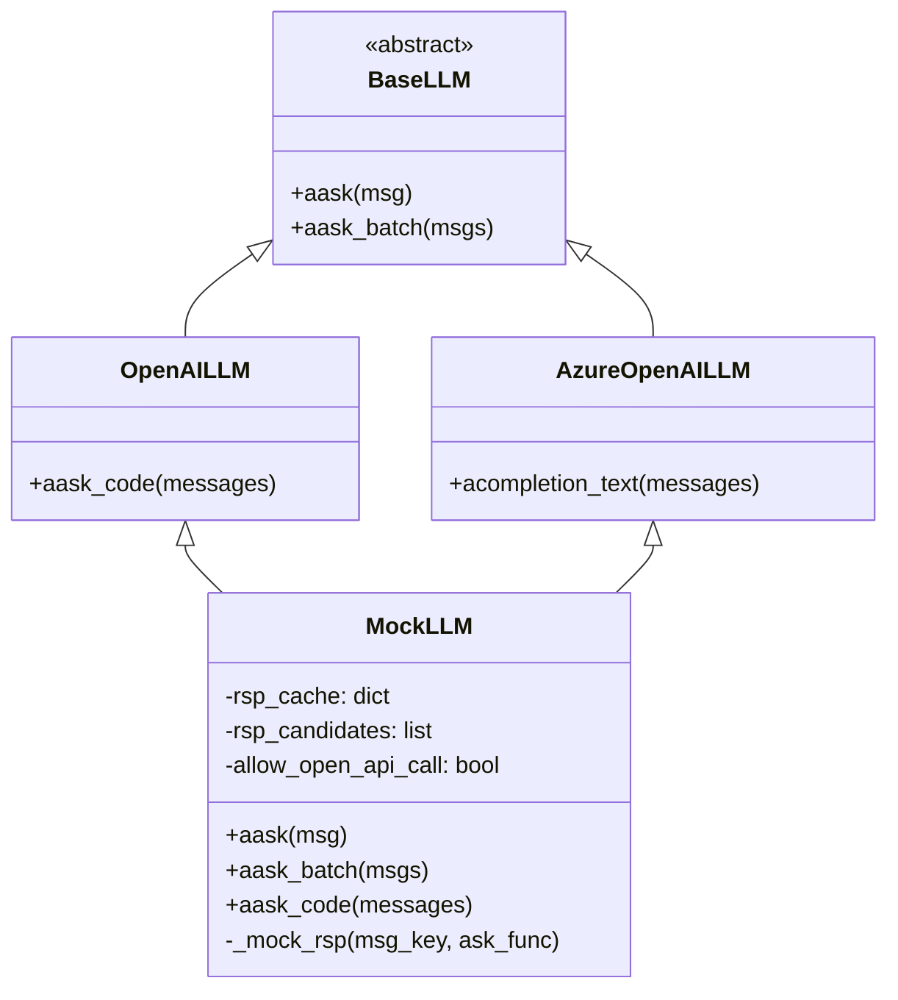
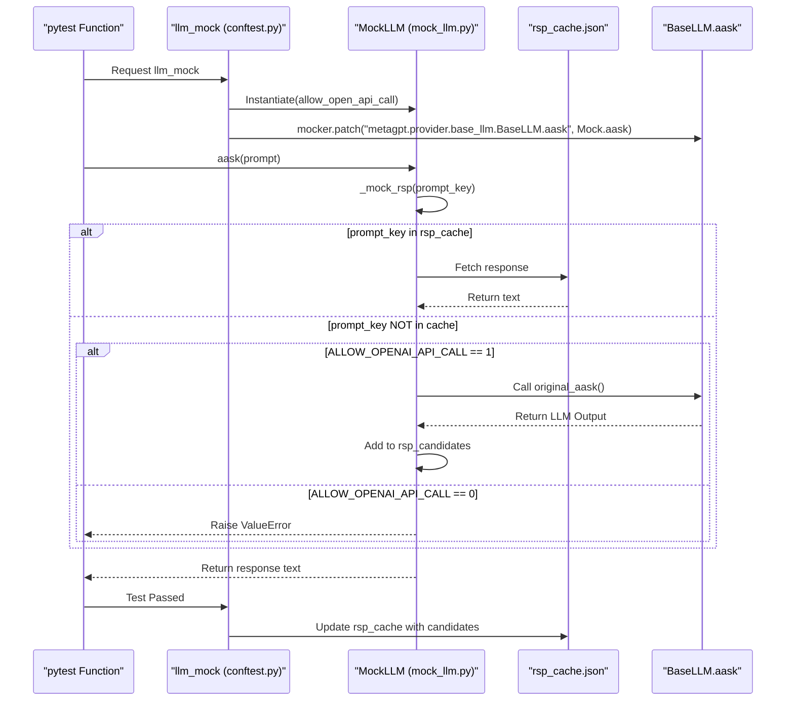

<!-- source: DeepWiki mcp.deepwiki.com · repo geekan/MetaGPT · page 9 Testing Framework · fetched 2026-10-26 -->

# Testing Framework

<details>
<summary>Relevant source files</summary>

The following files were used as context for generating this wiki page:

- [.coveragerc](.coveragerc)
- [.gitattributes](.gitattributes)
- [.github/ISSUE_TEMPLATE/config.yaml](.github/ISSUE_TEMPLATE/config.yaml)
- [.github/ISSUE_TEMPLATE/request_new_features.md](.github/ISSUE_TEMPLATE/request_new_features.md)
- [.github/ISSUE_TEMPLATE/show_me_the_bug.md](.github/ISSUE_TEMPLATE/show_me_the_bug.md)
- [.github/PULL_REQUEST_TEMPLATE.md](.github/PULL_REQUEST_TEMPLATE.md)
- [.github/workflows/fulltest.yaml](.github/workflows/fulltest.yaml)
- [.github/workflows/stale.yaml](.github/workflows/stale.yaml)
- [.github/workflows/unittest.yaml](.github/workflows/unittest.yaml)
- [examples/data/rag/travel.txt](examples/data/rag/travel.txt)
- [pytest.ini](pytest.ini)
- [tests/conftest.py](tests/conftest.py)
- [tests/data/rsp_cache.json](tests/data/rsp_cache.json)
- [tests/metagpt/serialize_deserialize/test_action.py](tests/metagpt/serialize_deserialize/test_action.py)
- [tests/metagpt/serialize_deserialize/test_environment.py](tests/metagpt/serialize_deserialize/test_environment.py)
- [tests/metagpt/serialize_deserialize/test_memory.py](tests/metagpt/serialize_deserialize/test_memory.py)
- [tests/metagpt/serialize_deserialize/test_product_manager.py](tests/metagpt/serialize_deserialize/test_product_manager.py)
- [tests/metagpt/serialize_deserialize/test_project_manager.py](tests/metagpt/serialize_deserialize/test_project_manager.py)
- [tests/metagpt/serialize_deserialize/test_role.py](tests/metagpt/serialize_deserialize/test_role.py)
- [tests/metagpt/serialize_deserialize/test_schema.py](tests/metagpt/serialize_deserialize/test_schema.py)
- [tests/metagpt/serialize_deserialize/test_serdeser_base.py](tests/metagpt/serialize_deserialize/test_serdeser_base.py)
- [tests/metagpt/serialize_deserialize/test_team.py](tests/metagpt/serialize_deserialize/test_team.py)
- [tests/metagpt/serialize_deserialize/test_write_code.py](tests/metagpt/serialize_deserialize/test_write_code.py)
- [tests/metagpt/serialize_deserialize/test_write_design.py](tests/metagpt/serialize_deserialize/test_write_design.py)
- [tests/metagpt/test_software_company.py](tests/metagpt/test_software_company.py)
- [tests/mock/mock_llm.py](tests/mock/mock_llm.py)

</details>


The MetaGPT testing framework enables developers to verify multi-agent systems and individual components without incurring costs or latency from external LLM APIs. It utilizes a sophisticated mocking layer, a persistent response cache, and standardized `pytest` fixtures to ensure deterministic test outcomes.

## Overview

Reliable testing of LLM-based applications is challenging due to the non-deterministic nature of model outputs and the cost of API calls. MetaGPT addresses this through:

1.  **Mock LLM System**: Intercepts calls to `BaseLLM` and `OpenAILLM` to provide pre-recorded responses [tests/mock/mock_llm.py:16-126]().
2.  **Response Caching (`rsp_cache.json`)**: A persistent storage mechanism for request-response pairs, ensuring that once a scenario is run, it can be re-tested offline [tests/data/rsp_cache.json:1-11]().
3.  **Serialization Testing**: Specialized suites to ensure `Role`, `Action`, and `Team` objects can be saved and restored without state loss [tests/metagpt/serialize_deserialize/test_team.py:25-48]().
4.  **Automated CI/CD**: Workflows in GitHub Actions that enforce zero-API-call policies while maintaining high code coverage [.github/workflows/unittest.yaml:34-49]().

Sources: [tests/conftest.py](), [tests/mock/mock_llm.py](), [.github/workflows/unittest.yaml]()

## Architecture and Data Flow

The testing framework bridges the gap between high-level Agent logic and low-level API communication by patching the provider layer.

### Mock LLM Class Hierarchy



`MockLLM` dynamically inherits from either `OpenAILLM` or `AzureOpenAILLM` based on the environment configuration `config.llm.api_type` [tests/mock/mock_llm.py:13-21]().

### LLM Interception Flow

The following diagram maps the relationship between the `pytest` execution space and the `MockLLM` code entities.



Sources: [tests/conftest.py:61-78](), [tests/mock/mock_llm.py:81-126]()

## Core Components

### Response Caching System
The cache is managed via the `rsp_cache` fixture. It reads from `tests/data/rsp_cache.json` at the start of a session and writes back any new successful interactions at the end [tests/conftest.py:36-50]().

*   **Key Generation**: For single prompts, the key is the string. For messages lists, it joins content with `#MSG_SEP#` [tests/mock/mock_llm.py:91-98]().
*   **Candidate Management**: New responses are stored in `rsp_candidates` during the test and only merged into the global cache if the test passes [tests/conftest.py:69-77]().

### Serialization Testing
MetaGPT places heavy emphasis on the ability to pause and resume multi-agent operations.
*   **`test_team_deserialize`**: Validates that a `Team` (hiring `ProductManager`, `Architect`, etc.) can be dumped to a dict and reconstructed with identical roles [tests/metagpt/serialize_deserialize/test_team.py:25-48]().
*   **`test_team_recover`**: Simulates an interruption in a project run and verifies that memory and environment state are preserved after recovery [tests/metagpt/serialize_deserialize/test_team.py:73-96]().

Sources: [tests/metagpt/serialize_deserialize/test_team.py:25-123](), [tests/metagpt/serialize_deserialize/test_role.py:54-74]()

### Global Fixtures (`conftest.py`)
| Fixture | Description | File:Lines |
| :--- | :--- | :--- |
| `llm_mock` | The primary fixture that patches `BaseLLM` methods with `MockLLM` logic. | [tests/conftest.py:61-78]() |
| `context` | Creates a `MetagptContext` and a temporary `GitRepository` for isolated file operations. | [tests/conftest.py:147-162]() |
| `aiohttp_mocker` | Intercepts `aiohttp.ClientSession` calls to simulate network responses. | [tests/conftest.py:199-212]() |
| `new_filename` | Mocks `FileRepository.new_filename` to return a static string ("20240101") for reproducible output paths. | [tests/conftest.py:169-174]() |

## CI/CD Workflows

MetaGPT uses GitHub Actions to ensure code quality across different environments.

### Unit Tests (`unittest.yaml`)
This workflow runs on every pull request.
*   **Environment**: Sets `ALLOW_OPENAI_API_CALL=0` to ensure no actual tokens are consumed [.github/workflows/unittest.yaml:36]().
*   **Setup**: Copies `tests/config2.yaml` to the default MetaGPT config location [.github/workflows/unittest.yaml:37]().
*   **Execution**: Runs `pytest` and generates a coverage report using `coverage report -m` [.github/workflows/unittest.yaml:38-41]().

### Full Tests (`fulltest.yaml`)
A more comprehensive suite that may include longer-running integration tests and specialized environment simulations.

Sources: [.github/workflows/unittest.yaml:1-60](), [.github/workflows/fulltest.yaml:1-87]()

## Implementation Details: Mocking LLM Responses

The `MockLLM._mock_rsp` method is the critical gatekeeper:

```python
async def _mock_rsp(self, msg_key, ask_func, *args, **kwargs):
    if msg_key not in self.rsp_cache:
        if not self.allow_open_api_call:
            raise ValueError("api call is not allowed... add response in rsp_cache.json")
        rsp = await ask_func(*args, **kwargs)
    else:
        logger.warning("Use response cache")
        rsp = self.rsp_cache[msg_key]
    self.rsp_candidates.append({msg_key: rsp})
    return rsp
```
[tests/mock/mock_llm.py:112-125]()

When `allow_open_api_call` is enabled (typically during local development), the framework calls `original_aask`, `original_aask_batch`, or `original_aask_code`. These methods are local copies of the provider's original logic to avoid infinite recursion when the base methods are patched [tests/mock/mock_llm.py:35-79]().

Sources: [tests/mock/mock_llm.py:16-126](), [tests/conftest.py:61-78]()

---

