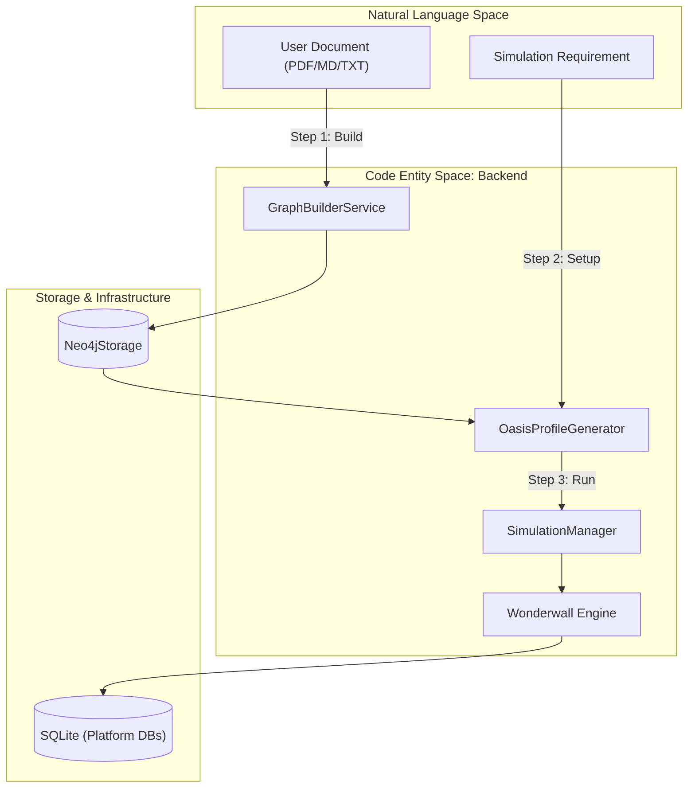
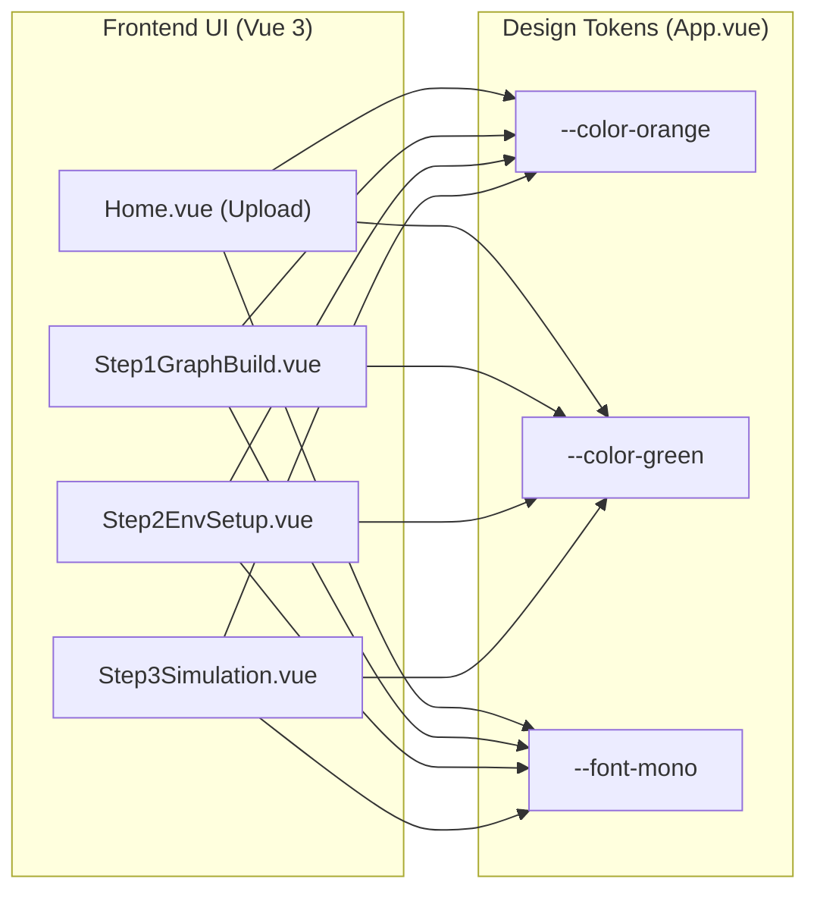

<!-- source: DeepWiki mcp.deepwiki.com · repo aaronjmars/MiroShark · page 1 MiroShark Overview · fetched 2026-10-26 -->

# MiroShark Overview

Relevant source files

The following files were used as context for generating this wiki page:

- [README.md](README.md)
- [frontend/index.html](frontend/index.html)
- [frontend/src/App.vue](frontend/src/App.vue)
- [frontend/src/views/Home.vue](frontend/src/views/Home.vue)
- [miroshark.jpg](miroshark.jpg)

MiroShark is a **Universal Swarm Intelligence Engine** designed to simulate complex social and market reactions to specific documents or policy drafts. By extracting a structured knowledge graph from raw text, the system instantiates hundreds of unique AI agents that interact across simulated versions of Twitter, Reddit, and Polymarket.

The core purpose of MiroShark is to move beyond static LLM predictions into dynamic **scenario exploration**, where emergent behaviors, opinion shifts, and market movements can be observed in a controlled, multi-round environment.

## Core Workflow

The system operates in a 5-step sequential pipeline, transitioning from unstructured data to an interactive, simulated world.

1.  **Graph Construction**: Parses documents into a Neo4j knowledge graph using Named Entity Recognition (NER) and Relationship Extraction (RE).
2.  **Agent Setup**: Generates rich, OASIS-compatible agent personas grounded in the graph topology and web-enriched data.
3.  **Simulation Execution**: Runs a multi-platform, synchronized simulation where agents post, reply, trade, and update their internal belief states.
4.  **Report Generation**: A ReACT-based analytical agent inspects the simulation artifacts to produce a comprehensive post-mortem.
5.  **Deep Interaction**: Users can chat with individual agents or the Report Agent to probe specific outcomes.

Sources: [README.md:37-43](), [frontend/src/views/Home.vue:59-95]()

## High-Level Architecture

MiroShark utilizes a decoupled architecture featuring a **Flask backend**, a **Vue 3 frontend**, and a **Neo4j graph database**. The simulation engine, known as **Wonderwall**, manages the lifecycle of social platforms and agent logic.

### System Components Diagram
This diagram illustrates the bridge between the high-level natural language requirements and the underlying code entities that process them.

Sources: [README.md:45-80](), [frontend/src/views/Home.vue:103-170]()

## Key Architectural Concepts

### 1. Knowledge Graph Grounding
Unlike "zero-shot" simulations, every agent in MiroShark is anchored to a node in a Neo4j graph. The `GraphBuilderService` ensures that agents possess specific "memories" and relationships derived directly from the source material.
*   For details, see **[Knowledge Graph Pipeline](#2)**.

### 2. Multi-Platform Synchronization
The simulation runs parallel environments for Twitter, Reddit, and Polymarket. The `Market-Media Bridge` ensures that social sentiment influences market prices and vice versa, while the `BeliefState` model tracks agent opinion shifts over time.
*   For details, see **[Simulation Execution Engine](#4)**.

### 3. Hyperstitions Design System
The frontend, built with Vue 3, follows the "Hyperstitions v2.0" design system—an Evangelion-inspired aesthetic using a high-contrast bicolor palette (Orange and Green) and modular spacing.

Sources: [frontend/src/App.vue:10-50](), [frontend/src/views/Home.vue:1-38]()

## Subsystem Integration

The following table summarizes how the major subsystems fit together:

| Subsystem | Primary Code Responsibility | Data Input | Data Output |
| :--- | :--- | :--- | :--- |
| **Ingestion** | `DocumentProcessor` | Raw Files | Text Chunks |
| **Graph Build** | `GraphBuilderService` | Text Chunks | Neo4j Nodes/Edges |
| **Agent Gen** | `OasisProfileGenerator` | Neo4j Data | `profiles.json` |
| **Simulation** | `SimulationRunner` | `simulation_config.json` | `actions.jsonl` / SQLite |
| **Analysis** | `ReportAgent` | `actions.jsonl` | `full_report.md` |

Sources: [README.md:88-95](), [frontend/src/views/Home.vue:59-95]()

## Next Steps
*   To set up your environment (Ollama, Neo4j, Docker), visit **[Getting Started & Configuration](#1.1)**.
*   To understand the technical details of the Flask/Vue architecture and the Wonderwall engine, visit **[System Architecture & Data Flow](#1.2)**.

---

