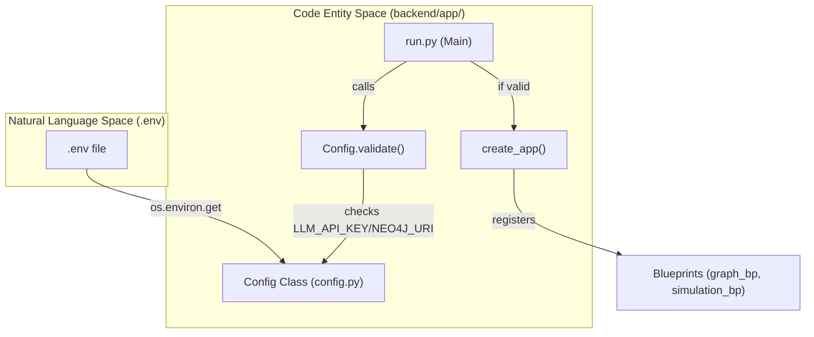
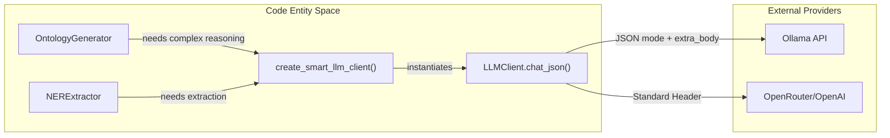

<!-- source: DeepWiki mcp.deepwiki.com · repo aaronjmars/MiroShark · page 1.1 Getting Started & Configuration · fetched 2026-10-26 -->

# Getting Started & Configuration

<details>
<summary>Relevant source files</summary>

The following files were used as context for generating this wiki page:

- [.dockerignore](.dockerignore)
- [.env.example](.env.example)
- [.github/workflows/docker-image.yml](.github/workflows/docker-image.yml)
- [.gitignore](.gitignore)
- [Dockerfile](Dockerfile)
- [backend/app/config.py](backend/app/config.py)
- [backend/app/services/ontology_generator.py](backend/app/services/ontology_generator.py)
- [backend/app/storage/ner_extractor.py](backend/app/storage/ner_extractor.py)
- [backend/app/utils/__init__.py](backend/app/utils/__init__.py)
- [backend/app/utils/file_parser.py](backend/app/utils/file_parser.py)
- [backend/app/utils/llm_client.py](backend/app/utils/llm_client.py)
- [backend/app/utils/logger.py](backend/app/utils/logger.py)
- [backend/pyproject.toml](backend/pyproject.toml)
- [backend/requirements.txt](backend/requirements.txt)
- [backend/run.py](backend/run.py)
- [backend/uv.lock](backend/uv.lock)
- [backend/wonderwall/simulations/social_media/__init__.py](backend/wonderwall/simulations/social_media/__init__.py)
- [docker-compose.yml](docker-compose.yml)
- [frontend/package-lock.json](frontend/package-lock.json)
- [frontend/package.json](frontend/package.json)
- [frontend/src/store/pendingUpload.js](frontend/src/store/pendingUpload.js)
- [package-lock.json](package-lock.json)
- [package.json](package.json)

</details>


This page provides a technical guide for setting up and configuring the MiroShark environment. MiroShark is designed to be flexible, supporting fully local deployments (Ollama + Neo4j), cloud-based provider configurations (OpenRouter/OpenAI), and containerized execution via Docker.

## Environment Setup & Prerequisites

MiroShark requires a Python 3.11+ backend and a Node.js 18+ frontend [backend/pyproject.toml:5-5](). The system relies on two external services:
1.  **Neo4j**: Used as the primary Graph Store for entities and relations [backend/app/config.py:46-48]().
2.  **LLM Provider**: Used for ontology generation, NER extraction, simulation reasoning, and report generation [backend/app/config.py:32-35]().

### Local Development Installation

To set up the project locally, use the provided `npm` scripts which orchestrate both frontend and backend dependencies:

```bash
# Install all dependencies (Node.js and Python via uv)
npm run setup:all

# Start both backend and frontend concurrently
npm run dev
```
The `setup:all` script triggers `npm install` in the root and frontend directories, and uses `uv sync` to manage the Python virtual environment in the backend [package.json:5-8]().

### Docker Deployment
The project includes a `docker-compose.yml` for rapid deployment. This orchestrates the `miroshark` application, a `neo4j` instance, and an `ollama` service for local inference. When running in Docker, internal service names (e.g., `http://ollama:11434`) must be used in the `.env` file instead of `localhost` [.env.example:79-85]().

---

## Configuration (.env)

MiroShark uses a centralized `.env` file located in the project root. The `Config` class in `backend/app/config.py` loads these variables and provides defaults [backend/app/config.py:9-25]().

### LLM Provider Selection
MiroShark uses a unified OpenAI-compatible interface for most providers.

| Variable | Description | Example (Ollama) | Example (OpenRouter) |
| :--- | :--- | :--- | :--- |
| `LLM_PROVIDER` | API Type: `openai` or `claude-code` | `openai` | `openai` |
| `LLM_API_KEY` | API Key (required for cloud) | `ollama` | `sk-or-v1-...` |
| `LLM_BASE_URL` | Endpoint URL | `http://localhost:11434/v1` | `https://openrouter.ai/api/v1` |
| `LLM_MODEL_NAME` | Model identifier | `qwen2.5:32b` | `anthropic/claude-3.5-sonnet` |

**Smart Model Routing:**
For "intelligence-sensitive" workflows—specifically `OntologyGenerator`, `ReportAgent`, and graph reasoning—you can configure a `SMART_MODEL_NAME`. If set, the `create_smart_llm_client()` factory will prioritize these credentials over the default LLM [backend/app/utils/llm_client.py:32-51](). This allows using a cheaper model (e.g., Qwen 14B) for high-volume simulation actions while using a premium model (e.g., Claude 3.5 Sonnet) for final analysis [backend/app/config.py:37-43]().

### Embedding Configuration
Embeddings are used for GraphRAG and entity search. MiroShark supports two embedding modes via `EMBEDDING_PROVIDER` [backend/app/config.py:51-56]():
*   **ollama**: Uses the `/api/embed` endpoint (standard for local setups).
*   **openai**: Uses the `/v1/embeddings` endpoint (compatible with OpenAI and OpenRouter).

---

## System Initialization Flow

The following diagram illustrates how the system initializes its configuration and establishes connections between the "Natural Language Space" (configuration strings) and the "Code Entity Space" (Python classes).

### Configuration Loading & Validation
Title: Configuration Initialization Flow

Sources: [backend/app/config.py:20-107](), [backend/run.py:25-45]()

---

## LLM Client Architecture

MiroShark abstracts LLM interactions through the `LLMClient` class. It handles provider-specific quirks, such as stripping `<think>` tags from reasoning models and managing Ollama's context window via `num_ctx` [backend/app/utils/llm_client.py:77-123]().

### Client Data Flow
Title: LLM Request Handling

Sources: [backend/app/utils/llm_client.py:54-158](), [backend/app/services/ontology_generator.py:164-165](), [backend/app/storage/ner_extractor.py:97-98]()

### Key Functions & Implementation Details

*   **`Config.validate()`**: Checks for mandatory environment variables (`LLM_API_KEY`, `NEO4J_URI`, `NEO4J_PASSWORD`) before the Flask server starts [backend/app/config.py:97-107]().
*   **`LLMClient.chat_json()`**: A wrapper that enforces JSON output from the LLM. It cleans Markdown code blocks (e.g., ` ```json `) and handles JSON parsing errors with retries [backend/app/utils/llm_client.py:125-158]().
*   **`OLLAMA_NUM_CTX`**: An environment variable that sets the context window size for Ollama via the `extra_body` parameter in the OpenAI SDK, preventing unexpected truncation of long graph-context prompts [backend/app/utils/llm_client.py:78-118]().
*   **`WEB_ENRICHMENT_ENABLED`**: When true, the system uses a search-capable LLM (configured via `WEB_SEARCH_MODEL`) to find real-world data for personas if the knowledge graph context is insufficient [backend/app/config.py:85-90]().

---

## Development Scripts Reference

The `package.json` in the root directory provides several utility scripts for development [package.json:5-14]():

| Script | Command | Purpose |
| :--- | :--- | :--- |
| `setup:all` | `npm run setup && npm run setup:backend` | Installs frontend `node_modules` and backend `uv` environment. |
| `dev` | `concurrently ... "npm run backend" "npm run frontend"` | Runs both servers. Backend on port `5001`, Frontend on `3000`. |
| `predev` | `node -e "..."` | Automatically kills stale processes on ports 3000 and 5001 to prevent "Address already in use" errors. |
| `backend` | `cd backend && uv run python run.py` | Starts the Flask backend independently. |

Sources: [package.json:5-14](), [backend/app/config.py:41-41]()

---

