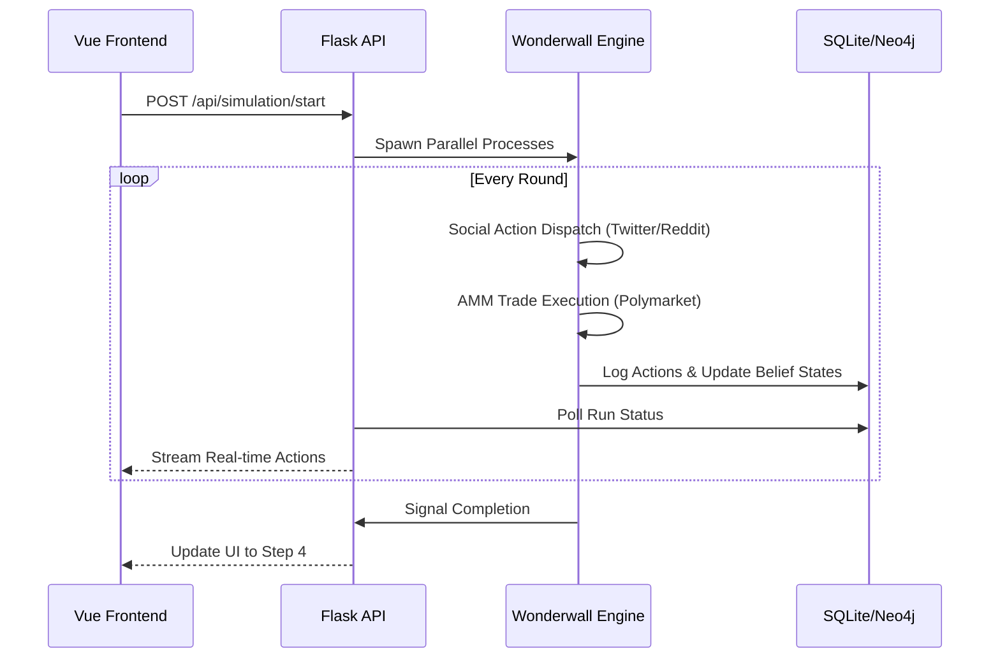

<!-- source: DeepWiki mcp.deepwiki.com · repo aaronjmars/MiroShark · page 1.2 System Architecture & Data Flow · fetched 2026-10-26 -->

# System Architecture & Data Flow

<details>
<summary>Relevant source files</summary>

The following files were used as context for generating this wiki page:

- [README.md](README.md)
- [backend/app/api/__init__.py](backend/app/api/__init__.py)
- [backend/app/models/task.py](backend/app/models/task.py)
- [backend/app/utils/logger.py](backend/app/utils/logger.py)
- [backend/run.py](backend/run.py)
- [frontend/src/api/report.js](frontend/src/api/report.js)
- [frontend/src/api/simulation.js](frontend/src/api/simulation.js)
- [frontend/src/router/index.js](frontend/src/router/index.js)

</details>


This page describes the technical architecture of MiroShark, detailing how the system transitions from unstructured document ingestion to a multi-agent social simulation and finally to an automated analytical report. MiroShark is built on a decoupled architecture comprising a Flask-based REST API, a Vue 3 reactive frontend, a Neo4j graph database, and the Wonderwall simulation engine.

## High-Level Architecture

The system is divided into four primary layers:
1.  **Frontend (Vue 3):** Manages the 5-step workflow (Upload, Build, Setup, Run, Report) and provides real-time visualization of simulation state [frontend/src/router/index.js:9-45]().
2.  **Backend API (Flask):** Orchestrates long-running tasks via a `TaskManager` and provides endpoints for graph operations, simulation control, and report generation [backend/app/api/__init__.py:7-9]().
3.  **Persistence Layer:** Uses **Neo4j** for the knowledge graph (entities and relationships) and **SQLite** (within the Wonderwall engine) for simulation-specific logs, trades, and message history [README.md:39-41]().
4.  **Simulation Engine (Wonderwall):** A multi-process environment that executes agents across Twitter, Reddit, and Polymarket platforms in parallel rounds [README.md:49-80]().

### System Component Diagram

The following diagram illustrates the relationship between the major code entities and the data storage systems.

**MiroShark Component Map**
```mermaid
graph TD
    subgraph "Frontend (Vue 3)"
        [Home.vue] --> [MainView.vue]
        [MainView.vue] --> [SimulationRunView.vue]
        [SimulationRunView.vue] --> [ReportView.vue]
    end

    subgraph "Backend API (Flask)"
        [graph_bp] --> [GraphBuilderService]
        [simulation_bp] --> [SimulationManager]
        [report_bp] --> [ReportAgent]
        [TaskManager] -.-> |"Tracks Status"| [graph_bp]
    end

    subgraph "Storage & Engines"
        [Neo4j_Graph_Store]
        [Wonderwall_Engine]
        [SQLite_Platform_DBs]
    end

    [GraphBuilderService] --> [Neo4j_Graph_Store]
    [SimulationManager] --> [Wonderwall_Engine]
    [Wonderwall_Engine] --> [SQLite_Platform_DBs]
    [ReportAgent] --> [SQLite_Platform_DBs]
    [ReportAgent] --> [Neo4j_Graph_Store]
```
**Sources:** [backend/app/api/__init__.py:7-9](), [frontend/src/router/index.js:9-45](), [backend/app/models/task.py:54-71](), [README.md:45-80]().

---

## Data Flow Pipeline

The MiroShark pipeline transforms natural language documents into actionable simulation data through five distinct phases.

### 1. Knowledge Graph Construction
When a user uploads a document, the `graph_bp` initiates a task via `GraphBuilderService`. The service parses the text, uses an LLM to generate an ontology, and extracts entities and relations.
*   **Optimization:** Extraction is parallelized using `ThreadPoolExecutor`, and writes to Neo4j are batched using `UNWIND` Cypher queries to maximize throughput [README.md:88-91]().
*   **Status Tracking:** The `TaskManager` singleton tracks the progress (0-100%) and state (PENDING, PROCESSING, COMPLETED, FAILED) [backend/app/models/task.py:14-36]().

### 2. Agent & Environment Preparation
The `SimulationManager` (invoked via `POST /api/simulation/prepare`) transforms graph nodes into agent personas [frontend/src/api/simulation.js:15-17]().
*   **Persona Grounding:** Each agent is built using five context layers: graph attributes, relationships, semantic search, related nodes, and optional web research via `WEB_SEARCH_MODEL` [README.md:40-98]().
*   **Configuration:** The `SimulationConfigGenerator` synthesizes the `simulation_config.json`, defining platform weights and initial "Reality Seeds" [README.md:41]().

### 3. Simulation Execution (Wonderwall)
The simulation runs in rounds. The backend spawns the Wonderwall engine, which executes Twitter, Reddit, and Polymarket simulations simultaneously using `asyncio.gather` [README.md:41]().

**Execution Data Flow**

**Sources:** [frontend/src/api/simulation.js:83-113](), [README.md:49-80]().

### 4. Cross-Platform Interaction
A "Market-Media Bridge" ensures data flow between platforms [README.md:68-72]():
*   **Social → Market:** Sentiment from Twitter/Reddit posts is injected into Polymarket trader prompts.
*   **Market → Social:** Current prediction market prices are injected into social media agent prompts to influence their stance [README.md:84]().
*   **Belief Tracking:** A heuristic model tracks each agent's stance (-1 to +1), confidence (0 to 1), and trust in other agents [README.md:75-79]().

### 5. Analysis & Report Generation
The `ReportAgent` uses a ReACT (Reasoning and Acting) loop to query the simulation results [README.md:42]().
*   **Data Retrieval:** The agent uses `simulation_feed` (to read `actions.jsonl`) and `market_state` (to query SQLite P&L) [README.md:42]().
*   **Final Output:** A structured Markdown report is generated and stored as `full_report.md`, which the frontend fetches via the `report_bp` [frontend/src/api/report.js:41-43]().

---

## Technical Implementation Details

### Threading & Process Management
The backend is configured to be `threaded=True` to handle multiple concurrent API requests and polling [backend/run.py:45](). However, the heavy lifting of the simulation is offloaded to separate processes to avoid the Python Global Interpreter Lock (GIL) and ensure platform isolation.

### Logging and Monitoring
MiroShark implements a dual-logging system:
1.  **System Logs:** Managed by `setup_logger`, providing detailed `DEBUG` logs to files and `INFO` logs to the console [backend/app/utils/logger.py:30-88]().
2.  **Simulation Logs:** Captured per-run, including an `agent_log.jsonl` for the Report Agent's thought process and a `console_log.txt` for the simulation's standard output [frontend/src/api/report.js:24-35]().

### API Blueprints
The backend functionality is modularized into three Flask Blueprints:
| Blueprint | Responsibility | Key File |
| :--- | :--- | :--- |
| `graph_bp` | Document ingestion, NER, and Neo4j graph building. | [backend/app/api/graph.py]() |
| `simulation_bp` | Environment preparation, agent generation, and run control. | [backend/app/api/simulation.py]() |
| `report_bp` | ReACT-based analysis and report artifact serving. | [backend/app/api/report.py]() |

**Sources:** [backend/app/api/__init__.py:7-9](), [backend/run.py:45](), [backend/app/utils/logger.py:66-82]().

---

