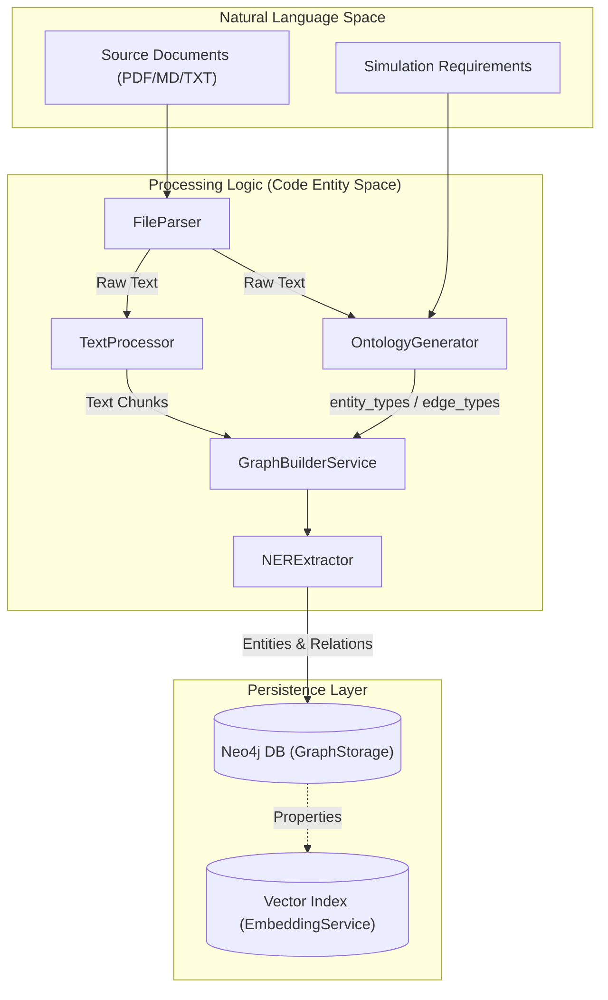

<!-- source: DeepWiki mcp.deepwiki.com · repo aaronjmars/MiroShark · page 2 Knowledge Graph Pipeline · fetched 2026-10-26 -->

# Knowledge Graph Pipeline

Relevant source files

The following files were used as context for generating this wiki page:

- [.env.example](.env.example)
- [backend/app/services/graph_builder.py](backend/app/services/graph_builder.py)
- [backend/app/services/ontology_generator.py](backend/app/services/ontology_generator.py)
- [backend/app/storage/ner_extractor.py](backend/app/storage/ner_extractor.py)
- [backend/app/utils/__init__.py](backend/app/utils/__init__.py)
- [backend/app/utils/llm_client.py](backend/app/utils/llm_client.py)

The **Knowledge Graph Pipeline** is the core data processing engine of MiroShark. It transforms unstructured source documents (PDFs, text files) into a structured, queryable Neo4j property graph. This graph serves as the "ground truth" for generating realistic agent personas and grounding social simulations in factual context.

The pipeline follows a sequential flow: ingestion of raw files, AI-driven ontology design, parallelized Named Entity Recognition (NER) and Relation Extraction (RE), and finally, persistence into a Neo4j database with vector embeddings for hybrid search.

### Pipeline Overview

The transition from Natural Language to a structured Graph is managed by the `GraphBuilderService` [[backend/app/services/graph_builder.py:38-42]](). It orchestrates several specialized services to process text chunks and populate the database.

#### System Architecture & Data Flow
The following diagram illustrates how the system components interact to move data from the "Natural Language Space" into the "Code Entity Space" of the Neo4j graph.

**Data Flow: Document to Neo4j**

**Sources:** [backend/app/services/graph_builder.py:110-143](), [backend/app/services/ontology_generator.py:167-183](), [backend/app/storage/ner_extractor.py:94-115]()

---

### 1. Document Ingestion & Ontology Generation
The pipeline begins by parsing uploaded files and analyzing their content to create a custom schema. Unlike static systems, MiroShark uses a **Smart LLM** to design an ontology specifically tailored to the simulation's needs.

*   **File Parsing:** Supports multiple formats with automatic encoding detection.
*   **Ontology Design:** The `OntologyGenerator` [[backend/app/services/ontology_generator.py:158-162]]() identifies key roles (e.g., `Professor`, `Executive`) and fallback types (`Person`, `Organization`) to ensure every extracted entity has a place in the graph [[backend/app/services/ontology_generator.py:75-86]]().

For details, see [Document Ingestion & Ontology Generation](#2.1).

**Sources:** [backend/app/services/ontology_generator.py:11-38](), [backend/app/utils/file_parser.py:1-10]() (implied by `FileParser` usage).

---

### 2. NER Extraction & Graph Building
Once the ontology is defined, the `GraphBuilderService` initiates an asynchronous build process [[backend/app/services/graph_builder.py:48-56]](). 

*   **Parallel Processing:** Text is split into chunks by the `TextProcessor` [[backend/app/services/graph_builder.py:126-127]]() and processed in batches using a `ThreadPoolExecutor` [[backend/app/services/graph_builder.py:186-198]]().
*   **Extraction:** The `NERExtractor` uses structured LLM prompts to identify entities and relationships while enforcing "Rejection Rules" to filter out fragments and abstract concepts [[backend/app/storage/ner_extractor.py:33-46]]().
*   **Canonicalization:** The system merges co-references (e.g., "it", "the firm") into canonical entity names to maintain graph integrity [[backend/app/storage/ner_extractor.py:30-31]]().

For details, see [NER Extraction & Graph Building](#2.2).

**Sources:** [backend/app/services/graph_builder.py:193-205](), [backend/app/storage/ner_extractor.py:17-31]().

---

### 3. Neo4j Storage & Graph Search
The final stage involves persisting the extracted data into Neo4j. This is not just a simple storage step; it includes building a rich index for later retrieval during simulation.

*   **Persistence:** Entities and relations are upserted using optimized Cypher queries.
*   **Hybrid Search:** The `SearchService` combines traditional BM25 keyword search with vector embeddings generated by the `EmbeddingService` [[.env.example:38-45]]().
*   **Graph Reasoning:** The system calculates graph metrics like degree centrality and identifies "bridge entities" to determine which agents are most influential in the simulation [[backend/app/services/graph_builder.py:154-156]]().

For details, see [Neo4j Storage & Graph Search](#2.3).

**Sources:** [backend/app/services/graph_builder.py:145-156](), [.env.example:32-36]().

---

### Code Entity Mapping
This diagram bridges the high-level pipeline stages to the specific classes and configurations used in the codebase.

**Pipeline Component Mapping**
| Pipeline Stage | Primary Class / Service | Config Dependency |
| :--- | :--- | :--- |
| **Ontology Generation** | `OntologyGenerator` [[backend/app/services/ontology_generator.py:158]]() | `SMART_MODEL_NAME` [[.env.example:55-62]]() |
| **LLM Orchestration** | `LLMClient` [[backend/app/utils/llm_client.py:54]]() | `LLM_PROVIDER` [[.env.example:8-10]]() |
| **Graph Construction** | `GraphBuilderService` [[backend/app/services/graph_builder.py:38]]() | `NEO4J_URI` [[.env.example:32-34]]() |
| **Entity Extraction** | `NERExtractor` [[backend/app/storage/ner_extractor.py:94]]() | `LLM_MODEL_NAME` [[.env.example:17]]() |
| **Task Management** | `TaskManager` [[backend/app/models/task.py:1-10]]() | N/A |

**Sources:** [backend/app/services/graph_builder.py:44-46](), [backend/app/utils/llm_client.py:32-51](), [.env.example:1-86]().

---

