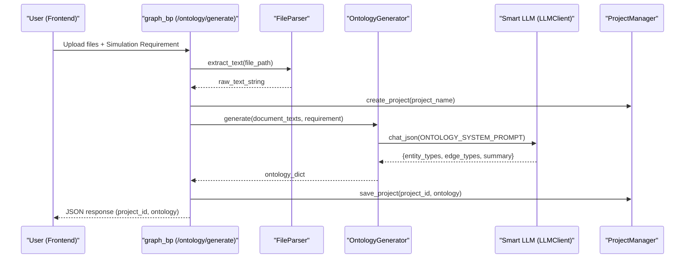

<!-- source: DeepWiki mcp.deepwiki.com · repo aaronjmars/MiroShark · page 2.1 Document Ingestion & Ontology Generation · fetched 2026-10-26 -->

# Document Ingestion & Ontology Generation

<details>
<summary>Relevant source files</summary>

The following files were used as context for generating this wiki page:

- [.env.example](.env.example)
- [.gitignore](.gitignore)
- [backend/app/api/graph.py](backend/app/api/graph.py)
- [backend/app/api/report.py](backend/app/api/report.py)
- [backend/app/services/ontology_generator.py](backend/app/services/ontology_generator.py)
- [backend/app/storage/ner_extractor.py](backend/app/storage/ner_extractor.py)
- [backend/app/utils/__init__.py](backend/app/utils/__init__.py)
- [backend/app/utils/file_parser.py](backend/app/utils/file_parser.py)
- [backend/app/utils/llm_client.py](backend/app/utils/llm_client.py)
- [backend/pyproject.toml](backend/pyproject.toml)
- [backend/requirements.txt](backend/requirements.txt)
- [backend/uv.lock](backend/uv.lock)
- [backend/wonderwall/simulations/social_media/__init__.py](backend/wonderwall/simulations/social_media/__init__.py)
- [package-lock.json](package-lock.json)
- [package.json](package.json)

</details>


This page details the initial stage of the MiroShark pipeline: transforming raw unstructured documents into a structured **Ontology** that defines the "rules of existence" for the subsequent Knowledge Graph and social simulation.

## 1. Document Ingestion & Parsing

The ingestion process begins at the `POST /api/graph/ontology/generate` endpoint [backend/app/api/graph.py:59-60](). This route handles multipart/form-data uploads, extracts raw text, and initializes a `Project` context.

### File Parsing Logic
MiroShark utilizes the `FileParser` utility to convert various file formats into clean text strings. The system supports PDF, Markdown (MD), and Plain Text (TXT) [backend/app/api/graph.py:32-32]().

*   **PDF Parsing**: Handled via `PyMuPDF` (imported as `fitz`) [backend/pyproject.toml:40-40]().
*   **Charset Fallback**: For text files, the system employs `charset-normalizer` and `chardet` to detect encodings, ensuring that non-UTF-8 files are correctly decoded [backend/pyproject.toml:41-43]().
*   **Preprocessing**: Extracted text is passed through `TextProcessor.preprocess_text` to normalize whitespace and remove artifacts before further processing [backend/app/api/graph.py:136-136]().

### Data Flow: Ingestion to Project
The `ProjectManager` persists the uploaded files and the combined extracted text to a project-specific directory [backend/app/api/graph.py:124-149]().

| Entity | Role | File Reference |
| :--- | :--- | :--- |
| `graph_bp` | Flask Blueprint handling `/ontology/generate` | [backend/app/api/graph.py:13-13]() |
| `FileParser` | Static utility for `extract_text` | [backend/app/utils/file_parser.py:1-10]() |
| `ProjectManager` | Manages filesystem storage and project metadata | [backend/app/models/project.py:1-20]() |

## 2. Ontology Generation Service

The `OntologyGenerator` service is responsible for defining the schema of the Knowledge Graph. Unlike generic RAG systems, MiroShark generates a **Simulation-Centric Ontology** designed specifically for public opinion modeling [backend/app/services/ontology_generator.py:12-22]().

### The Smart LLM Client
Ontology generation is considered an "intelligence-sensitive" workflow. The system uses the `create_smart_llm_client` factory [backend/app/utils/llm_client.py:32-32](). This factory checks for `SMART_MODEL_NAME` in the `.env` configuration [backend/app/utils/llm_client.py:37-37](). If defined, it uses a more capable model (e.g., Claude 3.5 Sonnet or Qwen 2.5 72B) for this task, otherwise falling back to the default `LLM_MODEL_NAME` [.env.example:55-72]().

### Design Constraints (Prompt Engineering)
The `ONTOLOGY_SYSTEM_PROMPT` enforces strict structural requirements to ensure the resulting graph is compatible with the `OasisProfileGenerator`:

1.  **Entity Quantity**: Exactly 10 entity types must be produced [backend/app/services/ontology_generator.py:77-77]().
2.  **Hierarchy**: Must include 8 specific types based on the text and 2 mandatory fallback types: `Person` and `Organization` [backend/app/services/ontology_generator.py:81-86]().
3.  **Interactivity**: Entities must be real-world subjects capable of "speaking" or "acting" on social media. Abstract concepts like "Public Opinion" are explicitly rejected as entity types [backend/app/services/ontology_generator.py:34-38]().
4.  **Relationships**: 6-10 edge types representing social interactions (e.g., `WORKS_FOR`, `OPPOSES`, `REPORTS_ON`) [backend/app/services/ontology_generator.py:103-155]().

### System Sequence: Ontology Generation
The following diagram bridges the Natural Language input to the structured `Project` state.

**Title: Natural Language to Structured Ontology Flow**

**Sources:** [backend/app/api/graph.py:59-185](), [backend/app/services/ontology_generator.py:158-183](), [backend/app/utils/llm_client.py:125-141]()

## 3. Implementation Details

### Text Chunking for Analysis
To avoid context window limits during ontology analysis, the `OntologyGenerator` builds a user message containing the simulation requirements and the source texts [backend/app/services/ontology_generator.py:185-190](). If the source text is excessively large, it is sampled to ensure the "Smart" LLM receives the most relevant context for schema design.

### JSON Validation and Cleaning
The `LLMClient.chat_json` method handles the communication with the LLM. It includes logic to:
1.  Strip Markdown code blocks (e.g., ` ```json `) from the response [backend/app/utils/llm_client.py:149-152]().
2.  Remove `<think>` tags generated by reasoning models like DeepSeek or MiniMax [backend/app/utils/llm_client.py:122-122]().
3.  Parse the string into a Python dictionary, raising a `ValueError` if the format is invalid [backend/app/utils/llm_client.py:154-157]().

### Key Class: OntologyGenerator
| Function | Purpose |
| :--- | :--- |
| `__init__` | Initializes the smart LLM client via `create_smart_llm_client()` [backend/app/services/ontology_generator.py:164-165]() |
| `generate` | Main entry point; orchestrates message building and LLM call [backend/app/services/ontology_generator.py:167-183]() |
| `_build_user_message` | Constructs the prompt including `document_texts` and `simulation_requirement` [backend/app/services/ontology_generator.py:185-190]() |

### Code Structure: Ontology Definition
The generated ontology follows a strict JSON schema defined in the system prompt [backend/app/services/ontology_generator.py:43-71]():

```json
{
    "entity_types": [
        {
            "name": "PascalCaseName",
            "description": "...",
            "attributes": [{"name": "snake_case", "type": "text", "description": "..."}],
            "examples": ["..."]
        }
    ],
    "edge_types": [
        {
            "name": "UPPER_SNAKE_CASE",
            "source_targets": [{"source": "TypeA", "target": "TypeB"}]
        }
    ]
}
```

**Title: Code Entity Space - Ontology Service Architecture**
```mermaid
classDiagram
    class "graph_bp" {
        +generate_ontology()
        +build_graph()
    }
    class "OntologyGenerator" {
        +llm_client: LLMClient
        +generate(texts, requirement)
    }
    class "LLMClient" {
        +chat_json(messages)
        -_is_ollama()
    }
    class "ProjectManager" {
        +save_project(project)
        +save_file_to_project()
    }

    "graph_bp" ..> "OntologyGenerator" : uses
    "graph_bp" ..> "ProjectManager" : persists state
    "OntologyGenerator" ..> "LLMClient" : invokes
```
**Sources:** [backend/app/api/graph.py:15-21](), [backend/app/services/ontology_generator.py:158-165](), [backend/app/utils/llm_client.py:54-62]()

## 4. Configuration Requirements
For successful ingestion and generation, the following environment variables must be configured in `.env` [.env.example:8-72]():

*   `LLM_API_KEY` / `LLM_BASE_URL`: For standard text processing.
*   `SMART_MODEL_NAME`: (Optional) Highly recommended for ontology generation to ensure strict JSON adherence and complex schema design.
*   `OLLAMA_NUM_CTX`: Defaults to `8192`. This is passed via `extra_body` to Ollama to prevent truncation of large source documents during analysis [backend/app/utils/llm_client.py:78-117]().

**Sources:**
- Ingestion logic: [backend/app/api/graph.py:59-185]()
- Ontology generation prompt: [backend/app/services/ontology_generator.py:11-155]()
- LLM client implementation: [backend/app/utils/llm_client.py:1-158]()
- Project management: [backend/app/models/project.py:1-20]()
- Dependencies: [backend/pyproject.toml:39-48]()

---

