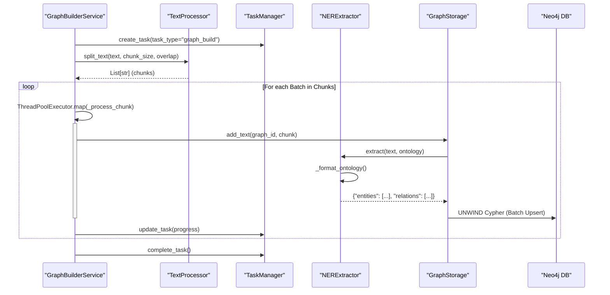
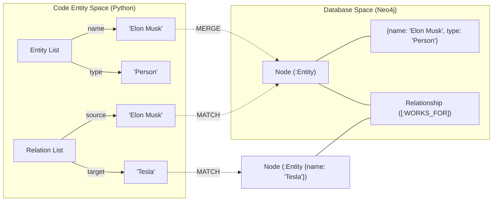

<!-- source: DeepWiki mcp.deepwiki.com · repo aaronjmars/MiroShark · page 2.2 NER Extraction & Graph Building · fetched 2026-10-26 -->

# NER Extraction & Graph Building

<details>
<summary>Relevant source files</summary>

The following files were used as context for generating this wiki page:

- [.env.example](.env.example)
- [backend/app/services/graph_builder.py](backend/app/services/graph_builder.py)
- [backend/app/services/ontology_generator.py](backend/app/services/ontology_generator.py)
- [backend/app/services/text_processor.py](backend/app/services/text_processor.py)
- [backend/app/storage/ner_extractor.py](backend/app/storage/ner_extractor.py)
- [backend/app/utils/__init__.py](backend/app/utils/__init__.py)
- [backend/app/utils/llm_client.py](backend/app/utils/llm_client.py)

</details>


The **NER Extraction & Graph Building** stage is the core transformation process that converts unstructured text into a structured knowledge graph. This process is managed by the `GraphBuilderService`, which orchestrates text chunking, parallel Named Entity Recognition (NER) and Relation Extraction (RE) via the `NERExtractor`, and final persistence into Neo4j.

## System Architecture & Data Flow

The pipeline operates as a series of coordinated services. Once an ontology is generated (see Section 2.1), the `GraphBuilderService` initiates an asynchronous task to process the document text.

### High-Level Build Sequence

1.  **Task Initialization**: The `GraphBuilderService` creates a tracking entry in the `TaskManager` [backend/app/services/graph_builder.py:72-79]().
2.  **Ontology Binding**: The generated ontology is stored in the Neo4j Graph node to guide the extraction logic [backend/app/services/graph_builder.py:119-124]().
3.  **Chunking**: `TextProcessor` splits the text into overlapping segments (default 500 chars) [backend/app/services/graph_builder.py:127-133]().
4.  **Parallel Extraction**: Chunks are processed in batches using a `ThreadPoolExecutor` to handle I/O-bound LLM calls [backend/app/services/graph_builder.py:186-205]().
5.  **Upsert**: Extracted entities and relations are pushed to Neo4j via `GraphStorage`.

### Code-to-Logic Mapping: Extraction Pipeline

The following diagram illustrates how the Python classes interact to move data from a raw string to a Neo4j transaction.


**Sources:** [backend/app/services/graph_builder.py:38-168](), [backend/app/storage/ner_extractor.py:94-152](), [backend/app/services/text_processor.py:18-34]()

---

## NERExtractor: Intelligence Logic

The `NERExtractor` replaces traditional NLP libraries with a structured LLM-based approach. It uses the `LLMClient.chat_json()` method to ensure the output conforms to a specific schema required for graph insertion [backend/app/storage/ner_extractor.py:131-136]().

### Extraction Rules & Constraints
To ensure the resulting graph is high-quality and suitable for social simulation, the `NERExtractor` enforces several "Rejection Rules" within its system prompt:

| Rule Type | Logic | Implementation |
| :--- | :--- | :--- |
| **Canonical Form** | Normalizes "Jack Ma" vs "ma jack" and prefers full names over abbreviations. | [backend/app/storage/ner_extractor.py:25-26](), [30-31]() |
| **Entity Rejection** | Rejects fragments ("the founder") or abstract concepts ("public opinion") as entities. | [backend/app/storage/ner_extractor.py:33-41]() |
| **Implicit Creation** | If the ontology requires it, creates specific attributes like `summary` based on text context. | [backend/app/storage/ner_extractor.py:42-45]() |
| **Ontology Adherence** | Only extracts types defined in the `entity_types` and `edge_types` lists. | [backend/app/storage/ner_extractor.py:23-24]() |

### Data Flow: Text to JSON
The extractor takes the raw chunk and the ontology, formats them into a prompt, and parses the result:
1.  **`_format_ontology`**: Converts the JSON ontology into a human-readable string for the LLM [backend/app/storage/ner_extractor.py:154-170]().
2.  **`extract`**: Sends the prompt to the LLM (typically `qwen2.5:32b` or similar) with a low temperature (0.1) for precision [backend/app/storage/ner_extractor.py:101-136]().
3.  **`_validate_and_clean`**: Post-processes the LLM output to ensure all entities have valid types and relations have valid sources/targets [backend/app/storage/ner_extractor.py:172-180]().

**Sources:** [backend/app/storage/ner_extractor.py:17-91](), [backend/app/storage/ner_extractor.py:101-152]()

---

## GraphBuilderService: Orchestration & Batching

The `GraphBuilderService` is responsible for the performance and reliability of the build process. It manages concurrency and provides progress updates to the frontend via the `TaskManager`.

### Concurrency Model
The service uses a `ThreadPoolExecutor` within `add_text_batches`. Because LLM extraction is I/O-bound (waiting for the model response), threading allows multiple chunks to be processed simultaneously, significantly reducing total build time [backend/app/services/graph_builder.py:193-205]().

```python
# Internal batch processing logic
def _process_chunk(chunk_idx: int, chunk: str) -> str:
    # ... logging and timing ...
    episode_id = self.storage.add_text(graph_id, chunk) # Triggers NERExtractor
    return episode_id
```
[backend/app/services/graph_builder.py:207-219]()

### Progress Tracking
The build process updates the `Task` status at several milestones:
*   **10%**: Graph created in Neo4j [backend/app/services/graph_builder.py:112-116]().
*   **15%**: Ontology metadata attached [backend/app/services/graph_builder.py:120-124]().
*   **20-80%**: Incremental progress as batches are processed [backend/app/services/graph_builder.py:136-143]().
*   **100%**: Final graph stats (node/edge counts) retrieved [backend/app/services/graph_builder.py:158-162]().

**Sources:** [backend/app/services/graph_builder.py:91-168](), [backend/app/models/task.py:14-15]()

---

## Persistence via Neo4j UNWIND

The system uses the `UNWIND` Cypher pattern for efficient batch upserts. When `GraphStorage.add_text` is called, it triggers the `NERExtractor` and then passes the resulting lists to Neo4j.

### Code-to-Database Space Mapping

The diagram below shows how the internal Python data structures (Entities and Relations) are mapped to Neo4j Graph elements.



### Batch Upsert Logic
Instead of creating nodes one-by-one, the system uses the following logic (simplified):
1.  **Nodes**: `UNWIND $entities AS entity MERGE (e:Entity {name: entity.name, graph_id: $gid}) SET e += entity.attributes`
2.  **Edges**: `UNWIND $relations AS rel MATCH (s:Entity {name: rel.source}), (t:Entity {name: rel.target}) MERGE (s)-[r:RELATION {type: rel.type}]->(t) SET r.fact = rel.fact`

This approach ensures that even if the same entity is mentioned in 50 different chunks, only one unique node is maintained in the graph, with attributes merged over time.

**Sources:** [backend/app/storage/ner_extractor.py:17-87](), [backend/app/services/graph_builder.py:135-143](), [backend/app/storage/graph_storage.py]() (referenced via `GraphBuilderService` calls).

---

