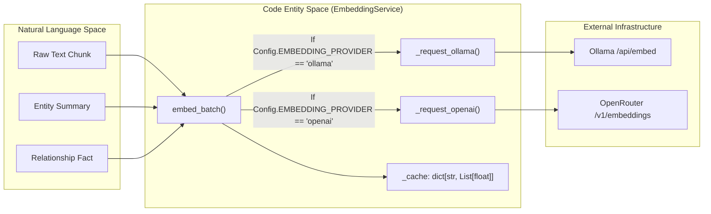
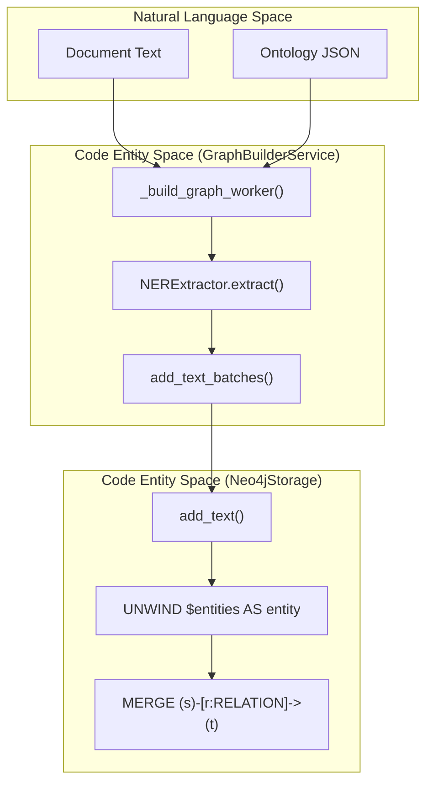

<!-- source: DeepWiki mcp.deepwiki.com · repo aaronjmars/MiroShark · page 2.3 Neo4j Storage & Graph Search · fetched 2026-10-26 -->

# Neo4j Storage & Graph Search

Relevant source files

The following files were used as context for generating this wiki page:

- [backend/app/services/graph_builder.py](backend/app/services/graph_builder.py)
- [backend/app/storage/embedding_service.py](backend/app/storage/embedding_service.py)
- [backend/app/storage/neo4j_schema.py](backend/app/storage/neo4j_schema.py)
- [backend/app/storage/neo4j_storage.py](backend/app/storage/neo4j_storage.py)
- [backend/wonderwall/simulations/polymarket/__init__.py](backend/wonderwall/simulations/polymarket/__init__.py)
- [backend/wonderwall/simulations/polymarket/platform.py](backend/wonderwall/simulations/polymarket/platform.py)
- [backend/wonderwall/social_agent/belief_state.py](backend/wonderwall/social_agent/belief_state.py)

This page details the **Neo4j Storage** layer, which serves as the primary persistence and retrieval engine for MiroShark. It replaces traditional relational storage for knowledge representation with a property graph model, enabling complex reasoning, hybrid vector/keyword search, and topological analysis of extracted data.

## Neo4jStorage Implementation

The `Neo4jStorage` class implements the `GraphStorage` interface, providing a unified API for graph lifecycle management, data ingestion, and retrieval. It manages a `neo4j.GraphDatabase.driver` instance and enforces schema constraints upon initialization [backend/app/storage/neo4j_storage.py:32-58]().

### Schema Enforcement
On startup, `Neo4jStorage` executes a series of Cypher queries defined in `neo4j_schema.py` to ensure the database environment is prepared [backend/app/storage/neo4j_storage.py:64-71]().

| Type | Target | Property | Purpose |
| :--- | :--- | :--- | :--- |
| **Constraint** | `:Graph` | `graph_id` | Unique identifier for graph projects [backend/app/storage/neo4j_schema.py:11-14](). |
| **Constraint** | `:Entity` | `uuid` | Unique identifier for extracted entities [backend/app/storage/neo4j_schema.py:16-19](). |
| **Vector Index** | `:Entity` | `embedding` | Cosine similarity search for entities [backend/app/storage/neo4j_schema.py:43-49](). |
| **Vector Index** | `[:RELATION]` | `fact_embedding` | Cosine similarity search for relationship facts [backend/app/storage/neo4j_schema.py:51-57](). |
| **Fulltext Index** | `:Entity` | `name`, `summary` | BM25 keyword search for entities [backend/app/storage/neo4j_schema.py:27-30](). |

### Resilience & Retries
To handle the transient nature of network-attached databases, `Neo4jStorage` wraps write operations in a retry mechanism that catches `TransientError`, `ServiceUnavailable`, and `SessionExpired` exceptions, applying exponential backoff [backend/app/storage/neo4j_storage.py:77-97]().

Sources: [backend/app/storage/neo4j_storage.py:32-97](), [backend/app/storage/neo4j_schema.py:1-71]()

## Embedding Pipeline

MiroShark uses a pluggable `EmbeddingService` to transform text into high-dimensional vectors. This service supports both **Ollama** (local) and **OpenAI-compatible** (cloud) providers [backend/app/storage/embedding_service.py:23-40]().

### Data Flow: Text to Vector
The pipeline utilizes an in-memory cache to avoid redundant LLM calls for identical text strings [backend/app/storage/embedding_service.py:49-51]().

1.  **Normalization**: Input text is stripped of whitespace [backend/app/storage/embedding_service.py:63]().
2.  **Batching**: Large sets of entities or relations are processed in batches (default size 32) to optimize throughput [backend/app/storage/embedding_service.py:74-100]().
3.  **Dispatch**: The request is sent to the configured endpoint (`/api/embed` for Ollama or `/v1/embeddings` for OpenAI) [backend/app/storage/embedding_service.py:44-47]().

### System-to-Code Mapping: Embedding Pipeline
This diagram illustrates how the abstract concept of "Text Embedding" is realized through specific classes and external service configurations.

Sources: [backend/app/storage/embedding_service.py:23-130](), [backend/app/config.py:1-20]()

## Hybrid Search & SearchService

MiroShark implements a **Hybrid Search** strategy via the `SearchService`, combining the semantic depth of Vector Search with the keyword precision of BM25 (Fulltext) search.

### Implementation Logic
The `SearchService` executes two parallel search paths and merges the results:

1.  **Vector Path**: Converts the query string into an embedding using `EmbeddingService.embed()` and performs a Cypher `db.index.vector.queryNodes` call [backend/app/storage/neo4j_storage.py:200-210]().
2.  **BM25 Path**: Uses the `entity_fulltext` index to find exact or fuzzy keyword matches [backend/app/storage/neo4j_schema.py:27-30]().
3.  **Reranking**: Results are combined, typically prioritizing vector similarity while ensuring keyword-relevant nodes are not missed.

Sources: [backend/app/storage/neo4j_storage.py:55](), [backend/app/storage/search_service.py:1-50](), [backend/app/storage/neo4j_schema.py:27-58]()

## Graph Reasoning & Topological Queries

Beyond simple retrieval, MiroShark utilizes Neo4j to perform structural analysis of the knowledge graph. These queries are essential for the `OasisProfileGenerator` to determine an entity's influence or "role" in the simulation.

### Key Reasoning Queries

*   **Degree Centrality**: Calculates the number of connections for an entity to determine its "importance" in the narrative.
*   **Bridge Entities**: Identifies nodes that act as connectors between otherwise disconnected communities (high betweenness).
*   **Weakly Connected Components (WCC)**: Used for community detection to group entities into related clusters or "factions" [backend/app/storage/neo4j_storage.py:320-350]().

### System-to-Code Mapping: Graph Ingestion
This diagram maps the flow of data from the `GraphBuilderService` into the `Neo4jStorage` persistent structures.

Sources: [backend/app/services/graph_builder.py:91-163](), [backend/app/storage/neo4j_storage.py:176-250]()

## Data Flow: NER to Neo4j Persistence

When `add_text` is called, the system performs a multi-stage transformation:

1.  **Extraction**: `NERExtractor` identifies entities and relationships based on the graph's ontology [backend/app/storage/neo4j_storage.py:186]().
2.  **Summarization**: Entity attributes are condensed into a single `summary` field for embedding [backend/app/storage/neo4j_storage.py:196-205]().
3.  **Batch Embedding**: All new entity summaries and relationship facts are embedded in a single `embed_batch` call [backend/app/storage/neo4j_storage.py:215-225]().
4.  **Cypher Transaction**: The data is pushed to Neo4j using the `UNWIND` pattern, which allows batch insertion of nodes and edges in a single ACID transaction, significantly improving performance over individual `CREATE` statements [backend/app/storage/neo4j_storage.py:230-280]().

Sources: [backend/app/storage/neo4j_storage.py:176-280](), [backend/app/services/graph_builder.py:186-219]()

---

