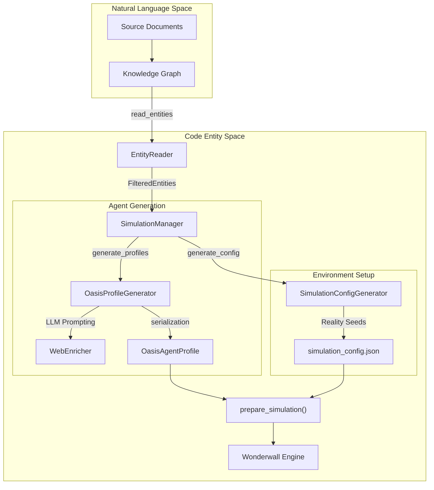
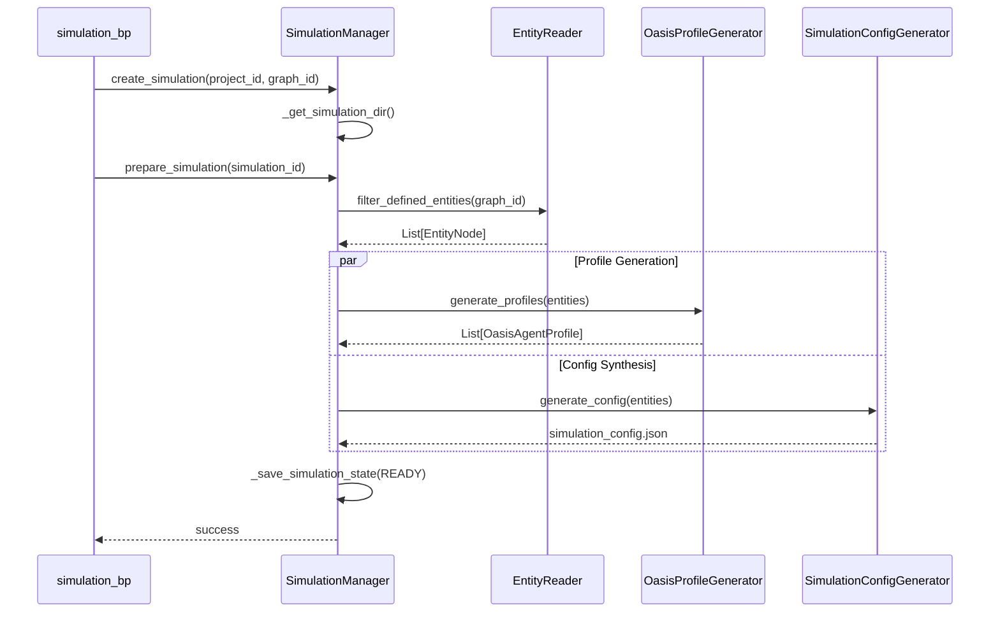

<!-- source: DeepWiki mcp.deepwiki.com · repo aaronjmars/MiroShark · page 3 Agent Generation & Simulation Preparation · fetched 2026-10-26 -->

# Agent Generation & Simulation Preparation

Relevant source files

The following files were used as context for generating this wiki page:

- [backend/app/api/simulation.py](backend/app/api/simulation.py)
- [backend/app/services/oasis_profile_generator.py](backend/app/services/oasis_profile_generator.py)
- [backend/app/services/simulation_manager.py](backend/app/services/simulation_manager.py)
- [backend/app/services/simulation_runner.py](backend/app/services/simulation_runner.py)

This stage of the MiroShark pipeline transforms static knowledge graph data into a dynamic simulation environment. It involves two primary processes: converting graph entities into high-fidelity agent personas and synthesizing a comprehensive simulation configuration that governs the behavioral logic of the environment.

The transition from the **Knowledge Graph Space** to the **OASIS Simulation Space** is managed by the `SimulationManager` [backend/app/services/simulation_manager.py:116-125](), which orchestrates the lifecycle from entity filtering to the final preparation of simulation artifacts.

### Transformation Overview

The simulation preparation follows a structured sequence:
1.  **Entity Filtering**: The `EntityReader` [backend/app/api/simulation.py:103-108]() extracts relevant nodes from Neo4j based on defined entity types.
2.  **Profile Generation**: The `OasisProfileGenerator` [backend/app/services/oasis_profile_generator.py:2-9]() enriches these entities with LLM-generated personas and structural metrics.
3.  **Config Synthesis**: The `SimulationConfigGenerator` [backend/app/services/simulation_config_generator.py]() produces the `simulation_config.json` which defines platform weights, narrative direction, and "Reality Seeds."

### Architecture: Preparation Lifecycle

The following diagram illustrates how system components interact to bridge the gap between the Neo4j graph and the Wonderwall simulation engine.

**Graph-to-Agent Transformation Flow**

**Sources:** [backend/app/services/simulation_manager.py:116-125](), [backend/app/api/simulation.py:82-113](), [backend/app/services/oasis_profile_generator.py:28-61]()

---

## OASIS Profile Generator (3.1)

The `OasisProfileGenerator` is responsible for creating "Digital Twins" of graph entities. Unlike simple template filling, this service uses the entity's position in the graph topology to ground its social media metrics (e.g., an entity with high degree centrality in Neo4j is assigned higher follower counts in the simulation) [backend/app/services/oasis_profile_generator.py:164-181]().

Key features include:
*   **Context Assembly**: Combining graph attributes, hybrid search results, and optional web enrichment via `WebEnricher` [backend/app/services/oasis_profile_generator.py:22]().
*   **Persona Distinction**: Differentiating between individual personas (detailed MBTI, profession) and institutional entities (media outlets, NGOs) [backend/app/services/oasis_profile_generator.py:186-190]().
*   **Multi-Platform Serialization**: Exporting profiles to Twitter-compatible CSVs, Reddit JSONs, and Polymarket trader profiles [backend/app/services/oasis_profile_generator.py:63-139]().

For a deep dive into the prompting logic and metric grounding, see **[OASIS Profile Generator](#3.1)**.

**Sources:** [backend/app/services/oasis_profile_generator.py:1-25](), [backend/app/services/oasis_profile_generator.py:164-181]()

---

## Simulation Configuration Generator (3.2)

The simulation environment is defined by a central `simulation_config.json`. This configuration is not static; the `SimulationConfigGenerator` uses the "Smart LLM" to analyze the ingested knowledge and determine the optimal simulation parameters.

Key configuration elements:
*   **Time & Scale**: Defining `max_rounds`, `simulated_hours`, and platform-specific algorithm weights [backend/app/services/simulation_runner.py:101-119]().
*   **Reality Seeds**: Initializing the simulation with "Initial Posts" that reflect the core conflicts or facts found in the source documents.
*   **Narrative Direction**: Setting the "Stance" and "Narrative" goals that guide the `SocialAgent` behavior across platforms.

The `SimulationManager` handles the `prepare_simulation` lifecycle, which includes real-time streaming of profiles and configs to the frontend via the `simulation_bp` API [backend/app/api/simulation.py:190-205]().

For details on the config schema and the Reality Seed concept, see **[Simulation Configuration Generator](#3.2)**.

**Sources:** [backend/app/services/simulation_manager.py:42-76](), [backend/app/api/simulation.py:190-205](), [backend/app/services/simulation_runner.py:101-119]()

---

### Data Mapping: Graph to Simulation

This table describes how code entities from the Knowledge Graph are mapped to simulation-ready objects.

| Graph Entity (Neo4j) | Agent Profile Attribute | Simulation Config Impact |
| :--- | :--- | :--- |
| `EntityNode.label` | `source_entity_type` | Determines `base_metrics` (e.g., Media vs Person) |
| `EntityNode.attributes` | `persona` / `bio` | Grounding for `NarrativeDirection` |
| `degree` (Connections) | `follower_count` / `karma` | Influences "Reach" in platform algorithms |
| `community_id` | `interested_topics` | Determines initial "Stance" and group alignment |

**Sources:** [backend/app/services/oasis_profile_generator.py:164-190](), [backend/app/services/entity_reader.py:21]()

### Preparation Orchestration

**SimulationManager Preparation Sequence**

**Sources:** [backend/app/services/simulation_manager.py:140-156](), [backend/app/api/simulation.py:190-205](), [backend/app/services/oasis_profile_generator.py:28-61]()

---

