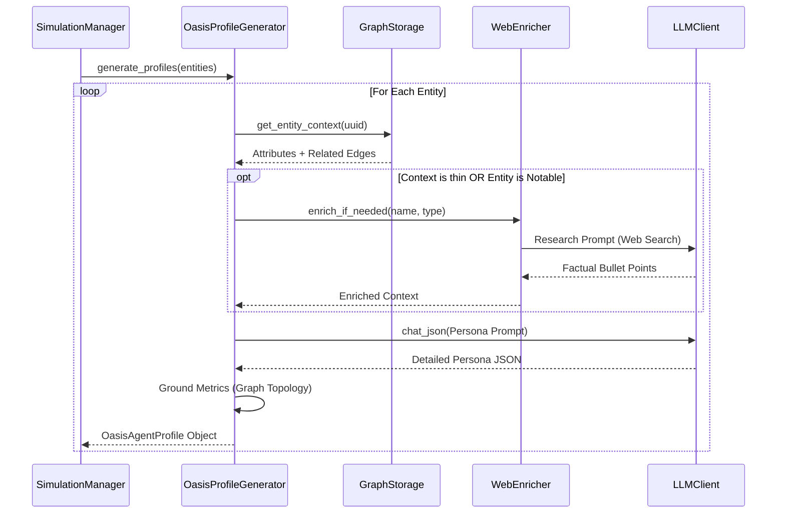
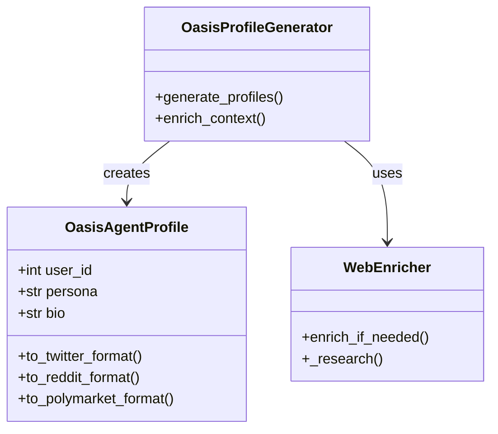

<!-- source: DeepWiki mcp.deepwiki.com · repo aaronjmars/MiroShark · page 3.1 OASIS Profile Generator · fetched 2026-10-26 -->

# OASIS Profile Generator

Relevant source files

The following files were used as context for generating this wiki page:

- [backend/app/services/oasis_profile_generator.py](backend/app/services/oasis_profile_generator.py)
- [backend/app/services/simulation_manager.py](backend/app/services/simulation_manager.py)
- [backend/app/services/web_enrichment.py](backend/app/services/web_enrichment.py)
- [backend/run.md](backend/run.md)

The **OASIS Profile Generator** is a critical subsystem that transforms static Knowledge Graph entities into dynamic, high-fidelity agent personas. It bridges the gap between structured data (Neo4j) and the behavioral requirements of the Wonderwall simulation engine. It handles entity context assembly, multi-stage enrichment, and platform-specific serialization for Twitter, Reddit, and Polymarket.

## 1. Core Architecture & Data Flow

The `OasisProfileGenerator` class orchestrates the transformation of a `GraphStorage` entity into an `OasisAgentProfile`. The process involves gathering graph attributes, performing hybrid search for context, optionally triggering web enrichment, and finally prompting an LLM to synthesize a persona.

### Profile Generation Sequence
The following diagram illustrates the lifecycle of a profile from graph entity to platform-ready JSON.

**Diagram: Entity to Persona Transformation**

Sources: [backend/app/services/oasis_profile_generator.py:116-125](), [backend/app/services/simulation_manager.py:203-220]()

---

## 2. Entity Context Assembly

Before an LLM can generate a persona, the system assembles a comprehensive context package. This prevents "hallucination" by grounding the agent in the specific facts found during the document ingestion phase.

### 2.1 Graph Attribute Retrieval
The generator extracts all key-value pairs stored in the Neo4j node attributes. It also traverses the graph to find `related_edges`, providing the agent with knowledge of its social or professional circle [backend/app/services/oasis_profile_generator.py:164-182]().

### 2.2 Web Enrichment
If an entity is identified as a "Notable" type (e.g., `PublicFigure`, `CEO`, `GovernmentAgency`) or if the graph context is shorter than 150 characters, the `WebEnricher` is triggered [backend/app/services/web_enrichment.py:105-131]().
- **Notable Types:** Defined in `_NOTABLE_ENTITY_TYPES` and `_NOTABLE_ORG_TYPES` [backend/app/services/web_enrichment.py:42-54]().
- **Mechanism:** Uses the `WEB_SEARCH_MODEL` (e.g., Perplexity Sonar) to fetch 8-12 factual bullet points regarding the entity's public positions and biography [backend/app/services/web_enrichment.py:61-76]().

Sources: [backend/app/services/web_enrichment.py:42-131](), [backend/app/services/oasis_profile_generator.py:164-182]()

---

## 3. Persona Generation Logic

The generator distinguishes between **Individual** and **Institutional** (Group) personas, using distinct system prompts to ensure appropriate social media behavior.

### 3.1 Individual vs. Institutional Prompts
- **Individual:** Focuses on MBTI, personal life experiences, education, and specific communication styles (e.g., "confrontational" or "diplomatic") [backend/run.md:171-199]().
- **Institutional:** Focuses on organizational mission, official tone, branding, and stakeholder interests. It avoids personal traits like "age" or "gender" [backend/run.md:214-230]().

### 3.2 Metric Grounding from Graph Topology
Rather than assigning random follower counts, the system uses the entity's **Degree Centrality** in the knowledge graph to scale its social media influence.
- **Degree Factor:** A scaling factor (1.0 to 3.0) based on the number of connections in Neo4j [backend/app/services/oasis_profile_generator.py:175-181]().
- **Base Metrics:** Archetypes (e.g., `MediaOutlet`) receive higher base followers (50,000) compared to `Faculty` (2,000) [backend/app/services/oasis_profile_generator.py:186-191]().

Sources: [backend/app/services/oasis_profile_generator.py:164-191](), [backend/run.md:159-230]()

---

## 4. Platform-Specific Serialization

The `OasisAgentProfile` dataclass contains methods to export the persona into formats required by the Wonderwall simulation environments.

| Platform | Format | Key Fields | File Method |
| :--- | :--- | :--- | :--- |
| **Twitter** | CSV/JSON | `friend_count`, `follower_count`, `statuses_count` | `to_twitter_format()` |
| **Reddit** | JSON | `karma`, `subreddit_preferences` | `to_reddit_format()` |
| **Polymarket** | JSON | `risk_tolerance`, `user_profile` (trader logic) | `to_polymarket_format()` |

### Polymarket Integration
For prediction market simulations, the profile includes a `risk_tolerance` field ("high", "moderate", "low"). This determines how the agent interacts with the Constant-Product AMM (Automated Market Maker) during the simulation [backend/app/services/oasis_profile_generator.py:46-47]().

**Diagram: Code Entity Space Mapping**

Sources: [backend/app/services/oasis_profile_generator.py:28-139](), [backend/app/services/oasis_profile_generator.py:121-139]()

---

## 5. Implementation Details

### Key Functions
- `_social_metrics_for_entity_type`: Calculates baseline social stats based on the entity's role and graph degree [backend/app/services/oasis_profile_generator.py:164-182]().
- `generate_profiles`: The main entry point called by `SimulationManager.prepare_simulation`. It supports real-time streaming of profiles to the frontend via a generator pattern [backend/app/services/simulation_manager.py:203-220]().

### Error Handling & Retries
The generator implements a retry mechanism for LLM calls with temperature backoff (0.7 → 0.6 → 0.5) to handle JSON parsing errors or rate limits [backend/run.md:166-168]().

Sources: [backend/app/services/oasis_profile_generator.py:164-182](), [backend/app/services/simulation_manager.py:203-220](), [backend/run.md:166-168]()

---

