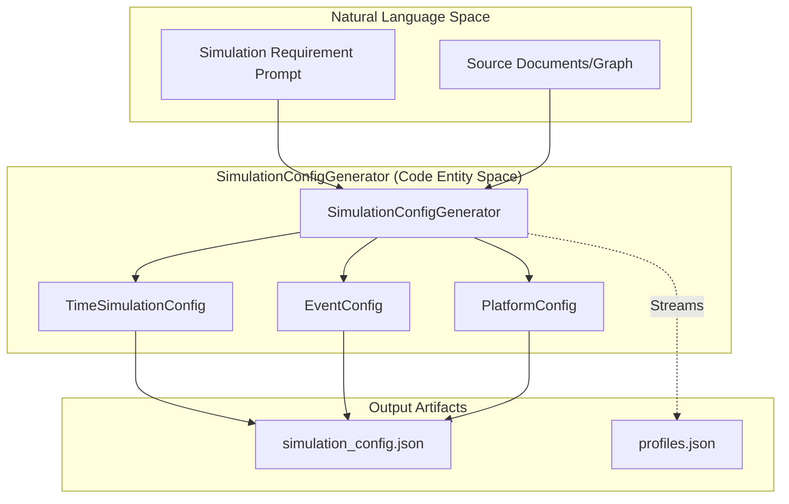
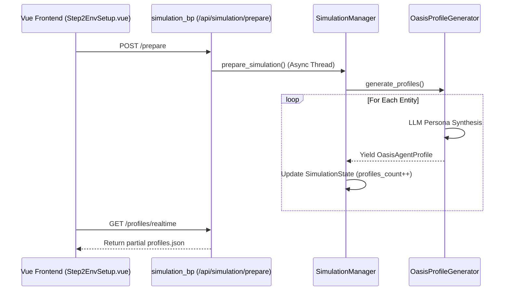

<!-- source: DeepWiki mcp.deepwiki.com · repo aaronjmars/MiroShark · page 3.2 Simulation Configuration Generator · fetched 2026-10-26 -->

# Simulation Configuration Generator

Relevant source files

The following files were used as context for generating this wiki page:

- [backend/app/api/simulation.py](backend/app/api/simulation.py)
- [backend/app/services/oasis_profile_generator.py](backend/app/services/oasis_profile_generator.py)
- [backend/app/services/simulation_config_generator.py](backend/app/services/simulation_config_generator.py)
- [backend/app/services/simulation_manager.py](backend/app/services/simulation_manager.py)
- [backend/app/services/simulation_runner.py](backend/app/services/simulation_runner.py)

The **Simulation Configuration Generator** is a core subsystem responsible for synthesizing the technical parameters required to execute a multi-platform social simulation. It bridges the gap between the static Knowledge Graph and the dynamic **Wonderwall** execution engine by producing `simulation_config.json` and streaming OASIS-compatible agent profiles.

## SimulationManager Lifecycle

The `SimulationManager` class in [backend/app/services/simulation_manager.py:116-125]() orchestrates the transition from a constructed graph to a ready-to-run simulation. This lifecycle, triggered via the `/api/simulation/prepare` endpoint [backend/app/api/simulation.py:236-258](), involves entity filtering, profile generation, and parameter synthesis.

### The prepare_simulation Workflow

The `prepare_simulation` method [backend/app/services/simulation_manager.py:221-314]() executes the following sequence:
1.  **Entity Extraction**: Uses `EntityReader` to fetch nodes from Neo4j that have defined labels (e.g., Person, Organization) [backend/app/api/simulation.py:103-108]().
2.  **Profile Streaming**: Invokes `OasisProfileGenerator` to transform graph entities into platform-specific personas [backend/app/services/simulation_manager.py:255-265]().
3.  **Config Synthesis**: Calls `SimulationConfigGenerator` to determine time scales, event injections, and algorithmic weights [backend/app/services/simulation_manager.py:280-295]().
4.  **Persistence**: Writes `profiles.json` and `simulation_config.json` to the simulation's dedicated upload directory [backend/app/services/simulation_manager.py:302-310]().

**Sources:** [backend/app/services/simulation_manager.py:116-314](), [backend/app/api/simulation.py:236-258]()

## SimulationConfigGenerator Implementation

The `SimulationConfigGenerator` [backend/app/services/simulation_config_generator.py:26-26]() uses a step-by-step LLM generation strategy to avoid context window overflows and ensure logical consistency across different configuration modules.

### 1. Time Configuration (`TimeSimulationConfig`)
The system defaults to a **China Timezone** activity model [backend/app/services/simulation_config_generator.py:29-48](). It calculates `total_simulation_hours` and `minutes_per_round` (defaulting to 60 minutes for rapid progression) [backend/app/services/simulation_config_generator.py:84-112]().

### 2. Platform Algorithm Weights (`PlatformConfig`)
For Twitter and Reddit, the generator assigns heuristic weights to the recommendation engines:
*   **Recency Weight**: Preference for new content.
*   **Popularity Weight**: Preference for high-engagement content.
*   **Relevance Weight**: Preference for content matching agent interests.
*   **Echo Chamber Strength**: A factor (0.0 to 1.0) controlling the degree of algorithmic siloing [backend/app/services/simulation_config_generator.py:133-165]().

### 3. Event Configuration and Reality Seeds
The "Reality Seeds" concept is implemented via `EventConfig` [backend/app/services/simulation_config_generator.py:114-130](). This includes:
*   **Initial Posts**: Content injected at Round 0 to kickstart the narrative.
*   **Narrative Direction**: A high-level prompt guiding the LLM's stance on the simulation topic.
*   **Initial Markets**: Seeded Polymarket contracts [backend/app/services/simulation_config_generator.py:128-129]().

**Sources:** [backend/app/services/simulation_config_generator.py:29-165]()

## Reality Seeds to Code Entity Mapping

The following diagram illustrates how natural language simulation requirements are transformed into specific code objects and JSON artifacts.

**Title: Configuration Synthesis Data Flow**

**Sources:** [backend/app/services/simulation_config_generator.py:167-195](), [backend/app/services/simulation_manager.py:280-310]()

## Profile Generation and Real-time Streaming

The `OasisProfileGenerator` [backend/app/services/oasis_profile_generator.py:25-25]() creates `OasisAgentProfile` objects. A key feature is the grounding of social metrics in graph topology.

### Metric Grounding
Instead of random numbers, the generator uses the graph's structural properties to derive influence:
*   **Degree Centrality**: The number of connections an entity has in Neo4j scales its `follower_count` and `influence_weight` [backend/app/services/oasis_profile_generator.py:175-181]().
*   **Archetype Scaling**: Entities labeled as `MediaOutlet` receive significantly higher base metrics than `Person` entities [backend/app/services/oasis_profile_generator.py:186-191]().

### Real-time Streaming Architecture
During the `prepare` phase, the system provides real-time updates to the frontend.

**Title: Profile Streaming Sequence**

**Sources:** [backend/app/services/simulation_manager.py:255-265](), [backend/app/api/simulation.py:213-234](), [backend/app/services/oasis_profile_generator.py:164-181]()

## Configuration Data Structures

| Class | Purpose | Key Fields |
| :--- | :--- | :--- |
| `SimulationParameters` | Root container for config | `time_config`, `agent_configs`, `event_config` |
| `AgentActivityConfig` | Individual behavior tuning | `activity_level`, `posts_per_hour`, `influence_weight` |
| `OasisAgentProfile` | Platform-specific persona | `bio`, `persona`, `karma`, `risk_tolerance` |

**Sources:** [backend/app/services/simulation_config_generator.py:52-82](), [backend/app/services/simulation_config_generator.py:167-195](), [backend/app/services/oasis_profile_generator.py:29-61]()

---

