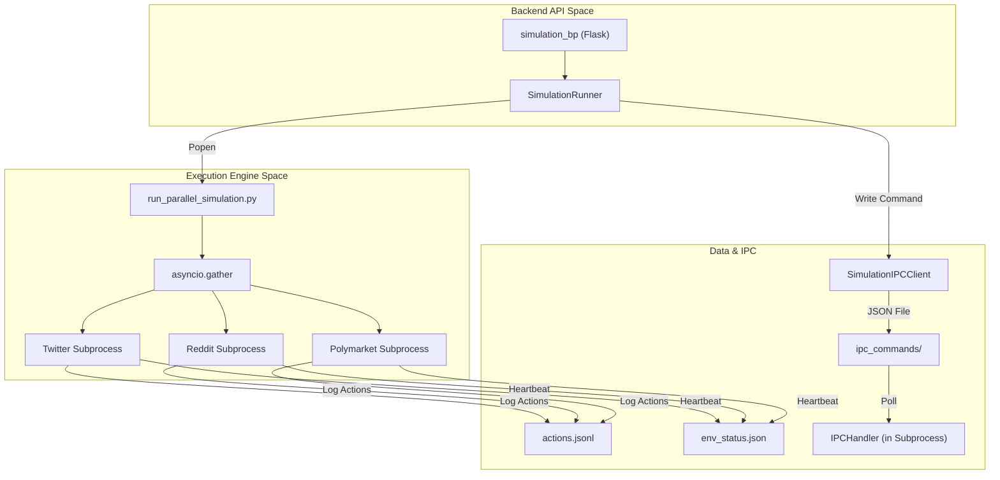

<!-- source: DeepWiki mcp.deepwiki.com · repo aaronjmars/MiroShark · page 4 Simulation Execution Engine · fetched 2026-10-26 -->

# Simulation Execution Engine

<details>
<summary>Relevant source files</summary>

The following files were used as context for generating this wiki page:

- [.gitignore](.gitignore)
- [backend/app/__init__.py](backend/app/__init__.py)
- [backend/app/services/simulation_ipc.py](backend/app/services/simulation_ipc.py)
- [backend/app/utils/file_parser.py](backend/app/utils/file_parser.py)
- [backend/pyproject.toml](backend/pyproject.toml)
- [backend/requirements.txt](backend/requirements.txt)
- [backend/scripts/run_parallel_simulation.py](backend/scripts/run_parallel_simulation.py)
- [backend/scripts/run_reddit_simulation.py](backend/scripts/run_reddit_simulation.py)
- [backend/scripts/run_twitter_simulation.py](backend/scripts/run_twitter_simulation.py)
- [backend/uv.lock](backend/uv.lock)
- [backend/wonderwall/simulations/social_media/__init__.py](backend/wonderwall/simulations/social_media/__init__.py)
- [package-lock.json](package-lock.json)
- [package.json](package.json)

</details>


The **Simulation Execution Engine** is the core runtime of MiroShark, powered by the **Wonderwall** framework (a specialized fork of OASIS). It orchestrates multi-agent interactions across social media platforms and prediction markets using a round-based execution loop. The engine is designed for high-concurrency LLM workloads, featuring parallel platform execution, cross-platform context injection, and a filesystem-based IPC protocol for real-time human-agent interaction.

## Parallel Simulation Orchestration

MiroShark executes simulations using a multi-process architecture. The `run_parallel_simulation.py` script acts as the master controller, utilizing `asyncio.gather` to launch and synchronize different platforms (Twitter, Reddit, and Polymarket) simultaneously.

*   **Process Management**: Each platform runs in its own subprocess to avoid Python's Global Interpreter Lock (GIL) and ensure isolation [backend/scripts/run_parallel_simulation.py:72-81]().
*   **Rate-Limit Mitigation**: The engine integrates with `camel-ai` and uses a `MaxTokensWarningFilter` to manage LLM token usage and prevent verbose logging from degrading performance [backend/scripts/run_parallel_simulation.py:110-121]().
*   **Platform Synchronization**: Platforms can run independently or in a synchronized "cross-platform" mode where agent actions on one platform are visible to agents on others [backend/scripts/run_parallel_simulation.py:8-12]().

For details on subprocess handling and LLM optimization, see [Parallel Simulation Runner & IPC](#4.1).

### Execution Flow Diagram

This diagram maps the high-level execution flow to the specific Python scripts and classes responsible for the simulation lifecycle.


Sources: [backend/scripts/run_parallel_simulation.py:1-30](), [backend/app/services/simulation_ipc.py:5-15](), [backend/app/__init__.py:58-62]()

## Social Platform Dynamics (Twitter & Reddit)

The social media component simulates user behavior on platforms like Twitter and Reddit. It utilizes a `SocialAgent` class which wraps `camel-ai` agents to perform actions such as posting, replying, and liking based on their generated personas.

*   **Action Dispatch**: Agents select actions through an `AgentGraph` that defines the social topology (who follows whom) [backend/scripts/run_parallel_simulation.py:180-183]().
*   **Recommendation Systems**: The engine simulates platform algorithms (e.g., `twhin-bert` for Twitter) to determine which posts appear in an agent's feed [backend/scripts/run_parallel_simulation.py:130-136]().
*   **Persistence**: All platform states, including user profiles and post histories, are stored in a local SQLite database for each simulation run [backend/scripts/run_parallel_simulation.py:78-81]().

For details on social agent behavior and recommendation logic, see [Wonderwall Social Platform (Twitter & Reddit)](#4.2).

## Prediction Market Integration

MiroShark introduces a financial layer through the **Polymarket Simulation**. This allows agents to trade on the outcomes of the narratives they are discussing on social media.

*   **AMM Mechanics**: The `PolymarketPlatform` implements a constant-product Automated Market Maker (AMM) for share pricing [backend/scripts/run_parallel_simulation.py:185-186]().
*   **Market-Media Bridge**: Market prices are injected into the social media agents' context, allowing financial trends to influence social discourse and vice versa [backend/scripts/run_parallel_simulation.py:165-169]().

For details on trade execution and the AMM formula, see [Polymarket Prediction Market Simulation](#4.3).

## Belief State & Memory Management

To maintain consistency across rounds, the engine tracks the internal state of every agent using a heuristic `BeliefState` model.

*   **Stance Tracking**: The `BeliefTracker` monitors an agent's stance, confidence, and trust levels regarding specific topics [backend/scripts/run_parallel_simulation.py:164-164]().
*   **Round Analysis**: At the end of each round, the `RoundAnalyzer` generates a `trajectory.json` to visualize opinion convergence or polarization [backend/scripts/run_reddit_simulation.py:33-37]().
*   **Context Compaction**: `RoundMemory` manages the sliding-window memory of agents, ensuring they remember key past interactions without exceeding LLM context limits [backend/scripts/run_parallel_simulation.py:170-170]().

For details on the resistance formulas and memory injection, see [Belief State, Round Memory & Cross-Platform Awareness](#4.4).

## Inter-Process Communication (IPC)

The Flask backend communicates with the detached simulation processes via a filesystem-based IPC protocol implemented in `SimulationIPC.py`.

| Feature | Code Entity | Description |
| :--- | :--- | :--- |
| **Command Client** | `SimulationIPCClient` | Used by Flask to write commands to `ipc_commands/` [backend/app/services/simulation_ipc.py:95-101](). |
| **Command Handler** | `IPCHandler` | Polling mechanism inside the simulation script to execute requests [backend/scripts/run_twitter_simulation.py:146-155](). |
| **Heartbeat** | `env_status.json` | Provides real-time status (Running, Paused, Completed) to the UI [backend/scripts/run_twitter_simulation.py:162-168](). |
| **Interviews** | `INTERVIEW` | Allows users to query an agent's internal thoughts mid-simulation [backend/app/services/simulation_ipc.py:27-27](). |

### System Entity Mapping

This diagram connects the logical IPC concepts to the physical classes and directories in the codebase.

```mermaid
classDiagram
    class SimulationIPCClient {
        +send_command(command_type, args)
        +send_interview(agent_id, prompt)
    }
    class IPCHandler {
        +poll_command()
        +send_response(command_id, status)
        +update_status(status)
    }
    class CommandType {
        <<enumeration>>
        INTERVIEW
        BATCH_INTERVIEW
        CLOSE_ENV
    }
    
    SimulationIPCClient ..> CommandType : uses
    SimulationIPCClient --> "ipc_commands/" : writes JSON
    IPCHandler --> "ipc_commands/" : reads JSON
    IPCHandler --> "ipc_responses/" : writes JSON
    SimulationIPCClient --> "ipc_responses/" : reads JSON
```
Sources: [backend/app/services/simulation_ipc.py:25-30](), [backend/app/services/simulation_ipc.py:102-115](), [backend/scripts/run_twitter_simulation.py:146-160]()

---

