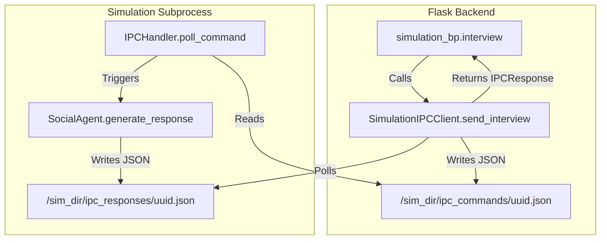
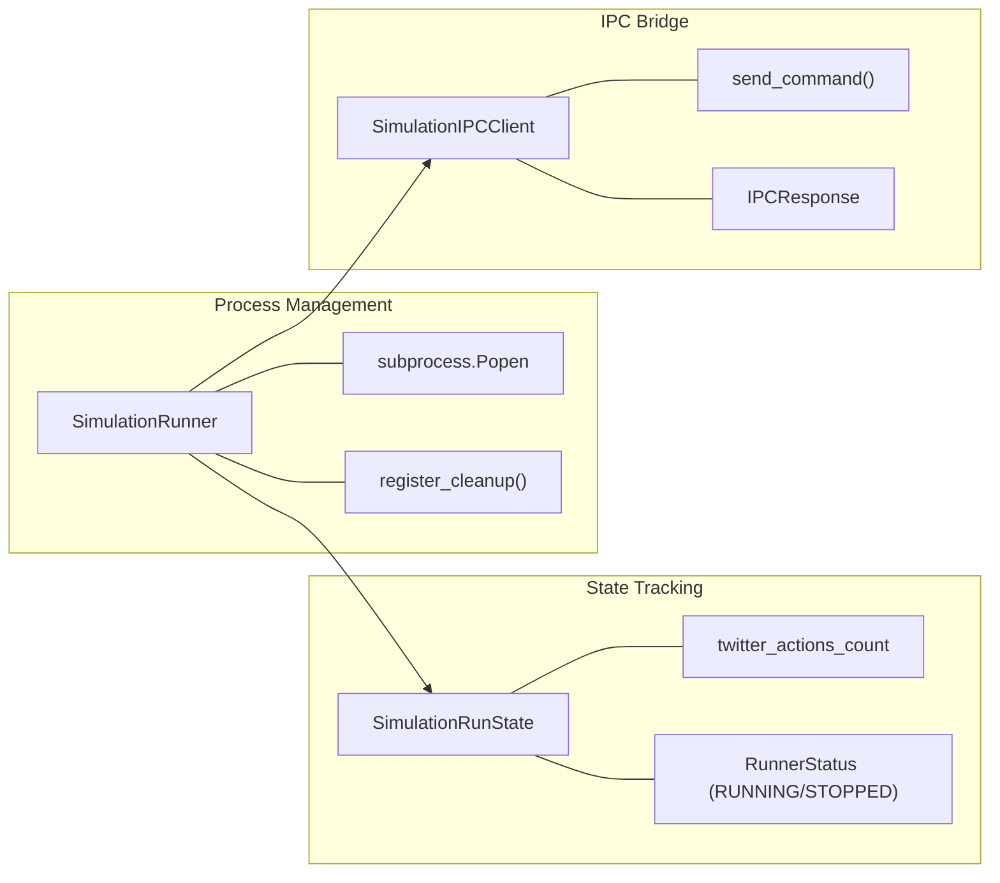

<!-- source: DeepWiki mcp.deepwiki.com · repo aaronjmars/MiroShark · page 4.1 Parallel Simulation Runner & IPC · fetched 2026-10-26 -->

# Parallel Simulation Runner & IPC

Relevant source files

The following files were used as context for generating this wiki page:

- [backend/app/__init__.py](backend/app/__init__.py)
- [backend/app/api/simulation.py](backend/app/api/simulation.py)
- [backend/app/services/simulation_ipc.py](backend/app/services/simulation_ipc.py)
- [backend/app/services/simulation_runner.py](backend/app/services/simulation_runner.py)
- [backend/scripts/run_parallel_simulation.py](backend/scripts/run_parallel_simulation.py)
- [backend/scripts/run_reddit_simulation.py](backend/scripts/run_reddit_simulation.py)
- [backend/scripts/run_twitter_simulation.py](backend/scripts/run_twitter_simulation.py)

The Parallel Simulation Runner and its associated Inter-Process Communication (IPC) system form the execution backbone of MiroShark. This subsystem manages the lifecycle of multi-platform simulations, enabling synchronized or independent execution of Twitter, Reddit, and Polymarket environments while maintaining a live communication bridge for real-time agent interaction.

## Parallel Simulation Execution

The primary entry point for multi-platform simulations is `run_parallel_simulation.py`. This script orchestrates the concurrent execution of different social environments using `asyncio` and `multiprocessing` [backend/scripts/run_parallel_simulation.py:1-30]().

### Execution Modes
1.  **Synchronized Platform Execution**: Platforms can be configured to run in lock-step, ensuring agents across different environments progress through time at the same rate.
2.  **Independent Execution**: Platforms run as fast as their respective LLM providers allow, tracked by independent round counters [backend/app/services/simulation_runner.py:112-118]().
3.  **Cross-Platform Awareness**: When enabled via the `--cross-platform` flag, agents receive digests of their activities on other platforms to maintain a consistent persona state [backend/scripts/run_parallel_simulation.py:8-16]().

### Boost LLM & Rate Limiting
To mitigate provider rate limits during parallel execution, the runner utilizes a "Boost LLM" strategy. It leverages `asyncio.gather` to trigger concurrent agent actions across platforms while implementing staggered starts and retry logic to handle high-concurrency demands on the LLM API [backend/scripts/run_parallel_simulation.py:71-82]().

## Simulation IPC Protocol

MiroShark uses a filesystem-based command/response protocol for communication between the Flask backend and the active simulation processes. This allows the backend to "interview" agents or shut down environments without direct memory sharing.

### Protocol Components
*   **Heartbeat (`env_status.json`)**: The simulation process periodically updates this file with its current status and timestamp. The backend uses `check_env_alive` to verify if the process is still responsive [backend/app/services/simulation_runner.py:32-34](), [backend/scripts/run_twitter_simulation.py:162-168]().
*   **Commands (`ipc_commands/`)**: The `SimulationIPCClient` writes JSON files containing a `command_id`, `command_type`, and `args` [backend/app/services/simulation_ipc.py:139-150]().
*   **Responses (`ipc_responses/`)**: The simulation's `IPCHandler` polls the commands directory, executes the logic, and writes a response file that the client then consumes [backend/app/services/simulation_ipc.py:154-172]().

### Supported Commands
| Command Type | Description |
| :--- | :--- |
| `INTERVIEW` | Requests a specific agent to respond to a prompt based on its current belief state and memory [backend/app/services/simulation_ipc.py:27](). |
| `BATCH_INTERVIEW` | Sends a prompt to multiple agents simultaneously [backend/app/services/simulation_ipc.py:28](). |
| `CLOSE_ENV` | Signals the simulation process to perform a graceful shutdown and cleanup [backend/app/services/simulation_ipc.py:29](). |

Sources: `[backend/app/services/simulation_ipc.py:1-188]()`, `[backend/scripts/run_twitter_simulation.py:134-206]()`, `[backend/app/services/simulation_runner.py:32-34]()`.

## Subprocess Management

The `SimulationRunner` class handles the low-level mechanics of spawning and killing simulation processes.

### Process Lifecycle
1.  **Startup**: Uses `subprocess.Popen` to launch the preset scripts (e.g., `run_parallel_simulation.py`). On Windows, it uses `CREATE_NEW_PROCESS_GROUP` to ensure child processes can be terminated together [backend/app/services/simulation_runner.py:32-33]().
2.  **Monitoring**: A background thread monitors the `actions.jsonl` files and the `env_status.json` heartbeat to update the `SimulationRunState` [backend/app/services/simulation_runner.py:101-150]().
3.  **Cleanup**: MiroShark registers an `atexit` handler and signal listeners (SIGINT, SIGTERM) to ensure that if the Flask server crashes or is stopped, all orphaned simulation subprocesses are terminated [backend/app/services/simulation_runner.py:14-15](), [backend/app/__init__.py:58-59]().

### Data Flow: Backend to Simulation
The following diagram illustrates how a user request for an agent interview travels from the API through the IPC layer into the running simulation.

**Interview Command Flow**

Sources: `[backend/app/api/simulation.py:27-60]()`, `[backend/app/services/simulation_ipc.py:95-152]()`, `[backend/scripts/run_twitter_simulation.py:146-191]()`.

## Implementation Detail: SimulationRunner

The `SimulationRunner` manages a singleton-like state for active runs, tracking PIDs and providing status updates to the frontend.

**Entity Association: Runner to Code**

### Key Functions
*   `start_simulation(...)`: Constructs the command line arguments and spawns the subprocess [backend/app/services/simulation_runner.py:42-47]().
*   `stop_simulation(...)`: Sends a `CLOSE_ENV` IPC command; if the process doesn't exit within a timeout, it performs a hard kill using `os.killpg` [backend/app/services/simulation_runner.py:148-150]().
*   `check_env_alive(...)`: Validates the existence of the process and the freshness of the `env_status.json` heartbeat [backend/app/api/simulation.py:27-34]().

Sources: `[backend/app/services/simulation_runner.py:1-203]()`, `[backend/app/api/simulation.py:1-60]()`, `[backend/app/__init__.py:58-62]()`.

---

