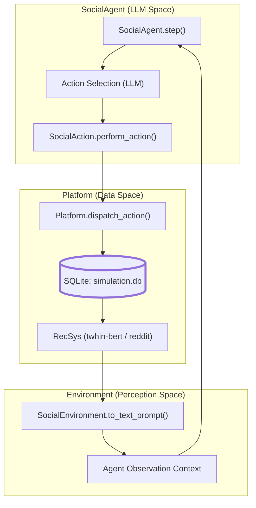
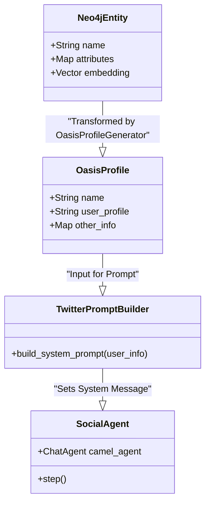

<!-- source: DeepWiki mcp.deepwiki.com · repo aaronjmars/MiroShark · page 4.2 Wonderwall Social Platform (Twitter & Reddit) · fetched 2026-10-26 -->

# Wonderwall Social Platform (Twitter & Reddit)

Relevant source files

The following files were used as context for generating this wiki page:

- [.gitignore](.gitignore)
- [backend/app/utils/file_parser.py](backend/app/utils/file_parser.py)
- [backend/pyproject.toml](backend/pyproject.toml)
- [backend/requirements.txt](backend/requirements.txt)
- [backend/uv.lock](backend/uv.lock)
- [backend/wonderwall/simulations/base.py](backend/wonderwall/simulations/base.py)
- [backend/wonderwall/simulations/polymarket/actions.py](backend/wonderwall/simulations/polymarket/actions.py)
- [backend/wonderwall/simulations/polymarket/environment.py](backend/wonderwall/simulations/polymarket/environment.py)
- [backend/wonderwall/simulations/polymarket/prompts.py](backend/wonderwall/simulations/polymarket/prompts.py)
- [backend/wonderwall/simulations/social_media/__init__.py](backend/wonderwall/simulations/social_media/__init__.py)
- [backend/wonderwall/simulations/social_media/prompts.py](backend/wonderwall/simulations/social_media/prompts.py)
- [backend/wonderwall/social_agent/agent_action.py](backend/wonderwall/social_agent/agent_action.py)
- [package-lock.json](package-lock.json)
- [package.json](package.json)

The Wonderwall social platform layer is the core execution environment for agent interactions within MiroShark. It simulates the mechanics of Twitter and Reddit, providing agents with platform-specific actions, recommendation algorithms, and a persistent state managed via SQLite. This layer bridges the gap between high-level agent personas and low-level digital traces.

## Architectural Overview

The social simulation is driven by the `Platform` class, which handles the environment's state, and the `SocialAgent`, which integrates with the CAMEL framework to perform reasoning and action selection.

### Core Components
| Component | Code Entity | Responsibility |
| :--- | :--- | :--- |
| **Platform Engine** | `Platform` | Manages SQLite schema, post/comment storage, and action dispatching. |
| **Agent Logic** | `SocialAgent` | Wraps `ChatAgent` for social-specific reasoning and tool calling. |
| **Recommendation** | `RecSys` | Implements `twhin-bert` (Twitter) and score-based (Reddit) feeds. |
| **Action Space** | `SocialAction` | Defines the tools (e.g., `create_post`, `like_post`) available to LLMs. |

Sources: [backend/wonderwall/simulations/social_media/__init__.py:29-42](), [backend/wonderwall/social_agent/agent_action.py:1-20]()

## Platform Implementation & Schema

The `Platform` class initializes a local SQLite database for every simulation run to ensure data isolation. It serves as the "Source of Truth" for all social interactions.

### Simulation Configurations
Wonderwall defines two primary `SimulationConfig` objects for social media:

1.  **Twitter Simulation** (`twitter_simulation`):
    *   **RecSys**: `twhin-bert` [backend/wonderwall/simulations/social_media/__init__.py:55]().
    *   **Actions**: `create_post`, `like_post`, `repost`, `follow`, `quote_post`, `do_nothing` [backend/wonderwall/simulations/social_media/__init__.py:50-53]().
2.  **Reddit Simulation** (`reddit_simulation`):
    *   **RecSys**: `reddit` (popularity/score-based) [backend/wonderwall/simulations/social_media/__init__.py:74]().
    *   **Actions**: `create_post`, `create_comment`, `like_post`, `dislike_comment`, `search_posts`, `trend` [backend/wonderwall/simulations/social_media/__init__.py:68-72]().

### Social Media Data Flow
The following diagram illustrates how an agent's intent is transformed into a database record and then surfaced back to other agents.

**Social Platform Action & Feed Loop**

Sources: [backend/wonderwall/simulations/social_media/__init__.py:44-80](), [backend/wonderwall/social_agent/agent_action.py:1-20]()

## SocialAgent & CAMEL Integration

The `SocialAgent` leverages the `camel-ai` library to manage the LLM dialogue. It uses a `ChatAgent` initialized with a platform-specific system prompt generated by the `PromptBuilder`.

### Action Selection Strategy
Agents are prompted to treat `do_nothing` as their default state to simulate realistic "lurking" behavior [backend/wonderwall/simulations/social_media/prompts.py:60-65]().

*   **Twitter Logic**: Focuses on "punchy" takes, wit, and timely reactions under 280 characters [backend/wonderwall/simulations/social_media/prompts.py:53-57]().
*   **Reddit Logic**: Prioritizes threaded discussions, "karma" reputation, and substance over brevity [backend/wonderwall/simulations/social_media/prompts.py:130-138]().

### Prompt Construction
The `TwitterPromptBuilder` and `RedditPromptBuilder` inject entity-specific metadata into the system prompt:
*   **Persona**: Extracted from `user_info.profile` [backend/wonderwall/simulations/social_media/prompts.py:23-38]().
*   **Demographics**: Age, Gender, MBTI, and Country are injected for Reddit agents to enforce personality consistency [backend/wonderwall/simulations/social_media/prompts.py:111-121]().

Sources: [backend/wonderwall/simulations/social_media/prompts.py:41-106](), [backend/wonderwall/simulations/social_media/prompts.py:107-165]()

## Recommendation Systems (RecSys)

The `Platform` uses different recommendation strategies to determine what an agent "sees" in their feed, influencing their belief updates and future actions.

### Twhin-BERT (Twitter)
For Twitter, the platform uses a BERT-based embedding model to calculate similarity between an agent's interests (derived from their graph-based persona) and available posts.
*   **Parameters**: Controlled via `platform_kwargs`, including `refresh_rec_post_count` and `following_post_count` [backend/wonderwall/simulations/social_media/__init__.py:54-59]().

### Reddit Algorithm
The Reddit RecSys simulates subreddit sorting:
*   **Score-based**: Posts with higher upvotes (likes) are prioritized.
*   **Self-Rating**: `allow_self_rating` is enabled by default to allow agents to interact with their own threads [backend/wonderwall/simulations/social_media/__init__.py:75]().

Sources: [backend/wonderwall/simulations/social_media/__init__.py:44-80]()

## Implementation Details: From Profile to Prompt

MiroShark maps the Knowledge Graph entities to these social platforms by synthesizing `SimulationConfig` objects.

**Entity to Social Persona Mapping**

### Key Functions
*   `_build_description(user_info)`: A utility that parses the JSON profile structure to create the "WHO YOU ARE" section of the LLM prompt [backend/wonderwall/simulations/social_media/prompts.py:23-39]().
*   `_get_platform_cls()`: Lazy-loads the `Platform` class to avoid circular imports during simulation initialization [backend/wonderwall/simulations/social_media/__init__.py:29-32]().

Sources: [backend/wonderwall/simulations/social_media/prompts.py:23-39](), [backend/wonderwall/simulations/social_media/__init__.py:29-42]()

---

