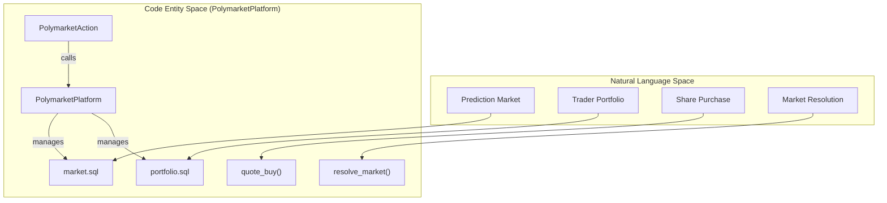
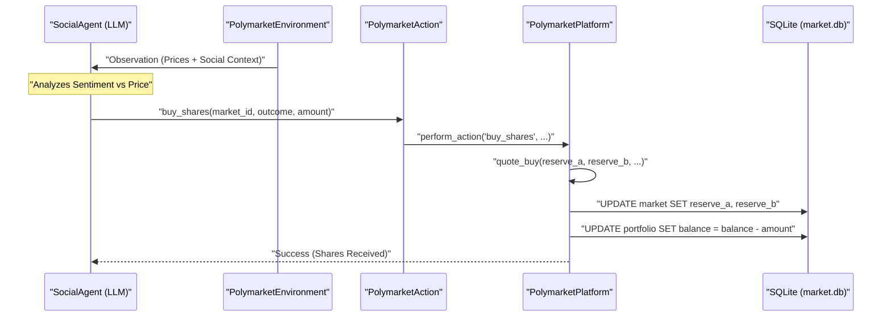

<!-- source: DeepWiki mcp.deepwiki.com · repo aaronjmars/MiroShark · page 4.3 Polymarket Prediction Market Simulation · fetched 2026-10-26 -->

# Polymarket Prediction Market Simulation

Relevant source files

The following files were used as context for generating this wiki page:

- [backend/app/storage/neo4j_storage.py](backend/app/storage/neo4j_storage.py)
- [backend/wonderwall/simulations/base.py](backend/wonderwall/simulations/base.py)
- [backend/wonderwall/simulations/polymarket/__init__.py](backend/wonderwall/simulations/polymarket/__init__.py)
- [backend/wonderwall/simulations/polymarket/actions.py](backend/wonderwall/simulations/polymarket/actions.py)
- [backend/wonderwall/simulations/polymarket/environment.py](backend/wonderwall/simulations/polymarket/environment.py)
- [backend/wonderwall/simulations/polymarket/platform.py](backend/wonderwall/simulations/polymarket/platform.py)
- [backend/wonderwall/simulations/polymarket/prompts.py](backend/wonderwall/simulations/polymarket/prompts.py)
- [backend/wonderwall/simulations/social_media/prompts.py](backend/wonderwall/simulations/social_media/prompts.py)
- [backend/wonderwall/social_agent/belief_state.py](backend/wonderwall/social_agent/belief_state.py)

The Polymarket simulation provides a high-fidelity prediction market environment within MiroShark. It simulates a constant-product Automated Market Maker (AMM) where agents trade on real-world outcomes using virtual currency. This platform operates in parallel with social media simulations, allowing market prices to reflect social sentiment and vice-versa through the Market-Media Bridge.

## PolymarketPlatform Architecture

The `PolymarketPlatform` class is the central authority for market state, trade execution, and portfolio management. It inherits from `BasePlatform` and manages a SQLite database containing market-specific tables.

### Market Mechanics and AMM
The platform utilizes a constant-product formula ($x \times y = k$) to determine pricing. 
- **Reserves**: Each market maintains `reserve_a` (YES shares) and `reserve_b` (NO shares) [backend/wonderwall/simulations/polymarket/platform.py:106-112]().
- **Pricing**: The price of a YES share is calculated as $\frac{reserve\_b}{reserve\_a + reserve\_b}$ [backend/wonderwall/simulations/polymarket/platform.py:98]().
- **Trade Cap**: To prevent extreme price manipulation by single agents, trade sizes are capped at 2% of the total pool liquidity [backend/wonderwall/simulations/polymarket/platform.py:157-161]().

### Data Entity Mapping
The following diagram bridges the conceptual market entities to the implementation classes and database schemas.

**Market Entity to Code Mapping**

Sources: [backend/wonderwall/simulations/polymarket/platform.py:33-46](), [backend/wonderwall/simulations/polymarket/actions.py:20-22]()

## Simulation Configuration

The `polymarket_simulation` object defines the specific classes and default parameters used by the `OasisEnv` to instantiate the prediction market.

| Parameter | Value / Class | Description |
| :--- | :--- | :--- |
| `name` | `"polymarket"` | Unique identifier for the simulation type. |
| `platform_cls` | `PolymarketPlatform` | Server-side logic and DB management. |
| `action_cls` | `PolymarketAction` | Tool definitions for LLM agents. |
| `environment_cls` | `PolymarketEnvironment` | Logic for generating agent observations. |
| `initial_balance` | `1000.0` | Starting USD for each trader agent. |
| `initial_liquidity` | `10000.0` | Initial $k$ value for the AMM pools. |

Sources: [backend/wonderwall/simulations/polymarket/__init__.py:32-46]()

## Trader Agent Behavior

Traders are governed by the `PolymarketPromptBuilder`, which shapes their decision-making process based on their persona and market state.

### Action Selection Logic
Agents follow a prioritized decision tree:
1.  **do_nothing**: The default state. Agents are instructed to wait for clear mispricings [backend/wonderwall/simulations/polymarket/prompts.py:63-64]().
2.  **buy_shares**: Triggered when the agent's internal belief (derived from graph context and social media) deviates from the market price [backend/wonderwall/simulations/polymarket/prompts.py:66-73]().
3.  **sell_shares**: Triggered to take profit (price > 0.90), cut losses (price < 0.10), or if beliefs shift [backend/wonderwall/simulations/polymarket/prompts.py:75-79]().

### Market-Media Bridge
The simulation implements a feedback loop where social media activity directly influences market behavior.
- **Context Injection**: The `PolymarketEnvironment` injects `extra_observation_context` containing digests of Twitter and Reddit activity [backend/wonderwall/simulations/polymarket/environment.py:101-103]().
- **Signal Analysis**: Agents are prompted to look for viral posts, sentiment shifts, and arguments from institutional accounts to identify "edges" in the market [backend/wonderwall/simulations/polymarket/prompts.py:94-102]().

## Execution Data Flow

The following diagram illustrates how a trade progresses from an agent's observation of social media to the update of the AMM reserves.

**Trade Execution Flow**

Sources: [backend/wonderwall/simulations/polymarket/environment.py:25-111](), [backend/wonderwall/simulations/polymarket/platform.py:123-189](), [backend/wonderwall/simulations/polymarket/actions.py:47-72]()

## Market Resolution
Markets are resolved by the platform, which calculates final payouts based on the winning outcome.
- **Payouts**: Winning shares are worth $1.00; losing shares are worth $0.00 [backend/wonderwall/simulations/polymarket/prompts.py:52-53]().
- **Portfolio Update**: Upon resolution, the platform iterates through all `position` records for the market and updates the `balance` in the `portfolio` table [backend/wonderwall/simulations/polymarket/platform.py:228-261]().

Sources: [backend/wonderwall/simulations/polymarket/platform.py:228-261]()

---

