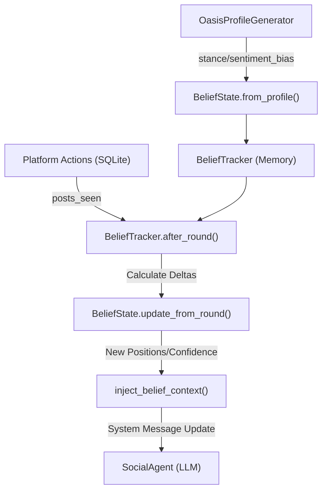
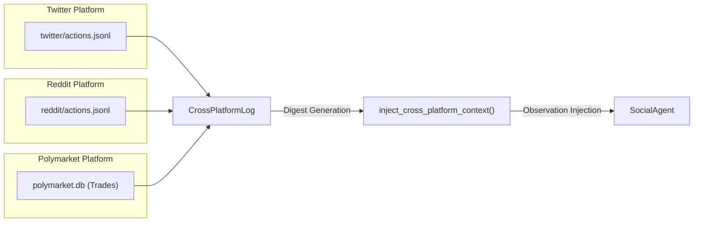

<!-- source: DeepWiki mcp.deepwiki.com · repo aaronjmars/MiroShark · page 4.4 Belief State, Round Memory & Cross-Platform Awareness · fetched 2026-10-26 -->

# Belief State, Round Memory & Cross-Platform Awareness

Relevant source files

The following files were used as context for generating this wiki page:

- [backend/app/__init__.py](backend/app/__init__.py)
- [backend/app/services/simulation_ipc.py](backend/app/services/simulation_ipc.py)
- [backend/app/storage/neo4j_storage.py](backend/app/storage/neo4j_storage.py)
- [backend/scripts/belief_integration.py](backend/scripts/belief_integration.py)
- [backend/scripts/run_parallel_simulation.py](backend/scripts/run_parallel_simulation.py)
- [backend/scripts/run_reddit_simulation.py](backend/scripts/run_reddit_simulation.py)
- [backend/scripts/run_twitter_simulation.py](backend/scripts/run_twitter_simulation.py)
- [backend/wonderwall/simulations/polymarket/__init__.py](backend/wonderwall/simulations/polymarket/__init__.py)
- [backend/wonderwall/simulations/polymarket/platform.py](backend/wonderwall/simulations/polymarket/platform.py)
- [backend/wonderwall/social_agent/belief_state.py](backend/wonderwall/social_agent/belief_state.py)
- [backend/wonderwall/social_agent/round_analyzer.py](backend/wonderwall/social_agent/round_analyzer.py)

This page details the cognitive and memory architectures that enable MiroShark agents to maintain consistent personas, evolve their opinions based on social dynamics, and remain aware of activities across multiple simulated platforms (Twitter, Reddit, and Polymarket).

## 1. Belief State Heuristic Model

The `BeliefState` class provides a mutable model for tracking an agent's internal cognitive state without requiring expensive LLM calls for every state transition. It tracks three primary dimensions: Stance, Confidence, and Trust.

### 1.1 Core Components
*   **Positions**: A mapping of `topic -> stance` where the stance is a float between -1.0 (strongly opposing) and +1.0 (strongly supportive) [backend/wonderwall/social_agent/belief_state.py:29-29]().
*   **Confidence**: A mapping of `topic -> certainty` (0.0 to 1.0). High confidence increases resistance to new information [backend/wonderwall/social_agent/belief_state.py:30-30]().
*   **Trust**: A mapping of `agent_id -> trust_level` (0.0 to 1.0). Interactions like "following" or "liking" increase this value, while "disliking" or "muting" decreases it [backend/wonderwall/social_agent/belief_state.py:31-31]().
*   **Exposure History**: A set of content hashes used to implement novelty weighting [backend/wonderwall/social_agent/belief_state.py:32-32]().

### 1.2 The Resistance Formula
When an agent encounters a post, the magnitude of the belief shift (nudge) is inversely proportional to their current confidence. This is governed by a resistance factor:
`resistance = 0.3 + (current_confidence * 0.7)` [backend/wonderwall/social_agent/belief_state.py:140-140]().

The final nudge calculation incorporates author trust, social proof (likes), and novelty:
`nudge = (post_stance - current_pos) * author_trust * social_weight * novelty_mult * 0.08 / resistance` [backend/wonderwall/social_agent/belief_state.py:141-148]().

### 1.3 Data Flow: Belief Initialization to Update
The following diagram illustrates how beliefs are initialized from profiles and updated during the simulation loop.

**Belief Update Pipeline**

Sources: [backend/wonderwall/social_agent/belief_state.py:40-76](), [backend/scripts/belief_integration.py:28-47](), [backend/scripts/belief_integration.py:48-96]()

## 2. Round Analysis & Trajectory Tracking

The `RoundAnalyzer` and `BeliefTracker` work together to aggregate metrics after each simulation step, producing the `trajectory.json` artifact used for final report generation.

### 2.1 Key Metrics
*   **Convergence/Polarization**: Measured by comparing the spread (Max - Min) of agent positions on a topic between the first and last rounds [backend/wonderwall/social_agent/round_analyzer.py:106-136]().
*   **Turning Points**: Rounds where an agent's belief shift exceeds a threshold of 0.15 [backend/wonderwall/social_agent/round_analyzer.py:138-154]().
*   **Viral Impact**: Identification of posts with high engagement that caused significant community-wide belief shifts [backend/wonderwall/social_agent/round_analyzer.py:38-38]().

### 2.2 Trajectory Serialization
The `SimulationTrajectory` class accumulates `RoundSnapshot` objects [backend/wonderwall/social_agent/round_analyzer.py:59-64](). At the end of the simulation, `save_trajectory()` writes the complete history to the simulation directory [backend/scripts/belief_integration.py:97-101]().

Sources: [backend/wonderwall/social_agent/round_analyzer.py:1-25](), [backend/wonderwall/social_agent/round_analyzer.py:167-180]()

## 3. Round Memory & Context Compaction

To prevent context window overflow in long simulations, MiroShark implements a sliding-window memory management system via `RoundMemory`.

### 3.1 Implementation Details
The `RoundMemory` class maintains a history of an agent's own actions and significant observations. When the history exceeds a platform-specific limit, it compacts the context by keeping only the most recent $N$ rounds of activity [backend/scripts/run_parallel_simulation.py:170-170]().

The `inject_round_memory` function modifies the agent's prompt to include a "Recent Memory" section, ensuring the agent remembers its previous posts and the feedback it received without re-processing the entire simulation log [backend/scripts/run_parallel_simulation.py:170-170]().

Sources: [backend/scripts/run_parallel_simulation.py:162-170]()

## 4. Cross-Platform Awareness

MiroShark allows agents to be "conscious" of their actions across different platforms (e.g., an agent on Reddit knowing what they posted on Twitter).

### 4.1 CrossPlatformLog Digest
The `CrossPlatformLog` class aggregates actions from all active platforms [backend/scripts/run_parallel_simulation.py:163-163](). It generates a "Cross-Platform Digest" that is injected into the agent's observation space.

### 4.2 Injection Mechanism
If the `--cross-platform` flag is enabled during simulation startup [backend/scripts/run_parallel_simulation.py:8-8](), the `inject_cross_platform_context` function is called every round.

**Cross-Platform Data Flow**

Sources: [backend/scripts/run_parallel_simulation.py:163-169](), [backend/scripts/run_parallel_simulation.py:22-30]()

## 5. Market-Media Bridge

The simulation engine includes a specific bridge between Polymarket and social media platforms to simulate how market prices influence public opinion and vice-versa.

### 5.1 Sentiment to Market
`inject_sentiment_context` takes the aggregated sentiment from social platforms and provides it as "Market News" to Polymarket traders [backend/scripts/run_parallel_simulation.py:168-169]().

### 5.2 Price to Social
`inject_market_context` takes the current AMM prices from `PolymarketPlatform` [backend/wonderwall/simulations/polymarket/platform.py:33-34]() and injects them into the prompts of social media agents, allowing them to react to market trends (e.g., "The market now gives this outcome a 70% chance") [backend/scripts/run_parallel_simulation.py:167-167]().

Sources: [backend/scripts/run_parallel_simulation.py:165-169](), [backend/wonderwall/simulations/polymarket/platform.py:123-165]()

---

