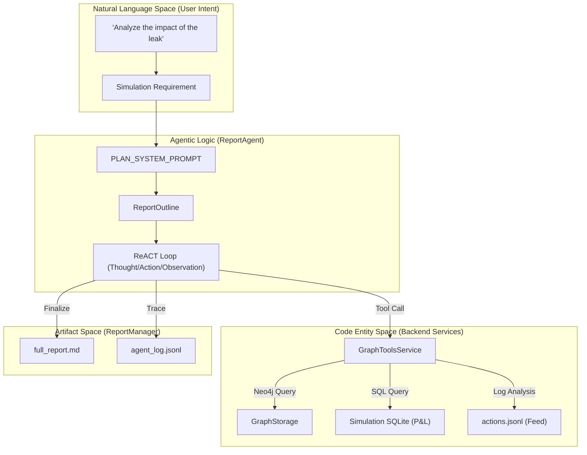
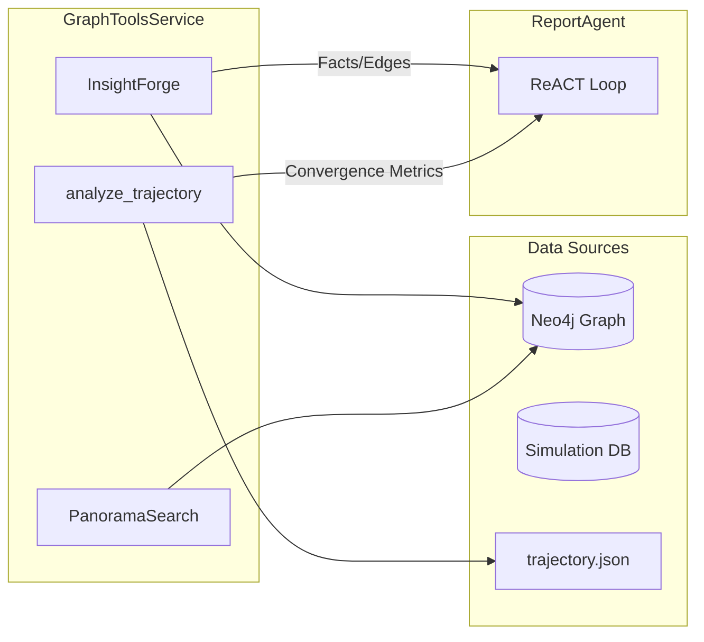

<!-- source: DeepWiki mcp.deepwiki.com · repo aaronjmars/MiroShark · page 5 Report Generation & Analysis · fetched 2026-10-26 -->

# Report Generation & Analysis

Relevant source files

The following files were used as context for generating this wiki page:

- [backend/app/api/graph.py](backend/app/api/graph.py)
- [backend/app/api/report.py](backend/app/api/report.py)
- [backend/app/services/graph_tools.py](backend/app/services/graph_tools.py)
- [backend/app/services/report_agent.py](backend/app/services/report_agent.py)

The **Report Generation & Analysis** system is the final stage of the MiroShark pipeline. It transitions from the "Simulation Space" (where agents interact and generate raw data) back into the "Knowledge Space" by synthesizing a comprehensive, structured analysis of the simulation's outcomes. This process is driven by an autonomous **ReportAgent** that utilizes a **ReACT** (Reasoning and Acting) loop to query the simulation state, graph data, and agent behaviors to fulfill the user's initial simulation requirements.

### System Overview

The reporting lifecycle begins after the simulation reaches a terminal state or is manually stopped. The system uses a specialized agentic workflow to ensure the final report is not just a summary of logs, but a grounded analysis supported by specific facts retrieved from the Knowledge Graph and Simulation databases.

#### Analysis Workflow

1.  **Initialization**: The `report_bp` API receives a request and initializes a `ReportAgent` with the `simulation_id` and the original `simulation_requirement` [backend/app/api/report.py:141-147]().
2.  **Planning**: The agent creates a `ReportOutline` containing 3-5 logical sections based on the project context [backend/app/services/report_agent.py:113-118]().
3.  **Iterative Generation**: For each section, the agent enters a ReACT loop, selecting tools from the `GraphToolsService` to gather evidence before writing [backend/app/services/report_agent.py:152-164]().
4.  **Synthesis**: A final pass merges sections, normalizes headings, and ensures cross-sectional consistency [backend/app/services/report_agent.py:211-220]().
5.  **Persistence**: The `ReportManager` saves the final Markdown, agent logs, and section artifacts to the filesystem [backend/app/services/report_agent.py:51-53]().

### Conceptual Bridge: Natural Language to Code Entities

The following diagram illustrates how high-level analysis concepts map to specific classes and services within the MiroShark codebase.

**Analysis System Mapping**

Sources: [backend/app/services/report_agent.py:1-10](), [backend/app/services/graph_tools.py:1-11](), [backend/app/api/report.py:125-130]()

### The ReportAgent & ReACT Loop

The `ReportAgent` is the core orchestrator of the analysis phase. Unlike a simple LLM prompt, it uses a multi-step ReACT pattern to ensure every claim in the report is grounded in data.

*   **Planning Phase**: Before writing, the agent generates a table of contents. This prevents the "drifting" common in long-form LLM generation.
*   **ReACT Execution**: For every section, the agent performs between 2 and 6 tool calls. It thinks about what it needs to know (Thought), executes a tool (Action), and interprets the data (Observation).
*   **Lifecycle Management**: The `ReportManager` tracks the status of these long-running tasks via `TaskStatus` and provides real-time progress updates to the frontend via the `report_bp` status endpoints.

For details on the prompt engineering and iteration logic, see [ReportAgent: ReACT Loop & Report Lifecycle](#5.1).

Sources: [backend/app/services/report_agent.py:142-164](), [backend/app/api/report.py:25-49]()

### GraphToolsService: Data Retrieval

The `GraphToolsService` provides the "senses" for the ReportAgent. It abstracts complex graph traversals and database queries into a simple toolset.

| Tool Name | Purpose | Data Source |
| :--- | :--- | :--- |
| `InsightForge` | Deep hybrid search with LLM-driven query decomposition. | Neo4j + LLM [backend/app/services/graph_tools.py:8-10]() |
| `PanoramaSearch` | Breadth-first search including historical/expired facts. | Neo4j [backend/app/services/graph_tools.py:9-10]() |
| `QuickSearch` | Low-latency GraphRAG retrieval. | Neo4j [backend/app/services/graph_tools.py:10-11]() |
| `market_state` | Retrieves P&L and market prices from the simulation. | SQLite [backend/app/services/graph_tools.py:24-30]() |
| `interview_agents` | Queries specific agents for their current belief states. | Simulation IPC [backend/app/services/graph_tools.py:24-30]() |

**Data Flow: Retrieval to Report**

Sources: [backend/app/services/graph_tools.py:1-22](), [backend/app/services/report_agent.py:24-30]()

For details on the specific implementation of these retrieval strategies, see [GraphToolsService: Data Retrieval Tools](#5.2).

### Report Artifacts & Accessibility

Once generation is complete, the system produces a structured directory within `Config.UPLOAD_FOLDER/reports/{report_id}/` [backend/app/services/report_agent.py:51-53]().

*   **`full_report.md`**: The final consolidated analysis.
*   **`section_XX.md`**: Individual section drafts, useful for debugging generation failures.
*   **`agent_log.jsonl`**: A high-fidelity trace of every "Thought", "Action", and "Observation" made by the agent [backend/app/services/report_agent.py:35-41]().
*   **`console_log.txt`**: Standard output capture from the generation process.

Users can access these reports via the **Step 4: Report** view in the frontend, which polls the `report_bp` for completion status [backend/app/api/report.py:221-230]().

Sources: [backend/app/services/report_agent.py:35-55](), [backend/app/api/report.py:163-174]()

---

