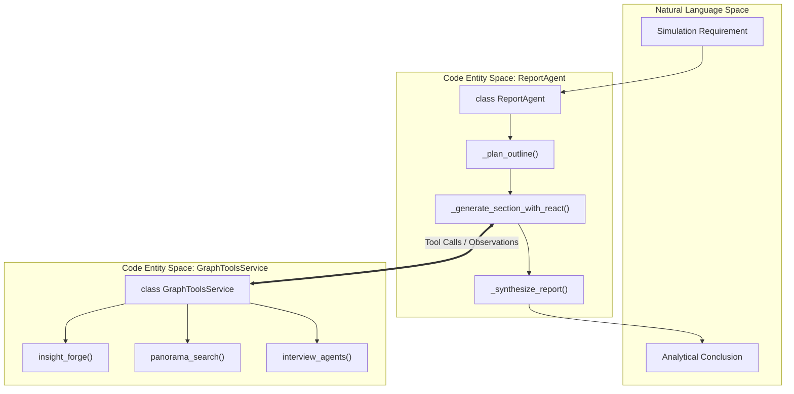
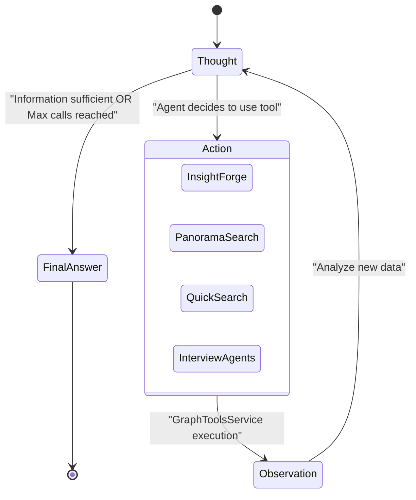

<!-- source: DeepWiki mcp.deepwiki.com · repo aaronjmars/MiroShark · page 5.1 ReportAgent: ReACT Loop & Report Lifecycle · fetched 2026-10-26 -->

# ReportAgent: ReACT Loop & Report Lifecycle

Relevant source files

The following files were used as context for generating this wiki page:

- [backend/app/services/graph_tools.py](backend/app/services/graph_tools.py)
- [backend/app/services/report_agent.py](backend/app/services/report_agent.py)

The `ReportAgent` is the final stage of the MiroShark pipeline, responsible for synthesizing simulation data, graph knowledge, and market results into a structured analytical report. It employs a **ReACT (Reasoning and Acting)** framework to autonomously explore the knowledge graph and simulation logs before drafting content.

## Report Lifecycle Overview

The report generation process is managed by the `ReportAgent` class [backend/app/services/report_agent.py:234-236](). It follows a strictly defined lifecycle to ensure that the final output is grounded in evidence retrieved from the simulation environment.

### 1. Planning Phase
The agent first generates a `ReportOutline` [backend/app/services/report_agent.py:221-228](). It uses the `PLAN_SYSTEM_PROMPT` to analyze the `simulation_requirement` and simulation metadata, producing a table of contents typically containing 3-5 sections [backend/app/services/report_agent.py:465-485]().

### 2. Iterative Section Generation (ReACT Loop)
For each section in the outline, the agent enters a ReACT loop. This loop consists of:
*   **Thought**: The LLM determines what information is missing to fulfill the section requirements.
*   **Action**: The agent selects a tool from the `GraphToolsService` (e.g., `InsightForge`, `PanoramaSearch`).
*   **Observation**: The tool returns raw data (facts, node attributes, or simulation logs).
*   **Loop Constraint**: The agent must perform a minimum of 2 and a maximum of 6 tool calls per section to ensure sufficient depth without infinite recursion [backend/app/services/report_agent.py:560-565]().

### 3. Synthesis & Post-Processing
After all sections are drafted, the agent performs a cross-section synthesis pass to ensure narrative consistency [backend/app/services/report_agent.py:645-650](). Finally, it applies heading normalization and cleans up markdown artifacts.

### 4. Artifact Persistence
The `ReportManager` [backend/app/services/report_agent.py:1264-1268]() saves the results into a dedicated report directory:
*   `section_XX.md`: Individual drafts for each section.
*   `full_report.md`: The concatenated and polished final report.
*   `agent_log.jsonl`: A detailed execution trace for debugging the ReACT steps.
*   `console_log.txt`: Standard output and error logs.

**Sources:** [backend/app/services/report_agent.py:234-236](), [backend/app/services/report_agent.py:465-485](), [backend/app/services/report_agent.py:560-565](), [backend/app/services/report_agent.py:1264-1268]()

---

## Technical Architecture: Code-to-Entity Mapping

The following diagram bridges the natural language concepts of the reporting process with the specific Python classes and functions implemented in the backend.

### Report Generation Flow

**Sources:** [backend/app/services/report_agent.py:234-245](), [backend/app/services/report_agent.py:448-455](), [backend/app/services/graph_tools.py:230-245]()

---

## The ReACT Implementation

The core of the generation logic resides in `_generate_section_with_react`. The agent is prompted to use a specific syntax: `Thought: ...`, `Action: tool_name(args)`, and `Observation: ...`.

### Tool Call Constraints
The system enforces strict limits on the agent's autonomy to manage token costs and execution time:
| Constraint | Value | Purpose |
| :--- | :--- | :--- |
| **Min Tool Calls** | 2 | Ensures the agent doesn't hallucinate without checking the graph [backend/app/services/report_agent.py:560](). |
| **Max Tool Calls** | 6 | Prevents "infinite loops" where the agent keeps searching for perfection [backend/app/services/report_agent.py:562](). |
| **Max Iterations** | 10 | Total rounds of Thought/Action/Observation allowed per section [backend/app/services/report_agent.py:564](). |

### ReACT Loop State Machine

**Sources:** [backend/app/services/report_agent.py:560-575](), [backend/app/services/report_agent.py:600-615]()

---

## Data Management & Logging

The `ReportLogger` class [backend/app/services/report_agent.py:35-41]() provides observability into the agent's "internal monologue." This is critical for auditing how the agent arrived at specific conclusions.

### Report Artifacts Structure
When a report is generated, the `ReportManager` creates a structured directory in `Config.UPLOAD_FOLDER/reports/{report_id}/` [backend/app/services/report_agent.py:51-53]().

| File | Content Type | Usage |
| :--- | :--- | :--- |
| `agent_log.jsonl` | JSON Lines | Contains every `react_thought`, `tool_call`, and `tool_result` [backend/app/services/report_agent.py:84-93](). |
| `full_report.md` | Markdown | The final concatenated report served to the UI [backend/app/services/report_agent.py:1330](). |
| `section_XX.md` | Markdown | Intermediate drafts used for granular polling in the frontend [backend/app/services/report_agent.py:1325](). |
| `console_log.txt` | Plain Text | Captures standard output from the `ReportAgent` process. |

### Logging Flow
1.  **log_start**: Records simulation and graph IDs [backend/app/services/report_agent.py:99-102]().
2.  **log_react_thought**: Captures the LLM's reasoning before a tool call [backend/app/services/report_agent.py:152-155]().
3.  **log_tool_call**: Records the exact parameters sent to `GraphToolsService` [backend/app/services/report_agent.py:166-172]().
4.  **log_section_complete**: Records the final markdown for that section [backend/app/services/report_agent.py:221-225]().

**Sources:** [backend/app/services/report_agent.py:35-53](), [backend/app/services/report_agent.py:84-102](), [backend/app/services/report_agent.py:152-172]()

---

