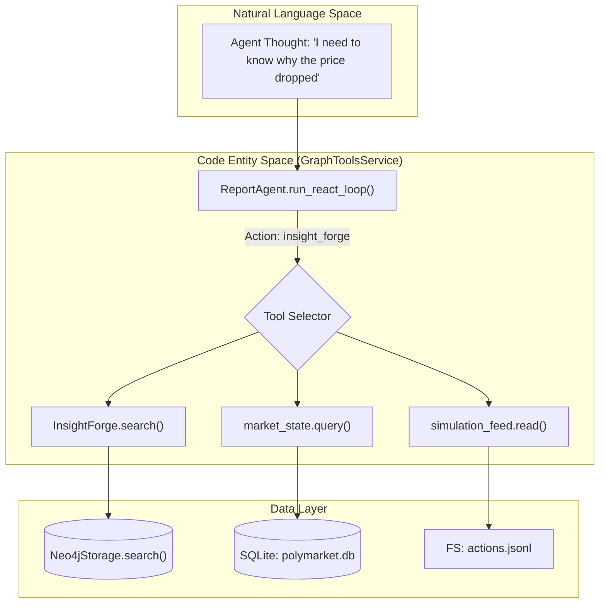
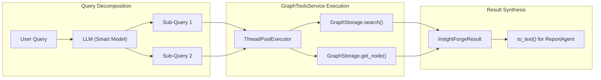

<!-- source: DeepWiki mcp.deepwiki.com · repo aaronjmars/MiroShark · page 5.2 GraphToolsService: Data Retrieval Tools · fetched 2026-10-26 -->

# GraphToolsService: Data Retrieval Tools

Relevant source files

The following files were used as context for generating this wiki page:

- [backend/app/services/graph_builder.py](backend/app/services/graph_builder.py)
- [backend/app/services/graph_tools.py](backend/app/services/graph_tools.py)
- [backend/app/services/report_agent.py](backend/app/services/report_agent.py)

The `GraphToolsService` is the data retrieval backbone for the `ReportAgent`. It provides a suite of specialized tools that allow the agent to bridge the gap between high-level natural language queries and the structured/unstructured data stored in Neo4j, SQLite, and the simulation filesystem. These tools are designed to support the ReACT (Reasoning and Acting) loop by providing granular, multi-dimensional observations.

### Architectural Role

The service encapsulates complex graph traversals, hybrid searches (Vector + BM25), and cross-platform data aggregation into a simplified interface used by the `ReportAgent` during its generation and interaction phases [backend/app/services/graph_tools.py:1-11]().

## 1. Core Retrieval Tools

The primary tools for knowledge graph interaction are categorized by the depth and breadth of the required search.

### InsightForge (Deep Insight Retrieval)
`InsightForge` is the most sophisticated tool. It uses a multi-stage process to decompose a complex query into sub-questions, performs multi-dimensional retrieval, and synthesizes the results.

*   **Implementation**: It utilizes a "Smart LLM" to generate sub-queries based on the `simulation_requirement` [backend/app/services/graph_tools.py:328-345]().
*   **Execution**: It executes these sub-queries in parallel using a `ThreadPoolExecutor` to fetch semantic facts, entity insights, and relationship chains [backend/app/services/graph_tools.py:365-385]().
*   **Data Flow**: 
    1.  **Decomposition**: LLM breaks "Will the market crash?" into "What are the debt levels?", "Who are the major sellers?", etc.
    2.  **Retrieval**: Each sub-query hits `GraphStorage.search` [backend/app/storage/neo4j_storage.py:480-510]().
    3.  **Synthesis**: Results are aggregated into an `InsightForgeResult` object [backend/app/services/graph_tools.py:138-170]().

### PanoramaSearch & QuickSearch
*   **PanoramaSearch**: Designed for breadth. It retrieves a comprehensive view of the graph, including "expired" or historical facts that might be filtered out by default search parameters [backend/app/services/graph_tools.py:284-300]().
*   **QuickSearch**: A low-latency tool for simple fact retrieval. It maps directly to a single hybrid search call in `GraphStorage` with a smaller limit [backend/app/services/graph_tools.py:255-275]().

### Tool Data Structures
| Class | Purpose | Key Attributes |
| :--- | :--- | :--- |
| `SearchResult` | Standardized search output | `facts`, `edges`, `nodes`, `total_count` |
| `NodeInfo` | Detailed entity data | `name`, `labels`, `summary`, `attributes` |
| `EdgeInfo` | Relationship context | `fact`, `source_node_uuid`, `target_node_uuid`, `valid_at` |

**Sources:** [backend/app/services/graph_tools.py:26-136](), [backend/app/services/graph_tools.py:138-210]().

## 2. Simulation & Market Analysis Tools

Beyond the static knowledge graph, the `ReportAgent` must analyze the dynamic outputs of the `Wonderwall` engine.

### simulation_feed
This tool reads the `actions.jsonl` file directly from the simulation's output directory. It allows the agent to see the raw chronological stream of social media interactions (posts, replies, likes) [backend/app/services/graph_tools.py:650-680]().

### market_state
Interrogates the `polymarket.db` SQLite database. It executes queries to retrieve the current P&L of traders, market prices, and order book depth. This is critical for reports focusing on economic impact or "skin in the game" analysis [backend/app/services/graph_tools.py:720-750]().

### analyze_trajectory
Accesses `trajectory.json` to observe opinion convergence or polarization. It provides metrics on how agent belief states (stance, confidence) evolved over the simulation rounds [backend/app/services/graph_tools.py:780-810]().

**Sources:** [backend/app/services/graph_tools.py:640-820]().

## 3. Agent Interaction Tools

### interview_agents
This tool allows the `ReportAgent` to "speak" to the simulated personas after the simulation has concluded.

*   **IPC Mechanism**: If the simulation environment is still active, it uses the `SimulationIPC` protocol to send an `INTERVIEW` command to the running subprocess [backend/app/services/graph_tools.py:560-580]().
*   **Fallback**: If the environment is closed, it initializes a `ThreadPoolExecutor` to spin up temporary `SocialAgent` instances, loading their saved `BeliefState` and `RoundMemory` to answer the query [backend/app/services/graph_tools.py:590-620]().

**Sources:** [backend/app/services/graph_tools.py:540-630](), [backend/app/services/report_agent.py:1130-1160]().

## 4. Entity Mapping: Natural Language to Code

The following diagrams illustrate how natural language requests from the `ReportAgent` are transformed into specific code executions within the `GraphToolsService`.

### Diagram: Tool Dispatch Logic
This diagram shows how the `ReportAgent` selects a tool and how `GraphToolsService` routes it to the underlying storage or simulation logic.

**Sources:** [backend/app/services/report_agent.py:465-510](), [backend/app/services/graph_tools.py:24-30]().

### Diagram: InsightForge Decomposition Flow
This diagram details the internal logic of the `InsightForge` tool, mapping LLM-generated sub-queries to `GraphStorage` methods.

**Sources:** [backend/app/services/graph_tools.py:328-420](), [backend/app/storage/neo4j_storage.py:480-500]().

## 5. Tool Summary Table

| Tool Name | Class/Method | Data Source | Typical Use Case |
| :--- | :--- | :--- | :--- |
| `insight_forge` | `GraphToolsService.insight_forge` | Neo4j (Hybrid) | Deep causal analysis of simulation events. |
| `panorama_search` | `GraphToolsService.panorama_search` | Neo4j (Full) | Identifying forgotten or historical context. |
| `quick_search` | `GraphToolsService.quick_search` | Neo4j (Vector) | Finding specific entity definitions or facts. |
| `simulation_feed` | `GraphToolsService.get_actions` | `actions.jsonl` | Quoting specific agent posts in the report. |
| `market_state` | `GraphToolsService.get_market_data` | `polymarket.db` | Reporting on price movements and trader P&L. |
| `interview_agents`| `GraphToolsService.interview` | IPC / Agents | Getting direct quotes or clarifications from personas. |

**Sources:** [backend/app/services/graph_tools.py:24-50](), [backend/app/services/report_agent.py:166-210]().

---

