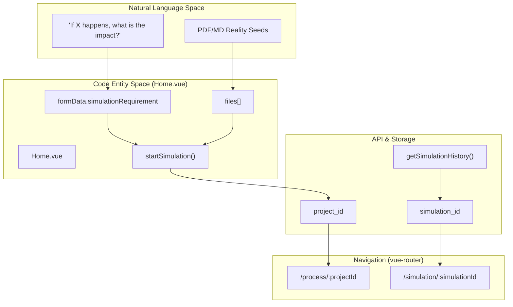
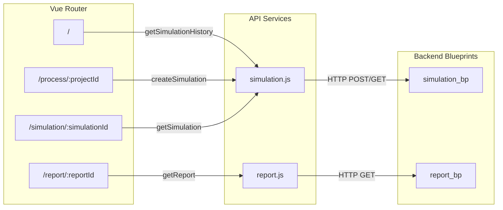

<!-- source: DeepWiki mcp.deepwiki.com · repo aaronjmars/MiroShark · page 6.1 Home, Routing & Design System · fetched 2026-10-26 -->

# Home, Routing & Design System

Relevant source files

The following files were used as context for generating this wiki page:

- [frontend/index.html](frontend/index.html)
- [frontend/src/App.vue](frontend/src/App.vue)
- [frontend/src/api/report.js](frontend/src/api/report.js)
- [frontend/src/api/simulation.js](frontend/src/api/simulation.js)
- [frontend/src/components/HistoryDatabase.vue](frontend/src/components/HistoryDatabase.vue)
- [frontend/src/router/index.js](frontend/src/router/index.js)
- [frontend/src/views/Home.vue](frontend/src/views/Home.vue)

This page details the entry point of the MiroShark frontend, including the landing page logic, the global design system, and the routing configuration that manages the 5-step simulation workflow.

## Design System: Hyperstitions v2.0

MiroShark utilizes a custom design system titled **Hyperstitions v2.0**, defined in the root `App.vue` component. The system is inspired by industrial and "Evangelion" aesthetics, characterized by a high-contrast bicolor palette and modular scaling.

### Core Visual Language
*   **Palette**: A primary bicolor scheme of Orange (`#FF6B1A`) and Green (`#43C165`) against a stark background of White (`#FAFAFA`) and Black (`#0A0A0A`) [[frontend/src/App.vue:15-23]]().
*   **Typography**: Uses `Young Serif` for display/headings and `Space Mono` for technical data and interactive console elements [[frontend/src/App.vue:47-50]]().
*   **Modular Scale**: Spacing and sizing follow a 1.4x scale (e.g., `6px`, `11px`, `22px`, `34px`, `56px`, `84px`) to maintain consistent proportions [[frontend/src/App.vue:29-35]]().
*   **Industrial Motifs**: Includes "Warning Stripes" dividers created via repeating linear gradients [[frontend/src/App.vue:110-119]]() and background grid patterns [[frontend/src/App.vue:122-127]]().

**Sources:** [frontend/src/App.vue:10-155](), [frontend/index.html:4-6]()

---

## Routing Configuration

The application uses `vue-router` to manage the transition between the simulation stages. Each route maps a specific URL pattern to a high-level view component, often passing IDs (Project, Simulation, or Report) as props.

### Route Mapping Table

| Path | Name | Component | Purpose |
| :--- | :--- | :--- | :--- |
| `/` | `Home` | `Home.vue` | Entry point, file upload, and history database. |
| `/process/:projectId` | `Process` | `MainView.vue` | Step 1 (Graph Build) & Step 2 (Env Setup). |
| `/simulation/:simulationId` | `Simulation` | `SimulationView.vue` | Detailed configuration and pre-run summary. |
| `/simulation/:simulationId/start` | `SimulationRun` | `SimulationRunView.vue` | Step 3: Real-time execution monitoring. |
| `/report/:reportId` | `Report` | `ReportView.vue` | Step 4: Analysis report generation and viewing. |
| `/interaction/:reportId` | `Interaction` | `InteractionView.vue` | Step 5: Post-sim agent chat and report interaction. |

**Sources:** [frontend/src/router/index.js:9-50]()

---

## Home View: Entry & Upload

The `Home.vue` component serves as the "Command Center." It handles the ingestion of "Reality Seeds" (documents) and the initialization of the simulation sequence.

### Implementation Details
*   **File Upload Zone**: A drag-and-drop area that filters for `.pdf`, `.md`, and `.txt` files [[frontend/src/views/Home.vue:109-141]](). It manages local state via a `files` array.
*   **Simulation Requirement**: A `textarea` where users input natural language prompts (e.g., "What happens if X occurs?") [[frontend/src/views/Home.vue:154-160]]().
*   **Validation**: The `canSubmit` computed property ensures that at least one file is uploaded and a simulation requirement is provided before the "Start Engine" button is enabled [[frontend/src/views/Home.vue:170-170]]().
*   **State Persistence**: When a simulation starts, the `setPendingUpload` method (likely in a store or parent) persists the selected files and requirements to ensure data isn't lost during the transition to the API-driven `Process` view.

### Data Flow: Initialization
1.  User uploads files and enters a prompt.
2.  `startSimulation()` is triggered [[frontend/src/views/Home.vue:169-169]]().
3.  The component interacts with the backend (via `graph_bp` or `simulation_bp`) to create a new project.
4.  Upon success, the router navigates to `/process/:projectId`.

**Sources:** [frontend/src/views/Home.vue:1-175](), [frontend/src/router/index.js:16-20]()

---

## History Database

The `HistoryDatabase.vue` component provides a visual archive of previous simulations, utilizing an IntersectionObserver for performance and a "fan-stack" layout for aesthetic density.

### Key Components
*   **Fan-Stack/Grid Layout**: Simulation records are displayed as `project-card` elements [[frontend/src/components/HistoryDatabase.vue:25-31]](). The layout can toggle between a collapsed "stack" and an expanded grid.
*   **Status Indicators**: Each card displays the availability of specific artifacts (Graph Build `◇`, Agent Setup `◈`, Analysis Report `◆`) based on the presence of `project_id` and `report_id` [[frontend/src/components/HistoryDatabase.vue:35-50]]().
*   **Simulation Replay Modal**: Clicking a card opens a `Teleport`-ed modal [[frontend/src/components/HistoryDatabase.vue:109-112]](). This modal allows users to "jump" back into any of the 5 steps of a previous simulation (e.g., `goToProject`, `goToSimulation`) [[frontend/src/components/HistoryDatabase.vue:154-180]]().

### Data Fetching
The component calls `getSimulationHistory(limit)` from the simulation API to populate the list [[frontend/src/api/simulation.js:204-206]]().

### Natural Language to Code Entity Space: Home & History
This diagram illustrates how user inputs and historical records map to backend entities and frontend routes.

**Sources:** [frontend/src/views/Home.vue:155-169](), [frontend/src/components/HistoryDatabase.vue:24-34](), [frontend/src/api/simulation.js:204-206](), [frontend/src/router/index.js:9-45]()

---

## API Layer Integration

The views described above communicate with the backend through modularized API services.

### Simulation Service (`simulation.js`)
*   `listSimulations(projectId)`: Filters simulations by project [[frontend/src/api/simulation.js:74-77]]().
*   `getSimulationHistory(limit)`: Retrieves recent simulations for the `HistoryDatabase` [[frontend/src/api/simulation.js:204-206]]().
*   `createSimulation(data)`: Initial POST to `/api/simulation/create` [[frontend/src/api/simulation.js:7-9]]().

### Report Service (`report.js`)
*   `getReport(reportId)`: Fetches the finalized Markdown report and metadata [[frontend/src/api/report.js:41-43]]().

### System Architecture: Routing & API Flow
This diagram shows the relationship between the URL routes and the API services they consume.

**Sources:** [frontend/src/router/index.js:9-45](), [frontend/src/api/simulation.js:7-206](), [frontend/src/api/report.js:7-51]()

---

