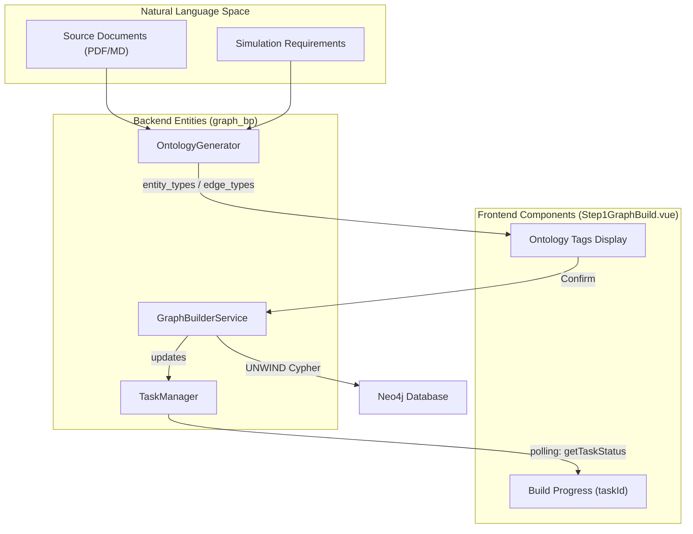
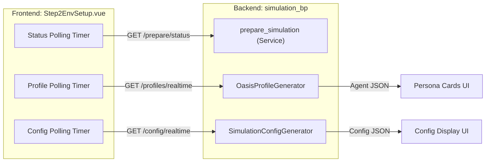

<!-- source: DeepWiki mcp.deepwiki.com · repo aaronjmars/MiroShark · page 6.2 Graph Build & Environment Setup Steps (Steps 1–2) · fetched 2026-10-26 -->

# Graph Build & Environment Setup Steps (Steps 1–2)

Relevant source files

The following files were used as context for generating this wiki page:

- [frontend/src/components/GraphPanel.vue](frontend/src/components/GraphPanel.vue)
- [frontend/src/components/Step1GraphBuild.vue](frontend/src/components/Step1GraphBuild.vue)
- [frontend/src/components/Step2EnvSetup.vue](frontend/src/components/Step2EnvSetup.vue)
- [frontend/src/views/InteractionView.vue](frontend/src/views/InteractionView.vue)
- [frontend/src/views/MainView.vue](frontend/src/views/MainView.vue)

This page details the implementation of the initial workflow stages in the MiroShark frontend, specifically focusing on the transition from raw document ingestion to a structured Knowledge Graph and the subsequent preparation of the simulation environment. These stages are managed by `Step1GraphBuild.vue` and `Step2EnvSetup.vue`, orchestrated within the `MainView.vue` layout.

## 1. MainView Layout & Orchestration

`MainView.vue` serves as the primary container for the multi-step simulation pipeline. It implements a split-panel architecture that balances data visualization (Knowledge Graph) with procedural workflow (Workbench).

### 1.1 Split-Panel Layout
The layout uses a flexible `viewMode` state (`graph`, `split`, or `workbench`) to control the visibility and width of the two main panels [frontend/src/views/MainView.vue:89-90]().
*   **Left Panel:** Houses the `GraphPanel.vue`, providing a D3-based visualization of the Neo4j graph [frontend/src/views/MainView.vue:38-47]().
*   **Right Panel:** Dynamically switches between step components (`Step1GraphBuild`, `Step2EnvSetup`, etc.) based on the `currentStep` [frontend/src/views/MainView.vue:49-72]().

### 1.2 Step Navigation and Logging
The view manages a centralized `systemLogs` array, which captures timestamped events from all child components to provide a "console-like" experience for the user [frontend/src/views/MainView.vue:141-148]().

| Feature | Code Entity | Description |
|:---|:---|:---|
| Step Tracking | `currentStep` | Integer (1-5) tracking the pipeline progress [frontend/src/views/MainView.vue:93](). |
| Phase Management | `currentPhase` | Internal state for sub-steps (e.g., Ontology vs. Build) [frontend/src/views/MainView.vue:103](). |
| Transition Logic | `handleNextStep` | Increments step and logs transitions [frontend/src/views/MainView.vue:159-169](). |

**Sources:** [frontend/src/views/MainView.vue:1-169]()

---

## 2. Step 1: Graph Construction (`Step1GraphBuild.vue`)

This step covers the transformation of uploaded documents into a queryable Neo4j graph via two sub-phases: Ontology Generation and GraphRAG Build.

### 2.1 Ontology Generation Polling
Upon project initialization, the system calls `POST /api/graph/ontology/generate` [frontend/src/views/MainView.vue:207](). While `currentPhase` is `0`, the UI displays the generated entity and edge types. Users can click these tags to view detailed attributes and descriptions in an overlay [frontend/src/components/Step1GraphBuild.vue:31-74]().

### 2.2 Graph Build Progress
Once the ontology is accepted, the system triggers the graph build. The frontend polls `getTaskStatus` to update the `buildProgress` percentage [frontend/src/views/MainView.vue:261-275]().
*   **Stats Display:** Shows real-time counts for Entity Nodes, Relation Edges, and Schema Types [frontend/src/components/Step1GraphBuild.vue:128-143]().
*   **Visualization:** The `GraphPanel` component listens for `currentPhase === 1` to show a "Updating in real time..." hint while the Neo4j database is being populated [frontend/src/components/GraphPanel.vue:22-32]().

### Data Flow: Document to Graph

**Sources:** [frontend/src/components/Step1GraphBuild.vue:1-143](), [frontend/src/views/MainView.vue:199-275](), [frontend/src/components/GraphPanel.vue:22-32]()

---

## 3. Step 2: Environment Setup (`Step2EnvSetup.vue`)

Step 2 prepares the simulation world. It orchestrates three distinct asynchronous processes: Instance Initialization, Agent Profile Generation, and Simulation Configuration.

### 3.1 Three-Stage Preparation
The component uses a `phase` variable (0, 1, or 2) to manage the sequence of initialization [frontend/src/components/Step2EnvSetup.vue:5-130]().

1.  **Simulation Initialization (Phase 0):** Calls `POST /api/simulation/create` to generate a unique `simulationId` [frontend/src/components/Step2EnvSetup.vue:18-35]().
2.  **Agent Profile Generation (Phase 1):** Polls `/api/simulation/prepare` and `/api/simulation/profiles/realtime`. This stage displays "Reality Seeds" and generates persona cards for each agent [frontend/src/components/Step2EnvSetup.vue:44-114]().
3.  **Simulation Config Synthesis (Phase 2):** Fetches the final `simulation_config.json` via `/api/simulation/config/realtime` [frontend/src/components/Step2EnvSetup.vue:116-137]().

### 3.2 Agent Persona Cards
As profiles are streamed from the backend, they are rendered as interactive cards.
*   **Data Points:** Displays `username`, `profession`, `bio`, and `interested_topics` [frontend/src/components/Step2EnvSetup.vue:85-111]().
*   **Interaction:** Clicking a profile card opens a detail view (handled via `selectProfile`) [frontend/src/components/Step2EnvSetup.vue:90]().

### 3.3 Simulation Config & Round Calculation
The UI displays the synthesized world parameters, including:
*   **Time Config:** Total simulation hours and minutes per round [frontend/src/components/Step2EnvSetup.vue:141-148]().
*   **Round Calculation:** Automatically calculates `Total Rounds` using the formula: `(hours * 60) / minutes_per_round` [frontend/src/components/Step2EnvSetup.vue:149-152]().
*   **Platform Weights:** Displays algorithm weights for platforms like Twitter and Reddit [frontend/src/components/Step2EnvSetup.vue:163-180]().

### Environment Orchestration Flow

**Sources:** [frontend/src/components/Step2EnvSetup.vue:1-180](), [frontend/src/views/MainView.vue:63-71]()

---

## 4. Graph Visualization (`GraphPanel.vue`)

The `GraphPanel` is persistent across steps 1 and 2, providing visual feedback on the data structure being built and prepared.

### 4.1 Node & Edge Details
When a node (Agent/Entity) or edge (Relationship) is selected in the D3 view, a detail panel opens [frontend/src/components/GraphPanel.vue:36-43]().
*   **Properties:** Displays raw attributes stored in Neo4j [frontend/src/components/GraphPanel.vue:61-69]().
*   **Agent Actions:** If a `simulationId` is present, the panel can fetch and display historical actions for that specific agent node [frontend/src/components/GraphPanel.vue:88-111]().

### 4.2 Real-time Updates
The component includes a `refresh` emitter and a `loading` state to handle manual and automated graph data reloads during the build and simulation phases [frontend/src/components/GraphPanel.vue:7-10]().

**Sources:** [frontend/src/components/GraphPanel.vue:1-111]()

---

