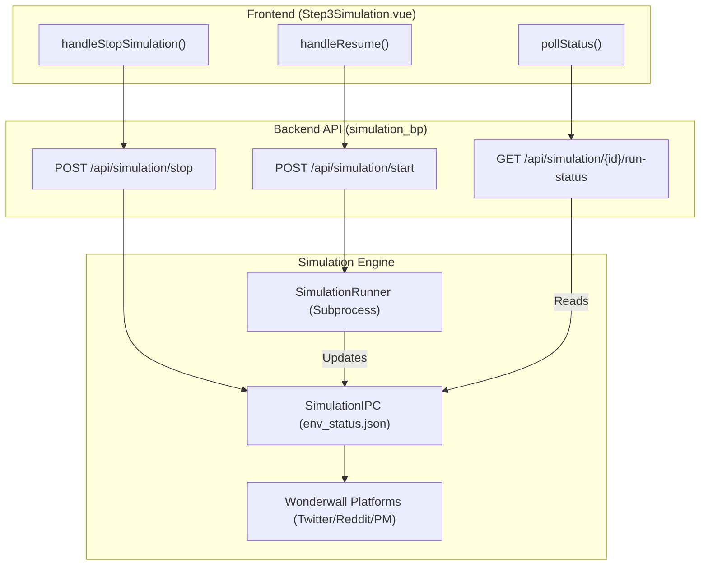
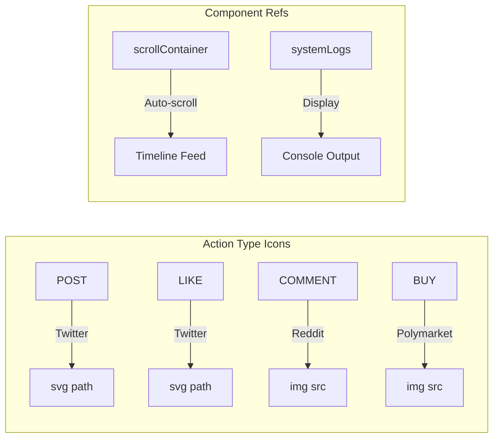

<!-- source: DeepWiki mcp.deepwiki.com · repo aaronjmars/MiroShark · page 6.3 Simulation Execution UI (Step 3) · fetched 2026-10-26 -->

# Simulation Execution UI (Step 3)

Relevant source files

The following files were used as context for generating this wiki page:

- [frontend/src/components/Step3Simulation.vue](frontend/src/components/Step3Simulation.vue)
- [frontend/src/views/SimulationRunView.vue](frontend/src/views/SimulationRunView.vue)
- [frontend/src/views/SimulationView.vue](frontend/src/views/SimulationView.vue)

The Simulation Execution UI is the primary interface for controlling and monitoring the Wonderwall simulation engine. It provides real-time visibility into agent actions across multiple platforms (Twitter, Reddit, Polymarket), manages the simulation lifecycle (start, pause, resume), and visualizes the evolving knowledge graph.

## SimulationRunView Layout

`SimulationRunView.vue` serves as the top-level container for Step 3. It manages the layout modes, data synchronization, and graceful lifecycle transitions when navigating between steps.

### View Modes and Layout
The view supports three layout configurations managed by the `viewMode` ref:
*   **Graph**: Maximizes the `GraphPanel` to 100% width [frontend/src/views/SimulationRunView.vue:101-103]().
*   **Workbench**: Maximizes the `Step3Simulation` control panel to 100% width [frontend/src/views/SimulationRunView.vue:107-109]().
*   **Split View**: Default mode providing a 50/50 split between the graph and the simulation controls [frontend/src/views/SimulationRunView.vue:104-111]().

### Lifecycle and Reconnection
The view handles reconnection and state persistence by loading existing simulation data on mount [frontend/src/views/SimulationRunView.vue:203-228](). It also implements a 30-second polling interval to refresh the `graphData` from the backend, ensuring the visualization reflects updates made by the simulation engine [frontend/src/views/SimulationRunView.vue:274-282]().

### Graceful Shutdown
When a user navigates back to Step 2 via `handleGoBack`, the view attempts a multi-stage shutdown of the simulation environment:
1.  **Stop Polling**: Ceases graph and status refreshes [frontend/src/views/SimulationRunView.vue:153]().
2.  **Graceful Close**: Calls `closeSimulationEnv` with a 10-second timeout to allow the `SimulationIPC` to signal agents to finish current tasks [frontend/src/views/SimulationRunView.vue:162-166]().
3.  **Force Stop**: If graceful closure fails, it invokes `stopSimulation` to terminate the subprocess group [frontend/src/views/SimulationRunView.vue:170-175]().

**Sources:**
*   [frontend/src/views/SimulationRunView.vue:100-111]() (Layout Styles)
*   [frontend/src/views/SimulationRunView.vue:148-194]() (handleGoBack logic)
*   [frontend/src/views/SimulationRunView.vue:274-282]() (Graph Refresh Timer)

---

## Step3Simulation Controls

`Step3Simulation.vue` provides the granular controls for the simulation execution and the "Dual Timeline" for event monitoring.

### Execution Lifecycle Management
The UI transitions through different phases based on the `runStatus.runner_status`:
*   **Start/Resume**: `handleResume` triggers the backend `/api/simulation/start` endpoint. If `hasPartialData` is true, it resumes from the last recorded round [frontend/src/components/Step3Simulation.vue:35-42]().
*   **Pause**: `handleStopSimulation` sends a stop signal to the backend. The UI enters a "Pausing..." state while waiting for the subprocesses to synchronize and halt [frontend/src/components/Step3Simulation.vue:13-21]().
*   **Restart**: Available if a simulation fails or completes, allowing a fresh run with the same configuration [frontend/src/components/Step3Simulation.vue:23-31]().

### Dual Timeline and Deduplication
The "Dual Timeline" displays simulation events as they occur. It implements a deduplication logic to prevent UI jitter during rapid polling:
*   **Deduplication**: The `mergedActions` computed property filters incoming actions by `id` to ensure unique entries [frontend/src/components/Step3Simulation.vue:262-265]().
*   **Cross-Platform Toggle**: Users can toggle `showCrossPlatformOnly` to filter the feed to events that involve multi-platform interactions [frontend/src/components/Step3Simulation.vue:267-270]().
*   **Platform Filtering**: Clicking a platform status card (Twitter, Reddit, or Polymarket) sets `filteredPlatform`, isolating the timeline to that specific source [frontend/src/components/Step3Simulation.vue:73-115]().

### Platform Counters and Action Icons
The `events-summary` bar provides a real-time tally of total events across all platforms [frontend/src/components/Step3Simulation.vue:58-67](). Each platform card displays:
*   **RND**: Current round vs. total configured rounds [frontend/src/components/Step3Simulation.vue:80]().
*   **TIME**: Elapsed time since the platform started the current run [frontend/src/components/Step3Simulation.vue:81]().
*   **ACTS**: Total action count for that platform [frontend/src/components/Step3Simulation.vue:82]().

**Sources:**
*   [frontend/src/components/Step3Simulation.vue:13-55]() (Action Buttons)
*   [frontend/src/components/Step3Simulation.vue:70-117]() (Platform Status Rows)
*   [frontend/src/components/Step3Simulation.vue:260-275]() (Timeline Deduplication Logic)

---

## Data Flow: UI to Backend IPC

The following diagram illustrates how UI interactions in `Step3Simulation.vue` translate into system commands that manage the `SimulationRunner`.

### Simulation Control Flow

**Sources:**
*   [frontend/src/components/Step3Simulation.vue:448-468]() (handleResume implementation)
*   [frontend/src/components/Step3Simulation.vue:470-490]() (handleStopSimulation implementation)
*   [frontend/src/components/Step3Simulation.vue:350-380]() (pollStatus implementation)

---

## Component Communication and State

`Step3Simulation.vue` manages a complex internal state to track simulation progress and UI synchronization.

### Key State Properties
| Property | Type | Description |
| :--- | :--- | :--- |
| `runStatus` | Object | The primary status object returned from `/run-status`, containing platform rounds, action counts, and runner state [frontend/src/components/Step3Simulation.vue:173-195](). |
| `actions` | Array | Local buffer of simulation events retrieved via polling [frontend/src/components/Step3Simulation.vue:205](). |
| `phase` | Number | 0: Ready, 1: Running, 2: Paused/Stopped [frontend/src/components/Step3Simulation.vue:211](). |
| `autoUpdateGraph` | Boolean | Toggle for whether the graph should automatically refresh its memory state during the run [frontend/src/components/Step3Simulation.vue:216](). |

### Timeline Deduplication and Sorting
To maintain a coherent chronological view, the `mergedActions` computed property performs the following:
1.  **Merging**: Combines `twitter_actions`, `reddit_actions`, and `polymarket_actions` from the `runStatus` [frontend/src/components/Step3Simulation.vue:261]().
2.  **ID Deduplication**: Uses a `Set` of IDs to ensure no duplicate actions are rendered [frontend/src/components/Step3Simulation.vue:262-265]().
3.  **Temporal Sorting**: Sorts all events by their `timestamp` in descending order [frontend/src/components/Step3Simulation.vue:272]().

### UI Action Mappings

**Sources:**
*   [frontend/src/components/Step3Simulation.vue:260-275]() (mergedActions logic)
*   [frontend/src/components/Step3Simulation.vue:75-114]() (Platform Icon definitions)
*   [frontend/src/components/Step3Simulation.vue:120-125]() (Scroll Container ref)

---

