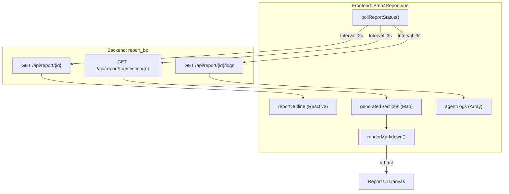
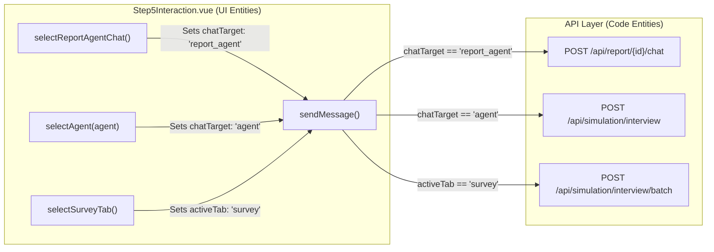

<!-- source: DeepWiki mcp.deepwiki.com · repo aaronjmars/MiroShark · page 6.4 Report & Interaction UI (Steps 4–5) · fetched 2026-10-26 -->

# Report & Interaction UI (Steps 4–5)

Relevant source files

The following files were used as context for generating this wiki page:

- [frontend/src/components/GraphPanel.vue](frontend/src/components/GraphPanel.vue)
- [frontend/src/components/Step4Report.vue](frontend/src/components/Step4Report.vue)
- [frontend/src/components/Step5Interaction.vue](frontend/src/components/Step5Interaction.vue)
- [frontend/src/views/InteractionView.vue](frontend/src/views/InteractionView.vue)
- [frontend/src/views/ReportView.vue](frontend/src/views/ReportView.vue)

The final stages of the MiroShark pipeline focus on synthesizing simulation data into a structured intelligence report (Step 4) and enabling direct interrogation of the results via the Report Agent and individual personas (Step 5). These steps utilize a split-panel architecture that balances high-level document rendering with low-level agent activity logs and interactive chat interfaces.

## Step 4: Report Generation

`Step4Report.vue` manages the lifecycle of report assembly. It operates primarily through a polling mechanism that tracks the progress of the backend `ReportAgent` as it executes its ReACT-based analysis loop.

### Report Assembly & Polling
The component initiates polling via `pollReportStatus` [frontend/src/components/Step4Report.vue:354-410](). It concurrently fetches:
1.  **Report Outline**: The skeleton of the report (title, summary, section titles) [frontend/src/components/Step4Report.vue:357-363]().
2.  **Generated Sections**: Individual markdown files for each section as they are completed [frontend/src/components/Step4Report.vue:366-382]().
3.  **Agent Logs**: Real-time ReACT loop logs showing tool usage (e.g., `InsightForge`, `PanoramaSearch`) [frontend/src/components/Step4Report.vue:385-391]().

### Structured Result Parsing
The UI includes a specialized renderer for tool outputs found within the agent logs. The `renderToolOutput` function [frontend/src/components/Step4Report.vue:530-618]() parses JSON-formatted observations from the backend:
*   **InsightForge/QuickSearch**: Renders a list of "Found Facts" with source citations [frontend/src/components/Step4Report.vue:536-554]().
*   **Interview**: Formats agent Q&A as a dialogue block [frontend/src/components/Step4Report.vue:573-587]().
*   **Market State**: Displays prediction market prices and P&L data [frontend/src/components/Step4Report.vue:589-603]().

### Markdown Rendering Engine
To maintain the "Hyperstitions v2.0" aesthetic, the component uses a custom `renderMarkdown` function [frontend/src/components/Step4Report.vue:620-645](). It performs regex-based transformations to convert standard Markdown into styled HTML, handling headers, bold text, lists, and blockquotes while sanitizing the output.

### Report Generation Flow
The following diagram illustrates the data flow between the UI and the backend services during Step 4.

**Diagram: Step 4 Data Orchestration**

Sources: [frontend/src/components/Step4Report.vue:354-410](), [frontend/src/components/Step4Report.vue:620-645](), [frontend/src/views/ReportView.vue:141-178]()

---

## Step 5: Deep Interaction

`Step5Interaction.vue` transitions the user from passive reading to active interrogation. It provides three distinct interaction modes: Report Agent Chat, Persona Chat, and Group Surveys.

### Interaction Modes
1.  **Report Agent Chat**: Uses the `chatWithReport` API [frontend/src/components/Step5Interaction.vue:640-665]() to ask follow-up questions about the synthesized report.
2.  **Persona Chat**: Allows 1-on-1 "interviews" with any agent from the simulation [frontend/src/components/Step5Interaction.vue:667-710](). This uses the `interviewAgent` API, targeting specific `agent_id` values.
3.  **Group Survey**: A broadcast tool that sends a single question to all agents simultaneously [frontend/src/components/Step5Interaction.vue:712-758](). Results are aggregated in the `surveyResults` reactive object.

### Chat State & Cache
To prevent state loss when switching between different agents or the report agent, the component implements a `chatHistoryCache` [frontend/src/components/Step5Interaction.vue:330]().
*   When a user selects a new chat target via `selectAgent` [frontend/src/components/Step5Interaction.vue:435-452](), the current `messages` array is saved to the cache keyed by the agent's ID.
*   The `messages` array is then restored from the cache for the new target.

### World 1/2 Platform Switching
For Persona Chat, the UI provides a "Platform Context" toggle [frontend/src/components/Step5Interaction.vue:178-195](). This allows the user to switch the agent's context between "World 1" (Twitter/X) and "World 2" (Reddit), which affects the agent's perspective and available memory during the interview.

### Interaction Entity Mapping
This diagram bridges the UI interaction components to the underlying backend communication logic.

**Diagram: Interaction UI to API Mapping**

Sources: [frontend/src/components/Step5Interaction.vue:425-460](), [frontend/src/components/Step5Interaction.vue:620-758]()

---

## Shared Layout & View Management

Both Step 4 and Step 5 utilize a specialized view wrapper (`ReportView.vue` and `InteractionView.vue`) that manages the global layout and data loading.

### Split-Panel Architecture
The views implement a `viewMode` toggle (`graph` | `workbench`) [frontend/src/views/ReportView.vue:83]().
*   **Graph Mode**: Expands the `GraphPanel` to 100% width for deep inspection of the final knowledge graph state [frontend/src/views/ReportView.vue:96]().
*   **Workbench Mode**: Focuses 100% on the report or interaction tools [frontend/src/views/ReportView.vue:102]().
*   **Default**: In these steps, the workbench is prioritized, but the graph remains accessible for verifying agent relationships or properties discovered during interaction.

### Profile & Project Loading
Upon mounting, the views execute a recursive data fetch:
1.  `getReport()`: Retrieves the `simulation_id` [frontend/src/views/ReportView.vue:147-150]().
2.  `getSimulation()`: Retrieves the `project_id` [frontend/src/views/ReportView.vue:154-157]().
3.  `getProject()`: Retrieves the `graph_id` [frontend/src/views/ReportView.vue:160-163]().
4.  `getGraphData()`: Populates the `GraphPanel` [frontend/src/views/ReportView.vue:181-195]().

| Feature | Step 4 (Report) | Step 5 (Interaction) |
| :--- | :--- | :--- |
| **Primary Goal** | Monitor ReACT loop and render MD | Interrogate agents and synthesis |
| **Data Source** | `agent_log.jsonl` & `section_XX.md` | `interview` & `chat` endpoints |
| **Key Component** | `Step4Report.vue` | `Step5Interaction.vue` |
| **Navigation** | Sequential section reveal | Tabbed tool switcher |

Sources: [frontend/src/views/ReportView.vue:141-214](), [frontend/src/views/InteractionView.vue:142-214]()

---

