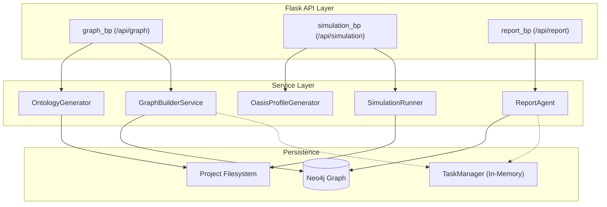
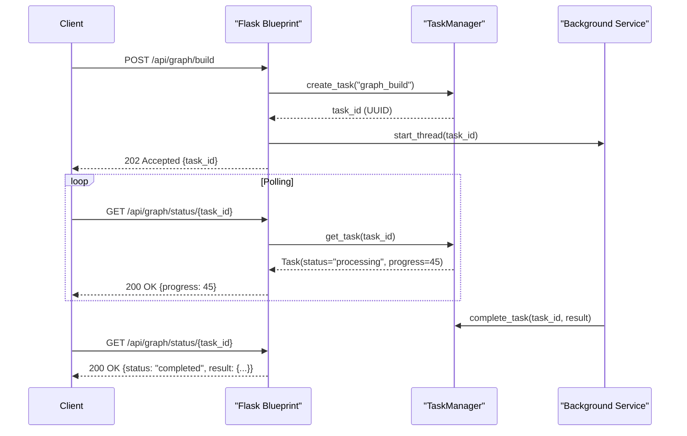

<!-- source: DeepWiki mcp.deepwiki.com · repo aaronjmars/MiroShark · page 7 Backend API Reference · fetched 2026-10-26 -->

# Backend API Reference

Relevant source files

The following files were used as context for generating this wiki page:

- [backend/app/api/__init__.py](backend/app/api/__init__.py)
- [backend/app/api/graph.py](backend/app/api/graph.py)
- [backend/app/api/report.py](backend/app/api/report.py)
- [backend/app/api/simulation.py](backend/app/api/simulation.py)
- [backend/app/models/task.py](backend/app/models/task.py)
- [backend/app/services/simulation_runner.py](backend/app/services/simulation_runner.py)

The MiroShark backend is a Flask-based REST API organized into three primary blueprints: `graph_bp`, `simulation_bp`, and `report_bp` [backend/app/api/__init__.py:7-13](). These APIs manage the end-to-end lifecycle of the system, from document ingestion and Knowledge Graph construction to agent-based social simulation and automated analysis.

### API Architecture Overview

The backend uses a task-based asynchronous pattern for long-running operations. Heavy processes like graph building and report generation return a `task_id` immediately, allowing the frontend to poll for progress via the `TaskManager` [backend/app/models/task.py:54-71]().

#### System Blueprint Map

"Blueprint to Service Mapping"

Sources: [backend/app/api/__init__.py:7-9](), [backend/app/api/graph.py:15-21](), [backend/app/api/simulation.py:12-17](), [backend/app/api/report.py:13-18](), [backend/app/models/task.py:54-71]()

---

### 7.1 Graph API (`graph_bp`)

The Graph API handles the "Knowledge" phase of the pipeline. It is responsible for processing uploaded documents, generating a domain-specific ontology using LLMs, and orchestrating the asynchronous build of the Neo4j Knowledge Graph.

*   **Key Responsibilities**: File validation, text extraction via `FileParser`, LLM-driven ontology generation, and batch-inserting entities/relationships.
*   **Primary Endpoints**:
    *   `POST /ontology/generate`: Accepts multipart form data (PDF/MD/TXT) and produces a schema of `entity_types` and `edge_types` [backend/app/api/graph.py:59-185]().
    *   `POST /build`: Initiates the asynchronous `GraphBuilderService` task [backend/app/api/graph.py:197-266]().
    *   `GET /status/<task_id>`: Returns the current `TaskStatus` and progress percentage [backend/app/api/graph.py:269-289]().

For detailed request/response schemas and project management logic, see [Graph API (graph_bp)](#7.1).

**Sources:** [backend/app/api/graph.py:59-289](), [backend/app/utils/file_parser.py:1-20]()

---

### 7.2 Simulation API (`simulation_bp`)

The Simulation API manages the "Execution" phase. It transforms Knowledge Graph entities into simulation-ready personas and controls the lifecycle of the `Wonderwall` simulation engine.

*   **Key Responsibilities**: Filtering graph entities for agent conversion, generating OASIS profiles, managing simulation state (Start/Stop/Resume), and handling real-time agent "interviews" via IPC.
*   **Primary Endpoints**:
    *   `POST /prepare`: Triggers the `OasisProfileGenerator` to create agent personas and simulation configurations [backend/app/api/simulation.py:276-353]().
    *   `POST /start`: Executes `SimulationRunner.start_simulation` to begin the round-based social media simulation [backend/app/api/simulation.py:465-534]().
    *   `POST /interview`: Allows direct interaction with an agent during or after a simulation by sending a command through the `SimulationIPC` [backend/app/api/simulation.py:688-757]().

For details on simulation state transitions and realtime data streaming, see [Simulation API (simulation_bp)](#7.2).

**Sources:** [backend/app/api/simulation.py:276-757](), [backend/app/services/simulation_runner.py:35-44](), [backend/app/services/simulation_ipc.py:24-30]()

---

### 7.3 Report API (`report_bp`)

The Report API handles the "Analysis" phase. It invokes a specialized `ReportAgent` that uses ReACT (Reasoning and Acting) to query both the Knowledge Graph and the simulation logs to produce a final analytical summary.

*   **Key Responsibilities**: Triggering the multi-stage report generation task, serving generated Markdown artifacts, and providing a chat interface for users to "talk to the report."
*   **Primary Endpoints**:
    *   `POST /generate`: Starts the asynchronous `ReportAgent` loop [backend/app/api/report.py:25-196]().
    *   `GET /content/<report_id>`: Retrieves the finalized Markdown content (e.g., `full_report.md`) [backend/app/api/report.py:302-339]().
    *   `POST /chat`: Routes user questions to the `ReportAgent` using the generated report and simulation data as context [backend/app/api/report.py:397-484]().

For details on the report generation stages and the `GraphToolsService` used by the agent, see [Report API (report_bp)](#7.3).

**Sources:** [backend/app/api/report.py:25-484](), [backend/app/services/report_agent.py:13-20]()

---

### Task Lifecycle Management

The `TaskManager` is a thread-safe singleton that tracks the state of background operations across all blueprints.

"API Task Execution Flow"

Sources: [backend/app/models/task.py:54-160](), [backend/app/api/graph.py:269-289]()

---

