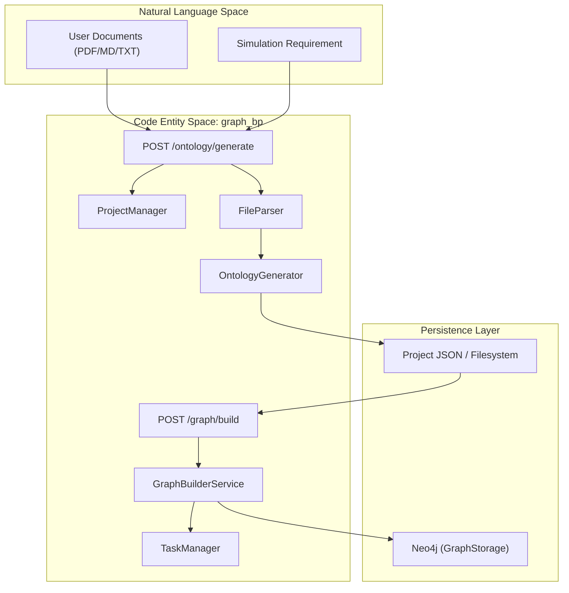
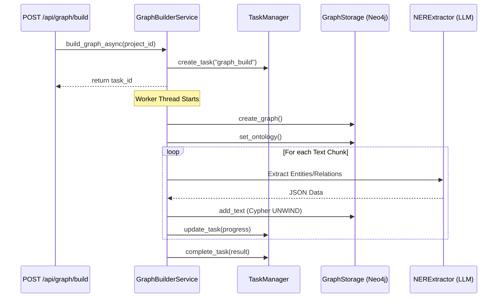

<!-- source: DeepWiki mcp.deepwiki.com · repo aaronjmars/MiroShark · page 7.1 Graph API (graph_bp) · fetched 2026-10-26 -->

# Graph API (graph_bp)

Relevant source files

The following files were used as context for generating this wiki page:

- [backend/app/api/graph.py](backend/app/api/graph.py)
- [backend/app/api/report.py](backend/app/api/report.py)
- [backend/app/services/graph_builder.py](backend/app/services/graph_builder.py)

The `graph_bp` blueprint provides the entry point for the MiroShark knowledge extraction pipeline. It manages the lifecycle of transforming raw documents into a structured Neo4j knowledge graph, including project creation, file validation, ontology generation via LLM, and asynchronous graph building.

## Overview and Data Flow

The Graph API facilitates a two-stage process:
1.  **Ontology Generation**: Documents are uploaded and analyzed by a "Smart LLM" to define the schema (entity and relationship types) relevant to the user's simulation requirements.
2.  **Graph Construction**: The extracted text is chunked and processed through a Named Entity Recognition (NER) pipeline to populate the Neo4j database.

### System Flow: Document to Graph

This diagram illustrates the transition from Natural Language Space (documents) to Code Entity Space (services and storage).

**Sources:** [backend/app/api/graph.py:59-185](), [backend/app/services/graph_builder.py:38-46]()

---

## Project Management & File Ingestion

The API uses a `ProjectManager` to maintain state across the multi-step build process. Projects are stored as JSON files on the server to ensure persistence between API calls.

### File Validation and Parsing
The system supports `.pdf`, `.md`, and `.txt` extensions as defined in `Config.ALLOWED_EXTENSIONS` [backend/app/api/graph.py:27-32](). 
*   **Text Extraction**: Handled by `FileParser.extract_text`, which utilizes PyMuPDF for PDFs and fallback charset detection for text files [backend/app/api/graph.py:135-135]().
*   **Preprocessing**: `TextProcessor.preprocess_text` cleans whitespace and normalizes formatting before the text is passed to the LLM [backend/app/api/graph.py:136-136]().

### Project Creation Logic
When `POST /ontology/generate` is called:
1.  A new project ID is generated via `ProjectManager.create_project` [backend/app/api/graph.py:113-113]().
2.  Files are saved to a project-specific directory [backend/app/api/graph.py:124-128]().
3.  The extracted text is concatenated and stored for the next stage [backend/app/api/graph.py:149-149]().

**Sources:** [backend/app/api/graph.py:27-151](), [backend/app/models/project.py]()

---

## Ontology Generation

The `OntologyGenerator` service acts as the architect of the knowledge graph. It uses the "Smart Model" (typically a high-reasoning LLM like GPT-4 or Claude 3.5) to analyze the source text against the user's simulation goals.

### Implementation Detail
The generator produces a JSON schema containing:
*   `entity_types`: A list of categories (e.g., "Person", "Technology", "Event").
*   `edge_types`: A list of valid relationships (e.g., "INFLUENCES", "DEVELOPED_BY").
*   `analysis_summary`: A high-level overview of the document's context [backend/app/api/graph.py:166-170]().

**Sources:** [backend/app/api/graph.py:152-173](), [backend/app/services/ontology_generator.py]()

---

## Graph Building Service (GraphBuilderService)

The `GraphBuilderService` handles the heavy lifting of entity extraction and Neo4j insertion. Because this process involves multiple LLM calls per text chunk, it is executed asynchronously.

### Asynchronous Execution Pattern
The service uses a `threading.Thread` to wrap the worker logic, allowing the API to return a `task_id` immediately to the frontend [backend/app/services/graph_builder.py:81-89]().

### Key Functions
*   **`build_graph_async`**: Entry point that initializes the background worker [backend/app/services/graph_builder.py:48-70]().
*   **`_build_graph_worker`**: Orchestrates the 6-step build lifecycle: Create Graph -> Set Ontology -> Chunk Text -> Batch Process -> Wait -> Finalize [backend/app/services/graph_builder.py:91-163]().
*   **`add_text_batches`**: Uses a `ThreadPoolExecutor` to parallelize LLM extraction calls, significantly reducing total build time [backend/app/services/graph_builder.py:186-205]().

**Sources:** [backend/app/services/graph_builder.py:38-205]()

---

## API Endpoint Reference

### 1. Ontology Generation
`POST /api/graph/ontology/generate`
*   **Input**: `multipart/form-data` containing `files[]`, `simulation_requirement`, and `project_name` [backend/app/api/graph.py:59-71]().
*   **Output**: Returns the generated ontology and a `project_id` [backend/app/api/graph.py:175-185]().

### 2. Build Graph
`POST /api/graph/build`
*   **Input**: `{"project_id": "..."}` [backend/app/api/graph.py:197-203]().
*   **Output**: A `task_id` used for polling status [backend/app/api/graph.py:228-234]().

### 3. Task Status
`GET /api/graph/status/{taskId}`
*   Returns the current `progress` (0-100), `status` (processing, completed, failed), and `message` [backend/app/services/graph_builder.py:103-108]().

### 4. Graph Data Retrieval
`GET /api/graph/data/{graphId}`
*   Fetches the graph structure (nodes and edges) for visualization in the frontend `GraphPanel` [backend/app/services/graph_builder.py:155-162]().

**Sources:** [backend/app/api/graph.py:59-234](), [backend/app/services/graph_builder.py:103-162]()

---

