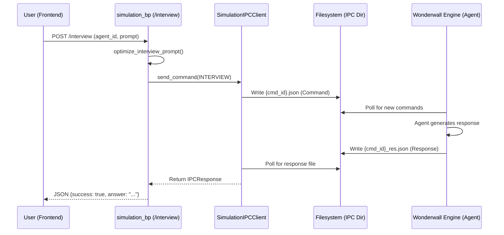

<!-- source: DeepWiki mcp.deepwiki.com · repo aaronjmars/MiroShark · page 7.2 Simulation API (simulation_bp) · fetched 2026-10-26 -->

# Simulation API (simulation_bp)

<details>
<summary>Relevant source files</summary>

The following files were used as context for generating this wiki page:

- [backend/app/api/simulation.py](backend/app/api/simulation.py)
- [backend/app/services/simulation_runner.py](backend/app/services/simulation_runner.py)

</details>


The Simulation API (`simulation_bp`) manages the lifecycle of agent-based simulations within MiroShark. It provides endpoints for entity filtering, profile generation, environment orchestration via the Wonderwall engine, real-time status monitoring, and agent interaction (interviews).

## Simulation Lifecycle Overview

The simulation process is divided into three primary phases managed by this API:
1.  **Preparation**: Filtering graph entities and generating OASIS-compatible personas and configurations.
2.  **Execution**: Spawning the simulation subprocess and managing its state (start, stop, resume).
3.  **Interaction**: Communicating with active agents via Inter-Process Communication (IPC) during or after a run.

### System Flow: API to Simulation Runner
The following diagram illustrates how a request to `/api/simulation/start` triggers the background execution of the simulation.

"API to Simulation Runner Flow"
```mermaid
graph TD
    subgraph "Flask API (simulation_bp)"
        [POST_start] --> |"calls"| [SimulationRunner.start_simulation]
    end

    subgraph "SimulationRunner (Service)"
        [SimulationRunner.start_simulation] --> |"spawns"| [Subprocess_Popen]
        [Subprocess_Popen] --> |"runs"| [run_parallel_simulation.py]
        [SimulationRunner.start_simulation] --> |"starts"| [MonitoringThread]
    end

    subgraph "Wonderwall Engine"
        [run_parallel_simulation.py] --> |"updates"| [actions.jsonl]
        [run_parallel_simulation.py] --> |"heartbeat"| [env_status.json]
    end

    [MonitoringThread] --> |"polls"| [actions.jsonl]
    [MonitoringThread] --> |"updates"| [SimulationRunState]
```
Sources: [backend/app/api/simulation.py:311-345](), [backend/app/services/simulation_runner.py:440-480](), [backend/app/services/simulation_runner.py:650-680]()

---

## Endpoint Reference

### 1. Preparation & Configuration

*   **POST `/create`**: Initializes a simulation record. It determines the `project_id` and sets up the initial `SimulationStatus.CREATED` [backend/app/api/simulation.py:190-245]().
*   **POST `/prepare`**: Triggers the `SimulationManager.prepare_simulation` task in a background thread. This involves calling the `OasisProfileGenerator` to transform graph entities into personas and the `SimulationConfigGenerator` to create the `simulation_config.json` [backend/app/api/simulation.py:248-283]().
*   **GET `/prepare/status`**: Returns the progress of the preparation phase, including how many profiles have been generated [backend/app/api/simulation.py:286-308]().
*   **GET `/profiles/realtime`**: Streams generated agent profiles as they are created [backend/app/api/simulation.py:388-410]().

### 2. Execution Control

*   **POST `/start`**: Starts or resumes a simulation. 
    *   If `force=true`, it restarts from round 0.
    *   It uses `SimulationRunner.start_simulation` to invoke the `run_parallel_simulation.py` script [backend/app/api/simulation.py:311-345]().
*   **POST `/stop`**: Terminates the simulation subprocess. It sends a `SIGTERM` (or `CTRL_BREAK_EVENT` on Windows) to the process group to ensure all platform sub-processes are cleaned up [backend/app/api/simulation.py:348-371](), [backend/app/services/simulation_runner.py:535-565]().
*   **GET `/{id}/run-status`**: Returns the `SimulationRunState`, which includes `current_round`, `total_actions_count`, and platform-specific progress (Twitter/Reddit/Polymarket) [backend/app/api/simulation.py:413-435]().

### 3. Agent Interaction (Interviews)

The API allows "interviewing" agents by sending prompts to the running simulation environment.

*   **POST `/interview`**: Sends a single question to a specific agent.
*   **POST `/interview/batch`**: Sends a prompt to multiple agents simultaneously.
*   **Implementation**: These endpoints use `SimulationIPCClient` to write a command to the simulation's IPC directory. The simulation engine picks up the command, generates a response using the agent's LLM context, and writes back an `IPCResponse` [backend/app/api/simulation.py:438-510]().

---

## Key Service Classes

### SimulationRunner
The `SimulationRunner` is a singleton-like class that manages the lifecycle of the simulation subprocess.

| Attribute/Method | Description |
| :--- | :--- |
| `_run_states` | A dictionary mapping `simulation_id` to `SimulationRunState` objects [backend/app/services/simulation_runner.py:265](). |
| `start_simulation()` | Spawns the `run_parallel_simulation.py` script using `subprocess.Popen` [backend/app/services/simulation_runner.py:440](). |
| `_monitor_output()` | A background thread that tails `actions.jsonl` to update the real-time state [backend/app/services/simulation_runner.py:650](). |
| `check_env_alive()` | Validates if the simulation environment is responsive via `env_status.json` [backend/app/services/simulation_runner.py:365](). |

Sources: [backend/app/services/simulation_runner.py:35-150](), [backend/app/services/simulation_runner.py:255-280]()

### SimulationManager
Handles the high-level orchestration of simulation data. It bridges the gap between the Graph database and the Simulation Runner.

| Function | Role |
| :--- | :--- |
| `prepare_simulation()` | Coordinates `OasisProfileGenerator` and `SimulationConfigGenerator` [backend/app/services/simulation_manager.py:150](). |
| `get_simulation_history()` | Retrieves previous simulation runs from the `ProjectManager` [backend/app/api/simulation.py:560-580](). |

Sources: [backend/app/services/simulation_manager.py:20-60](), [backend/app/api/simulation.py:14-17]()

---

## Data Flow: Inter-Process Communication (IPC)

When a user interviews an agent via the API, the system uses a filesystem-based IPC mechanism to communicate with the `Wonderwall` engine.

"Interview IPC Mechanism"

Sources: [backend/app/api/simulation.py:438-470](), [backend/app/api/simulation.py:62-78](), [backend/app/services/simulation_ipc.py:10-50]()

## Implementation Details

### Environment Auto-Restart
The API includes a helper function `_ensure_env_alive`. If an interview request is made but the simulation is not running, the system attempts to start the environment in `env_only` mode. This allows agents to be queried even after the simulation rounds have completed [backend/app/api/simulation.py:27-60]().

### Prompt Optimization
To ensure agents respond with natural language rather than attempting to trigger simulation tools (like posting or liking) during an interview, the API prepends `INTERVIEW_PROMPT_PREFIX` to user queries. This forces the LLM to "reply directly with text without calling any tools" [backend/app/api/simulation.py:22-24](), [backend/app/api/simulation.py:62-78]().

Sources: [backend/app/api/simulation.py:1-78](), [backend/app/services/simulation_runner.py:1-200](), [backend/app/services/simulation_ipc.py:1-100]()

---

