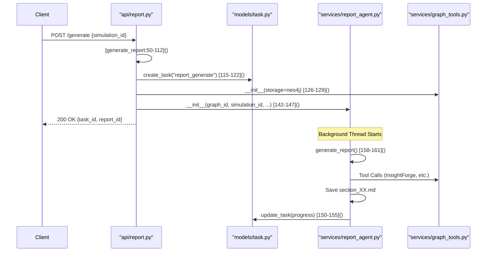
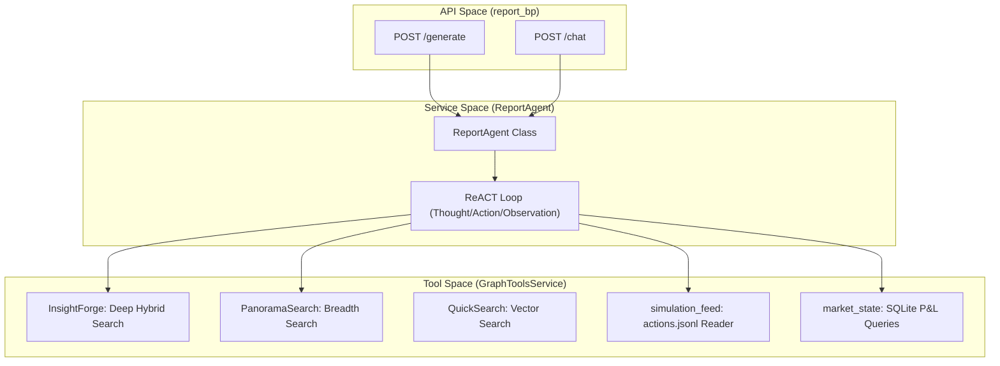

<!-- source: DeepWiki mcp.deepwiki.com · repo aaronjmars/MiroShark · page 7.3 Report API (report_bp) · fetched 2026-10-26 -->

# Report API (report_bp)

Relevant source files

The following files were used as context for generating this wiki page:

- [backend/app/api/graph.py](backend/app/api/graph.py)
- [backend/app/api/report.py](backend/app/api/report.py)
- [backend/app/services/graph_tools.py](backend/app/services/graph_tools.py)
- [backend/app/services/report_agent.py](backend/app/services/report_agent.py)

The `report_bp` blueprint manages the final stage of the MiroShark pipeline: analyzing simulation results and generating a structured, evidence-based report. It provides endpoints for triggering the ReACT-based `ReportAgent`, streaming logs of the agent's "thought" process, retrieving generated artifacts, and supporting an interactive chat interface where users can query the report using autonomous retrieval tools.

### Report Generation Lifecycle

Report generation is an asynchronous process managed by the `TaskManager`. When a report is requested, the backend spawns a background thread that orchestrates the `ReportAgent` through a multi-stage lifecycle: planning, iterative section generation via tool-augmented reasoning (ReACT), and final synthesis.

#### Data Flow: Generation Trigger
The following diagram illustrates the flow from the API request to the background execution of the `ReportAgent`.

**Report Task Initialization**

**Sources:** [backend/app/api/report.py:25-196](), [backend/app/services/report_agent.py:1-10]()

---

### Core Endpoints

#### 1. POST `/api/report/generate`
Triggers the asynchronous generation of a simulation report.
*   **Logic**: Checks if a report already exists for the `simulation_id`. If not (or if `force_regenerate` is true), it initializes a `ReportAgent` and starts a background thread [backend/app/api/report.py:73-184]().
*   **Artifacts**: Creates a directory in `UPLOAD_FOLDER/reports/{report_id}/` to store `agent_log.jsonl`, `section_XX.md`, and `full_report.md` [backend/app/services/report_agent.py:43-53]().

#### 2. GET `/api/report/logs/agent`
Retrieves the execution logs of the `ReportAgent`.
*   **Pagination**: Uses `from_line` parameter to support incremental polling by the frontend [backend/app/api/report.py:315-320]().
*   **Content**: Returns entries from `agent_log.jsonl`, which include `react_thought`, `tool_call`, and `tool_result` events [backend/app/services/report_agent.py:152-209]().

#### 3. POST `/api/report/chat`
Allows users to ask follow-up questions about the generated report.
*   **Implementation**: Uses `ReportAgent.chat_with_report()`. This method does not just search the text of the report; it allows the agent to use `GraphToolsService` to query the Neo4j database and simulation logs to answer questions not explicitly covered in the summary [backend/app/services/report_agent.py:9-10]().

---

### Report Agent & Tool Integration

The `ReportAgent` uses the `GraphToolsService` to ground its analysis in the data stored in Neo4j and the simulation's SQLite databases.

**Code Entity Mapping: API to Service Tools**

**Sources:** [backend/app/services/report_agent.py:1-10](), [backend/app/services/graph_tools.py:1-11]()

#### Retrieval Tools Detail
| Tool Name | Implementation Function | Purpose |
| :--- | :--- | :--- |
| `InsightForge` | `GraphToolsService.insight_forge()` | Generates sub-questions for multi-dimensional retrieval [backend/app/services/graph_tools.py:7-8](). |
| `PanoramaSearch` | `GraphToolsService.panorama_search()` | Retrieves a broad view of entities, including expired/historical facts [backend/app/services/graph_tools.py:9](). |
| `simulation_feed` | `GraphToolsService.get_simulation_feed()` | Directly reads `actions.jsonl` to see raw agent interactions [backend/app/services/report_agent.py:5.2](). |
| `market_state` | `GraphToolsService.get_market_state()` | Queries Polymarket SQLite DBs for price trends and trader P&L [backend/app/services/report_agent.py:5.2](). |

---

### File Storage & Artifact Serving

Reports are persisted as a collection of Markdown files and logs.

| File Path | Description |
| :--- | :--- |
| `reports/{id}/agent_log.jsonl` | Structured log of every LLM thought and tool interaction [backend/app/services/report_agent.py:39-41](). |
| `reports/{id}/section_01.md` | Individual report sections generated during the iterative phase [backend/app/services/report_agent.py:142-150](). |
| `reports/{id}/full_report.md` | The final concatenated and synthesized report [backend/app/services/report_agent.py:163-164](). |
| `reports/{id}/console_log.txt` | Raw standard output/error from the generation process [backend/app/api/report.py:365-370](). |

#### Serving Mechanism
The blueprint uses `send_file` to serve these artifacts directly. For example, `GET /api/report/full` reads `full_report.md` from the filesystem and returns it to the frontend for rendering via the `renderMarkdown` engine [backend/app/api/report.py:270-285]().

**Sources:** [backend/app/api/report.py:23-285](), [backend/app/services/report_agent.py:35-53]()

---

