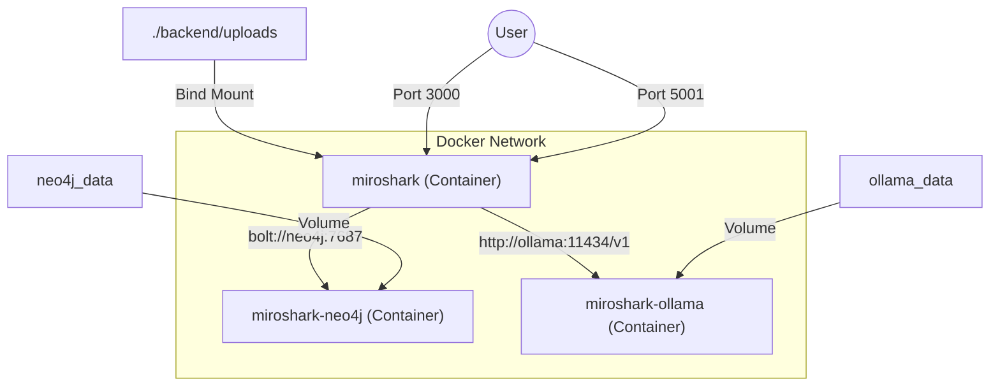
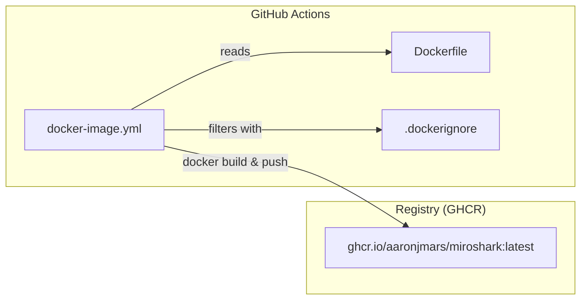

<!-- source: DeepWiki mcp.deepwiki.com · repo aaronjmars/MiroShark · page 8.1 Docker & Production Deployment · fetched 2026-10-26 -->

# Docker & Production Deployment

Relevant source files

The following files were used as context for generating this wiki page:

- [.dockerignore](.dockerignore)
- [.github/workflows/docker-image.yml](.github/workflows/docker-image.yml)
- [Dockerfile](Dockerfile)
- [docker-compose.yml](docker-compose.yml)
- [frontend/package-lock.json](frontend/package-lock.json)
- [frontend/package.json](frontend/package.json)
- [frontend/src/store/pendingUpload.js](frontend/src/store/pendingUpload.js)

This page details the infrastructure and deployment configuration for MiroShark. The system is designed to be fully containerized, supporting both local development and production-grade orchestration using Docker Compose and GitHub Actions.

## Container Orchestration

MiroShark utilizes `docker-compose.yml` to orchestrate three primary services: the MiroShark application (frontend and backend), a Neo4j graph database, and an Ollama instance for local LLM inference.

### Service Architecture

The orchestration ensures that the application has immediate access to its persistence layer and inference engine upon startup.

| Service | Image | Role | Port Mapping |
| :--- | :--- | :--- | :--- |
| `neo4j` | `neo4j:5.15-community` | Graph database for entity/relationship storage [docker-compose.yml:3-4]() | `7474` (HTTP), `7687` (Bolt) [docker-compose.yml:8-9]() |
| `ollama` | `ollama/ollama:latest` | Local LLM and Embedding provider [docker-compose.yml:15-16]() | `11434` [docker-compose.yml:18]() |
| `miroshark` | `ghcr.io/aaronjmars/miroshark` | Unified Flask backend and Vue 3 frontend [docker-compose.yml:24-27]() | `3000` (Frontend), `5001` (Backend API) [docker-compose.yml:40-41]() |

### Dependency & Data Flow

The `miroshark` service depends on `neo4j` and `ollama` being healthy [docker-compose.yml:42-44](). Data persistence is handled via named volumes for databases and bind mounts for uploaded documents.

**Infrastructure Component Relationship**

**Sources:** [docker-compose.yml:1-52]()

---

## Application Containerization

MiroShark uses a single `Dockerfile` for the main application, employing a multi-runtime environment that supports both Node.js (for the Vue 3 frontend) and Python (for the Flask backend and simulation engine).

### Build Process Implementation

The build process leverages `uv` for high-performance Python dependency management and standard `npm` for the frontend.

1.  **Environment Setup**: Uses `python:3.11` as the base and installs `nodejs` and `npm` [Dockerfile:1-6]().
2.  **Package Manager**: Copies the `uv` binary from the official Astral image to handle backend sync [Dockerfile:9]().
3.  **Dependency Caching**: Copies `package.json` and `pyproject.toml` files separately before the source code to leverage Docker layer caching [Dockerfile:14-16]().
4.  **Installation**: Executes `npm ci` for the root and frontend, and `uv sync --frozen` for the backend [Dockerfile:19-21]().
5.  **Execution**: Starts the development server using `npm run dev`, which concurrently launches the Vite dev server and the Flask API [Dockerfile:29]().

### .dockerignore Configuration
To keep image sizes small and prevent sensitive data leakage, the following are excluded from the build context:
*   Local virtual environments (`.venv`, `backend/.venv`) [ .dockerignore:10-11]()
*   Environment secrets (`.env`) [ .dockerignore:6]()
*   Frontend build artifacts (`dist`, `.vite`) [ .dockerignore:20-21]()
*   Local upload data (`backend/uploads`) [ .dockerignore:23]()

**Sources:** [Dockerfile:1-29](), [.dockerignore:1-24]()

---

## Environment Configuration

The `miroshark` service is configured via environment variables in `docker-compose.yml`. These variables point the application to the internal Docker network aliases for Neo4j and Ollama.

| Variable | Value | Purpose |
| :--- | :--- | :--- |
| `LLM_BASE_URL` | `http://ollama:11434/v1` | LLM endpoint for Smart/Boost models [docker-compose.yml:30]() |
| `NEO4J_URI` | `bolt://neo4j:7687` | Connection string for GraphBuilderService [docker-compose.yml:32]() |
| `EMBEDDING_BASE_URL` | `http://ollama:11434` | Endpoint for `nomic-embed-text` [docker-compose.yml:36]() |
| `NEO4J_AUTH` | `neo4j/miroshark` | Credentials for Neo4jStorage [docker-compose.yml:6]() |

**Sources:** [docker-compose.yml:28-38]()

---

## CI/CD Workflow

MiroShark uses GitHub Actions to automate the building and distribution of Docker images. The workflow is defined in `.github/workflows/docker-image.yml`.

### Docker Image Pipeline

The workflow triggers on any tag push or manual dispatch [ .github/workflows/docker-image.yml:3-7]().

1.  **Metadata Extraction**: Uses `docker/metadata-action` to generate tags based on the Git ref (e.g., `latest` and the specific SHA) [ .github/workflows/docker-image.yml:32-41]().
2.  **Multi-Platform Support**: Sets up QEMU for cross-platform builds [ .github/workflows/docker-image.yml:19-20]().
3.  **Registry Authentication**: Logs into the GitHub Container Registry (GHCR) using the `GITHUB_TOKEN` [ .github/workflows/docker-image.yml:25-30]().
4.  **Build and Push**: Builds the image using the root `Dockerfile` and pushes it to `ghcr.io/aaronjmars/miroshark` [ .github/workflows/docker-image.yml:42-49]().

**Code-to-Registry Mapping**

**Sources:** [.github/workflows/docker-image.yml:1-50](), [Dockerfile:1-29]()

---

## Production Considerations

While the current `Dockerfile` uses `npm run dev` for convenience [Dockerfile:29](), a production deployment typically involves:
1.  **Frontend Dist**: Running `npm run build` in the `frontend/` directory [frontend/package.json:8]() to generate optimized assets.
2.  **Static Serving**: Using an Nginx container to serve the `frontend/dist` folder.
3.  **WSGI Server**: Running the Flask backend via `gunicorn` instead of the development server.
4.  **State Management**: Ensuring the `pendingUpload.js` store is cleared or handled during container restarts if the frontend state is lost [frontend/src/store/pendingUpload.js:27-31]().

**Sources:** [frontend/package.json:1-21](), [frontend/src/store/pendingUpload.js:1-33]()

---

