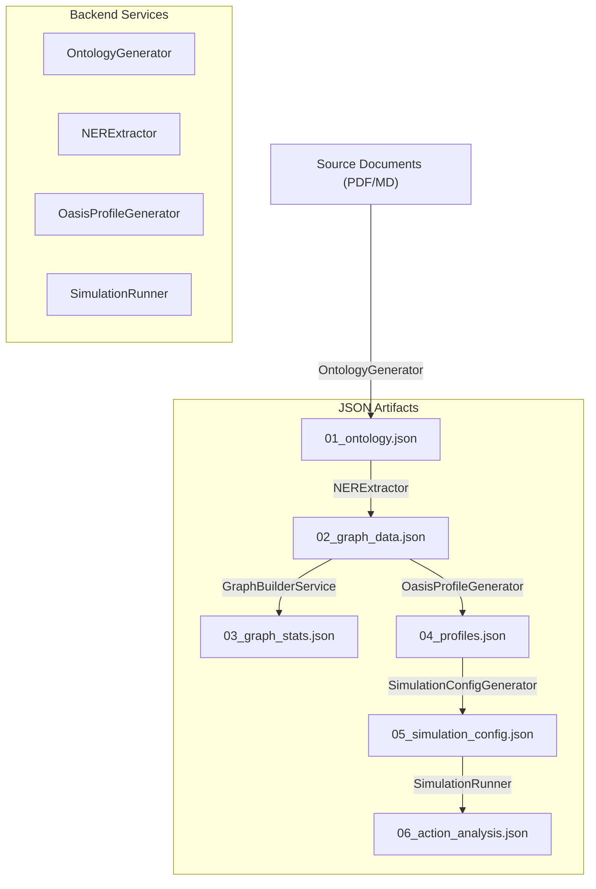
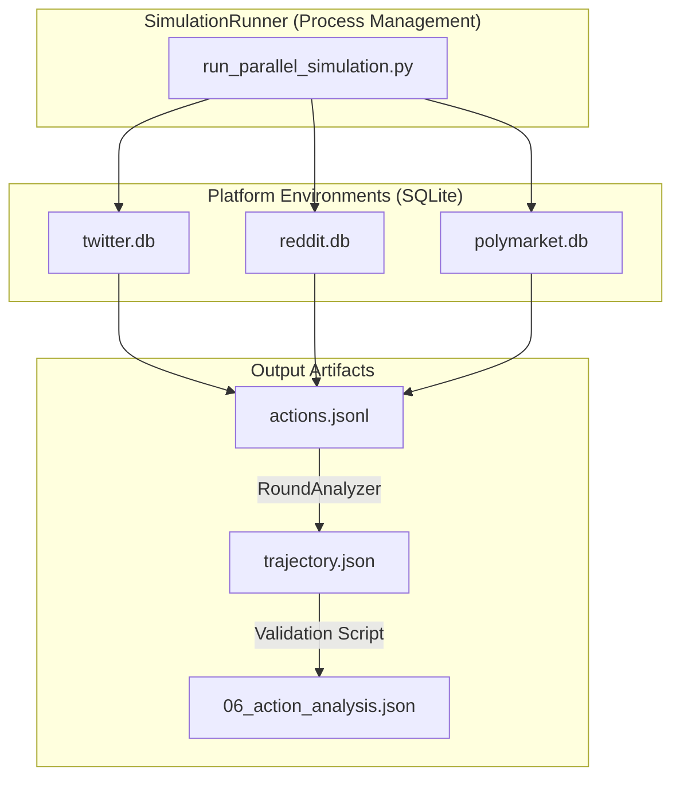

<!-- source: DeepWiki mcp.deepwiki.com · repo aaronjmars/MiroShark · page 8.2 Test Fixtures & Pipeline Test Outputs · fetched 2026-10-26 -->

# Test Fixtures & Pipeline Test Outputs

Relevant source files

The following files were used as context for generating this wiki page:

- [backend/e2e_test_output/01_ontology.json](backend/e2e_test_output/01_ontology.json)
- [backend/e2e_test_output/02_graph_data.json](backend/e2e_test_output/02_graph_data.json)
- [backend/e2e_test_output/03_simulation_created.json](backend/e2e_test_output/03_simulation_created.json)
- [backend/pipeline_test_output/03_graph_stats.json](backend/pipeline_test_output/03_graph_stats.json)
- [backend/pipeline_test_output/04_profiles.json](backend/pipeline_test_output/04_profiles.json)
- [backend/pipeline_test_output/05_simulation_config.json](backend/pipeline_test_output/05_simulation_config.json)
- [backend/pipeline_test_output/06_action_analysis.json](backend/pipeline_test_output/06_action_analysis.json)

This page describes the structured output artifacts generated by the MiroShark pipeline and stored within the `pipeline_test_output/` and `e2e_test_output/` directories. These files serve as high-fidelity test fixtures that allow developers to validate individual stages of the system—from ontology generation to agent simulation—without requiring a live Neo4j instance or a full multi-hour simulation run.

## Purpose of Test Artifacts

MiroShark's pipeline is computationally expensive and relies on non-deterministic LLM calls. To ensure stability, the system captures the state of the data at key transition points. These artifacts are used to:
1.  **Validate Pipeline Logic:** Ensure that the `OntologyGenerator`, `NERExtractor`, and `OasisProfileGenerator` produce schema-compliant JSON.
2.  **Regression Testing:** Provide a baseline for comparing how different LLM models (e.g., GPT-4o vs. Llama 3) affect the quality of extracted entities and generated personas.
3.  **Frontend Development:** Allow UI testing of the "Hyperstitions v2.0" design system using real-world data without running the backend services.

---

## Pipeline Output Directory Structure

The `backend/pipeline_test_output/` directory contains the results of a standard document-to-simulation workflow.

### 01_ontology.json
Produced by the `OntologyGenerator`, this file defines the schema for the knowledge graph based on the uploaded documents [backend/e2e_test_output/01_ontology.json:1-161]().

*   **analysis_summary:** A high-level narrative of the source text [backend/e2e_test_output/01_ontology.json:2-2]().
*   **edge_types:** Definitions of allowed relationships (e.g., `INVESTS_IN`, `REGULATES`) including valid source and target entity types [backend/e2e_test_output/01_ontology.json:10-161]().
*   **entity_types:** Definitions of entity categories (e.g., `CryptoFounder`, `PredictionMarketTrader`) and their expected attributes [backend/e2e_test_output/01_ontology.json:162-230]().

### 02_graph_data.json
Contains the serialized nodes and edges after the `NERExtractor` and `GraphBuilderService` have processed the text [backend/e2e_test_output/02_graph_data.json:1-24]().

*   **Edges:** Individual relationship instances containing a `fact` string, `fact_type`, and UUIDs for source/target nodes [backend/e2e_test_output/02_graph_data.json:4-23]().
*   **Metadata:** Includes `created_at` timestamps and `episode_ids` linking facts back to specific document chunks [backend/e2e_test_output/02_graph_data.json:6-12]().

### 03_graph_stats.json
A summary of the graph build performance and topology [backend/pipeline_test_output/03_graph_stats.json:1-8]().

| Metric | Description |
| :--- | :--- |
| `node_count` | Total entities successfully upserted to Neo4j [backend/pipeline_test_output/03_graph_stats.json:3-3](). |
| `edge_count` | Total relationships created [backend/pipeline_test_output/03_graph_stats.json:4-4](). |
| `chunks_processed` | Number of text segments analyzed by the LLM [backend/pipeline_test_output/03_graph_stats.json:6-6](). |
| `time_seconds` | Total duration of the graph build process [backend/pipeline_test_output/03_graph_stats.json:7-7](). |

### 04_profiles.json
Generated by the `OasisProfileGenerator`, this file contains the detailed personas for simulation agents [backend/pipeline_test_output/04_profiles.json:1-28]().

*   **Persona:** A comprehensive behavioral guide for the LLM, covering "Institutional Identity," "Official Position," and "Red Lines" [backend/pipeline_test_output/04_profiles.json:7-7]().
*   **Psychographics:** MBTI types, interested topics, and professional backgrounds derived from graph attributes [backend/pipeline_test_output/04_profiles.json:14-24]().
*   **Graph Linking:** The `source_entity_uuid` connects the agent back to the original Neo4j node [backend/pipeline_test_output/04_profiles.json:25-25]().

### 05_simulation_config.json
The master configuration file produced by the `SimulationConfigGenerator` [backend/pipeline_test_output/05_simulation_config.json:1-200]().

*   **time_config:** Defines the temporal dynamics, including `peak_hours` and `activity_multipliers` [backend/pipeline_test_output/05_simulation_config.json:6-46]().
*   **agent_configs:** Per-agent behavioral parameters such as `influence_weight`, `sentiment_bias`, and `response_delay` [backend/pipeline_test_output/05_simulation_config.json:47-200]().
*   **event_config:** Contains the "Reality Seeds" (initial posts) and the `narrative_direction` that guides the LLM during the simulation [backend/pipeline_test_output/05_simulation_config.json:201-233]().

### 06_action_analysis.json
A post-simulation summary used to validate the `Wonderwall` execution engine [backend/pipeline_test_output/06_action_analysis.json:1-74]().

*   **action_types:** A tally of agent behaviors (e.g., `CREATE_POST`, `LIKE_POST`, `SEARCH_POSTS`) [backend/pipeline_test_output/06_action_analysis.json:12-21]().
*   **sample_posts:** Representative content generated by agents during the simulation rounds [backend/pipeline_test_output/06_action_analysis.json:22-73]().

---

## Data Flow & Entity Association

The following diagram illustrates how natural language documents are transformed into these structured JSON artifacts and associated with specific code entities.

### Natural Language to Code Entity Mapping
Title: "Pipeline Artifact Generation Flow"

Sources: [backend/e2e_test_output/01_ontology.json:1-9](), [backend/e2e_test_output/02_graph_data.json:1-5](), [backend/pipeline_test_output/04_profiles.json:1-7](), [backend/pipeline_test_output/05_simulation_config.json:1-5]()

---

## Implementation Details: Simulation Persistence

When a simulation runs, it produces transient and permanent data stores that are reflected in the test outputs.

### Simulation Databases (SQLite)
Each platform (Twitter, Reddit, Polymarket) maintains its own SQLite database during execution.
*   **Twitter/Reddit:** Stores `posts`, `comments`, and `actions`.
*   **Polymarket:** Stores `orders`, `trades`, and `market_state` (AMM reserves).

### Trajectory and Logs
*   **trajectory.json:** Produced by `BeliefTracker`, tracking the evolution of agent stances (e.g., "supportive" to "opposing") across rounds.
*   **actions.jsonl:** A line-delimited JSON file recording every discrete action taken by every agent for auditability.

Title: "Simulation Execution State Management"

Sources: [backend/pipeline_test_output/06_action_analysis.json:1-21](), [backend/pipeline_test_output/05_simulation_config.json:234-240]()

---

## Validation Usage

Developers can use these fixtures to verify the system's integrity without a full environment:

1.  **Schema Validation:** Compare `01_ontology.json` against the expected `entity_types` in `02_graph_data.json` to ensure the `NERExtractor` respects the generated ontology [backend/e2e_test_output/01_ontology.json:162-187](), [backend/e2e_test_output/02_graph_data.json:15-17]().
2.  **Persona Consistency:** Check that the `persona` text in `04_profiles.json` aligns with the `sentiment_bias` and `stance` defined in `05_simulation_config.json` [backend/pipeline_test_output/04_profiles.json:7-7](), [backend/pipeline_test_output/05_simulation_config.json:68-69]().
3.  **Action Coverage:** Verify that the `action_types` in `06_action_analysis.json` include all supported `Wonderwall` actions like `CREATE_POST` and `LIKE_COMMENT` [backend/pipeline_test_output/06_action_analysis.json:12-21]().

Sources:
- `backend/pipeline_test_output/03_graph_stats.json`
- `backend/pipeline_test_output/04_profiles.json`
- `backend/pipeline_test_output/05_simulation_config.json`
- `backend/pipeline_test_output/06_action_analysis.json`
- `backend/e2e_test_output/01_ontology.json`
- `backend/e2e_test_output/02_graph_data.json`
- `backend/e2e_test_output/03_simulation_created.json`

---

