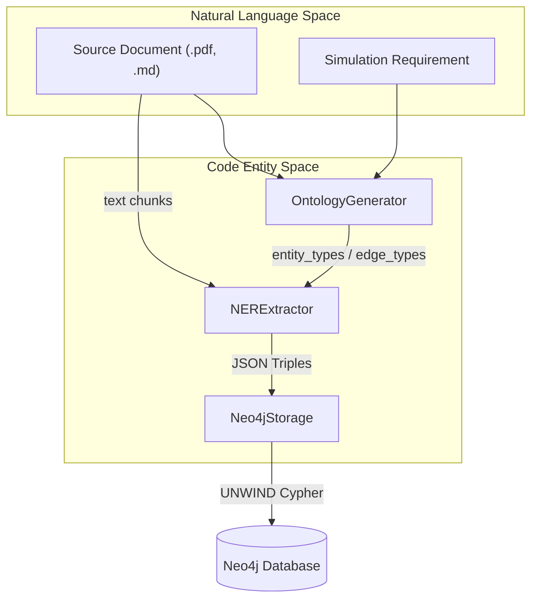
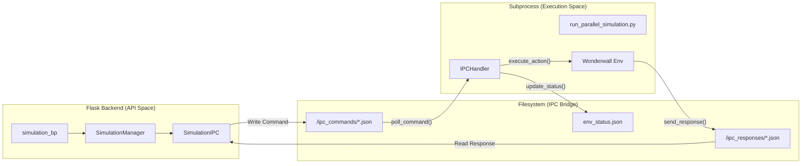

<!-- source: DeepWiki mcp.deepwiki.com · repo aaronjmars/MiroShark · page 9 Glossary · fetched 2026-10-26 -->

# Glossary

Relevant source files

The following files were used as context for generating this wiki page:

- [.env.example](.env.example)
- [README.md](README.md)
- [backend/app/__init__.py](backend/app/__init__.py)
- [backend/app/services/graph_tools.py](backend/app/services/graph_tools.py)
- [backend/app/services/oasis_profile_generator.py](backend/app/services/oasis_profile_generator.py)
- [backend/app/services/ontology_generator.py](backend/app/services/ontology_generator.py)
- [backend/app/services/report_agent.py](backend/app/services/report_agent.py)
- [backend/app/services/simulation_ipc.py](backend/app/services/simulation_ipc.py)
- [backend/app/services/simulation_manager.py](backend/app/services/simulation_manager.py)
- [backend/app/storage/neo4j_storage.py](backend/app/storage/neo4j_storage.py)
- [backend/app/storage/ner_extractor.py](backend/app/storage/ner_extractor.py)
- [backend/app/utils/__init__.py](backend/app/utils/__init__.py)
- [backend/app/utils/llm_client.py](backend/app/utils/llm_client.py)
- [backend/scripts/run_parallel_simulation.py](backend/scripts/run_parallel_simulation.py)
- [backend/scripts/run_reddit_simulation.py](backend/scripts/run_reddit_simulation.py)
- [backend/scripts/run_twitter_simulation.py](backend/scripts/run_twitter_simulation.py)
- [backend/wonderwall/simulations/polymarket/__init__.py](backend/wonderwall/simulations/polymarket/__init__.py)
- [backend/wonderwall/simulations/polymarket/platform.py](backend/wonderwall/simulations/polymarket/platform.py)
- [backend/wonderwall/social_agent/belief_state.py](backend/wonderwall/social_agent/belief_state.py)

This page provides a comprehensive reference for the domain-specific terminology, technical jargon, and architectural concepts used within the MiroShark codebase.

## 1. Knowledge Graph & Ingestion

MiroShark uses a GraphRAG (Graph Retrieval-Augmented Generation) approach to ground its simulations. The following terms describe the transformation of raw documents into a structured Neo4j store.

| Term | Definition | Key Code Entities |
|:---|:---|:---|
| **Ontology** | A schema defining the specific `entity_types` and `edge_types` relevant to a simulation, generated dynamically based on the input document. | `OntologyGenerator` [backend/app/services/ontology_generator.py:158-162](), `ONTOLOGY_SYSTEM_PROMPT` [backend/app/services/ontology_generator.py:12-155]() |
| **NER Extractor** | Named Entity Recognition service that extracts nodes and relationships from text chunks using LLM prompts with strict rejection rules. | `NERExtractor` [backend/app/storage/ner_extractor.py]() |
| **UNWIND Batching** | A Neo4j optimization technique where multiple entities or relationships are passed as a single list in a Cypher query to reduce transaction overhead. | `Neo4jStorage` [backend/app/storage/neo4j_storage.py](), [README.md:90-90]() |
| **Hybrid Search** | A retrieval strategy combining vector-based semantic search with keyword-based BM25 search to find relevant graph context. | `SearchService` [backend/app/storage/neo4j_storage.py](), `InsightForge` [backend/app/services/graph_tools.py:8-11]() |

### Knowledge Graph Pipeline Data Flow
The diagram below illustrates how raw text is converted into the graph entities used for agent persona generation.

**Document to Graph Flow**

**Sources:** [backend/app/services/ontology_generator.py:158-172](), [backend/app/storage/ner_extractor.py](), [README.md:39-39]()

---

## 2. Agent & Simulation Concepts

MiroShark generates a "Swarm Intelligence" environment where agents behave according to personas derived from the knowledge graph.

### OASIS Profile
A structured data object required by the underlying **Wonderwall** engine to define an agent's identity. Profiles are platform-specific (Twitter vs. Reddit).
*   **Implementation:** `OasisAgentProfile` [backend/app/services/oasis_profile_generator.py:29-61]()
*   **Grounded Metrics:** Social stats (followers, karma) are not random; they are scaled by the entity's "degree" (connectivity) in the Neo4j graph. [backend/app/services/oasis_profile_generator.py:164-181]()

### Belief State
A heuristic model tracking an agent's internal psychological state regarding specific topics. It consists of:
*   **Stance:** Numerical value (-1 to +1) representing the agent's position on a topic.
*   **Confidence:** (0 to 1) how certain the agent is of their stance.
*   **Trust:** (0 to 1) level of trust toward other specific agents.
*   **Implementation:** `BeliefState` [backend/scripts/run_reddit_simulation.py:28-32](), `BeliefTracker` [backend/scripts/run_parallel_simulation.py:164-164]()

### Reality Seeds
Initial content or "narrative directions" generated by the LLM during the `prepare` phase to kickstart the simulation. These ensure agents have an initial topic to react to.
*   **Implementation:** `SimulationConfigGenerator` [backend/app/services/simulation_config_generator.py]()

### Web Enrichment
An automated research step triggered when an entity is a public figure or has insufficient graph context (<150 characters). It uses a search-enabled LLM (e.g., Perplexity) to fetch real-world details.
*   **Implementation:** `WebEnricher` [backend/app/services/oasis_profile_generator.py:22-22](), [README.md:96-98]()

---

## 3. Simulation Execution & IPC

MiroShark runs multiple social platforms in parallel as separate subprocesses, communicating via a file-based protocol.

### Simulation IPC (Inter-Process Communication)
A filesystem-based command/response protocol that allows the Flask backend to interact with the running simulation subprocesses (e.g., for "Interviewing" an agent).
*   **Commands:** `INTERVIEW`, `BATCH_INTERVIEW`, `CLOSE_ENV`. [backend/scripts/run_twitter_simulation.py:139-144]()
*   **Heartbeat:** `env_status.json` tracks whether the environment is active. [backend/scripts/run_twitter_simulation.py:162-168]()

### Market-Media Bridge
A synchronization layer that allows Polymarket price movements to influence social media posts, and social media sentiment to influence trader behavior.
*   **Implementation:** `MarketMediaBridge` [backend/scripts/run_parallel_simulation.py:165-169](), [README.md:68-72]()

### Round Memory
A sliding-window mechanism where recent rounds are kept in full detail, while older rounds are "compacted" into LLM-generated summaries to prevent context window overflow.
*   **Implementation:** `RoundMemory` [backend/scripts/run_parallel_simulation.py:170-170](), [README.md:52-57]()

---

## 4. Analysis & Reporting

Post-simulation, a specialized agent analyzes the resulting data to produce a final report.

### ReACT (Reasoning and Acting)
The execution pattern used by the `ReportAgent`. It follows a "Thought -> Action -> Observation" loop, where "Actions" are calls to graph or simulation tools.
*   **Implementation:** `ReportAgent` [backend/app/services/report_agent.py:1-10](), `log_react_thought` [backend/app/services/report_agent.py:152-164]()

### Retrieval Tools
Specific functions available to the `ReportAgent` to query the simulation state:
*   **InsightForge:** Deep retrieval that decomposes a report question into sub-queries. [backend/app/services/graph_tools.py:138-143]()
*   **PanoramaSearch:** A breadth-first search for historical and current facts. [backend/app/services/graph_tools.py:9-9]()
*   **QuickSearch:** Standard GraphRAG retrieval. [backend/app/services/graph_tools.py:10-10]()

### Simulation IPC Flow
The diagram below maps the interaction between the API and the running simulation scripts.

**API to Simulation Subprocess Communication**

**Sources:** [backend/app/services/simulation_manager.py:116-125](), [backend/scripts/run_twitter_simulation.py:146-206](), [backend/app/services/simulation_ipc.py]()

---

## 5. Abbreviations & Technical Jargon

| Abbreviation | Full Term | Context |
|:---|:---|:---|
| **AMM** | Automated Market Maker | Used in `PolymarketPlatform` for constant-product pricing. [README.md:84-84]() |
| **JSONL** | JSON Lines | The format used for `actions.jsonl` and `agent_log.jsonl` for streaming/append-only logging. [backend/app/services/report_agent.py:39-41]() |
| **IPC** | Inter-Process Communication | The file-based bridge between Flask and the simulation scripts. [backend/scripts/run_twitter_simulation.py:134-137]() |
| **NER** | Named Entity Recognition | The process of identifying entities in text. [README.md:39-39]() |
| **P&L** | Profit and Loss | Calculated for agents in the Polymarket simulation. [README.md:42-42]() |

**Sources:** [backend/app/services/report_agent.py](), [backend/app/services/oasis_profile_generator.py](), [backend/app/services/ontology_generator.py](), [backend/app/services/simulation_manager.py](), [backend/scripts/run_parallel_simulation.py](), [backend/scripts/run_twitter_simulation.py](), [README.md]()