# Page: MiroShark Overview

# MiroShark Overview

<details>
<summary>Relevant source files</summary>

The following files were used as context for generating this wiki page:

- [README.md](README.md)
- [frontend/index.html](frontend/index.html)
- [frontend/src/App.vue](frontend/src/App.vue)
- [frontend/src/views/Home.vue](frontend/src/views/Home.vue)
- [miroshark.jpg](miroshark.jpg)

</details>


MiroShark is a **Universal Swarm Intelligence Engine** designed to simulate complex social and market reactions to specific documents or policy drafts. By extracting a structured knowledge graph from raw text, the system instantiates hundreds of unique AI agents that interact across simulated versions of Twitter, Reddit, and Polymarket.

The core purpose of MiroShark is to move beyond static LLM predictions into dynamic **scenario exploration**, where emergent behaviors, opinion shifts, and market movements can be observed in a controlled, multi-round environment.

## Core Workflow

The system operates in a 5-step sequential pipeline, transitioning from unstructured data to an interactive, simulated world.

1.  **Graph Construction**: Parses documents into a Neo4j knowledge graph using Named Entity Recognition (NER) and Relationship Extraction (RE).
2.  **Agent Setup**: Generates rich, OASIS-compatible agent personas grounded in the graph topology and web-enriched data.
3.  **Simulation Execution**: Runs a multi-platform, synchronized simulation where agents post, reply, trade, and update their internal belief states.
4.  **Report Generation**: A ReACT-based analytical agent inspects the simulation artifacts to produce a comprehensive post-mortem.
5.  **Deep Interaction**: Users can chat with individual agents or the Report Agent to probe specific outcomes.

Sources: [README.md:37-43](), [frontend/src/views/Home.vue:59-95]()

## High-Level Architecture

MiroShark utilizes a decoupled architecture featuring a **Flask backend**, a **Vue 3 frontend**, and a **Neo4j graph database**. The simulation engine, known as **Wonderwall**, manages the lifecycle of social platforms and agent logic.

### System Components Diagram
This diagram illustrates the bridge between the high-level natural language requirements and the underlying code entities that process them.

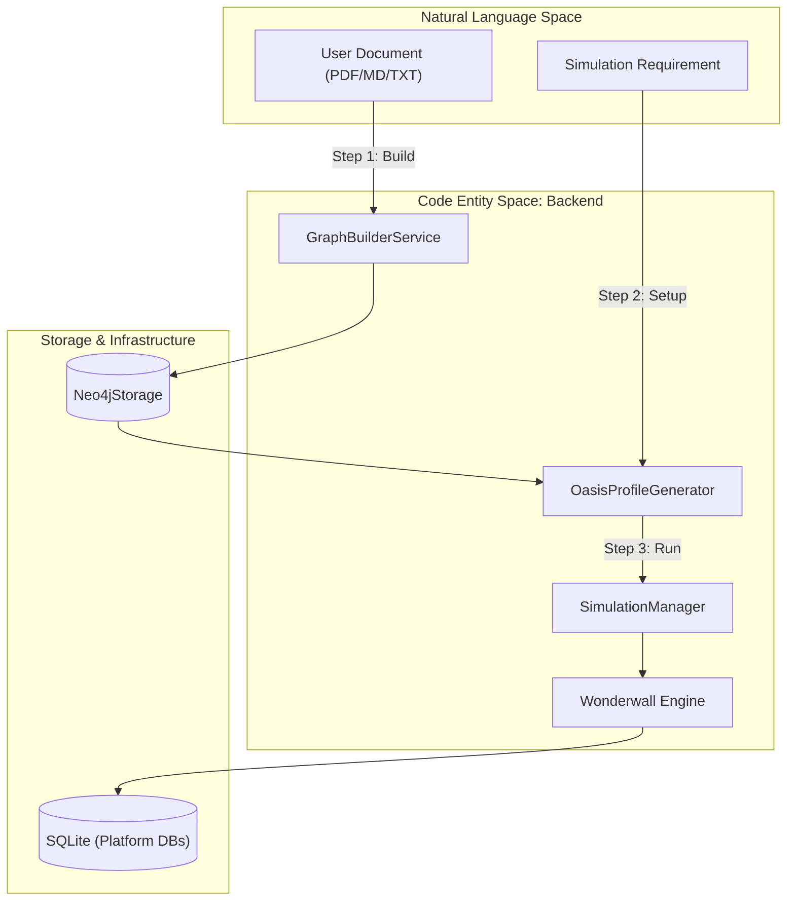
Sources: [README.md:45-80](), [frontend/src/views/Home.vue:103-170]()

## Key Architectural Concepts

### 1. Knowledge Graph Grounding
Unlike "zero-shot" simulations, every agent in MiroShark is anchored to a node in a Neo4j graph. The `GraphBuilderService` ensures that agents possess specific "memories" and relationships derived directly from the source material.
*   For details, see **[Knowledge Graph Pipeline](#2)**.

### 2. Multi-Platform Synchronization
The simulation runs parallel environments for Twitter, Reddit, and Polymarket. The `Market-Media Bridge` ensures that social sentiment influences market prices and vice versa, while the `BeliefState` model tracks agent opinion shifts over time.
*   For details, see **[Simulation Execution Engine](#4)**.

### 3. Hyperstitions Design System
The frontend, built with Vue 3, follows the "Hyperstitions v2.0" design system—an Evangelion-inspired aesthetic using a high-contrast bicolor palette (Orange and Green) and modular spacing.

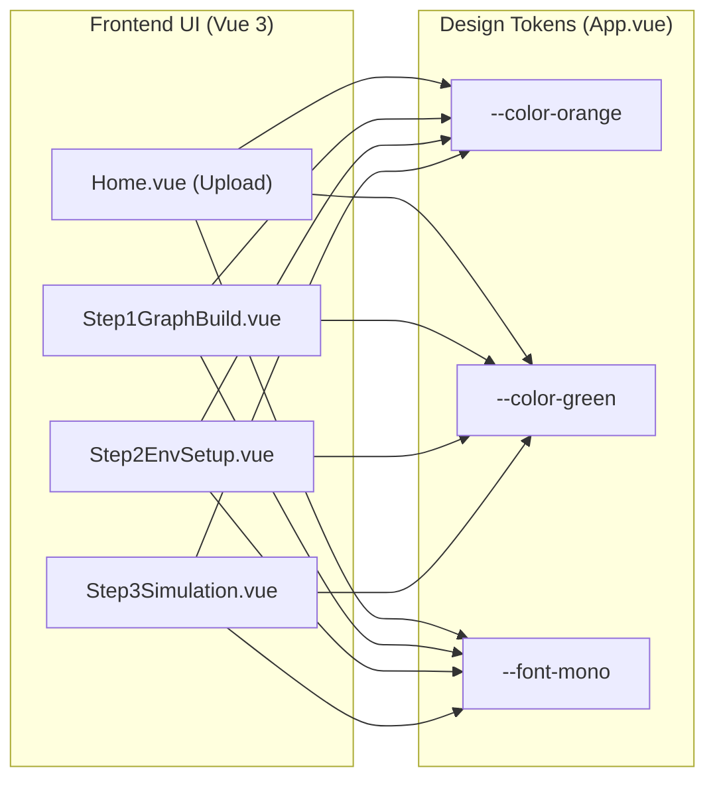
Sources: [frontend/src/App.vue:10-50](), [frontend/src/views/Home.vue:1-38]()

## Subsystem Integration

The following table summarizes how the major subsystems fit together:

| Subsystem | Primary Code Responsibility | Data Input | Data Output |
| :--- | :--- | :--- | :--- |
| **Ingestion** | `DocumentProcessor` | Raw Files | Text Chunks |
| **Graph Build** | `GraphBuilderService` | Text Chunks | Neo4j Nodes/Edges |
| **Agent Gen** | `OasisProfileGenerator` | Neo4j Data | `profiles.json` |
| **Simulation** | `SimulationRunner` | `simulation_config.json` | `actions.jsonl` / SQLite |
| **Analysis** | `ReportAgent` | `actions.jsonl` | `full_report.md` |

Sources: [README.md:88-95](), [frontend/src/views/Home.vue:59-95]()

## Next Steps
*   To set up your environment (Ollama, Neo4j, Docker), visit **[Getting Started & Configuration](#1.1)**.
*   To understand the technical details of the Flask/Vue architecture and the Wonderwall engine, visit **[System Architecture & Data Flow](#1.2)**.

---

# Page: Getting Started & Configuration

# Getting Started & Configuration

<details>
<summary>Relevant source files</summary>

The following files were used as context for generating this wiki page:

- [.dockerignore](.dockerignore)
- [.env.example](.env.example)
- [.github/workflows/docker-image.yml](.github/workflows/docker-image.yml)
- [.gitignore](.gitignore)
- [Dockerfile](Dockerfile)
- [backend/app/config.py](backend/app/config.py)
- [backend/app/services/ontology_generator.py](backend/app/services/ontology_generator.py)
- [backend/app/storage/ner_extractor.py](backend/app/storage/ner_extractor.py)
- [backend/app/utils/__init__.py](backend/app/utils/__init__.py)
- [backend/app/utils/file_parser.py](backend/app/utils/file_parser.py)
- [backend/app/utils/llm_client.py](backend/app/utils/llm_client.py)
- [backend/app/utils/logger.py](backend/app/utils/logger.py)
- [backend/pyproject.toml](backend/pyproject.toml)
- [backend/requirements.txt](backend/requirements.txt)
- [backend/run.py](backend/run.py)
- [backend/uv.lock](backend/uv.lock)
- [backend/wonderwall/simulations/social_media/__init__.py](backend/wonderwall/simulations/social_media/__init__.py)
- [docker-compose.yml](docker-compose.yml)
- [frontend/package-lock.json](frontend/package-lock.json)
- [frontend/package.json](frontend/package.json)
- [frontend/src/store/pendingUpload.js](frontend/src/store/pendingUpload.js)
- [package-lock.json](package-lock.json)
- [package.json](package.json)

</details>


This page provides a technical guide for setting up and configuring the MiroShark environment. MiroShark is designed to be flexible, supporting fully local deployments (Ollama + Neo4j), cloud-based provider configurations (OpenRouter/OpenAI), and containerized execution via Docker.

## Environment Setup & Prerequisites

MiroShark requires a Python 3.11+ backend and a Node.js 18+ frontend [backend/pyproject.toml:5-5](). The system relies on two external services:
1.  **Neo4j**: Used as the primary Graph Store for entities and relations [backend/app/config.py:46-48]().
2.  **LLM Provider**: Used for ontology generation, NER extraction, simulation reasoning, and report generation [backend/app/config.py:32-35]().

### Local Development Installation

To set up the project locally, use the provided `npm` scripts which orchestrate both frontend and backend dependencies:

```bash
# Install all dependencies (Node.js and Python via uv)
npm run setup:all

# Start both backend and frontend concurrently
npm run dev
```
The `setup:all` script triggers `npm install` in the root and frontend directories, and uses `uv sync` to manage the Python virtual environment in the backend [package.json:5-8]().

### Docker Deployment
The project includes a `docker-compose.yml` for rapid deployment. This orchestrates the `miroshark` application, a `neo4j` instance, and an `ollama` service for local inference. When running in Docker, internal service names (e.g., `http://ollama:11434`) must be used in the `.env` file instead of `localhost` [.env.example:79-85]().

---

## Configuration (.env)

MiroShark uses a centralized `.env` file located in the project root. The `Config` class in `backend/app/config.py` loads these variables and provides defaults [backend/app/config.py:9-25]().

### LLM Provider Selection
MiroShark uses a unified OpenAI-compatible interface for most providers.

| Variable | Description | Example (Ollama) | Example (OpenRouter) |
| :--- | :--- | :--- | :--- |
| `LLM_PROVIDER` | API Type: `openai` or `claude-code` | `openai` | `openai` |
| `LLM_API_KEY` | API Key (required for cloud) | `ollama` | `sk-or-v1-...` |
| `LLM_BASE_URL` | Endpoint URL | `http://localhost:11434/v1` | `https://openrouter.ai/api/v1` |
| `LLM_MODEL_NAME` | Model identifier | `qwen2.5:32b` | `anthropic/claude-3.5-sonnet` |

**Smart Model Routing:**
For "intelligence-sensitive" workflows—specifically `OntologyGenerator`, `ReportAgent`, and graph reasoning—you can configure a `SMART_MODEL_NAME`. If set, the `create_smart_llm_client()` factory will prioritize these credentials over the default LLM [backend/app/utils/llm_client.py:32-51](). This allows using a cheaper model (e.g., Qwen 14B) for high-volume simulation actions while using a premium model (e.g., Claude 3.5 Sonnet) for final analysis [backend/app/config.py:37-43]().

### Embedding Configuration
Embeddings are used for GraphRAG and entity search. MiroShark supports two embedding modes via `EMBEDDING_PROVIDER` [backend/app/config.py:51-56]():
*   **ollama**: Uses the `/api/embed` endpoint (standard for local setups).
*   **openai**: Uses the `/v1/embeddings` endpoint (compatible with OpenAI and OpenRouter).

---

## System Initialization Flow

The following diagram illustrates how the system initializes its configuration and establishes connections between the "Natural Language Space" (configuration strings) and the "Code Entity Space" (Python classes).

### Configuration Loading & Validation
Title: Configuration Initialization Flow
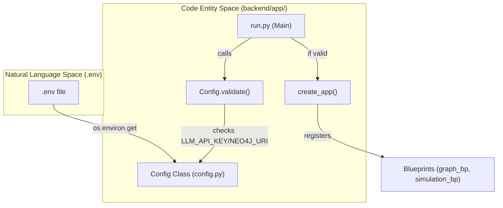
Sources: [backend/app/config.py:20-107](), [backend/run.py:25-45]()

---

## LLM Client Architecture

MiroShark abstracts LLM interactions through the `LLMClient` class. It handles provider-specific quirks, such as stripping `<think>` tags from reasoning models and managing Ollama's context window via `num_ctx` [backend/app/utils/llm_client.py:77-123]().

### Client Data Flow
Title: LLM Request Handling
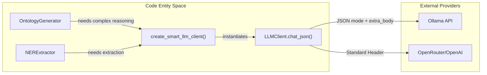
Sources: [backend/app/utils/llm_client.py:54-158](), [backend/app/services/ontology_generator.py:164-165](), [backend/app/storage/ner_extractor.py:97-98]()

### Key Functions & Implementation Details

*   **`Config.validate()`**: Checks for mandatory environment variables (`LLM_API_KEY`, `NEO4J_URI`, `NEO4J_PASSWORD`) before the Flask server starts [backend/app/config.py:97-107]().
*   **`LLMClient.chat_json()`**: A wrapper that enforces JSON output from the LLM. It cleans Markdown code blocks (e.g., ` ```json `) and handles JSON parsing errors with retries [backend/app/utils/llm_client.py:125-158]().
*   **`OLLAMA_NUM_CTX`**: An environment variable that sets the context window size for Ollama via the `extra_body` parameter in the OpenAI SDK, preventing unexpected truncation of long graph-context prompts [backend/app/utils/llm_client.py:78-118]().
*   **`WEB_ENRICHMENT_ENABLED`**: When true, the system uses a search-capable LLM (configured via `WEB_SEARCH_MODEL`) to find real-world data for personas if the knowledge graph context is insufficient [backend/app/config.py:85-90]().

---

## Development Scripts Reference

The `package.json` in the root directory provides several utility scripts for development [package.json:5-14]():

| Script | Command | Purpose |
| :--- | :--- | :--- |
| `setup:all` | `npm run setup && npm run setup:backend` | Installs frontend `node_modules` and backend `uv` environment. |
| `dev` | `concurrently ... "npm run backend" "npm run frontend"` | Runs both servers. Backend on port `5001`, Frontend on `3000`. |
| `predev` | `node -e "..."` | Automatically kills stale processes on ports 3000 and 5001 to prevent "Address already in use" errors. |
| `backend` | `cd backend && uv run python run.py` | Starts the Flask backend independently. |

Sources: [package.json:5-14](), [backend/app/config.py:41-41]()

---

# Page: System Architecture & Data Flow

# System Architecture & Data Flow

<details>
<summary>Relevant source files</summary>

The following files were used as context for generating this wiki page:

- [README.md](README.md)
- [backend/app/api/__init__.py](backend/app/api/__init__.py)
- [backend/app/models/task.py](backend/app/models/task.py)
- [backend/app/utils/logger.py](backend/app/utils/logger.py)
- [backend/run.py](backend/run.py)
- [frontend/src/api/report.js](frontend/src/api/report.js)
- [frontend/src/api/simulation.js](frontend/src/api/simulation.js)
- [frontend/src/router/index.js](frontend/src/router/index.js)

</details>


This page describes the technical architecture of MiroShark, detailing how the system transitions from unstructured document ingestion to a multi-agent social simulation and finally to an automated analytical report. MiroShark is built on a decoupled architecture comprising a Flask-based REST API, a Vue 3 reactive frontend, a Neo4j graph database, and the Wonderwall simulation engine.

## High-Level Architecture

The system is divided into four primary layers:
1.  **Frontend (Vue 3):** Manages the 5-step workflow (Upload, Build, Setup, Run, Report) and provides real-time visualization of simulation state [frontend/src/router/index.js:9-45]().
2.  **Backend API (Flask):** Orchestrates long-running tasks via a `TaskManager` and provides endpoints for graph operations, simulation control, and report generation [backend/app/api/__init__.py:7-9]().
3.  **Persistence Layer:** Uses **Neo4j** for the knowledge graph (entities and relationships) and **SQLite** (within the Wonderwall engine) for simulation-specific logs, trades, and message history [README.md:39-41]().
4.  **Simulation Engine (Wonderwall):** A multi-process environment that executes agents across Twitter, Reddit, and Polymarket platforms in parallel rounds [README.md:49-80]().

### System Component Diagram

The following diagram illustrates the relationship between the major code entities and the data storage systems.

**MiroShark Component Map**
```mermaid
graph TD
    subgraph "Frontend (Vue 3)"
        [Home.vue] --> [MainView.vue]
        [MainView.vue] --> [SimulationRunView.vue]
        [SimulationRunView.vue] --> [ReportView.vue]
    end

    subgraph "Backend API (Flask)"
        [graph_bp] --> [GraphBuilderService]
        [simulation_bp] --> [SimulationManager]
        [report_bp] --> [ReportAgent]
        [TaskManager] -.-> |"Tracks Status"| [graph_bp]
    end

    subgraph "Storage & Engines"
        [Neo4j_Graph_Store]
        [Wonderwall_Engine]
        [SQLite_Platform_DBs]
    end

    [GraphBuilderService] --> [Neo4j_Graph_Store]
    [SimulationManager] --> [Wonderwall_Engine]
    [Wonderwall_Engine] --> [SQLite_Platform_DBs]
    [ReportAgent] --> [SQLite_Platform_DBs]
    [ReportAgent] --> [Neo4j_Graph_Store]
```
**Sources:** [backend/app/api/__init__.py:7-9](), [frontend/src/router/index.js:9-45](), [backend/app/models/task.py:54-71](), [README.md:45-80]().

---

## Data Flow Pipeline

The MiroShark pipeline transforms natural language documents into actionable simulation data through five distinct phases.

### 1. Knowledge Graph Construction
When a user uploads a document, the `graph_bp` initiates a task via `GraphBuilderService`. The service parses the text, uses an LLM to generate an ontology, and extracts entities and relations.
*   **Optimization:** Extraction is parallelized using `ThreadPoolExecutor`, and writes to Neo4j are batched using `UNWIND` Cypher queries to maximize throughput [README.md:88-91]().
*   **Status Tracking:** The `TaskManager` singleton tracks the progress (0-100%) and state (PENDING, PROCESSING, COMPLETED, FAILED) [backend/app/models/task.py:14-36]().

### 2. Agent & Environment Preparation
The `SimulationManager` (invoked via `POST /api/simulation/prepare`) transforms graph nodes into agent personas [frontend/src/api/simulation.js:15-17]().
*   **Persona Grounding:** Each agent is built using five context layers: graph attributes, relationships, semantic search, related nodes, and optional web research via `WEB_SEARCH_MODEL` [README.md:40-98]().
*   **Configuration:** The `SimulationConfigGenerator` synthesizes the `simulation_config.json`, defining platform weights and initial "Reality Seeds" [README.md:41]().

### 3. Simulation Execution (Wonderwall)
The simulation runs in rounds. The backend spawns the Wonderwall engine, which executes Twitter, Reddit, and Polymarket simulations simultaneously using `asyncio.gather` [README.md:41]().

**Execution Data Flow**
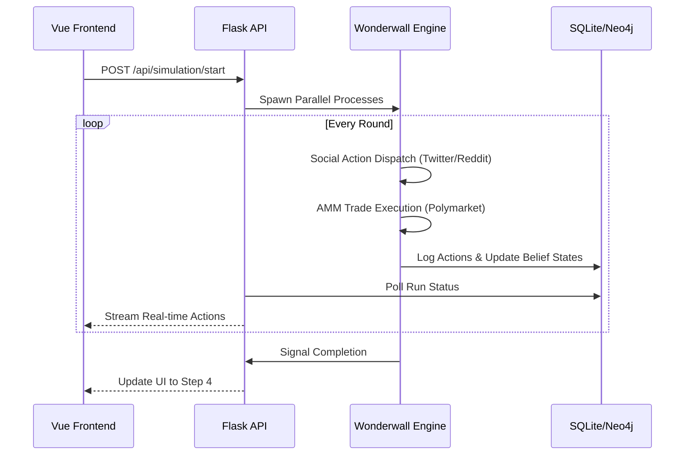
**Sources:** [frontend/src/api/simulation.js:83-113](), [README.md:49-80]().

### 4. Cross-Platform Interaction
A "Market-Media Bridge" ensures data flow between platforms [README.md:68-72]():
*   **Social → Market:** Sentiment from Twitter/Reddit posts is injected into Polymarket trader prompts.
*   **Market → Social:** Current prediction market prices are injected into social media agent prompts to influence their stance [README.md:84]().
*   **Belief Tracking:** A heuristic model tracks each agent's stance (-1 to +1), confidence (0 to 1), and trust in other agents [README.md:75-79]().

### 5. Analysis & Report Generation
The `ReportAgent` uses a ReACT (Reasoning and Acting) loop to query the simulation results [README.md:42]().
*   **Data Retrieval:** The agent uses `simulation_feed` (to read `actions.jsonl`) and `market_state` (to query SQLite P&L) [README.md:42]().
*   **Final Output:** A structured Markdown report is generated and stored as `full_report.md`, which the frontend fetches via the `report_bp` [frontend/src/api/report.js:41-43]().

---

## Technical Implementation Details

### Threading & Process Management
The backend is configured to be `threaded=True` to handle multiple concurrent API requests and polling [backend/run.py:45](). However, the heavy lifting of the simulation is offloaded to separate processes to avoid the Python Global Interpreter Lock (GIL) and ensure platform isolation.

### Logging and Monitoring
MiroShark implements a dual-logging system:
1.  **System Logs:** Managed by `setup_logger`, providing detailed `DEBUG` logs to files and `INFO` logs to the console [backend/app/utils/logger.py:30-88]().
2.  **Simulation Logs:** Captured per-run, including an `agent_log.jsonl` for the Report Agent's thought process and a `console_log.txt` for the simulation's standard output [frontend/src/api/report.js:24-35]().

### API Blueprints
The backend functionality is modularized into three Flask Blueprints:
| Blueprint | Responsibility | Key File |
| :--- | :--- | :--- |
| `graph_bp` | Document ingestion, NER, and Neo4j graph building. | [backend/app/api/graph.py]() |
| `simulation_bp` | Environment preparation, agent generation, and run control. | [backend/app/api/simulation.py]() |
| `report_bp` | ReACT-based analysis and report artifact serving. | [backend/app/api/report.py]() |

**Sources:** [backend/app/api/__init__.py:7-9](), [backend/run.py:45](), [backend/app/utils/logger.py:66-82]().

---

# Page: Knowledge Graph Pipeline

# Knowledge Graph Pipeline

<details>
<summary>Relevant source files</summary>

The following files were used as context for generating this wiki page:

- [.env.example](.env.example)
- [backend/app/services/graph_builder.py](backend/app/services/graph_builder.py)
- [backend/app/services/ontology_generator.py](backend/app/services/ontology_generator.py)
- [backend/app/storage/ner_extractor.py](backend/app/storage/ner_extractor.py)
- [backend/app/utils/__init__.py](backend/app/utils/__init__.py)
- [backend/app/utils/llm_client.py](backend/app/utils/llm_client.py)

</details>


The **Knowledge Graph Pipeline** is the core data processing engine of MiroShark. It transforms unstructured source documents (PDFs, text files) into a structured, queryable Neo4j property graph. This graph serves as the "ground truth" for generating realistic agent personas and grounding social simulations in factual context.

The pipeline follows a sequential flow: ingestion of raw files, AI-driven ontology design, parallelized Named Entity Recognition (NER) and Relation Extraction (RE), and finally, persistence into a Neo4j database with vector embeddings for hybrid search.

### Pipeline Overview

The transition from Natural Language to a structured Graph is managed by the `GraphBuilderService` [[backend/app/services/graph_builder.py:38-42]](). It orchestrates several specialized services to process text chunks and populate the database.

#### System Architecture & Data Flow
The following diagram illustrates how the system components interact to move data from the "Natural Language Space" into the "Code Entity Space" of the Neo4j graph.

**Data Flow: Document to Neo4j**
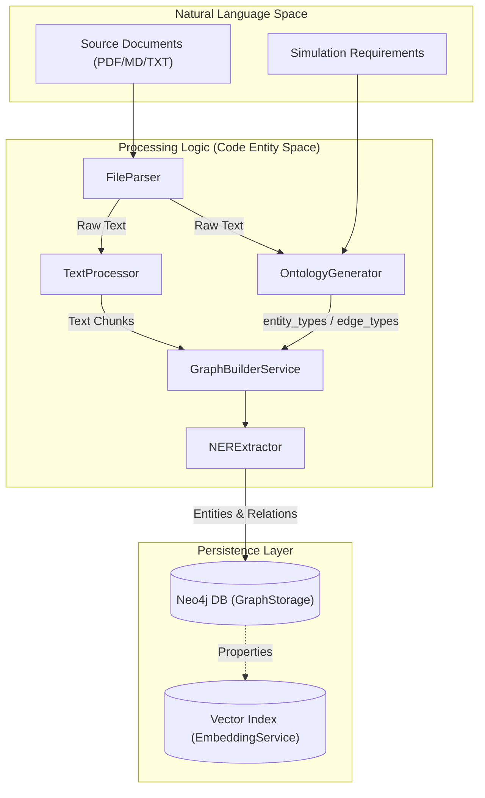
**Sources:** [backend/app/services/graph_builder.py:110-143](), [backend/app/services/ontology_generator.py:167-183](), [backend/app/storage/ner_extractor.py:94-115]()

---

### 1. Document Ingestion & Ontology Generation
The pipeline begins by parsing uploaded files and analyzing their content to create a custom schema. Unlike static systems, MiroShark uses a **Smart LLM** to design an ontology specifically tailored to the simulation's needs.

*   **File Parsing:** Supports multiple formats with automatic encoding detection.
*   **Ontology Design:** The `OntologyGenerator` [[backend/app/services/ontology_generator.py:158-162]]() identifies key roles (e.g., `Professor`, `Executive`) and fallback types (`Person`, `Organization`) to ensure every extracted entity has a place in the graph [[backend/app/services/ontology_generator.py:75-86]]().

For details, see [Document Ingestion & Ontology Generation](#2.1).

**Sources:** [backend/app/services/ontology_generator.py:11-38](), [backend/app/utils/file_parser.py:1-10]() (implied by `FileParser` usage).

---

### 2. NER Extraction & Graph Building
Once the ontology is defined, the `GraphBuilderService` initiates an asynchronous build process [[backend/app/services/graph_builder.py:48-56]](). 

*   **Parallel Processing:** Text is split into chunks by the `TextProcessor` [[backend/app/services/graph_builder.py:126-127]]() and processed in batches using a `ThreadPoolExecutor` [[backend/app/services/graph_builder.py:186-198]]().
*   **Extraction:** The `NERExtractor` uses structured LLM prompts to identify entities and relationships while enforcing "Rejection Rules" to filter out fragments and abstract concepts [[backend/app/storage/ner_extractor.py:33-46]]().
*   **Canonicalization:** The system merges co-references (e.g., "it", "the firm") into canonical entity names to maintain graph integrity [[backend/app/storage/ner_extractor.py:30-31]]().

For details, see [NER Extraction & Graph Building](#2.2).

**Sources:** [backend/app/services/graph_builder.py:193-205](), [backend/app/storage/ner_extractor.py:17-31]().

---

### 3. Neo4j Storage & Graph Search
The final stage involves persisting the extracted data into Neo4j. This is not just a simple storage step; it includes building a rich index for later retrieval during simulation.

*   **Persistence:** Entities and relations are upserted using optimized Cypher queries.
*   **Hybrid Search:** The `SearchService` combines traditional BM25 keyword search with vector embeddings generated by the `EmbeddingService` [[.env.example:38-45]]().
*   **Graph Reasoning:** The system calculates graph metrics like degree centrality and identifies "bridge entities" to determine which agents are most influential in the simulation [[backend/app/services/graph_builder.py:154-156]]().

For details, see [Neo4j Storage & Graph Search](#2.3).

**Sources:** [backend/app/services/graph_builder.py:145-156](), [.env.example:32-36]().

---

### Code Entity Mapping
This diagram bridges the high-level pipeline stages to the specific classes and configurations used in the codebase.

**Pipeline Component Mapping**
| Pipeline Stage | Primary Class / Service | Config Dependency |
| :--- | :--- | :--- |
| **Ontology Generation** | `OntologyGenerator` [[backend/app/services/ontology_generator.py:158]]() | `SMART_MODEL_NAME` [[.env.example:55-62]]() |
| **LLM Orchestration** | `LLMClient` [[backend/app/utils/llm_client.py:54]]() | `LLM_PROVIDER` [[.env.example:8-10]]() |
| **Graph Construction** | `GraphBuilderService` [[backend/app/services/graph_builder.py:38]]() | `NEO4J_URI` [[.env.example:32-34]]() |
| **Entity Extraction** | `NERExtractor` [[backend/app/storage/ner_extractor.py:94]]() | `LLM_MODEL_NAME` [[.env.example:17]]() |
| **Task Management** | `TaskManager` [[backend/app/models/task.py:1-10]]() | N/A |

**Sources:** [backend/app/services/graph_builder.py:44-46](), [backend/app/utils/llm_client.py:32-51](), [.env.example:1-86]().

---

# Page: Document Ingestion & Ontology Generation

# Document Ingestion & Ontology Generation

<details>
<summary>Relevant source files</summary>

The following files were used as context for generating this wiki page:

- [.env.example](.env.example)
- [.gitignore](.gitignore)
- [backend/app/api/graph.py](backend/app/api/graph.py)
- [backend/app/api/report.py](backend/app/api/report.py)
- [backend/app/services/ontology_generator.py](backend/app/services/ontology_generator.py)
- [backend/app/storage/ner_extractor.py](backend/app/storage/ner_extractor.py)
- [backend/app/utils/__init__.py](backend/app/utils/__init__.py)
- [backend/app/utils/file_parser.py](backend/app/utils/file_parser.py)
- [backend/app/utils/llm_client.py](backend/app/utils/llm_client.py)
- [backend/pyproject.toml](backend/pyproject.toml)
- [backend/requirements.txt](backend/requirements.txt)
- [backend/uv.lock](backend/uv.lock)
- [backend/wonderwall/simulations/social_media/__init__.py](backend/wonderwall/simulations/social_media/__init__.py)
- [package-lock.json](package-lock.json)
- [package.json](package.json)

</details>


This page details the initial stage of the MiroShark pipeline: transforming raw unstructured documents into a structured **Ontology** that defines the "rules of existence" for the subsequent Knowledge Graph and social simulation.

## 1. Document Ingestion & Parsing

The ingestion process begins at the `POST /api/graph/ontology/generate` endpoint [backend/app/api/graph.py:59-60](). This route handles multipart/form-data uploads, extracts raw text, and initializes a `Project` context.

### File Parsing Logic
MiroShark utilizes the `FileParser` utility to convert various file formats into clean text strings. The system supports PDF, Markdown (MD), and Plain Text (TXT) [backend/app/api/graph.py:32-32]().

*   **PDF Parsing**: Handled via `PyMuPDF` (imported as `fitz`) [backend/pyproject.toml:40-40]().
*   **Charset Fallback**: For text files, the system employs `charset-normalizer` and `chardet` to detect encodings, ensuring that non-UTF-8 files are correctly decoded [backend/pyproject.toml:41-43]().
*   **Preprocessing**: Extracted text is passed through `TextProcessor.preprocess_text` to normalize whitespace and remove artifacts before further processing [backend/app/api/graph.py:136-136]().

### Data Flow: Ingestion to Project
The `ProjectManager` persists the uploaded files and the combined extracted text to a project-specific directory [backend/app/api/graph.py:124-149]().

| Entity | Role | File Reference |
| :--- | :--- | :--- |
| `graph_bp` | Flask Blueprint handling `/ontology/generate` | [backend/app/api/graph.py:13-13]() |
| `FileParser` | Static utility for `extract_text` | [backend/app/utils/file_parser.py:1-10]() |
| `ProjectManager` | Manages filesystem storage and project metadata | [backend/app/models/project.py:1-20]() |

## 2. Ontology Generation Service

The `OntologyGenerator` service is responsible for defining the schema of the Knowledge Graph. Unlike generic RAG systems, MiroShark generates a **Simulation-Centric Ontology** designed specifically for public opinion modeling [backend/app/services/ontology_generator.py:12-22]().

### The Smart LLM Client
Ontology generation is considered an "intelligence-sensitive" workflow. The system uses the `create_smart_llm_client` factory [backend/app/utils/llm_client.py:32-32](). This factory checks for `SMART_MODEL_NAME` in the `.env` configuration [backend/app/utils/llm_client.py:37-37](). If defined, it uses a more capable model (e.g., Claude 3.5 Sonnet or Qwen 2.5 72B) for this task, otherwise falling back to the default `LLM_MODEL_NAME` [.env.example:55-72]().

### Design Constraints (Prompt Engineering)
The `ONTOLOGY_SYSTEM_PROMPT` enforces strict structural requirements to ensure the resulting graph is compatible with the `OasisProfileGenerator`:

1.  **Entity Quantity**: Exactly 10 entity types must be produced [backend/app/services/ontology_generator.py:77-77]().
2.  **Hierarchy**: Must include 8 specific types based on the text and 2 mandatory fallback types: `Person` and `Organization` [backend/app/services/ontology_generator.py:81-86]().
3.  **Interactivity**: Entities must be real-world subjects capable of "speaking" or "acting" on social media. Abstract concepts like "Public Opinion" are explicitly rejected as entity types [backend/app/services/ontology_generator.py:34-38]().
4.  **Relationships**: 6-10 edge types representing social interactions (e.g., `WORKS_FOR`, `OPPOSES`, `REPORTS_ON`) [backend/app/services/ontology_generator.py:103-155]().

### System Sequence: Ontology Generation
The following diagram bridges the Natural Language input to the structured `Project` state.

**Title: Natural Language to Structured Ontology Flow**
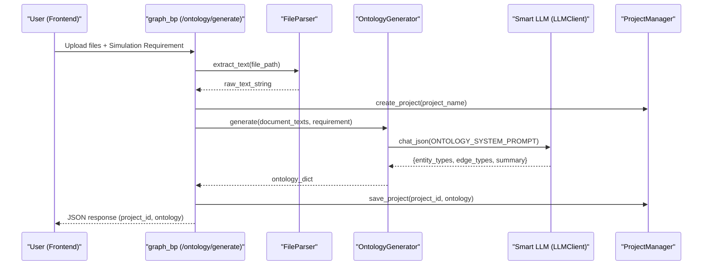
**Sources:** [backend/app/api/graph.py:59-185](), [backend/app/services/ontology_generator.py:158-183](), [backend/app/utils/llm_client.py:125-141]()

## 3. Implementation Details

### Text Chunking for Analysis
To avoid context window limits during ontology analysis, the `OntologyGenerator` builds a user message containing the simulation requirements and the source texts [backend/app/services/ontology_generator.py:185-190](). If the source text is excessively large, it is sampled to ensure the "Smart" LLM receives the most relevant context for schema design.

### JSON Validation and Cleaning
The `LLMClient.chat_json` method handles the communication with the LLM. It includes logic to:
1.  Strip Markdown code blocks (e.g., ` ```json `) from the response [backend/app/utils/llm_client.py:149-152]().
2.  Remove `<think>` tags generated by reasoning models like DeepSeek or MiniMax [backend/app/utils/llm_client.py:122-122]().
3.  Parse the string into a Python dictionary, raising a `ValueError` if the format is invalid [backend/app/utils/llm_client.py:154-157]().

### Key Class: OntologyGenerator
| Function | Purpose |
| :--- | :--- |
| `__init__` | Initializes the smart LLM client via `create_smart_llm_client()` [backend/app/services/ontology_generator.py:164-165]() |
| `generate` | Main entry point; orchestrates message building and LLM call [backend/app/services/ontology_generator.py:167-183]() |
| `_build_user_message` | Constructs the prompt including `document_texts` and `simulation_requirement` [backend/app/services/ontology_generator.py:185-190]() |

### Code Structure: Ontology Definition
The generated ontology follows a strict JSON schema defined in the system prompt [backend/app/services/ontology_generator.py:43-71]():

```json
{
    "entity_types": [
        {
            "name": "PascalCaseName",
            "description": "...",
            "attributes": [{"name": "snake_case", "type": "text", "description": "..."}],
            "examples": ["..."]
        }
    ],
    "edge_types": [
        {
            "name": "UPPER_SNAKE_CASE",
            "source_targets": [{"source": "TypeA", "target": "TypeB"}]
        }
    ]
}
```

**Title: Code Entity Space - Ontology Service Architecture**
```mermaid
classDiagram
    class "graph_bp" {
        +generate_ontology()
        +build_graph()
    }
    class "OntologyGenerator" {
        +llm_client: LLMClient
        +generate(texts, requirement)
    }
    class "LLMClient" {
        +chat_json(messages)
        -_is_ollama()
    }
    class "ProjectManager" {
        +save_project(project)
        +save_file_to_project()
    }

    "graph_bp" ..> "OntologyGenerator" : uses
    "graph_bp" ..> "ProjectManager" : persists state
    "OntologyGenerator" ..> "LLMClient" : invokes
```
**Sources:** [backend/app/api/graph.py:15-21](), [backend/app/services/ontology_generator.py:158-165](), [backend/app/utils/llm_client.py:54-62]()

## 4. Configuration Requirements
For successful ingestion and generation, the following environment variables must be configured in `.env` [.env.example:8-72]():

*   `LLM_API_KEY` / `LLM_BASE_URL`: For standard text processing.
*   `SMART_MODEL_NAME`: (Optional) Highly recommended for ontology generation to ensure strict JSON adherence and complex schema design.
*   `OLLAMA_NUM_CTX`: Defaults to `8192`. This is passed via `extra_body` to Ollama to prevent truncation of large source documents during analysis [backend/app/utils/llm_client.py:78-117]().

**Sources:**
- Ingestion logic: [backend/app/api/graph.py:59-185]()
- Ontology generation prompt: [backend/app/services/ontology_generator.py:11-155]()
- LLM client implementation: [backend/app/utils/llm_client.py:1-158]()
- Project management: [backend/app/models/project.py:1-20]()
- Dependencies: [backend/pyproject.toml:39-48]()

---

# Page: NER Extraction & Graph Building

# NER Extraction & Graph Building

<details>
<summary>Relevant source files</summary>

The following files were used as context for generating this wiki page:

- [.env.example](.env.example)
- [backend/app/services/graph_builder.py](backend/app/services/graph_builder.py)
- [backend/app/services/ontology_generator.py](backend/app/services/ontology_generator.py)
- [backend/app/services/text_processor.py](backend/app/services/text_processor.py)
- [backend/app/storage/ner_extractor.py](backend/app/storage/ner_extractor.py)
- [backend/app/utils/__init__.py](backend/app/utils/__init__.py)
- [backend/app/utils/llm_client.py](backend/app/utils/llm_client.py)

</details>


The **NER Extraction & Graph Building** stage is the core transformation process that converts unstructured text into a structured knowledge graph. This process is managed by the `GraphBuilderService`, which orchestrates text chunking, parallel Named Entity Recognition (NER) and Relation Extraction (RE) via the `NERExtractor`, and final persistence into Neo4j.

## System Architecture & Data Flow

The pipeline operates as a series of coordinated services. Once an ontology is generated (see Section 2.1), the `GraphBuilderService` initiates an asynchronous task to process the document text.

### High-Level Build Sequence

1.  **Task Initialization**: The `GraphBuilderService` creates a tracking entry in the `TaskManager` [backend/app/services/graph_builder.py:72-79]().
2.  **Ontology Binding**: The generated ontology is stored in the Neo4j Graph node to guide the extraction logic [backend/app/services/graph_builder.py:119-124]().
3.  **Chunking**: `TextProcessor` splits the text into overlapping segments (default 500 chars) [backend/app/services/graph_builder.py:127-133]().
4.  **Parallel Extraction**: Chunks are processed in batches using a `ThreadPoolExecutor` to handle I/O-bound LLM calls [backend/app/services/graph_builder.py:186-205]().
5.  **Upsert**: Extracted entities and relations are pushed to Neo4j via `GraphStorage`.

### Code-to-Logic Mapping: Extraction Pipeline

The following diagram illustrates how the Python classes interact to move data from a raw string to a Neo4j transaction.

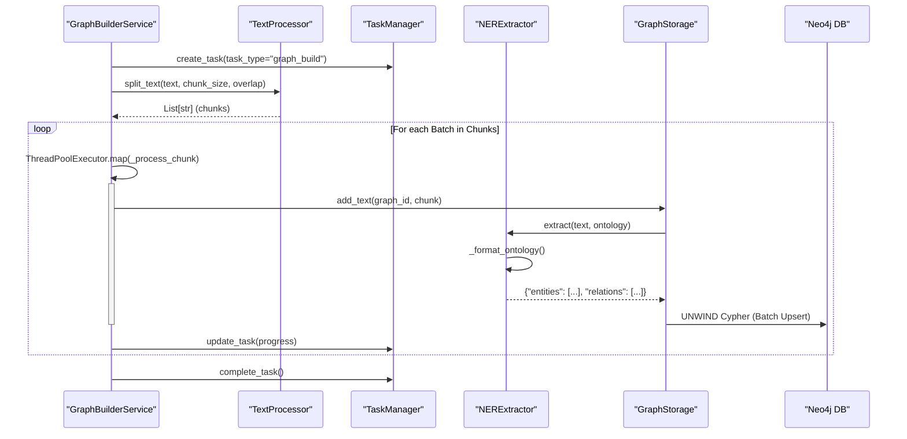
**Sources:** [backend/app/services/graph_builder.py:38-168](), [backend/app/storage/ner_extractor.py:94-152](), [backend/app/services/text_processor.py:18-34]()

---

## NERExtractor: Intelligence Logic

The `NERExtractor` replaces traditional NLP libraries with a structured LLM-based approach. It uses the `LLMClient.chat_json()` method to ensure the output conforms to a specific schema required for graph insertion [backend/app/storage/ner_extractor.py:131-136]().

### Extraction Rules & Constraints
To ensure the resulting graph is high-quality and suitable for social simulation, the `NERExtractor` enforces several "Rejection Rules" within its system prompt:

| Rule Type | Logic | Implementation |
| :--- | :--- | :--- |
| **Canonical Form** | Normalizes "Jack Ma" vs "ma jack" and prefers full names over abbreviations. | [backend/app/storage/ner_extractor.py:25-26](), [30-31]() |
| **Entity Rejection** | Rejects fragments ("the founder") or abstract concepts ("public opinion") as entities. | [backend/app/storage/ner_extractor.py:33-41]() |
| **Implicit Creation** | If the ontology requires it, creates specific attributes like `summary` based on text context. | [backend/app/storage/ner_extractor.py:42-45]() |
| **Ontology Adherence** | Only extracts types defined in the `entity_types` and `edge_types` lists. | [backend/app/storage/ner_extractor.py:23-24]() |

### Data Flow: Text to JSON
The extractor takes the raw chunk and the ontology, formats them into a prompt, and parses the result:
1.  **`_format_ontology`**: Converts the JSON ontology into a human-readable string for the LLM [backend/app/storage/ner_extractor.py:154-170]().
2.  **`extract`**: Sends the prompt to the LLM (typically `qwen2.5:32b` or similar) with a low temperature (0.1) for precision [backend/app/storage/ner_extractor.py:101-136]().
3.  **`_validate_and_clean`**: Post-processes the LLM output to ensure all entities have valid types and relations have valid sources/targets [backend/app/storage/ner_extractor.py:172-180]().

**Sources:** [backend/app/storage/ner_extractor.py:17-91](), [backend/app/storage/ner_extractor.py:101-152]()

---

## GraphBuilderService: Orchestration & Batching

The `GraphBuilderService` is responsible for the performance and reliability of the build process. It manages concurrency and provides progress updates to the frontend via the `TaskManager`.

### Concurrency Model
The service uses a `ThreadPoolExecutor` within `add_text_batches`. Because LLM extraction is I/O-bound (waiting for the model response), threading allows multiple chunks to be processed simultaneously, significantly reducing total build time [backend/app/services/graph_builder.py:193-205]().

```python
# Internal batch processing logic
def _process_chunk(chunk_idx: int, chunk: str) -> str:
    # ... logging and timing ...
    episode_id = self.storage.add_text(graph_id, chunk) # Triggers NERExtractor
    return episode_id
```
[backend/app/services/graph_builder.py:207-219]()

### Progress Tracking
The build process updates the `Task` status at several milestones:
*   **10%**: Graph created in Neo4j [backend/app/services/graph_builder.py:112-116]().
*   **15%**: Ontology metadata attached [backend/app/services/graph_builder.py:120-124]().
*   **20-80%**: Incremental progress as batches are processed [backend/app/services/graph_builder.py:136-143]().
*   **100%**: Final graph stats (node/edge counts) retrieved [backend/app/services/graph_builder.py:158-162]().

**Sources:** [backend/app/services/graph_builder.py:91-168](), [backend/app/models/task.py:14-15]()

---

## Persistence via Neo4j UNWIND

The system uses the `UNWIND` Cypher pattern for efficient batch upserts. When `GraphStorage.add_text` is called, it triggers the `NERExtractor` and then passes the resulting lists to Neo4j.

### Code-to-Database Space Mapping

The diagram below shows how the internal Python data structures (Entities and Relations) are mapped to Neo4j Graph elements.

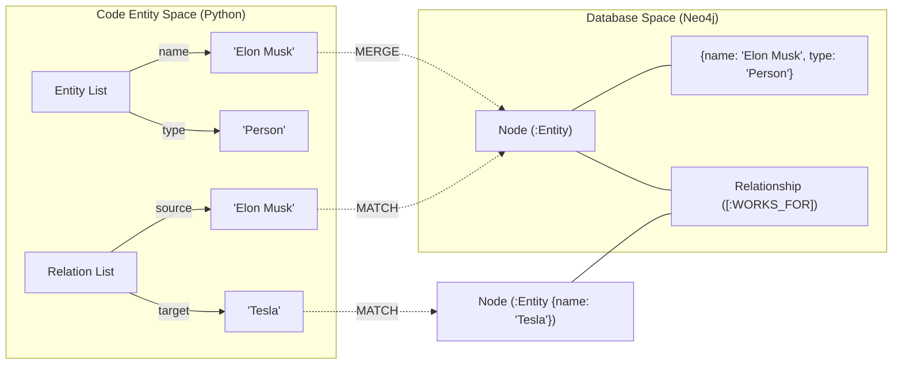

### Batch Upsert Logic
Instead of creating nodes one-by-one, the system uses the following logic (simplified):
1.  **Nodes**: `UNWIND $entities AS entity MERGE (e:Entity {name: entity.name, graph_id: $gid}) SET e += entity.attributes`
2.  **Edges**: `UNWIND $relations AS rel MATCH (s:Entity {name: rel.source}), (t:Entity {name: rel.target}) MERGE (s)-[r:RELATION {type: rel.type}]->(t) SET r.fact = rel.fact`

This approach ensures that even if the same entity is mentioned in 50 different chunks, only one unique node is maintained in the graph, with attributes merged over time.

**Sources:** [backend/app/storage/ner_extractor.py:17-87](), [backend/app/services/graph_builder.py:135-143](), [backend/app/storage/graph_storage.py]() (referenced via `GraphBuilderService` calls).

---

# Page: Neo4j Storage & Graph Search

# Neo4j Storage & Graph Search

<details>
<summary>Relevant source files</summary>

The following files were used as context for generating this wiki page:

- [backend/app/services/graph_builder.py](backend/app/services/graph_builder.py)
- [backend/app/storage/embedding_service.py](backend/app/storage/embedding_service.py)
- [backend/app/storage/neo4j_schema.py](backend/app/storage/neo4j_schema.py)
- [backend/app/storage/neo4j_storage.py](backend/app/storage/neo4j_storage.py)
- [backend/wonderwall/simulations/polymarket/__init__.py](backend/wonderwall/simulations/polymarket/__init__.py)
- [backend/wonderwall/simulations/polymarket/platform.py](backend/wonderwall/simulations/polymarket/platform.py)
- [backend/wonderwall/social_agent/belief_state.py](backend/wonderwall/social_agent/belief_state.py)

</details>


This page details the **Neo4j Storage** layer, which serves as the primary persistence and retrieval engine for MiroShark. It replaces traditional relational storage for knowledge representation with a property graph model, enabling complex reasoning, hybrid vector/keyword search, and topological analysis of extracted data.

## Neo4jStorage Implementation

The `Neo4jStorage` class implements the `GraphStorage` interface, providing a unified API for graph lifecycle management, data ingestion, and retrieval. It manages a `neo4j.GraphDatabase.driver` instance and enforces schema constraints upon initialization [backend/app/storage/neo4j_storage.py:32-58]().

### Schema Enforcement
On startup, `Neo4jStorage` executes a series of Cypher queries defined in `neo4j_schema.py` to ensure the database environment is prepared [backend/app/storage/neo4j_storage.py:64-71]().

| Type | Target | Property | Purpose |
| :--- | :--- | :--- | :--- |
| **Constraint** | `:Graph` | `graph_id` | Unique identifier for graph projects [backend/app/storage/neo4j_schema.py:11-14](). |
| **Constraint** | `:Entity` | `uuid` | Unique identifier for extracted entities [backend/app/storage/neo4j_schema.py:16-19](). |
| **Vector Index** | `:Entity` | `embedding` | Cosine similarity search for entities [backend/app/storage/neo4j_schema.py:43-49](). |
| **Vector Index** | `[:RELATION]` | `fact_embedding` | Cosine similarity search for relationship facts [backend/app/storage/neo4j_schema.py:51-57](). |
| **Fulltext Index** | `:Entity` | `name`, `summary` | BM25 keyword search for entities [backend/app/storage/neo4j_schema.py:27-30](). |

### Resilience & Retries
To handle the transient nature of network-attached databases, `Neo4jStorage` wraps write operations in a retry mechanism that catches `TransientError`, `ServiceUnavailable`, and `SessionExpired` exceptions, applying exponential backoff [backend/app/storage/neo4j_storage.py:77-97]().

Sources: [backend/app/storage/neo4j_storage.py:32-97](), [backend/app/storage/neo4j_schema.py:1-71]()

## Embedding Pipeline

MiroShark uses a pluggable `EmbeddingService` to transform text into high-dimensional vectors. This service supports both **Ollama** (local) and **OpenAI-compatible** (cloud) providers [backend/app/storage/embedding_service.py:23-40]().

### Data Flow: Text to Vector
The pipeline utilizes an in-memory cache to avoid redundant LLM calls for identical text strings [backend/app/storage/embedding_service.py:49-51]().

1.  **Normalization**: Input text is stripped of whitespace [backend/app/storage/embedding_service.py:63]().
2.  **Batching**: Large sets of entities or relations are processed in batches (default size 32) to optimize throughput [backend/app/storage/embedding_service.py:74-100]().
3.  **Dispatch**: The request is sent to the configured endpoint (`/api/embed` for Ollama or `/v1/embeddings` for OpenAI) [backend/app/storage/embedding_service.py:44-47]().

### System-to-Code Mapping: Embedding Pipeline
This diagram illustrates how the abstract concept of "Text Embedding" is realized through specific classes and external service configurations.

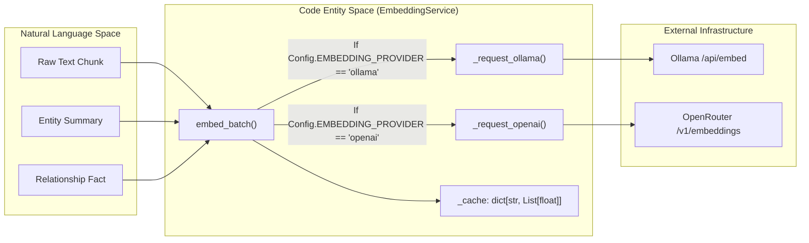
Sources: [backend/app/storage/embedding_service.py:23-130](), [backend/app/config.py:1-20]()

## Hybrid Search & SearchService

MiroShark implements a **Hybrid Search** strategy via the `SearchService`, combining the semantic depth of Vector Search with the keyword precision of BM25 (Fulltext) search.

### Implementation Logic
The `SearchService` executes two parallel search paths and merges the results:

1.  **Vector Path**: Converts the query string into an embedding using `EmbeddingService.embed()` and performs a Cypher `db.index.vector.queryNodes` call [backend/app/storage/neo4j_storage.py:200-210]().
2.  **BM25 Path**: Uses the `entity_fulltext` index to find exact or fuzzy keyword matches [backend/app/storage/neo4j_schema.py:27-30]().
3.  **Reranking**: Results are combined, typically prioritizing vector similarity while ensuring keyword-relevant nodes are not missed.

Sources: [backend/app/storage/neo4j_storage.py:55](), [backend/app/storage/search_service.py:1-50](), [backend/app/storage/neo4j_schema.py:27-58]()

## Graph Reasoning & Topological Queries

Beyond simple retrieval, MiroShark utilizes Neo4j to perform structural analysis of the knowledge graph. These queries are essential for the `OasisProfileGenerator` to determine an entity's influence or "role" in the simulation.

### Key Reasoning Queries

*   **Degree Centrality**: Calculates the number of connections for an entity to determine its "importance" in the narrative.
*   **Bridge Entities**: Identifies nodes that act as connectors between otherwise disconnected communities (high betweenness).
*   **Weakly Connected Components (WCC)**: Used for community detection to group entities into related clusters or "factions" [backend/app/storage/neo4j_storage.py:320-350]().

### System-to-Code Mapping: Graph Ingestion
This diagram maps the flow of data from the `GraphBuilderService` into the `Neo4jStorage` persistent structures.

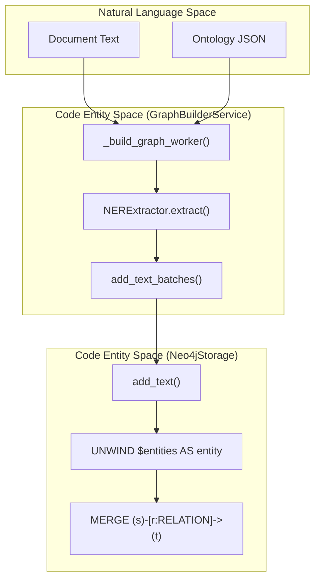
Sources: [backend/app/services/graph_builder.py:91-163](), [backend/app/storage/neo4j_storage.py:176-250]()

## Data Flow: NER to Neo4j Persistence

When `add_text` is called, the system performs a multi-stage transformation:

1.  **Extraction**: `NERExtractor` identifies entities and relationships based on the graph's ontology [backend/app/storage/neo4j_storage.py:186]().
2.  **Summarization**: Entity attributes are condensed into a single `summary` field for embedding [backend/app/storage/neo4j_storage.py:196-205]().
3.  **Batch Embedding**: All new entity summaries and relationship facts are embedded in a single `embed_batch` call [backend/app/storage/neo4j_storage.py:215-225]().
4.  **Cypher Transaction**: The data is pushed to Neo4j using the `UNWIND` pattern, which allows batch insertion of nodes and edges in a single ACID transaction, significantly improving performance over individual `CREATE` statements [backend/app/storage/neo4j_storage.py:230-280]().

Sources: [backend/app/storage/neo4j_storage.py:176-280](), [backend/app/services/graph_builder.py:186-219]()

---

# Page: Agent Generation & Simulation Preparation

# Agent Generation & Simulation Preparation

<details>
<summary>Relevant source files</summary>

The following files were used as context for generating this wiki page:

- [backend/app/api/simulation.py](backend/app/api/simulation.py)
- [backend/app/services/oasis_profile_generator.py](backend/app/services/oasis_profile_generator.py)
- [backend/app/services/simulation_manager.py](backend/app/services/simulation_manager.py)
- [backend/app/services/simulation_runner.py](backend/app/services/simulation_runner.py)

</details>


This stage of the MiroShark pipeline transforms static knowledge graph data into a dynamic simulation environment. It involves two primary processes: converting graph entities into high-fidelity agent personas and synthesizing a comprehensive simulation configuration that governs the behavioral logic of the environment.

The transition from the **Knowledge Graph Space** to the **OASIS Simulation Space** is managed by the `SimulationManager` [backend/app/services/simulation_manager.py:116-125](), which orchestrates the lifecycle from entity filtering to the final preparation of simulation artifacts.

### Transformation Overview

The simulation preparation follows a structured sequence:
1.  **Entity Filtering**: The `EntityReader` [backend/app/api/simulation.py:103-108]() extracts relevant nodes from Neo4j based on defined entity types.
2.  **Profile Generation**: The `OasisProfileGenerator` [backend/app/services/oasis_profile_generator.py:2-9]() enriches these entities with LLM-generated personas and structural metrics.
3.  **Config Synthesis**: The `SimulationConfigGenerator` [backend/app/services/simulation_config_generator.py]() produces the `simulation_config.json` which defines platform weights, narrative direction, and "Reality Seeds."

### Architecture: Preparation Lifecycle

The following diagram illustrates how system components interact to bridge the gap between the Neo4j graph and the Wonderwall simulation engine.

**Graph-to-Agent Transformation Flow**
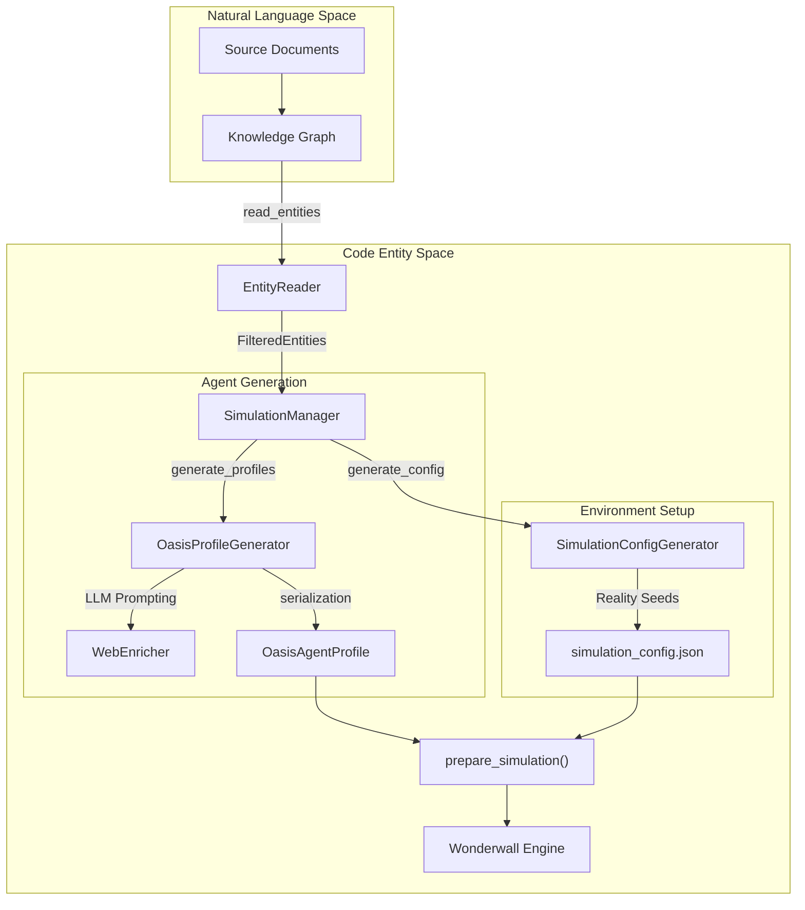
**Sources:** [backend/app/services/simulation_manager.py:116-125](), [backend/app/api/simulation.py:82-113](), [backend/app/services/oasis_profile_generator.py:28-61]()

---

## OASIS Profile Generator (3.1)

The `OasisProfileGenerator` is responsible for creating "Digital Twins" of graph entities. Unlike simple template filling, this service uses the entity's position in the graph topology to ground its social media metrics (e.g., an entity with high degree centrality in Neo4j is assigned higher follower counts in the simulation) [backend/app/services/oasis_profile_generator.py:164-181]().

Key features include:
*   **Context Assembly**: Combining graph attributes, hybrid search results, and optional web enrichment via `WebEnricher` [backend/app/services/oasis_profile_generator.py:22]().
*   **Persona Distinction**: Differentiating between individual personas (detailed MBTI, profession) and institutional entities (media outlets, NGOs) [backend/app/services/oasis_profile_generator.py:186-190]().
*   **Multi-Platform Serialization**: Exporting profiles to Twitter-compatible CSVs, Reddit JSONs, and Polymarket trader profiles [backend/app/services/oasis_profile_generator.py:63-139]().

For a deep dive into the prompting logic and metric grounding, see **[OASIS Profile Generator](#3.1)**.

**Sources:** [backend/app/services/oasis_profile_generator.py:1-25](), [backend/app/services/oasis_profile_generator.py:164-181]()

---

## Simulation Configuration Generator (3.2)

The simulation environment is defined by a central `simulation_config.json`. This configuration is not static; the `SimulationConfigGenerator` uses the "Smart LLM" to analyze the ingested knowledge and determine the optimal simulation parameters.

Key configuration elements:
*   **Time & Scale**: Defining `max_rounds`, `simulated_hours`, and platform-specific algorithm weights [backend/app/services/simulation_runner.py:101-119]().
*   **Reality Seeds**: Initializing the simulation with "Initial Posts" that reflect the core conflicts or facts found in the source documents.
*   **Narrative Direction**: Setting the "Stance" and "Narrative" goals that guide the `SocialAgent` behavior across platforms.

The `SimulationManager` handles the `prepare_simulation` lifecycle, which includes real-time streaming of profiles and configs to the frontend via the `simulation_bp` API [backend/app/api/simulation.py:190-205]().

For details on the config schema and the Reality Seed concept, see **[Simulation Configuration Generator](#3.2)**.

**Sources:** [backend/app/services/simulation_manager.py:42-76](), [backend/app/api/simulation.py:190-205](), [backend/app/services/simulation_runner.py:101-119]()

---

### Data Mapping: Graph to Simulation

This table describes how code entities from the Knowledge Graph are mapped to simulation-ready objects.

| Graph Entity (Neo4j) | Agent Profile Attribute | Simulation Config Impact |
| :--- | :--- | :--- |
| `EntityNode.label` | `source_entity_type` | Determines `base_metrics` (e.g., Media vs Person) |
| `EntityNode.attributes` | `persona` / `bio` | Grounding for `NarrativeDirection` |
| `degree` (Connections) | `follower_count` / `karma` | Influences "Reach" in platform algorithms |
| `community_id` | `interested_topics` | Determines initial "Stance" and group alignment |

**Sources:** [backend/app/services/oasis_profile_generator.py:164-190](), [backend/app/services/entity_reader.py:21]()

### Preparation Orchestration

**SimulationManager Preparation Sequence**
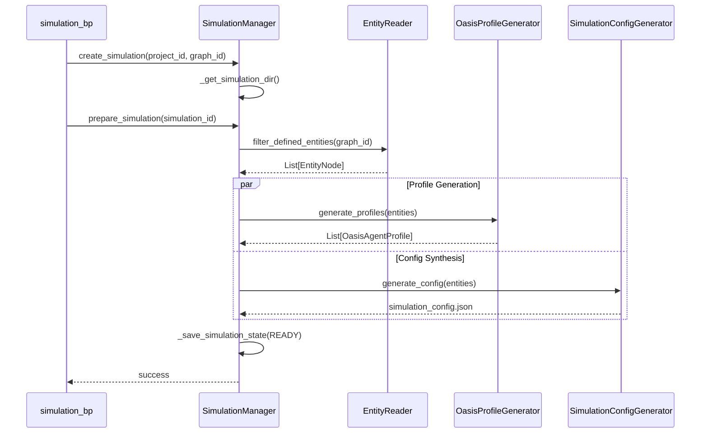
**Sources:** [backend/app/services/simulation_manager.py:140-156](), [backend/app/api/simulation.py:190-205](), [backend/app/services/oasis_profile_generator.py:28-61]()

---

# Page: OASIS Profile Generator

# OASIS Profile Generator

<details>
<summary>Relevant source files</summary>

The following files were used as context for generating this wiki page:

- [backend/app/services/oasis_profile_generator.py](backend/app/services/oasis_profile_generator.py)
- [backend/app/services/simulation_manager.py](backend/app/services/simulation_manager.py)
- [backend/app/services/web_enrichment.py](backend/app/services/web_enrichment.py)
- [backend/run.md](backend/run.md)

</details>


The **OASIS Profile Generator** is a critical subsystem that transforms static Knowledge Graph entities into dynamic, high-fidelity agent personas. It bridges the gap between structured data (Neo4j) and the behavioral requirements of the Wonderwall simulation engine. It handles entity context assembly, multi-stage enrichment, and platform-specific serialization for Twitter, Reddit, and Polymarket.

## 1. Core Architecture & Data Flow

The `OasisProfileGenerator` class orchestrates the transformation of a `GraphStorage` entity into an `OasisAgentProfile`. The process involves gathering graph attributes, performing hybrid search for context, optionally triggering web enrichment, and finally prompting an LLM to synthesize a persona.

### Profile Generation Sequence
The following diagram illustrates the lifecycle of a profile from graph entity to platform-ready JSON.

**Diagram: Entity to Persona Transformation**
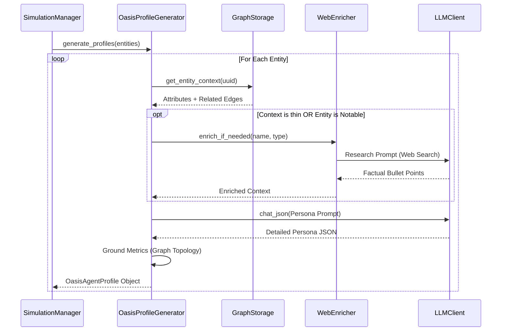
Sources: [backend/app/services/oasis_profile_generator.py:116-125](), [backend/app/services/simulation_manager.py:203-220]()

---

## 2. Entity Context Assembly

Before an LLM can generate a persona, the system assembles a comprehensive context package. This prevents "hallucination" by grounding the agent in the specific facts found during the document ingestion phase.

### 2.1 Graph Attribute Retrieval
The generator extracts all key-value pairs stored in the Neo4j node attributes. It also traverses the graph to find `related_edges`, providing the agent with knowledge of its social or professional circle [backend/app/services/oasis_profile_generator.py:164-182]().

### 2.2 Web Enrichment
If an entity is identified as a "Notable" type (e.g., `PublicFigure`, `CEO`, `GovernmentAgency`) or if the graph context is shorter than 150 characters, the `WebEnricher` is triggered [backend/app/services/web_enrichment.py:105-131]().
- **Notable Types:** Defined in `_NOTABLE_ENTITY_TYPES` and `_NOTABLE_ORG_TYPES` [backend/app/services/web_enrichment.py:42-54]().
- **Mechanism:** Uses the `WEB_SEARCH_MODEL` (e.g., Perplexity Sonar) to fetch 8-12 factual bullet points regarding the entity's public positions and biography [backend/app/services/web_enrichment.py:61-76]().

Sources: [backend/app/services/web_enrichment.py:42-131](), [backend/app/services/oasis_profile_generator.py:164-182]()

---

## 3. Persona Generation Logic

The generator distinguishes between **Individual** and **Institutional** (Group) personas, using distinct system prompts to ensure appropriate social media behavior.

### 3.1 Individual vs. Institutional Prompts
- **Individual:** Focuses on MBTI, personal life experiences, education, and specific communication styles (e.g., "confrontational" or "diplomatic") [backend/run.md:171-199]().
- **Institutional:** Focuses on organizational mission, official tone, branding, and stakeholder interests. It avoids personal traits like "age" or "gender" [backend/run.md:214-230]().

### 3.2 Metric Grounding from Graph Topology
Rather than assigning random follower counts, the system uses the entity's **Degree Centrality** in the knowledge graph to scale its social media influence.
- **Degree Factor:** A scaling factor (1.0 to 3.0) based on the number of connections in Neo4j [backend/app/services/oasis_profile_generator.py:175-181]().
- **Base Metrics:** Archetypes (e.g., `MediaOutlet`) receive higher base followers (50,000) compared to `Faculty` (2,000) [backend/app/services/oasis_profile_generator.py:186-191]().

Sources: [backend/app/services/oasis_profile_generator.py:164-191](), [backend/run.md:159-230]()

---

## 4. Platform-Specific Serialization

The `OasisAgentProfile` dataclass contains methods to export the persona into formats required by the Wonderwall simulation environments.

| Platform | Format | Key Fields | File Method |
| :--- | :--- | :--- | :--- |
| **Twitter** | CSV/JSON | `friend_count`, `follower_count`, `statuses_count` | `to_twitter_format()` |
| **Reddit** | JSON | `karma`, `subreddit_preferences` | `to_reddit_format()` |
| **Polymarket** | JSON | `risk_tolerance`, `user_profile` (trader logic) | `to_polymarket_format()` |

### Polymarket Integration
For prediction market simulations, the profile includes a `risk_tolerance` field ("high", "moderate", "low"). This determines how the agent interacts with the Constant-Product AMM (Automated Market Maker) during the simulation [backend/app/services/oasis_profile_generator.py:46-47]().

**Diagram: Code Entity Space Mapping**
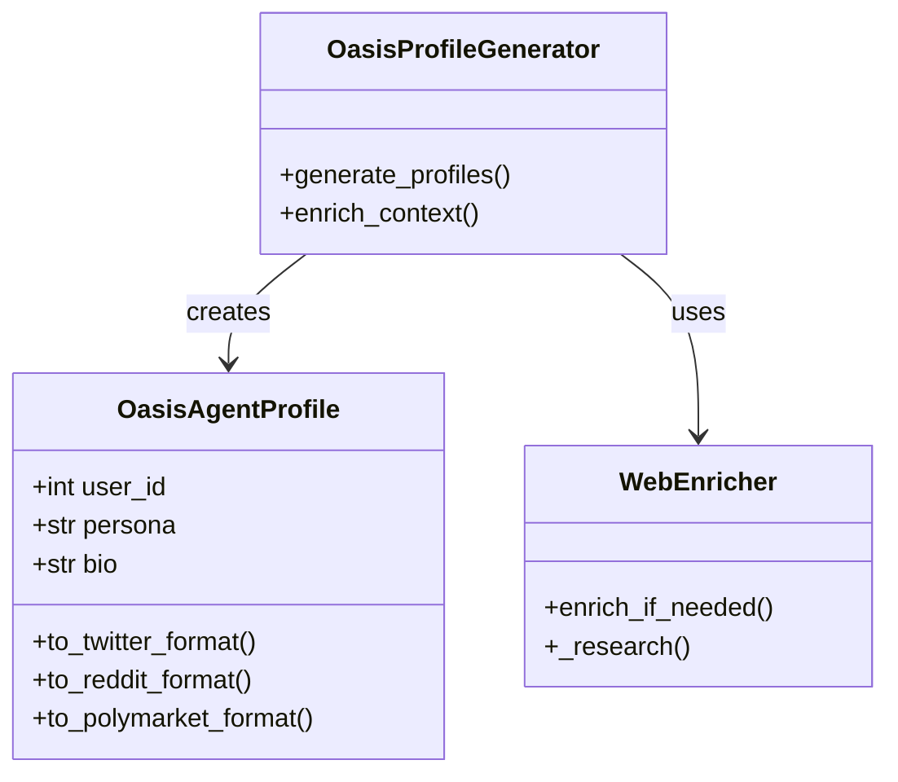

Sources: [backend/app/services/oasis_profile_generator.py:28-139](), [backend/app/services/oasis_profile_generator.py:121-139]()

---

## 5. Implementation Details

### Key Functions
- `_social_metrics_for_entity_type`: Calculates baseline social stats based on the entity's role and graph degree [backend/app/services/oasis_profile_generator.py:164-182]().
- `generate_profiles`: The main entry point called by `SimulationManager.prepare_simulation`. It supports real-time streaming of profiles to the frontend via a generator pattern [backend/app/services/simulation_manager.py:203-220]().

### Error Handling & Retries
The generator implements a retry mechanism for LLM calls with temperature backoff (0.7 → 0.6 → 0.5) to handle JSON parsing errors or rate limits [backend/run.md:166-168]().

Sources: [backend/app/services/oasis_profile_generator.py:164-182](), [backend/app/services/simulation_manager.py:203-220](), [backend/run.md:166-168]()

---

# Page: Simulation Configuration Generator

# Simulation Configuration Generator

<details>
<summary>Relevant source files</summary>

The following files were used as context for generating this wiki page:

- [backend/app/api/simulation.py](backend/app/api/simulation.py)
- [backend/app/services/oasis_profile_generator.py](backend/app/services/oasis_profile_generator.py)
- [backend/app/services/simulation_config_generator.py](backend/app/services/simulation_config_generator.py)
- [backend/app/services/simulation_manager.py](backend/app/services/simulation_manager.py)
- [backend/app/services/simulation_runner.py](backend/app/services/simulation_runner.py)

</details>


The **Simulation Configuration Generator** is a core subsystem responsible for synthesizing the technical parameters required to execute a multi-platform social simulation. It bridges the gap between the static Knowledge Graph and the dynamic **Wonderwall** execution engine by producing `simulation_config.json` and streaming OASIS-compatible agent profiles.

## SimulationManager Lifecycle

The `SimulationManager` class in [backend/app/services/simulation_manager.py:116-125]() orchestrates the transition from a constructed graph to a ready-to-run simulation. This lifecycle, triggered via the `/api/simulation/prepare` endpoint [backend/app/api/simulation.py:236-258](), involves entity filtering, profile generation, and parameter synthesis.

### The prepare_simulation Workflow

The `prepare_simulation` method [backend/app/services/simulation_manager.py:221-314]() executes the following sequence:
1.  **Entity Extraction**: Uses `EntityReader` to fetch nodes from Neo4j that have defined labels (e.g., Person, Organization) [backend/app/api/simulation.py:103-108]().
2.  **Profile Streaming**: Invokes `OasisProfileGenerator` to transform graph entities into platform-specific personas [backend/app/services/simulation_manager.py:255-265]().
3.  **Config Synthesis**: Calls `SimulationConfigGenerator` to determine time scales, event injections, and algorithmic weights [backend/app/services/simulation_manager.py:280-295]().
4.  **Persistence**: Writes `profiles.json` and `simulation_config.json` to the simulation's dedicated upload directory [backend/app/services/simulation_manager.py:302-310]().

**Sources:** [backend/app/services/simulation_manager.py:116-314](), [backend/app/api/simulation.py:236-258]()

## SimulationConfigGenerator Implementation

The `SimulationConfigGenerator` [backend/app/services/simulation_config_generator.py:26-26]() uses a step-by-step LLM generation strategy to avoid context window overflows and ensure logical consistency across different configuration modules.

### 1. Time Configuration (`TimeSimulationConfig`)
The system defaults to a **China Timezone** activity model [backend/app/services/simulation_config_generator.py:29-48](). It calculates `total_simulation_hours` and `minutes_per_round` (defaulting to 60 minutes for rapid progression) [backend/app/services/simulation_config_generator.py:84-112]().

### 2. Platform Algorithm Weights (`PlatformConfig`)
For Twitter and Reddit, the generator assigns heuristic weights to the recommendation engines:
*   **Recency Weight**: Preference for new content.
*   **Popularity Weight**: Preference for high-engagement content.
*   **Relevance Weight**: Preference for content matching agent interests.
*   **Echo Chamber Strength**: A factor (0.0 to 1.0) controlling the degree of algorithmic siloing [backend/app/services/simulation_config_generator.py:133-165]().

### 3. Event Configuration and Reality Seeds
The "Reality Seeds" concept is implemented via `EventConfig` [backend/app/services/simulation_config_generator.py:114-130](). This includes:
*   **Initial Posts**: Content injected at Round 0 to kickstart the narrative.
*   **Narrative Direction**: A high-level prompt guiding the LLM's stance on the simulation topic.
*   **Initial Markets**: Seeded Polymarket contracts [backend/app/services/simulation_config_generator.py:128-129]().

**Sources:** [backend/app/services/simulation_config_generator.py:29-165]()

## Reality Seeds to Code Entity Mapping

The following diagram illustrates how natural language simulation requirements are transformed into specific code objects and JSON artifacts.

**Title: Configuration Synthesis Data Flow**
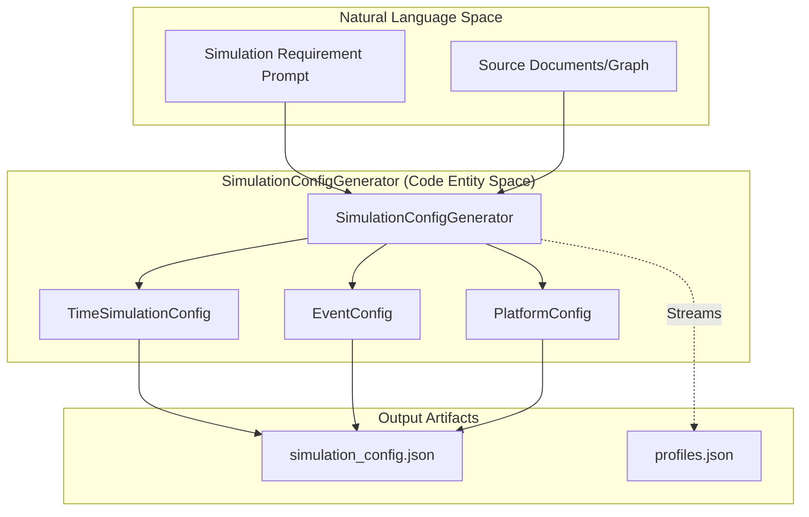
**Sources:** [backend/app/services/simulation_config_generator.py:167-195](), [backend/app/services/simulation_manager.py:280-310]()

## Profile Generation and Real-time Streaming

The `OasisProfileGenerator` [backend/app/services/oasis_profile_generator.py:25-25]() creates `OasisAgentProfile` objects. A key feature is the grounding of social metrics in graph topology.

### Metric Grounding
Instead of random numbers, the generator uses the graph's structural properties to derive influence:
*   **Degree Centrality**: The number of connections an entity has in Neo4j scales its `follower_count` and `influence_weight` [backend/app/services/oasis_profile_generator.py:175-181]().
*   **Archetype Scaling**: Entities labeled as `MediaOutlet` receive significantly higher base metrics than `Person` entities [backend/app/services/oasis_profile_generator.py:186-191]().

### Real-time Streaming Architecture
During the `prepare` phase, the system provides real-time updates to the frontend.

**Title: Profile Streaming Sequence**
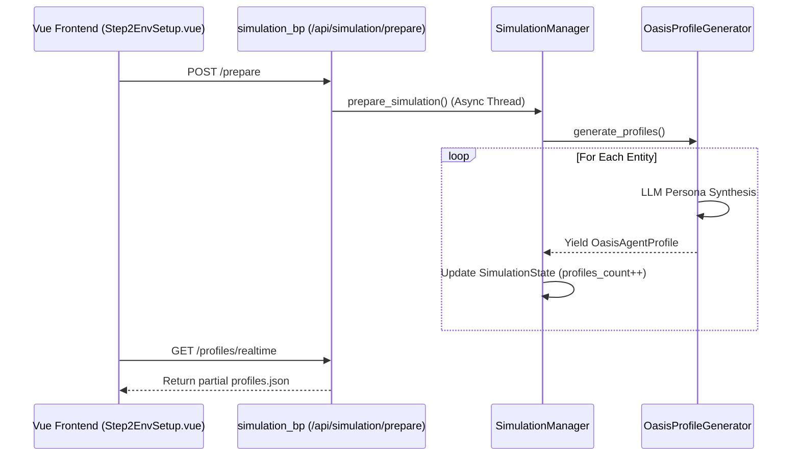
**Sources:** [backend/app/services/simulation_manager.py:255-265](), [backend/app/api/simulation.py:213-234](), [backend/app/services/oasis_profile_generator.py:164-181]()

## Configuration Data Structures

| Class | Purpose | Key Fields |
| :--- | :--- | :--- |
| `SimulationParameters` | Root container for config | `time_config`, `agent_configs`, `event_config` |
| `AgentActivityConfig` | Individual behavior tuning | `activity_level`, `posts_per_hour`, `influence_weight` |
| `OasisAgentProfile` | Platform-specific persona | `bio`, `persona`, `karma`, `risk_tolerance` |

**Sources:** [backend/app/services/simulation_config_generator.py:52-82](), [backend/app/services/simulation_config_generator.py:167-195](), [backend/app/services/oasis_profile_generator.py:29-61]()

---

# Page: Simulation Execution Engine

# Simulation Execution Engine

<details>
<summary>Relevant source files</summary>

The following files were used as context for generating this wiki page:

- [.gitignore](.gitignore)
- [backend/app/__init__.py](backend/app/__init__.py)
- [backend/app/services/simulation_ipc.py](backend/app/services/simulation_ipc.py)
- [backend/app/utils/file_parser.py](backend/app/utils/file_parser.py)
- [backend/pyproject.toml](backend/pyproject.toml)
- [backend/requirements.txt](backend/requirements.txt)
- [backend/scripts/run_parallel_simulation.py](backend/scripts/run_parallel_simulation.py)
- [backend/scripts/run_reddit_simulation.py](backend/scripts/run_reddit_simulation.py)
- [backend/scripts/run_twitter_simulation.py](backend/scripts/run_twitter_simulation.py)
- [backend/uv.lock](backend/uv.lock)
- [backend/wonderwall/simulations/social_media/__init__.py](backend/wonderwall/simulations/social_media/__init__.py)
- [package-lock.json](package-lock.json)
- [package.json](package.json)

</details>


The **Simulation Execution Engine** is the core runtime of MiroShark, powered by the **Wonderwall** framework (a specialized fork of OASIS). It orchestrates multi-agent interactions across social media platforms and prediction markets using a round-based execution loop. The engine is designed for high-concurrency LLM workloads, featuring parallel platform execution, cross-platform context injection, and a filesystem-based IPC protocol for real-time human-agent interaction.

## Parallel Simulation Orchestration

MiroShark executes simulations using a multi-process architecture. The `run_parallel_simulation.py` script acts as the master controller, utilizing `asyncio.gather` to launch and synchronize different platforms (Twitter, Reddit, and Polymarket) simultaneously.

*   **Process Management**: Each platform runs in its own subprocess to avoid Python's Global Interpreter Lock (GIL) and ensure isolation [backend/scripts/run_parallel_simulation.py:72-81]().
*   **Rate-Limit Mitigation**: The engine integrates with `camel-ai` and uses a `MaxTokensWarningFilter` to manage LLM token usage and prevent verbose logging from degrading performance [backend/scripts/run_parallel_simulation.py:110-121]().
*   **Platform Synchronization**: Platforms can run independently or in a synchronized "cross-platform" mode where agent actions on one platform are visible to agents on others [backend/scripts/run_parallel_simulation.py:8-12]().

For details on subprocess handling and LLM optimization, see [Parallel Simulation Runner & IPC](#4.1).

### Execution Flow Diagram

This diagram maps the high-level execution flow to the specific Python scripts and classes responsible for the simulation lifecycle.

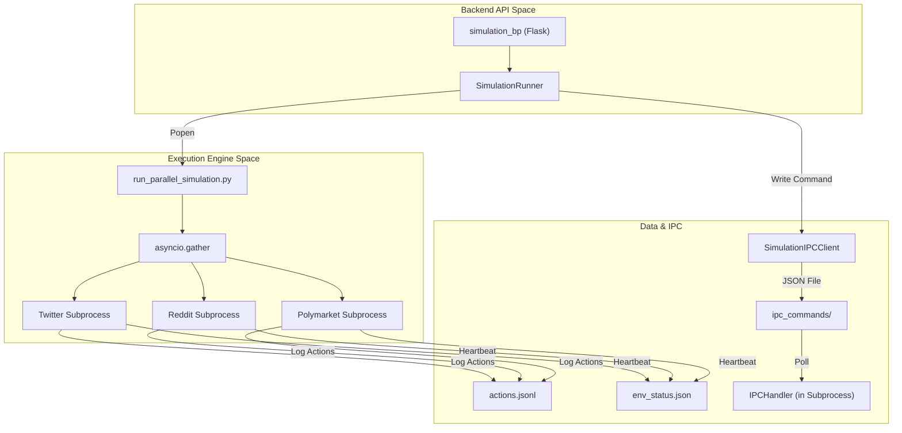
Sources: [backend/scripts/run_parallel_simulation.py:1-30](), [backend/app/services/simulation_ipc.py:5-15](), [backend/app/__init__.py:58-62]()

## Social Platform Dynamics (Twitter & Reddit)

The social media component simulates user behavior on platforms like Twitter and Reddit. It utilizes a `SocialAgent` class which wraps `camel-ai` agents to perform actions such as posting, replying, and liking based on their generated personas.

*   **Action Dispatch**: Agents select actions through an `AgentGraph` that defines the social topology (who follows whom) [backend/scripts/run_parallel_simulation.py:180-183]().
*   **Recommendation Systems**: The engine simulates platform algorithms (e.g., `twhin-bert` for Twitter) to determine which posts appear in an agent's feed [backend/scripts/run_parallel_simulation.py:130-136]().
*   **Persistence**: All platform states, including user profiles and post histories, are stored in a local SQLite database for each simulation run [backend/scripts/run_parallel_simulation.py:78-81]().

For details on social agent behavior and recommendation logic, see [Wonderwall Social Platform (Twitter & Reddit)](#4.2).

## Prediction Market Integration

MiroShark introduces a financial layer through the **Polymarket Simulation**. This allows agents to trade on the outcomes of the narratives they are discussing on social media.

*   **AMM Mechanics**: The `PolymarketPlatform` implements a constant-product Automated Market Maker (AMM) for share pricing [backend/scripts/run_parallel_simulation.py:185-186]().
*   **Market-Media Bridge**: Market prices are injected into the social media agents' context, allowing financial trends to influence social discourse and vice versa [backend/scripts/run_parallel_simulation.py:165-169]().

For details on trade execution and the AMM formula, see [Polymarket Prediction Market Simulation](#4.3).

## Belief State & Memory Management

To maintain consistency across rounds, the engine tracks the internal state of every agent using a heuristic `BeliefState` model.

*   **Stance Tracking**: The `BeliefTracker` monitors an agent's stance, confidence, and trust levels regarding specific topics [backend/scripts/run_parallel_simulation.py:164-164]().
*   **Round Analysis**: At the end of each round, the `RoundAnalyzer` generates a `trajectory.json` to visualize opinion convergence or polarization [backend/scripts/run_reddit_simulation.py:33-37]().
*   **Context Compaction**: `RoundMemory` manages the sliding-window memory of agents, ensuring they remember key past interactions without exceeding LLM context limits [backend/scripts/run_parallel_simulation.py:170-170]().

For details on the resistance formulas and memory injection, see [Belief State, Round Memory & Cross-Platform Awareness](#4.4).

## Inter-Process Communication (IPC)

The Flask backend communicates with the detached simulation processes via a filesystem-based IPC protocol implemented in `SimulationIPC.py`.

| Feature | Code Entity | Description |
| :--- | :--- | :--- |
| **Command Client** | `SimulationIPCClient` | Used by Flask to write commands to `ipc_commands/` [backend/app/services/simulation_ipc.py:95-101](). |
| **Command Handler** | `IPCHandler` | Polling mechanism inside the simulation script to execute requests [backend/scripts/run_twitter_simulation.py:146-155](). |
| **Heartbeat** | `env_status.json` | Provides real-time status (Running, Paused, Completed) to the UI [backend/scripts/run_twitter_simulation.py:162-168](). |
| **Interviews** | `INTERVIEW` | Allows users to query an agent's internal thoughts mid-simulation [backend/app/services/simulation_ipc.py:27-27](). |

### System Entity Mapping

This diagram connects the logical IPC concepts to the physical classes and directories in the codebase.

```mermaid
classDiagram
    class SimulationIPCClient {
        +send_command(command_type, args)
        +send_interview(agent_id, prompt)
    }
    class IPCHandler {
        +poll_command()
        +send_response(command_id, status)
        +update_status(status)
    }
    class CommandType {
        <<enumeration>>
        INTERVIEW
        BATCH_INTERVIEW
        CLOSE_ENV
    }
    
    SimulationIPCClient ..> CommandType : uses
    SimulationIPCClient --> "ipc_commands/" : writes JSON
    IPCHandler --> "ipc_commands/" : reads JSON
    IPCHandler --> "ipc_responses/" : writes JSON
    SimulationIPCClient --> "ipc_responses/" : reads JSON
```
Sources: [backend/app/services/simulation_ipc.py:25-30](), [backend/app/services/simulation_ipc.py:102-115](), [backend/scripts/run_twitter_simulation.py:146-160]()

---

# Page: Parallel Simulation Runner & IPC

# Parallel Simulation Runner & IPC

<details>
<summary>Relevant source files</summary>

The following files were used as context for generating this wiki page:

- [backend/app/__init__.py](backend/app/__init__.py)
- [backend/app/api/simulation.py](backend/app/api/simulation.py)
- [backend/app/services/simulation_ipc.py](backend/app/services/simulation_ipc.py)
- [backend/app/services/simulation_runner.py](backend/app/services/simulation_runner.py)
- [backend/scripts/run_parallel_simulation.py](backend/scripts/run_parallel_simulation.py)
- [backend/scripts/run_reddit_simulation.py](backend/scripts/run_reddit_simulation.py)
- [backend/scripts/run_twitter_simulation.py](backend/scripts/run_twitter_simulation.py)

</details>


The Parallel Simulation Runner and its associated Inter-Process Communication (IPC) system form the execution backbone of MiroShark. This subsystem manages the lifecycle of multi-platform simulations, enabling synchronized or independent execution of Twitter, Reddit, and Polymarket environments while maintaining a live communication bridge for real-time agent interaction.

## Parallel Simulation Execution

The primary entry point for multi-platform simulations is `run_parallel_simulation.py`. This script orchestrates the concurrent execution of different social environments using `asyncio` and `multiprocessing` [backend/scripts/run_parallel_simulation.py:1-30]().

### Execution Modes
1.  **Synchronized Platform Execution**: Platforms can be configured to run in lock-step, ensuring agents across different environments progress through time at the same rate.
2.  **Independent Execution**: Platforms run as fast as their respective LLM providers allow, tracked by independent round counters [backend/app/services/simulation_runner.py:112-118]().
3.  **Cross-Platform Awareness**: When enabled via the `--cross-platform` flag, agents receive digests of their activities on other platforms to maintain a consistent persona state [backend/scripts/run_parallel_simulation.py:8-16]().

### Boost LLM & Rate Limiting
To mitigate provider rate limits during parallel execution, the runner utilizes a "Boost LLM" strategy. It leverages `asyncio.gather` to trigger concurrent agent actions across platforms while implementing staggered starts and retry logic to handle high-concurrency demands on the LLM API [backend/scripts/run_parallel_simulation.py:71-82]().

## Simulation IPC Protocol

MiroShark uses a filesystem-based command/response protocol for communication between the Flask backend and the active simulation processes. This allows the backend to "interview" agents or shut down environments without direct memory sharing.

### Protocol Components
*   **Heartbeat (`env_status.json`)**: The simulation process periodically updates this file with its current status and timestamp. The backend uses `check_env_alive` to verify if the process is still responsive [backend/app/services/simulation_runner.py:32-34](), [backend/scripts/run_twitter_simulation.py:162-168]().
*   **Commands (`ipc_commands/`)**: The `SimulationIPCClient` writes JSON files containing a `command_id`, `command_type`, and `args` [backend/app/services/simulation_ipc.py:139-150]().
*   **Responses (`ipc_responses/`)**: The simulation's `IPCHandler` polls the commands directory, executes the logic, and writes a response file that the client then consumes [backend/app/services/simulation_ipc.py:154-172]().

### Supported Commands
| Command Type | Description |
| :--- | :--- |
| `INTERVIEW` | Requests a specific agent to respond to a prompt based on its current belief state and memory [backend/app/services/simulation_ipc.py:27](). |
| `BATCH_INTERVIEW` | Sends a prompt to multiple agents simultaneously [backend/app/services/simulation_ipc.py:28](). |
| `CLOSE_ENV` | Signals the simulation process to perform a graceful shutdown and cleanup [backend/app/services/simulation_ipc.py:29](). |

Sources: `[backend/app/services/simulation_ipc.py:1-188]()`, `[backend/scripts/run_twitter_simulation.py:134-206]()`, `[backend/app/services/simulation_runner.py:32-34]()`.

## Subprocess Management

The `SimulationRunner` class handles the low-level mechanics of spawning and killing simulation processes.

### Process Lifecycle
1.  **Startup**: Uses `subprocess.Popen` to launch the preset scripts (e.g., `run_parallel_simulation.py`). On Windows, it uses `CREATE_NEW_PROCESS_GROUP` to ensure child processes can be terminated together [backend/app/services/simulation_runner.py:32-33]().
2.  **Monitoring**: A background thread monitors the `actions.jsonl` files and the `env_status.json` heartbeat to update the `SimulationRunState` [backend/app/services/simulation_runner.py:101-150]().
3.  **Cleanup**: MiroShark registers an `atexit` handler and signal listeners (SIGINT, SIGTERM) to ensure that if the Flask server crashes or is stopped, all orphaned simulation subprocesses are terminated [backend/app/services/simulation_runner.py:14-15](), [backend/app/__init__.py:58-59]().

### Data Flow: Backend to Simulation
The following diagram illustrates how a user request for an agent interview travels from the API through the IPC layer into the running simulation.

**Interview Command Flow**
```mermaid
graph TD
    subgraph "Flask Backend"
        A["simulation_bp.interview"] -- "Calls" --> B["SimulationIPCClient.send_interview"]
        B -- "Writes JSON" --> C["/sim_dir/ipc_commands/uuid.json"]
    end

    subgraph "Simulation Subprocess"
        D["IPCHandler.poll_command"] -- "Reads" --> C
        D -- "Triggers" --> E["SocialAgent.generate_response"]
        E -- "Writes JSON" --> F["/sim_dir/ipc_responses/uuid.json"]
    end

    B -- "Polls" --> F
    B -- "Returns IPCResponse" --> A
```
Sources: `[backend/app/api/simulation.py:27-60]()`, `[backend/app/services/simulation_ipc.py:95-152]()`, `[backend/scripts/run_twitter_simulation.py:146-191]()`.

## Implementation Detail: SimulationRunner

The `SimulationRunner` manages a singleton-like state for active runs, tracking PIDs and providing status updates to the frontend.

**Entity Association: Runner to Code**
```mermaid
graph LR
    subgraph "Process Management"
        SR["SimulationRunner"] --- POPEN["subprocess.Popen"]
        SR --- CLEANUP["register_cleanup()"]
    end

    subgraph "State Tracking"
        SRS["SimulationRunState"] --- STATS["twitter_actions_count"]
        SRS --- STATUS["RunnerStatus (RUNNING/STOPPED)"]
    end

    subgraph "IPC Bridge"
        SIPC["SimulationIPCClient"] --- CMD["send_command()"]
        SIPC --- RESP["IPCResponse"]
    end

    SR --> SRS
    SR --> SIPC
```

### Key Functions
*   `start_simulation(...)`: Constructs the command line arguments and spawns the subprocess [backend/app/services/simulation_runner.py:42-47]().
*   `stop_simulation(...)`: Sends a `CLOSE_ENV` IPC command; if the process doesn't exit within a timeout, it performs a hard kill using `os.killpg` [backend/app/services/simulation_runner.py:148-150]().
*   `check_env_alive(...)`: Validates the existence of the process and the freshness of the `env_status.json` heartbeat [backend/app/api/simulation.py:27-34]().

Sources: `[backend/app/services/simulation_runner.py:1-203]()`, `[backend/app/api/simulation.py:1-60]()`, `[backend/app/__init__.py:58-62]()`.

---

# Page: Wonderwall Social Platform (Twitter & Reddit)

# Wonderwall Social Platform (Twitter & Reddit)

<details>
<summary>Relevant source files</summary>

The following files were used as context for generating this wiki page:

- [.gitignore](.gitignore)
- [backend/app/utils/file_parser.py](backend/app/utils/file_parser.py)
- [backend/pyproject.toml](backend/pyproject.toml)
- [backend/requirements.txt](backend/requirements.txt)
- [backend/uv.lock](backend/uv.lock)
- [backend/wonderwall/simulations/base.py](backend/wonderwall/simulations/base.py)
- [backend/wonderwall/simulations/polymarket/actions.py](backend/wonderwall/simulations/polymarket/actions.py)
- [backend/wonderwall/simulations/polymarket/environment.py](backend/wonderwall/simulations/polymarket/environment.py)
- [backend/wonderwall/simulations/polymarket/prompts.py](backend/wonderwall/simulations/polymarket/prompts.py)
- [backend/wonderwall/simulations/social_media/__init__.py](backend/wonderwall/simulations/social_media/__init__.py)
- [backend/wonderwall/simulations/social_media/prompts.py](backend/wonderwall/simulations/social_media/prompts.py)
- [backend/wonderwall/social_agent/agent_action.py](backend/wonderwall/social_agent/agent_action.py)
- [package-lock.json](package-lock.json)
- [package.json](package.json)

</details>


The Wonderwall social platform layer is the core execution environment for agent interactions within MiroShark. It simulates the mechanics of Twitter and Reddit, providing agents with platform-specific actions, recommendation algorithms, and a persistent state managed via SQLite. This layer bridges the gap between high-level agent personas and low-level digital traces.

## Architectural Overview

The social simulation is driven by the `Platform` class, which handles the environment's state, and the `SocialAgent`, which integrates with the CAMEL framework to perform reasoning and action selection.

### Core Components
| Component | Code Entity | Responsibility |
| :--- | :--- | :--- |
| **Platform Engine** | `Platform` | Manages SQLite schema, post/comment storage, and action dispatching. |
| **Agent Logic** | `SocialAgent` | Wraps `ChatAgent` for social-specific reasoning and tool calling. |
| **Recommendation** | `RecSys` | Implements `twhin-bert` (Twitter) and score-based (Reddit) feeds. |
| **Action Space** | `SocialAction` | Defines the tools (e.g., `create_post`, `like_post`) available to LLMs. |

Sources: [backend/wonderwall/simulations/social_media/__init__.py:29-42](), [backend/wonderwall/social_agent/agent_action.py:1-20]()

## Platform Implementation & Schema

The `Platform` class initializes a local SQLite database for every simulation run to ensure data isolation. It serves as the "Source of Truth" for all social interactions.

### Simulation Configurations
Wonderwall defines two primary `SimulationConfig` objects for social media:

1.  **Twitter Simulation** (`twitter_simulation`):
    *   **RecSys**: `twhin-bert` [backend/wonderwall/simulations/social_media/__init__.py:55]().
    *   **Actions**: `create_post`, `like_post`, `repost`, `follow`, `quote_post`, `do_nothing` [backend/wonderwall/simulations/social_media/__init__.py:50-53]().
2.  **Reddit Simulation** (`reddit_simulation`):
    *   **RecSys**: `reddit` (popularity/score-based) [backend/wonderwall/simulations/social_media/__init__.py:74]().
    *   **Actions**: `create_post`, `create_comment`, `like_post`, `dislike_comment`, `search_posts`, `trend` [backend/wonderwall/simulations/social_media/__init__.py:68-72]().

### Social Media Data Flow
The following diagram illustrates how an agent's intent is transformed into a database record and then surfaced back to other agents.

**Social Platform Action & Feed Loop**
```mermaid
graph TD
    subgraph "SocialAgent (LLM Space)"
        A["SocialAgent.step()"] --> B["Action Selection (LLM)"]
        B --> C["SocialAction.perform_action()"]
    end

    subgraph "Platform (Data Space)"
        C --> D["Platform.dispatch_action()"]
        D --> E[("SQLite: simulation.db")]
        E --> F["RecSys (twhin-bert / reddit)"]
    end

    subgraph "Environment (Perception Space)"
        F --> G["SocialEnvironment.to_text_prompt()"]
        G --> H["Agent Observation Context"]
        H --> A
    end
    
    style E stroke-width:4px
```
Sources: [backend/wonderwall/simulations/social_media/__init__.py:44-80](), [backend/wonderwall/social_agent/agent_action.py:1-20]()

## SocialAgent & CAMEL Integration

The `SocialAgent` leverages the `camel-ai` library to manage the LLM dialogue. It uses a `ChatAgent` initialized with a platform-specific system prompt generated by the `PromptBuilder`.

### Action Selection Strategy
Agents are prompted to treat `do_nothing` as their default state to simulate realistic "lurking" behavior [backend/wonderwall/simulations/social_media/prompts.py:60-65]().

*   **Twitter Logic**: Focuses on "punchy" takes, wit, and timely reactions under 280 characters [backend/wonderwall/simulations/social_media/prompts.py:53-57]().
*   **Reddit Logic**: Prioritizes threaded discussions, "karma" reputation, and substance over brevity [backend/wonderwall/simulations/social_media/prompts.py:130-138]().

### Prompt Construction
The `TwitterPromptBuilder` and `RedditPromptBuilder` inject entity-specific metadata into the system prompt:
*   **Persona**: Extracted from `user_info.profile` [backend/wonderwall/simulations/social_media/prompts.py:23-38]().
*   **Demographics**: Age, Gender, MBTI, and Country are injected for Reddit agents to enforce personality consistency [backend/wonderwall/simulations/social_media/prompts.py:111-121]().

Sources: [backend/wonderwall/simulations/social_media/prompts.py:41-106](), [backend/wonderwall/simulations/social_media/prompts.py:107-165]()

## Recommendation Systems (RecSys)

The `Platform` uses different recommendation strategies to determine what an agent "sees" in their feed, influencing their belief updates and future actions.

### Twhin-BERT (Twitter)
For Twitter, the platform uses a BERT-based embedding model to calculate similarity between an agent's interests (derived from their graph-based persona) and available posts.
*   **Parameters**: Controlled via `platform_kwargs`, including `refresh_rec_post_count` and `following_post_count` [backend/wonderwall/simulations/social_media/__init__.py:54-59]().

### Reddit Algorithm
The Reddit RecSys simulates subreddit sorting:
*   **Score-based**: Posts with higher upvotes (likes) are prioritized.
*   **Self-Rating**: `allow_self_rating` is enabled by default to allow agents to interact with their own threads [backend/wonderwall/simulations/social_media/__init__.py:75]().

Sources: [backend/wonderwall/simulations/social_media/__init__.py:44-80]()

## Implementation Details: From Profile to Prompt

MiroShark maps the Knowledge Graph entities to these social platforms by synthesizing `SimulationConfig` objects.

**Entity to Social Persona Mapping**
```mermaid
classDiagram
    class Neo4jEntity {
        +String name
        +Map attributes
        +Vector embedding
    }
    class OasisProfile {
        +String name
        +String user_profile
        +Map other_info
    }
    class TwitterPromptBuilder {
        +build_system_prompt(user_info)
    }
    class SocialAgent {
        +ChatAgent camel_agent
        +step()
    }

    Neo4jEntity --|> OasisProfile : "Transformed by OasisProfileGenerator"
    OasisProfile --|> TwitterPromptBuilder : "Input for Prompt"
    TwitterPromptBuilder --|> SocialAgent : "Sets System Message"
```

### Key Functions
*   `_build_description(user_info)`: A utility that parses the JSON profile structure to create the "WHO YOU ARE" section of the LLM prompt [backend/wonderwall/simulations/social_media/prompts.py:23-39]().
*   `_get_platform_cls()`: Lazy-loads the `Platform` class to avoid circular imports during simulation initialization [backend/wonderwall/simulations/social_media/__init__.py:29-32]().

Sources: [backend/wonderwall/simulations/social_media/prompts.py:23-39](), [backend/wonderwall/simulations/social_media/__init__.py:29-42]()

---

# Page: Polymarket Prediction Market Simulation

# Polymarket Prediction Market Simulation

<details>
<summary>Relevant source files</summary>

The following files were used as context for generating this wiki page:

- [backend/app/storage/neo4j_storage.py](backend/app/storage/neo4j_storage.py)
- [backend/wonderwall/simulations/base.py](backend/wonderwall/simulations/base.py)
- [backend/wonderwall/simulations/polymarket/__init__.py](backend/wonderwall/simulations/polymarket/__init__.py)
- [backend/wonderwall/simulations/polymarket/actions.py](backend/wonderwall/simulations/polymarket/actions.py)
- [backend/wonderwall/simulations/polymarket/environment.py](backend/wonderwall/simulations/polymarket/environment.py)
- [backend/wonderwall/simulations/polymarket/platform.py](backend/wonderwall/simulations/polymarket/platform.py)
- [backend/wonderwall/simulations/polymarket/prompts.py](backend/wonderwall/simulations/polymarket/prompts.py)
- [backend/wonderwall/simulations/social_media/prompts.py](backend/wonderwall/simulations/social_media/prompts.py)
- [backend/wonderwall/social_agent/belief_state.py](backend/wonderwall/social_agent/belief_state.py)

</details>


The Polymarket simulation provides a high-fidelity prediction market environment within MiroShark. It simulates a constant-product Automated Market Maker (AMM) where agents trade on real-world outcomes using virtual currency. This platform operates in parallel with social media simulations, allowing market prices to reflect social sentiment and vice-versa through the Market-Media Bridge.

## PolymarketPlatform Architecture

The `PolymarketPlatform` class is the central authority for market state, trade execution, and portfolio management. It inherits from `BasePlatform` and manages a SQLite database containing market-specific tables.

### Market Mechanics and AMM
The platform utilizes a constant-product formula ($x \times y = k$) to determine pricing. 
- **Reserves**: Each market maintains `reserve_a` (YES shares) and `reserve_b` (NO shares) [backend/wonderwall/simulations/polymarket/platform.py:106-112]().
- **Pricing**: The price of a YES share is calculated as $\frac{reserve\_b}{reserve\_a + reserve\_b}$ [backend/wonderwall/simulations/polymarket/platform.py:98]().
- **Trade Cap**: To prevent extreme price manipulation by single agents, trade sizes are capped at 2% of the total pool liquidity [backend/wonderwall/simulations/polymarket/platform.py:157-161]().

### Data Entity Mapping
The following diagram bridges the conceptual market entities to the implementation classes and database schemas.

**Market Entity to Code Mapping**
```mermaid
graph TD
    subgraph "Natural Language Space"
        A["Prediction Market"]
        B["Trader Portfolio"]
        C["Share Purchase"]
        D["Market Resolution"]
    end

    subgraph "Code Entity Space (PolymarketPlatform)"
        A1["market.sql"]
        B1["portfolio.sql"]
        C1["quote_buy()"]
        D1["resolve_market()"]
        
        E1["PolymarketPlatform"]
        F1["PolymarketAction"]
    end

    A --> A1
    B --> B1
    C --> C1
    D --> D1
    
    E1 --"manages"--> A1
    E1 --"manages"--> B1
    F1 --"calls"--> E1
```
Sources: [backend/wonderwall/simulations/polymarket/platform.py:33-46](), [backend/wonderwall/simulations/polymarket/actions.py:20-22]()

## Simulation Configuration

The `polymarket_simulation` object defines the specific classes and default parameters used by the `OasisEnv` to instantiate the prediction market.

| Parameter | Value / Class | Description |
| :--- | :--- | :--- |
| `name` | `"polymarket"` | Unique identifier for the simulation type. |
| `platform_cls` | `PolymarketPlatform` | Server-side logic and DB management. |
| `action_cls` | `PolymarketAction` | Tool definitions for LLM agents. |
| `environment_cls` | `PolymarketEnvironment` | Logic for generating agent observations. |
| `initial_balance` | `1000.0` | Starting USD for each trader agent. |
| `initial_liquidity` | `10000.0` | Initial $k$ value for the AMM pools. |

Sources: [backend/wonderwall/simulations/polymarket/__init__.py:32-46]()

## Trader Agent Behavior

Traders are governed by the `PolymarketPromptBuilder`, which shapes their decision-making process based on their persona and market state.

### Action Selection Logic
Agents follow a prioritized decision tree:
1.  **do_nothing**: The default state. Agents are instructed to wait for clear mispricings [backend/wonderwall/simulations/polymarket/prompts.py:63-64]().
2.  **buy_shares**: Triggered when the agent's internal belief (derived from graph context and social media) deviates from the market price [backend/wonderwall/simulations/polymarket/prompts.py:66-73]().
3.  **sell_shares**: Triggered to take profit (price > 0.90), cut losses (price < 0.10), or if beliefs shift [backend/wonderwall/simulations/polymarket/prompts.py:75-79]().

### Market-Media Bridge
The simulation implements a feedback loop where social media activity directly influences market behavior.
- **Context Injection**: The `PolymarketEnvironment` injects `extra_observation_context` containing digests of Twitter and Reddit activity [backend/wonderwall/simulations/polymarket/environment.py:101-103]().
- **Signal Analysis**: Agents are prompted to look for viral posts, sentiment shifts, and arguments from institutional accounts to identify "edges" in the market [backend/wonderwall/simulations/polymarket/prompts.py:94-102]().

## Execution Data Flow

The following diagram illustrates how a trade progresses from an agent's observation of social media to the update of the AMM reserves.

**Trade Execution Flow**
```mermaid
sequenceDiagram
    participant Agent as "SocialAgent (LLM)"
    participant Env as "PolymarketEnvironment"
    participant Action as "PolymarketAction"
    participant Plat as "PolymarketPlatform"
    participant DB as "SQLite (market.db)"

    Env->>Agent: "Observation (Prices + Social Context)"
    Note over Agent: "Analyzes Sentiment vs Price"
    Agent->>Action: "buy_shares(market_id, outcome, amount)"
    Action->>Plat: "perform_action('buy_shares', ...)"
    Plat->>Plat: "quote_buy(reserve_a, reserve_b, ...)"
    Plat->>DB: "UPDATE market SET reserve_a, reserve_b"
    Plat->>DB: "UPDATE portfolio SET balance = balance - amount"
    Plat-->>Agent: "Success (Shares Received)"
```
Sources: [backend/wonderwall/simulations/polymarket/environment.py:25-111](), [backend/wonderwall/simulations/polymarket/platform.py:123-189](), [backend/wonderwall/simulations/polymarket/actions.py:47-72]()

## Market Resolution
Markets are resolved by the platform, which calculates final payouts based on the winning outcome.
- **Payouts**: Winning shares are worth $1.00; losing shares are worth $0.00 [backend/wonderwall/simulations/polymarket/prompts.py:52-53]().
- **Portfolio Update**: Upon resolution, the platform iterates through all `position` records for the market and updates the `balance` in the `portfolio` table [backend/wonderwall/simulations/polymarket/platform.py:228-261]().

Sources: [backend/wonderwall/simulations/polymarket/platform.py:228-261]()

---

# Page: Belief State, Round Memory & Cross-Platform Awareness

# Belief State, Round Memory & Cross-Platform Awareness

<details>
<summary>Relevant source files</summary>

The following files were used as context for generating this wiki page:

- [backend/app/__init__.py](backend/app/__init__.py)
- [backend/app/services/simulation_ipc.py](backend/app/services/simulation_ipc.py)
- [backend/app/storage/neo4j_storage.py](backend/app/storage/neo4j_storage.py)
- [backend/scripts/belief_integration.py](backend/scripts/belief_integration.py)
- [backend/scripts/run_parallel_simulation.py](backend/scripts/run_parallel_simulation.py)
- [backend/scripts/run_reddit_simulation.py](backend/scripts/run_reddit_simulation.py)
- [backend/scripts/run_twitter_simulation.py](backend/scripts/run_twitter_simulation.py)
- [backend/wonderwall/simulations/polymarket/__init__.py](backend/wonderwall/simulations/polymarket/__init__.py)
- [backend/wonderwall/simulations/polymarket/platform.py](backend/wonderwall/simulations/polymarket/platform.py)
- [backend/wonderwall/social_agent/belief_state.py](backend/wonderwall/social_agent/belief_state.py)
- [backend/wonderwall/social_agent/round_analyzer.py](backend/wonderwall/social_agent/round_analyzer.py)

</details>


This page details the cognitive and memory architectures that enable MiroShark agents to maintain consistent personas, evolve their opinions based on social dynamics, and remain aware of activities across multiple simulated platforms (Twitter, Reddit, and Polymarket).

## 1. Belief State Heuristic Model

The `BeliefState` class provides a mutable model for tracking an agent's internal cognitive state without requiring expensive LLM calls for every state transition. It tracks three primary dimensions: Stance, Confidence, and Trust.

### 1.1 Core Components
*   **Positions**: A mapping of `topic -> stance` where the stance is a float between -1.0 (strongly opposing) and +1.0 (strongly supportive) [backend/wonderwall/social_agent/belief_state.py:29-29]().
*   **Confidence**: A mapping of `topic -> certainty` (0.0 to 1.0). High confidence increases resistance to new information [backend/wonderwall/social_agent/belief_state.py:30-30]().
*   **Trust**: A mapping of `agent_id -> trust_level` (0.0 to 1.0). Interactions like "following" or "liking" increase this value, while "disliking" or "muting" decreases it [backend/wonderwall/social_agent/belief_state.py:31-31]().
*   **Exposure History**: A set of content hashes used to implement novelty weighting [backend/wonderwall/social_agent/belief_state.py:32-32]().

### 1.2 The Resistance Formula
When an agent encounters a post, the magnitude of the belief shift (nudge) is inversely proportional to their current confidence. This is governed by a resistance factor:
`resistance = 0.3 + (current_confidence * 0.7)` [backend/wonderwall/social_agent/belief_state.py:140-140]().

The final nudge calculation incorporates author trust, social proof (likes), and novelty:
`nudge = (post_stance - current_pos) * author_trust * social_weight * novelty_mult * 0.08 / resistance` [backend/wonderwall/social_agent/belief_state.py:141-148]().

### 1.3 Data Flow: Belief Initialization to Update
The following diagram illustrates how beliefs are initialized from profiles and updated during the simulation loop.

**Belief Update Pipeline**
```mermaid
graph TD
    A["OasisProfileGenerator"] -- "stance/sentiment_bias" --> B["BeliefState.from_profile()"]
    B --> C["BeliefTracker (Memory)"]
    D["Platform Actions (SQLite)"] -- "posts_seen" --> E["BeliefTracker.after_round()"]
    C --> E
    E -- "Calculate Deltas" --> F["BeliefState.update_from_round()"]
    F -- "New Positions/Confidence" --> G["inject_belief_context()"]
    G -- "System Message Update" --> H["SocialAgent (LLM)"]
```
Sources: [backend/wonderwall/social_agent/belief_state.py:40-76](), [backend/scripts/belief_integration.py:28-47](), [backend/scripts/belief_integration.py:48-96]()

## 2. Round Analysis & Trajectory Tracking

The `RoundAnalyzer` and `BeliefTracker` work together to aggregate metrics after each simulation step, producing the `trajectory.json` artifact used for final report generation.

### 2.1 Key Metrics
*   **Convergence/Polarization**: Measured by comparing the spread (Max - Min) of agent positions on a topic between the first and last rounds [backend/wonderwall/social_agent/round_analyzer.py:106-136]().
*   **Turning Points**: Rounds where an agent's belief shift exceeds a threshold of 0.15 [backend/wonderwall/social_agent/round_analyzer.py:138-154]().
*   **Viral Impact**: Identification of posts with high engagement that caused significant community-wide belief shifts [backend/wonderwall/social_agent/round_analyzer.py:38-38]().

### 2.2 Trajectory Serialization
The `SimulationTrajectory` class accumulates `RoundSnapshot` objects [backend/wonderwall/social_agent/round_analyzer.py:59-64](). At the end of the simulation, `save_trajectory()` writes the complete history to the simulation directory [backend/scripts/belief_integration.py:97-101]().

Sources: [backend/wonderwall/social_agent/round_analyzer.py:1-25](), [backend/wonderwall/social_agent/round_analyzer.py:167-180]()

## 3. Round Memory & Context Compaction

To prevent context window overflow in long simulations, MiroShark implements a sliding-window memory management system via `RoundMemory`.

### 3.1 Implementation Details
The `RoundMemory` class maintains a history of an agent's own actions and significant observations. When the history exceeds a platform-specific limit, it compacts the context by keeping only the most recent $N$ rounds of activity [backend/scripts/run_parallel_simulation.py:170-170]().

The `inject_round_memory` function modifies the agent's prompt to include a "Recent Memory" section, ensuring the agent remembers its previous posts and the feedback it received without re-processing the entire simulation log [backend/scripts/run_parallel_simulation.py:170-170]().

Sources: [backend/scripts/run_parallel_simulation.py:162-170]()

## 4. Cross-Platform Awareness

MiroShark allows agents to be "conscious" of their actions across different platforms (e.g., an agent on Reddit knowing what they posted on Twitter).

### 4.1 CrossPlatformLog Digest
The `CrossPlatformLog` class aggregates actions from all active platforms [backend/scripts/run_parallel_simulation.py:163-163](). It generates a "Cross-Platform Digest" that is injected into the agent's observation space.

### 4.2 Injection Mechanism
If the `--cross-platform` flag is enabled during simulation startup [backend/scripts/run_parallel_simulation.py:8-8](), the `inject_cross_platform_context` function is called every round.

**Cross-Platform Data Flow**
```mermaid
graph LR
    subgraph "Twitter Platform"
        T_ACT["twitter/actions.jsonl"]
    end
    subgraph "Reddit Platform"
        R_ACT["reddit/actions.jsonl"]
    end
    subgraph "Polymarket Platform"
        P_ACT["polymarket.db (Trades)"]
    end

    T_ACT --> CP_LOG["CrossPlatformLog"]
    R_ACT --> CP_LOG
    P_ACT --> CP_LOG

    CP_LOG -- "Digest Generation" --> INJECT["inject_cross_platform_context()"]
    INJECT -- "Observation Injection" --> AGENT["SocialAgent"]
```
Sources: [backend/scripts/run_parallel_simulation.py:163-169](), [backend/scripts/run_parallel_simulation.py:22-30]()

## 5. Market-Media Bridge

The simulation engine includes a specific bridge between Polymarket and social media platforms to simulate how market prices influence public opinion and vice-versa.

### 5.1 Sentiment to Market
`inject_sentiment_context` takes the aggregated sentiment from social platforms and provides it as "Market News" to Polymarket traders [backend/scripts/run_parallel_simulation.py:168-169]().

### 5.2 Price to Social
`inject_market_context` takes the current AMM prices from `PolymarketPlatform` [backend/wonderwall/simulations/polymarket/platform.py:33-34]() and injects them into the prompts of social media agents, allowing them to react to market trends (e.g., "The market now gives this outcome a 70% chance") [backend/scripts/run_parallel_simulation.py:167-167]().

Sources: [backend/scripts/run_parallel_simulation.py:165-169](), [backend/wonderwall/simulations/polymarket/platform.py:123-165]()

---

# Page: Report Generation & Analysis

# Report Generation & Analysis

<details>
<summary>Relevant source files</summary>

The following files were used as context for generating this wiki page:

- [backend/app/api/graph.py](backend/app/api/graph.py)
- [backend/app/api/report.py](backend/app/api/report.py)
- [backend/app/services/graph_tools.py](backend/app/services/graph_tools.py)
- [backend/app/services/report_agent.py](backend/app/services/report_agent.py)

</details>


The **Report Generation & Analysis** system is the final stage of the MiroShark pipeline. It transitions from the "Simulation Space" (where agents interact and generate raw data) back into the "Knowledge Space" by synthesizing a comprehensive, structured analysis of the simulation's outcomes. This process is driven by an autonomous **ReportAgent** that utilizes a **ReACT** (Reasoning and Acting) loop to query the simulation state, graph data, and agent behaviors to fulfill the user's initial simulation requirements.

### System Overview

The reporting lifecycle begins after the simulation reaches a terminal state or is manually stopped. The system uses a specialized agentic workflow to ensure the final report is not just a summary of logs, but a grounded analysis supported by specific facts retrieved from the Knowledge Graph and Simulation databases.

#### Analysis Workflow

1.  **Initialization**: The `report_bp` API receives a request and initializes a `ReportAgent` with the `simulation_id` and the original `simulation_requirement` [backend/app/api/report.py:141-147]().
2.  **Planning**: The agent creates a `ReportOutline` containing 3-5 logical sections based on the project context [backend/app/services/report_agent.py:113-118]().
3.  **Iterative Generation**: For each section, the agent enters a ReACT loop, selecting tools from the `GraphToolsService` to gather evidence before writing [backend/app/services/report_agent.py:152-164]().
4.  **Synthesis**: A final pass merges sections, normalizes headings, and ensures cross-sectional consistency [backend/app/services/report_agent.py:211-220]().
5.  **Persistence**: The `ReportManager` saves the final Markdown, agent logs, and section artifacts to the filesystem [backend/app/services/report_agent.py:51-53]().

### Conceptual Bridge: Natural Language to Code Entities

The following diagram illustrates how high-level analysis concepts map to specific classes and services within the MiroShark codebase.

**Analysis System Mapping**
```mermaid
graph TD
    subgraph "Natural Language Space (User Intent)"
        A["'Analyze the impact of the leak'"] --> B["Simulation Requirement"]
    end

    subgraph "Agentic Logic (ReportAgent)"
        B --> C["PLAN_SYSTEM_PROMPT"]
        C --> D["ReportOutline"]
        D --> E["ReACT Loop (Thought/Action/Observation)"]
    end

    subgraph "Code Entity Space (Backend Services)"
        E -- "Tool Call" --> F["GraphToolsService"]
        F -- "Neo4j Query" --> G["GraphStorage"]
        F -- "SQL Query" --> H["Simulation SQLite (P&L)"]
        F -- "Log Analysis" --> I["actions.jsonl (Feed)"]
    end

    subgraph "Artifact Space (ReportManager)"
        E -- "Finalize" --> J["full_report.md"]
        E -- "Trace" --> K["agent_log.jsonl"]
    end
```
Sources: [backend/app/services/report_agent.py:1-10](), [backend/app/services/graph_tools.py:1-11](), [backend/app/api/report.py:125-130]()

### The ReportAgent & ReACT Loop

The `ReportAgent` is the core orchestrator of the analysis phase. Unlike a simple LLM prompt, it uses a multi-step ReACT pattern to ensure every claim in the report is grounded in data.

*   **Planning Phase**: Before writing, the agent generates a table of contents. This prevents the "drifting" common in long-form LLM generation.
*   **ReACT Execution**: For every section, the agent performs between 2 and 6 tool calls. It thinks about what it needs to know (Thought), executes a tool (Action), and interprets the data (Observation).
*   **Lifecycle Management**: The `ReportManager` tracks the status of these long-running tasks via `TaskStatus` and provides real-time progress updates to the frontend via the `report_bp` status endpoints.

For details on the prompt engineering and iteration logic, see [ReportAgent: ReACT Loop & Report Lifecycle](#5.1).

Sources: [backend/app/services/report_agent.py:142-164](), [backend/app/api/report.py:25-49]()

### GraphToolsService: Data Retrieval

The `GraphToolsService` provides the "senses" for the ReportAgent. It abstracts complex graph traversals and database queries into a simple toolset.

| Tool Name | Purpose | Data Source |
| :--- | :--- | :--- |
| `InsightForge` | Deep hybrid search with LLM-driven query decomposition. | Neo4j + LLM [backend/app/services/graph_tools.py:8-10]() |
| `PanoramaSearch` | Breadth-first search including historical/expired facts. | Neo4j [backend/app/services/graph_tools.py:9-10]() |
| `QuickSearch` | Low-latency GraphRAG retrieval. | Neo4j [backend/app/services/graph_tools.py:10-11]() |
| `market_state` | Retrieves P&L and market prices from the simulation. | SQLite [backend/app/services/graph_tools.py:24-30]() |
| `interview_agents` | Queries specific agents for their current belief states. | Simulation IPC [backend/app/services/graph_tools.py:24-30]() |

**Data Flow: Retrieval to Report**
```mermaid
graph LR
    subgraph "GraphToolsService"
        IF["InsightForge"]
        PS["PanoramaSearch"]
        MA["analyze_trajectory"]
    end

    subgraph "Data Sources"
        N4J[("Neo4j Graph")]
        SQL[("Simulation DB")]
        TRJ["trajectory.json"]
    end

    IF --> N4J
    PS --> N4J
    MA --> TRJ
    
    subgraph "ReportAgent"
        RE["ReACT Loop"]
    end

    IF -- "Facts/Edges" --> RE
    MA -- "Convergence Metrics" --> RE
```
Sources: [backend/app/services/graph_tools.py:1-22](), [backend/app/services/report_agent.py:24-30]()

For details on the specific implementation of these retrieval strategies, see [GraphToolsService: Data Retrieval Tools](#5.2).

### Report Artifacts & Accessibility

Once generation is complete, the system produces a structured directory within `Config.UPLOAD_FOLDER/reports/{report_id}/` [backend/app/services/report_agent.py:51-53]().

*   **`full_report.md`**: The final consolidated analysis.
*   **`section_XX.md`**: Individual section drafts, useful for debugging generation failures.
*   **`agent_log.jsonl`**: A high-fidelity trace of every "Thought", "Action", and "Observation" made by the agent [backend/app/services/report_agent.py:35-41]().
*   **`console_log.txt`**: Standard output capture from the generation process.

Users can access these reports via the **Step 4: Report** view in the frontend, which polls the `report_bp` for completion status [backend/app/api/report.py:221-230]().

Sources: [backend/app/services/report_agent.py:35-55](), [backend/app/api/report.py:163-174]()

---

# Page: ReportAgent: ReACT Loop & Report Lifecycle

# ReportAgent: ReACT Loop & Report Lifecycle

<details>
<summary>Relevant source files</summary>

The following files were used as context for generating this wiki page:

- [backend/app/services/graph_tools.py](backend/app/services/graph_tools.py)
- [backend/app/services/report_agent.py](backend/app/services/report_agent.py)

</details>


The `ReportAgent` is the final stage of the MiroShark pipeline, responsible for synthesizing simulation data, graph knowledge, and market results into a structured analytical report. It employs a **ReACT (Reasoning and Acting)** framework to autonomously explore the knowledge graph and simulation logs before drafting content.

## Report Lifecycle Overview

The report generation process is managed by the `ReportAgent` class [backend/app/services/report_agent.py:234-236](). It follows a strictly defined lifecycle to ensure that the final output is grounded in evidence retrieved from the simulation environment.

### 1. Planning Phase
The agent first generates a `ReportOutline` [backend/app/services/report_agent.py:221-228](). It uses the `PLAN_SYSTEM_PROMPT` to analyze the `simulation_requirement` and simulation metadata, producing a table of contents typically containing 3-5 sections [backend/app/services/report_agent.py:465-485]().

### 2. Iterative Section Generation (ReACT Loop)
For each section in the outline, the agent enters a ReACT loop. This loop consists of:
*   **Thought**: The LLM determines what information is missing to fulfill the section requirements.
*   **Action**: The agent selects a tool from the `GraphToolsService` (e.g., `InsightForge`, `PanoramaSearch`).
*   **Observation**: The tool returns raw data (facts, node attributes, or simulation logs).
*   **Loop Constraint**: The agent must perform a minimum of 2 and a maximum of 6 tool calls per section to ensure sufficient depth without infinite recursion [backend/app/services/report_agent.py:560-565]().

### 3. Synthesis & Post-Processing
After all sections are drafted, the agent performs a cross-section synthesis pass to ensure narrative consistency [backend/app/services/report_agent.py:645-650](). Finally, it applies heading normalization and cleans up markdown artifacts.

### 4. Artifact Persistence
The `ReportManager` [backend/app/services/report_agent.py:1264-1268]() saves the results into a dedicated report directory:
*   `section_XX.md`: Individual drafts for each section.
*   `full_report.md`: The concatenated and polished final report.
*   `agent_log.jsonl`: A detailed execution trace for debugging the ReACT steps.
*   `console_log.txt`: Standard output and error logs.

**Sources:** [backend/app/services/report_agent.py:234-236](), [backend/app/services/report_agent.py:465-485](), [backend/app/services/report_agent.py:560-565](), [backend/app/services/report_agent.py:1264-1268]()

---

## Technical Architecture: Code-to-Entity Mapping

The following diagram bridges the natural language concepts of the reporting process with the specific Python classes and functions implemented in the backend.

### Report Generation Flow
```mermaid
graph TD
    subgraph "Natural Language Space"
        UserReq["Simulation Requirement"]
        ReportGoal["Analytical Conclusion"]
    end

    subgraph "Code Entity Space: ReportAgent"
        RA["class ReportAgent"]
        Planner["_plan_outline()"]
        GenLoop["_generate_section_with_react()"]
        Synthesizer["_synthesize_report()"]
    end

    subgraph "Code Entity Space: GraphToolsService"
        Tools["class GraphToolsService"]
        IF["insight_forge()"]
        PS["panorama_search()"]
        IA["interview_agents()"]
    end

    UserReq --> RA
    RA --> Planner
    Planner --> GenLoop
    GenLoop <== "Tool Calls / Observations" ==> Tools
    Tools --> IF
    Tools --> PS
    Tools --> IA
    GenLoop --> Synthesizer
    Synthesizer --> ReportGoal
```
**Sources:** [backend/app/services/report_agent.py:234-245](), [backend/app/services/report_agent.py:448-455](), [backend/app/services/graph_tools.py:230-245]()

---

## The ReACT Implementation

The core of the generation logic resides in `_generate_section_with_react`. The agent is prompted to use a specific syntax: `Thought: ...`, `Action: tool_name(args)`, and `Observation: ...`.

### Tool Call Constraints
The system enforces strict limits on the agent's autonomy to manage token costs and execution time:
| Constraint | Value | Purpose |
| :--- | :--- | :--- |
| **Min Tool Calls** | 2 | Ensures the agent doesn't hallucinate without checking the graph [backend/app/services/report_agent.py:560](). |
| **Max Tool Calls** | 6 | Prevents "infinite loops" where the agent keeps searching for perfection [backend/app/services/report_agent.py:562](). |
| **Max Iterations** | 10 | Total rounds of Thought/Action/Observation allowed per section [backend/app/services/report_agent.py:564](). |

### ReACT Loop State Machine
```mermaid
stateDiagram-v2
    [*] --> Thought
    Thought --> Action: "Agent decides to use tool"
    Action --> Observation: "GraphToolsService execution"
    Observation --> Thought: "Analyze new data"
    Thought --> FinalAnswer: "Information sufficient OR Max calls reached"
    FinalAnswer --> [*]

    state Action {
        direction LR
        InsightForge
        PanoramaSearch
        QuickSearch
        InterviewAgents
    }
```
**Sources:** [backend/app/services/report_agent.py:560-575](), [backend/app/services/report_agent.py:600-615]()

---

## Data Management & Logging

The `ReportLogger` class [backend/app/services/report_agent.py:35-41]() provides observability into the agent's "internal monologue." This is critical for auditing how the agent arrived at specific conclusions.

### Report Artifacts Structure
When a report is generated, the `ReportManager` creates a structured directory in `Config.UPLOAD_FOLDER/reports/{report_id}/` [backend/app/services/report_agent.py:51-53]().

| File | Content Type | Usage |
| :--- | :--- | :--- |
| `agent_log.jsonl` | JSON Lines | Contains every `react_thought`, `tool_call`, and `tool_result` [backend/app/services/report_agent.py:84-93](). |
| `full_report.md` | Markdown | The final concatenated report served to the UI [backend/app/services/report_agent.py:1330](). |
| `section_XX.md` | Markdown | Intermediate drafts used for granular polling in the frontend [backend/app/services/report_agent.py:1325](). |
| `console_log.txt` | Plain Text | Captures standard output from the `ReportAgent` process. |

### Logging Flow
1.  **log_start**: Records simulation and graph IDs [backend/app/services/report_agent.py:99-102]().
2.  **log_react_thought**: Captures the LLM's reasoning before a tool call [backend/app/services/report_agent.py:152-155]().
3.  **log_tool_call**: Records the exact parameters sent to `GraphToolsService` [backend/app/services/report_agent.py:166-172]().
4.  **log_section_complete**: Records the final markdown for that section [backend/app/services/report_agent.py:221-225]().

**Sources:** [backend/app/services/report_agent.py:35-53](), [backend/app/services/report_agent.py:84-102](), [backend/app/services/report_agent.py:152-172]()

---

# Page: GraphToolsService: Data Retrieval Tools

# GraphToolsService: Data Retrieval Tools

<details>
<summary>Relevant source files</summary>

The following files were used as context for generating this wiki page:

- [backend/app/services/graph_builder.py](backend/app/services/graph_builder.py)
- [backend/app/services/graph_tools.py](backend/app/services/graph_tools.py)
- [backend/app/services/report_agent.py](backend/app/services/report_agent.py)

</details>


The `GraphToolsService` is the data retrieval backbone for the `ReportAgent`. It provides a suite of specialized tools that allow the agent to bridge the gap between high-level natural language queries and the structured/unstructured data stored in Neo4j, SQLite, and the simulation filesystem. These tools are designed to support the ReACT (Reasoning and Acting) loop by providing granular, multi-dimensional observations.

### Architectural Role

The service encapsulates complex graph traversals, hybrid searches (Vector + BM25), and cross-platform data aggregation into a simplified interface used by the `ReportAgent` during its generation and interaction phases [backend/app/services/graph_tools.py:1-11]().

## 1. Core Retrieval Tools

The primary tools for knowledge graph interaction are categorized by the depth and breadth of the required search.

### InsightForge (Deep Insight Retrieval)
`InsightForge` is the most sophisticated tool. It uses a multi-stage process to decompose a complex query into sub-questions, performs multi-dimensional retrieval, and synthesizes the results.

*   **Implementation**: It utilizes a "Smart LLM" to generate sub-queries based on the `simulation_requirement` [backend/app/services/graph_tools.py:328-345]().
*   **Execution**: It executes these sub-queries in parallel using a `ThreadPoolExecutor` to fetch semantic facts, entity insights, and relationship chains [backend/app/services/graph_tools.py:365-385]().
*   **Data Flow**: 
    1.  **Decomposition**: LLM breaks "Will the market crash?" into "What are the debt levels?", "Who are the major sellers?", etc.
    2.  **Retrieval**: Each sub-query hits `GraphStorage.search` [backend/app/storage/neo4j_storage.py:480-510]().
    3.  **Synthesis**: Results are aggregated into an `InsightForgeResult` object [backend/app/services/graph_tools.py:138-170]().

### PanoramaSearch & QuickSearch
*   **PanoramaSearch**: Designed for breadth. It retrieves a comprehensive view of the graph, including "expired" or historical facts that might be filtered out by default search parameters [backend/app/services/graph_tools.py:284-300]().
*   **QuickSearch**: A low-latency tool for simple fact retrieval. It maps directly to a single hybrid search call in `GraphStorage` with a smaller limit [backend/app/services/graph_tools.py:255-275]().

### Tool Data Structures
| Class | Purpose | Key Attributes |
| :--- | :--- | :--- |
| `SearchResult` | Standardized search output | `facts`, `edges`, `nodes`, `total_count` |
| `NodeInfo` | Detailed entity data | `name`, `labels`, `summary`, `attributes` |
| `EdgeInfo` | Relationship context | `fact`, `source_node_uuid`, `target_node_uuid`, `valid_at` |

**Sources:** [backend/app/services/graph_tools.py:26-136](), [backend/app/services/graph_tools.py:138-210]().

## 2. Simulation & Market Analysis Tools

Beyond the static knowledge graph, the `ReportAgent` must analyze the dynamic outputs of the `Wonderwall` engine.

### simulation_feed
This tool reads the `actions.jsonl` file directly from the simulation's output directory. It allows the agent to see the raw chronological stream of social media interactions (posts, replies, likes) [backend/app/services/graph_tools.py:650-680]().

### market_state
Interrogates the `polymarket.db` SQLite database. It executes queries to retrieve the current P&L of traders, market prices, and order book depth. This is critical for reports focusing on economic impact or "skin in the game" analysis [backend/app/services/graph_tools.py:720-750]().

### analyze_trajectory
Accesses `trajectory.json` to observe opinion convergence or polarization. It provides metrics on how agent belief states (stance, confidence) evolved over the simulation rounds [backend/app/services/graph_tools.py:780-810]().

**Sources:** [backend/app/services/graph_tools.py:640-820]().

## 3. Agent Interaction Tools

### interview_agents
This tool allows the `ReportAgent` to "speak" to the simulated personas after the simulation has concluded.

*   **IPC Mechanism**: If the simulation environment is still active, it uses the `SimulationIPC` protocol to send an `INTERVIEW` command to the running subprocess [backend/app/services/graph_tools.py:560-580]().
*   **Fallback**: If the environment is closed, it initializes a `ThreadPoolExecutor` to spin up temporary `SocialAgent` instances, loading their saved `BeliefState` and `RoundMemory` to answer the query [backend/app/services/graph_tools.py:590-620]().

**Sources:** [backend/app/services/graph_tools.py:540-630](), [backend/app/services/report_agent.py:1130-1160]().

## 4. Entity Mapping: Natural Language to Code

The following diagrams illustrate how natural language requests from the `ReportAgent` are transformed into specific code executions within the `GraphToolsService`.

### Diagram: Tool Dispatch Logic
This diagram shows how the `ReportAgent` selects a tool and how `GraphToolsService` routes it to the underlying storage or simulation logic.

```mermaid
graph TD
    subgraph "Natural Language Space"
        A["Agent Thought: 'I need to know why the price dropped'"]
    end

    subgraph "Code Entity Space (GraphToolsService)"
        B["ReportAgent.run_react_loop()"]
        C{"Tool Selector"}
        D["InsightForge.search()"]
        E["market_state.query()"]
        F["simulation_feed.read()"]
    end

    subgraph "Data Layer"
        G[("Neo4jStorage.search()")]
        H[("SQLite: polymarket.db")]
        I["FS: actions.jsonl"]
    end

    A --> B
    B -- "Action: insight_forge" --> C
    C --> D
    C --> E
    C --> F
    D --> G
    E --> H
    F --> I
```
**Sources:** [backend/app/services/report_agent.py:465-510](), [backend/app/services/graph_tools.py:24-30]().

### Diagram: InsightForge Decomposition Flow
This diagram details the internal logic of the `InsightForge` tool, mapping LLM-generated sub-queries to `GraphStorage` methods.

```mermaid
graph LR
    subgraph "Query Decomposition"
        Q["User Query"] --> LLM["LLM (Smart Model)"]
        LLM --> SQ1["Sub-Query 1"]
        LLM --> SQ2["Sub-Query 2"]
    end

    subgraph "GraphToolsService Execution"
        SQ1 --> TP["ThreadPoolExecutor"]
        SQ2 --> TP
        TP --> GS_S["GraphStorage.search()"]
        TP --> GS_G["GraphStorage.get_node()"]
    end

    subgraph "Result Synthesis"
        GS_S --> IFR["InsightForgeResult"]
        GS_G --> IFR
        IFR --> TXT["to_text() for ReportAgent"]
    end
```
**Sources:** [backend/app/services/graph_tools.py:328-420](), [backend/app/storage/neo4j_storage.py:480-500]().

## 5. Tool Summary Table

| Tool Name | Class/Method | Data Source | Typical Use Case |
| :--- | :--- | :--- | :--- |
| `insight_forge` | `GraphToolsService.insight_forge` | Neo4j (Hybrid) | Deep causal analysis of simulation events. |
| `panorama_search` | `GraphToolsService.panorama_search` | Neo4j (Full) | Identifying forgotten or historical context. |
| `quick_search` | `GraphToolsService.quick_search` | Neo4j (Vector) | Finding specific entity definitions or facts. |
| `simulation_feed` | `GraphToolsService.get_actions` | `actions.jsonl` | Quoting specific agent posts in the report. |
| `market_state` | `GraphToolsService.get_market_data` | `polymarket.db` | Reporting on price movements and trader P&L. |
| `interview_agents`| `GraphToolsService.interview` | IPC / Agents | Getting direct quotes or clarifications from personas. |

**Sources:** [backend/app/services/graph_tools.py:24-50](), [backend/app/services/report_agent.py:166-210]().

---

# Page: Frontend Application

# Frontend Application

<details>
<summary>Relevant source files</summary>

The following files were used as context for generating this wiki page:

- [frontend/.gitignore](frontend/.gitignore)
- [frontend/index.html](frontend/index.html)
- [frontend/src/App.vue](frontend/src/App.vue)
- [frontend/src/api/graph.js](frontend/src/api/graph.js)
- [frontend/src/api/index.js](frontend/src/api/index.js)
- [frontend/src/api/report.js](frontend/src/api/report.js)
- [frontend/src/api/simulation.js](frontend/src/api/simulation.js)
- [frontend/src/router/index.js](frontend/src/router/index.js)
- [frontend/src/views/Home.vue](frontend/src/views/Home.vue)

</details>


The MiroShark frontend is a Vue 3 application that orchestrates a complex 5-step workflow, transforming static documents into dynamic, interactive simulations. It utilizes a custom design system called **Hyperstitions v2.0**, inspired by Evangelion aesthetics, and communicates with the Flask backend via a robust, retry-capable API layer.

## Workflow Progression

The application enforces a linear progression from document ingestion to post-simulation analysis. This sequence is reflected in the routing and UI states, ensuring that each stage has the necessary data dependencies met before proceeding.

| Step | Phase | Key Code Entity | Purpose |
| :--- | :--- | :--- | :--- |
| **01** | **Graph Construction** | `Step1GraphBuild.vue` | Reality seed extraction and GraphRAG construction. [frontend/src/views/Home.vue:60-66]() |
| **02** | **Agent Setup** | `Step2EnvSetup.vue` | Persona generation and environment configuration. [frontend/src/views/Home.vue:67-73]() |
| **03** | **Start Simulation** | `Step3Simulation.vue` | Parallel execution across Twitter, Reddit, and Polymarket. [frontend/src/views/Home.vue:74-80]() |
| **04** | **Report Generation** | `Step4Report.vue` | ReACT-based analysis of simulation outcomes. [frontend/src/views/Home.vue:81-87]() |
| **05** | **Deep Interaction** | `Step5Interaction.vue` | Direct chat with agents and the Report Agent. [frontend/src/views/Home.vue:88-94]() |

**Sources:** [frontend/src/views/Home.vue:54-96](), [frontend/src/router/index.js:9-45]()

## System Architecture & Routing

The frontend uses `vue-router` to manage the transition between these phases. The `MainView.vue` component acts as a primary container for the multi-step pipeline, while specific views like `SimulationRunView.vue` handle the high-intensity execution phase.

### Navigation & Code Mapping

The following diagram maps the logical workflow steps to their corresponding Vue components and route definitions.

**Workflow to Code Mapping**
```mermaid
graph TD
    subgraph "Natural Language Space"
        Home["'Home / Upload'"]
        Build["'Step 1: Build Graph'"]
        Setup["'Step 2: Setup Agents'"]
        Run["'Step 3: Run Simulation'"]
        Analysis["'Step 4: Report'"]
        Chat["'Step 5: Interaction'"]
    end

    subgraph "Code Entity Space"
        R_Home["Route: '/' -> Home.vue"]
        R_Proc["Route: '/process/:projectId' -> MainView.vue"]
        R_Sim["Route: '/simulation/:simulationId' -> SimulationView.vue"]
        R_Run["Route: '/simulation/:simulationId/start' -> SimulationRunView.vue"]
        R_Rep["Route: '/report/:reportId' -> ReportView.vue"]
        R_Int["Route: '/interaction/:reportId' -> InteractionView.vue"]
    end

    Home --> R_Home
    Build --> R_Proc
    Setup --> R_Proc
    Run --> R_Sim
    Run --> R_Run
    Analysis --> R_Rep
    Chat --> R_Int
```
**Sources:** [frontend/src/router/index.js:9-45](), [frontend/src/views/Home.vue:167-175]()

## Hyperstitions v2.0 Design System

The UI adheres to a strict visual identity defined in `App.vue`. It features a bicolor palette (Orange/Green), a 1.4x modular spacing scale, and technical decorative elements like warning stripes and background grids.

*   **Primary Palette:** Orange (`#FF6B1A`) for actions/warnings and Green (`#43C165`) for status/success. [frontend/src/App.vue:17-18]()
*   **Typography:** `Young Serif` for headings and `Space Mono` for technical data and buttons. [frontend/src/App.vue:48-49]()
*   **Visual Motifs:** 
    *   `.warning-stripes`: Repeating linear gradients used as dividers. [frontend/src/App.vue:110-119]()
    *   `.bg-grid`: A subtle 70px grid overlay. [frontend/src/App.vue:122-127]()
    *   **Animations:** Scanlines and shimmering borders to simulate a "live" terminal environment. [frontend/src/App.vue:130-155]()

**Sources:** [frontend/src/App.vue:10-155](), [frontend/index.html:4-6]()

## API Layer & Data Flow

Communication with the backend is centralized in `frontend/src/api/`. The system uses `axios` with a custom `requestWithRetry` wrapper to handle transient network issues or long-running LLM tasks (e.g., ontology generation).

### API Module Responsibilities
*   **`index.js`**: Base configuration, 5-minute timeouts, and exponential backoff retry logic. [frontend/src/api/index.js:4-65]()
*   **`graph.js`**: Handles `generateOntology`, `buildGraph`, and graph data retrieval. [frontend/src/api/graph.js:8-58]()
*   **`simulation.js`**: Manages simulation lifecycle (`create`, `prepare`, `start`, `stop`) and real-time status polling. [frontend/src/api/simulation.js:7-113]()
*   **`report.js`**: Triggers report generation and facilitates chat interactions with the `ReportAgent`. [frontend/src/api/report.js:7-51]()

**API Integration Diagram**
```mermaid
graph LR
    subgraph "Frontend Components"
        Home_V["Home.vue"]
        Step1_V["Step1GraphBuild.vue"]
        SimRun_V["SimulationRunView.vue"]
    end

    subgraph "API Layer (src/api/)"
        G_API["graph.js"]
        S_API["simulation.js"]
        R_API["report.js"]
        Retry["requestWithRetry()"]
    end

    subgraph "Backend Blueprints"
        GB["graph_bp"]
        SB["simulation_bp"]
        RB["report_bp"]
    end

    Home_V --> G_API
    Step1_V --> G_API
    SimRun_V --> S_API
    
    G_API --> Retry
    S_API --> Retry
    R_API --> Retry
    
    Retry --> GB
    Retry --> SB
    Retry --> RB
```
**Sources:** [frontend/src/api/index.js:54-65](), [frontend/src/api/graph.js:1-19](), [frontend/src/api/simulation.js:1-105]()

## Detailed Area Documentation

For deep dives into specific UI components and logic, see the following child pages:

*   **[Home, Routing & Design System](#6.1)**: Details on the landing page, file upload logic, and global CSS architecture.
*   **[Graph Build & Environment Setup Steps (Steps 1–2)](#6.2)**: Polling mechanisms for ontology generation and real-time agent profile streaming.
*   **[Simulation Execution UI (Step 3)](#6.3)**: The Dual Timeline view, platform counters, and simulation control logic.
*   **[Report & Interaction UI (Steps 4–5)](#6.4)**: Markdown rendering for reports and the multi-world chat interface.

---

# Page: Home, Routing & Design System

# Home, Routing & Design System

<details>
<summary>Relevant source files</summary>

The following files were used as context for generating this wiki page:

- [frontend/index.html](frontend/index.html)
- [frontend/src/App.vue](frontend/src/App.vue)
- [frontend/src/api/report.js](frontend/src/api/report.js)
- [frontend/src/api/simulation.js](frontend/src/api/simulation.js)
- [frontend/src/components/HistoryDatabase.vue](frontend/src/components/HistoryDatabase.vue)
- [frontend/src/router/index.js](frontend/src/router/index.js)
- [frontend/src/views/Home.vue](frontend/src/views/Home.vue)

</details>


This page details the entry point of the MiroShark frontend, including the landing page logic, the global design system, and the routing configuration that manages the 5-step simulation workflow.

## Design System: Hyperstitions v2.0

MiroShark utilizes a custom design system titled **Hyperstitions v2.0**, defined in the root `App.vue` component. The system is inspired by industrial and "Evangelion" aesthetics, characterized by a high-contrast bicolor palette and modular scaling.

### Core Visual Language
*   **Palette**: A primary bicolor scheme of Orange (`#FF6B1A`) and Green (`#43C165`) against a stark background of White (`#FAFAFA`) and Black (`#0A0A0A`) [[frontend/src/App.vue:15-23]]().
*   **Typography**: Uses `Young Serif` for display/headings and `Space Mono` for technical data and interactive console elements [[frontend/src/App.vue:47-50]]().
*   **Modular Scale**: Spacing and sizing follow a 1.4x scale (e.g., `6px`, `11px`, `22px`, `34px`, `56px`, `84px`) to maintain consistent proportions [[frontend/src/App.vue:29-35]]().
*   **Industrial Motifs**: Includes "Warning Stripes" dividers created via repeating linear gradients [[frontend/src/App.vue:110-119]]() and background grid patterns [[frontend/src/App.vue:122-127]]().

**Sources:** [frontend/src/App.vue:10-155](), [frontend/index.html:4-6]()

---

## Routing Configuration

The application uses `vue-router` to manage the transition between the simulation stages. Each route maps a specific URL pattern to a high-level view component, often passing IDs (Project, Simulation, or Report) as props.

### Route Mapping Table

| Path | Name | Component | Purpose |
| :--- | :--- | :--- | :--- |
| `/` | `Home` | `Home.vue` | Entry point, file upload, and history database. |
| `/process/:projectId` | `Process` | `MainView.vue` | Step 1 (Graph Build) & Step 2 (Env Setup). |
| `/simulation/:simulationId` | `Simulation` | `SimulationView.vue` | Detailed configuration and pre-run summary. |
| `/simulation/:simulationId/start` | `SimulationRun` | `SimulationRunView.vue` | Step 3: Real-time execution monitoring. |
| `/report/:reportId` | `Report` | `ReportView.vue` | Step 4: Analysis report generation and viewing. |
| `/interaction/:reportId` | `Interaction` | `InteractionView.vue` | Step 5: Post-sim agent chat and report interaction. |

**Sources:** [frontend/src/router/index.js:9-50]()

---

## Home View: Entry & Upload

The `Home.vue` component serves as the "Command Center." It handles the ingestion of "Reality Seeds" (documents) and the initialization of the simulation sequence.

### Implementation Details
*   **File Upload Zone**: A drag-and-drop area that filters for `.pdf`, `.md`, and `.txt` files [[frontend/src/views/Home.vue:109-141]](). It manages local state via a `files` array.
*   **Simulation Requirement**: A `textarea` where users input natural language prompts (e.g., "What happens if X occurs?") [[frontend/src/views/Home.vue:154-160]]().
*   **Validation**: The `canSubmit` computed property ensures that at least one file is uploaded and a simulation requirement is provided before the "Start Engine" button is enabled [[frontend/src/views/Home.vue:170-170]]().
*   **State Persistence**: When a simulation starts, the `setPendingUpload` method (likely in a store or parent) persists the selected files and requirements to ensure data isn't lost during the transition to the API-driven `Process` view.

### Data Flow: Initialization
1.  User uploads files and enters a prompt.
2.  `startSimulation()` is triggered [[frontend/src/views/Home.vue:169-169]]().
3.  The component interacts with the backend (via `graph_bp` or `simulation_bp`) to create a new project.
4.  Upon success, the router navigates to `/process/:projectId`.

**Sources:** [frontend/src/views/Home.vue:1-175](), [frontend/src/router/index.js:16-20]()

---

## History Database

The `HistoryDatabase.vue` component provides a visual archive of previous simulations, utilizing an IntersectionObserver for performance and a "fan-stack" layout for aesthetic density.

### Key Components
*   **Fan-Stack/Grid Layout**: Simulation records are displayed as `project-card` elements [[frontend/src/components/HistoryDatabase.vue:25-31]](). The layout can toggle between a collapsed "stack" and an expanded grid.
*   **Status Indicators**: Each card displays the availability of specific artifacts (Graph Build `◇`, Agent Setup `◈`, Analysis Report `◆`) based on the presence of `project_id` and `report_id` [[frontend/src/components/HistoryDatabase.vue:35-50]]().
*   **Simulation Replay Modal**: Clicking a card opens a `Teleport`-ed modal [[frontend/src/components/HistoryDatabase.vue:109-112]](). This modal allows users to "jump" back into any of the 5 steps of a previous simulation (e.g., `goToProject`, `goToSimulation`) [[frontend/src/components/HistoryDatabase.vue:154-180]]().

### Data Fetching
The component calls `getSimulationHistory(limit)` from the simulation API to populate the list [[frontend/src/api/simulation.js:204-206]]().

### Natural Language to Code Entity Space: Home & History
This diagram illustrates how user inputs and historical records map to backend entities and frontend routes.

```mermaid
graph TD
    subgraph "Natural Language Space"
        UserPrompt["'If X happens, what is the impact?'"]
        Files["PDF/MD Reality Seeds"]
    end

    subgraph "Code Entity Space (Home.vue)"
        Home["Home.vue"]
        FormData["formData.simulationRequirement"]
        FileList["files[]"]
        StartBtn["startSimulation()"]
    end

    subgraph "API & Storage"
        SimHistory["getSimulationHistory()"]
        SimID["simulation_id"]
        ProjID["project_id"]
    end

    subgraph "Navigation (vue-router)"
        RouteProcess["/process/:projectId"]
        RouteSim["/simulation/:simulationId"]
    end

    UserPrompt --> FormData
    Files --> FileList
    FormData & FileList --> StartBtn
    StartBtn --> ProjID
    ProjID --> RouteProcess
    
    SimHistory --> SimID
    SimID --> RouteSim
```
**Sources:** [frontend/src/views/Home.vue:155-169](), [frontend/src/components/HistoryDatabase.vue:24-34](), [frontend/src/api/simulation.js:204-206](), [frontend/src/router/index.js:9-45]()

---

## API Layer Integration

The views described above communicate with the backend through modularized API services.

### Simulation Service (`simulation.js`)
*   `listSimulations(projectId)`: Filters simulations by project [[frontend/src/api/simulation.js:74-77]]().
*   `getSimulationHistory(limit)`: Retrieves recent simulations for the `HistoryDatabase` [[frontend/src/api/simulation.js:204-206]]().
*   `createSimulation(data)`: Initial POST to `/api/simulation/create` [[frontend/src/api/simulation.js:7-9]]().

### Report Service (`report.js`)
*   `getReport(reportId)`: Fetches the finalized Markdown report and metadata [[frontend/src/api/report.js:41-43]]().

### System Architecture: Routing & API Flow
This diagram shows the relationship between the URL routes and the API services they consume.

```mermaid
graph LR
    subgraph "Vue Router"
        R_Home["/"]
        R_Proc["/process/:projectId"]
        R_Sim["/simulation/:simulationId"]
        R_Rep["/report/:reportId"]
    end

    subgraph "API Services"
        S_Sim["simulation.js"]
        S_Rep["report.js"]
    end

    subgraph "Backend Blueprints"
        B_Sim["simulation_bp"]
        B_Rep["report_bp"]
    end

    R_Home -- "getSimulationHistory" --> S_Sim
    R_Proc -- "createSimulation" --> S_Sim
    R_Sim -- "getSimulation" --> S_Sim
    R_Rep -- "getReport" --> S_Rep

    S_Sim -- "HTTP POST/GET" --> B_Sim
    S_Rep -- "HTTP GET" --> B_Rep
```
**Sources:** [frontend/src/router/index.js:9-45](), [frontend/src/api/simulation.js:7-206](), [frontend/src/api/report.js:7-51]()

---

# Page: Graph Build & Environment Setup Steps (Steps 1–2)

# Graph Build & Environment Setup Steps (Steps 1–2)

<details>
<summary>Relevant source files</summary>

The following files were used as context for generating this wiki page:

- [frontend/src/components/GraphPanel.vue](frontend/src/components/GraphPanel.vue)
- [frontend/src/components/Step1GraphBuild.vue](frontend/src/components/Step1GraphBuild.vue)
- [frontend/src/components/Step2EnvSetup.vue](frontend/src/components/Step2EnvSetup.vue)
- [frontend/src/views/InteractionView.vue](frontend/src/views/InteractionView.vue)
- [frontend/src/views/MainView.vue](frontend/src/views/MainView.vue)

</details>


This page details the implementation of the initial workflow stages in the MiroShark frontend, specifically focusing on the transition from raw document ingestion to a structured Knowledge Graph and the subsequent preparation of the simulation environment. These stages are managed by `Step1GraphBuild.vue` and `Step2EnvSetup.vue`, orchestrated within the `MainView.vue` layout.

## 1. MainView Layout & Orchestration

`MainView.vue` serves as the primary container for the multi-step simulation pipeline. It implements a split-panel architecture that balances data visualization (Knowledge Graph) with procedural workflow (Workbench).

### 1.1 Split-Panel Layout
The layout uses a flexible `viewMode` state (`graph`, `split`, or `workbench`) to control the visibility and width of the two main panels [frontend/src/views/MainView.vue:89-90]().
*   **Left Panel:** Houses the `GraphPanel.vue`, providing a D3-based visualization of the Neo4j graph [frontend/src/views/MainView.vue:38-47]().
*   **Right Panel:** Dynamically switches between step components (`Step1GraphBuild`, `Step2EnvSetup`, etc.) based on the `currentStep` [frontend/src/views/MainView.vue:49-72]().

### 1.2 Step Navigation and Logging
The view manages a centralized `systemLogs` array, which captures timestamped events from all child components to provide a "console-like" experience for the user [frontend/src/views/MainView.vue:141-148]().

| Feature | Code Entity | Description |
|:---|:---|:---|
| Step Tracking | `currentStep` | Integer (1-5) tracking the pipeline progress [frontend/src/views/MainView.vue:93](). |
| Phase Management | `currentPhase` | Internal state for sub-steps (e.g., Ontology vs. Build) [frontend/src/views/MainView.vue:103](). |
| Transition Logic | `handleNextStep` | Increments step and logs transitions [frontend/src/views/MainView.vue:159-169](). |

**Sources:** [frontend/src/views/MainView.vue:1-169]()

---

## 2. Step 1: Graph Construction (`Step1GraphBuild.vue`)

This step covers the transformation of uploaded documents into a queryable Neo4j graph via two sub-phases: Ontology Generation and GraphRAG Build.

### 2.1 Ontology Generation Polling
Upon project initialization, the system calls `POST /api/graph/ontology/generate` [frontend/src/views/MainView.vue:207](). While `currentPhase` is `0`, the UI displays the generated entity and edge types. Users can click these tags to view detailed attributes and descriptions in an overlay [frontend/src/components/Step1GraphBuild.vue:31-74]().

### 2.2 Graph Build Progress
Once the ontology is accepted, the system triggers the graph build. The frontend polls `getTaskStatus` to update the `buildProgress` percentage [frontend/src/views/MainView.vue:261-275]().
*   **Stats Display:** Shows real-time counts for Entity Nodes, Relation Edges, and Schema Types [frontend/src/components/Step1GraphBuild.vue:128-143]().
*   **Visualization:** The `GraphPanel` component listens for `currentPhase === 1` to show a "Updating in real time..." hint while the Neo4j database is being populated [frontend/src/components/GraphPanel.vue:22-32]().

### Data Flow: Document to Graph
```mermaid
graph TD
    subgraph "Natural Language Space"
        DOCS["Source Documents (PDF/MD)"]
        REQ["Simulation Requirements"]
    end

    subgraph "Frontend Components (Step1GraphBuild.vue)"
        ONT_UI["Ontology Tags Display"]
        PROG_BAR["Build Progress (taskId)"]
    end

    subgraph "Backend Entities (graph_bp)"
        OG["OntologyGenerator"]
        GB["GraphBuilderService"]
        TM["TaskManager"]
    end

    DOCS --> OG
    REQ --> OG
    OG -- "entity_types / edge_types" --> ONT_UI
    ONT_UI -- "Confirm" --> GB
    GB -- "updates" --> TM
    TM -- "polling: getTaskStatus" --> PROG_BAR
    GB -- "UNWIND Cypher" --> NEO["Neo4j Database"]
```
**Sources:** [frontend/src/components/Step1GraphBuild.vue:1-143](), [frontend/src/views/MainView.vue:199-275](), [frontend/src/components/GraphPanel.vue:22-32]()

---

## 3. Step 2: Environment Setup (`Step2EnvSetup.vue`)

Step 2 prepares the simulation world. It orchestrates three distinct asynchronous processes: Instance Initialization, Agent Profile Generation, and Simulation Configuration.

### 3.1 Three-Stage Preparation
The component uses a `phase` variable (0, 1, or 2) to manage the sequence of initialization [frontend/src/components/Step2EnvSetup.vue:5-130]().

1.  **Simulation Initialization (Phase 0):** Calls `POST /api/simulation/create` to generate a unique `simulationId` [frontend/src/components/Step2EnvSetup.vue:18-35]().
2.  **Agent Profile Generation (Phase 1):** Polls `/api/simulation/prepare` and `/api/simulation/profiles/realtime`. This stage displays "Reality Seeds" and generates persona cards for each agent [frontend/src/components/Step2EnvSetup.vue:44-114]().
3.  **Simulation Config Synthesis (Phase 2):** Fetches the final `simulation_config.json` via `/api/simulation/config/realtime` [frontend/src/components/Step2EnvSetup.vue:116-137]().

### 3.2 Agent Persona Cards
As profiles are streamed from the backend, they are rendered as interactive cards.
*   **Data Points:** Displays `username`, `profession`, `bio`, and `interested_topics` [frontend/src/components/Step2EnvSetup.vue:85-111]().
*   **Interaction:** Clicking a profile card opens a detail view (handled via `selectProfile`) [frontend/src/components/Step2EnvSetup.vue:90]().

### 3.3 Simulation Config & Round Calculation
The UI displays the synthesized world parameters, including:
*   **Time Config:** Total simulation hours and minutes per round [frontend/src/components/Step2EnvSetup.vue:141-148]().
*   **Round Calculation:** Automatically calculates `Total Rounds` using the formula: `(hours * 60) / minutes_per_round` [frontend/src/components/Step2EnvSetup.vue:149-152]().
*   **Platform Weights:** Displays algorithm weights for platforms like Twitter and Reddit [frontend/src/components/Step2EnvSetup.vue:163-180]().

### Environment Orchestration Flow
```mermaid
graph LR
    subgraph "Frontend: Step2EnvSetup.vue"
        TIMER1["Status Polling Timer"]
        TIMER2["Profile Polling Timer"]
        TIMER3["Config Polling Timer"]
    end

    subgraph "Backend: simulation_bp"
        PREP["prepare_simulation (Service)"]
        PROF_GEN["OasisProfileGenerator"]
        CONF_GEN["SimulationConfigGenerator"]
    end

    TIMER1 -- "GET /prepare/status" --> PREP
    TIMER2 -- "GET /profiles/realtime" --> PROF_GEN
    TIMER3 -- "GET /config/realtime" --> CONF_GEN

    PROF_GEN -- "Agent JSON" --> AGENT_CARDS["Persona Cards UI"]
    CONF_GEN -- "Config JSON" --> CONFIG_PANEL["Config Display UI"]
```
**Sources:** [frontend/src/components/Step2EnvSetup.vue:1-180](), [frontend/src/views/MainView.vue:63-71]()

---

## 4. Graph Visualization (`GraphPanel.vue`)

The `GraphPanel` is persistent across steps 1 and 2, providing visual feedback on the data structure being built and prepared.

### 4.1 Node & Edge Details
When a node (Agent/Entity) or edge (Relationship) is selected in the D3 view, a detail panel opens [frontend/src/components/GraphPanel.vue:36-43]().
*   **Properties:** Displays raw attributes stored in Neo4j [frontend/src/components/GraphPanel.vue:61-69]().
*   **Agent Actions:** If a `simulationId` is present, the panel can fetch and display historical actions for that specific agent node [frontend/src/components/GraphPanel.vue:88-111]().

### 4.2 Real-time Updates
The component includes a `refresh` emitter and a `loading` state to handle manual and automated graph data reloads during the build and simulation phases [frontend/src/components/GraphPanel.vue:7-10]().

**Sources:** [frontend/src/components/GraphPanel.vue:1-111]()

---

# Page: Simulation Execution UI (Step 3)

# Simulation Execution UI (Step 3)

<details>
<summary>Relevant source files</summary>

The following files were used as context for generating this wiki page:

- [frontend/src/components/Step3Simulation.vue](frontend/src/components/Step3Simulation.vue)
- [frontend/src/views/SimulationRunView.vue](frontend/src/views/SimulationRunView.vue)
- [frontend/src/views/SimulationView.vue](frontend/src/views/SimulationView.vue)

</details>


The Simulation Execution UI is the primary interface for controlling and monitoring the Wonderwall simulation engine. It provides real-time visibility into agent actions across multiple platforms (Twitter, Reddit, Polymarket), manages the simulation lifecycle (start, pause, resume), and visualizes the evolving knowledge graph.

## SimulationRunView Layout

`SimulationRunView.vue` serves as the top-level container for Step 3. It manages the layout modes, data synchronization, and graceful lifecycle transitions when navigating between steps.

### View Modes and Layout
The view supports three layout configurations managed by the `viewMode` ref:
*   **Graph**: Maximizes the `GraphPanel` to 100% width [frontend/src/views/SimulationRunView.vue:101-103]().
*   **Workbench**: Maximizes the `Step3Simulation` control panel to 100% width [frontend/src/views/SimulationRunView.vue:107-109]().
*   **Split View**: Default mode providing a 50/50 split between the graph and the simulation controls [frontend/src/views/SimulationRunView.vue:104-111]().

### Lifecycle and Reconnection
The view handles reconnection and state persistence by loading existing simulation data on mount [frontend/src/views/SimulationRunView.vue:203-228](). It also implements a 30-second polling interval to refresh the `graphData` from the backend, ensuring the visualization reflects updates made by the simulation engine [frontend/src/views/SimulationRunView.vue:274-282]().

### Graceful Shutdown
When a user navigates back to Step 2 via `handleGoBack`, the view attempts a multi-stage shutdown of the simulation environment:
1.  **Stop Polling**: Ceases graph and status refreshes [frontend/src/views/SimulationRunView.vue:153]().
2.  **Graceful Close**: Calls `closeSimulationEnv` with a 10-second timeout to allow the `SimulationIPC` to signal agents to finish current tasks [frontend/src/views/SimulationRunView.vue:162-166]().
3.  **Force Stop**: If graceful closure fails, it invokes `stopSimulation` to terminate the subprocess group [frontend/src/views/SimulationRunView.vue:170-175]().

**Sources:**
*   [frontend/src/views/SimulationRunView.vue:100-111]() (Layout Styles)
*   [frontend/src/views/SimulationRunView.vue:148-194]() (handleGoBack logic)
*   [frontend/src/views/SimulationRunView.vue:274-282]() (Graph Refresh Timer)

---

## Step3Simulation Controls

`Step3Simulation.vue` provides the granular controls for the simulation execution and the "Dual Timeline" for event monitoring.

### Execution Lifecycle Management
The UI transitions through different phases based on the `runStatus.runner_status`:
*   **Start/Resume**: `handleResume` triggers the backend `/api/simulation/start` endpoint. If `hasPartialData` is true, it resumes from the last recorded round [frontend/src/components/Step3Simulation.vue:35-42]().
*   **Pause**: `handleStopSimulation` sends a stop signal to the backend. The UI enters a "Pausing..." state while waiting for the subprocesses to synchronize and halt [frontend/src/components/Step3Simulation.vue:13-21]().
*   **Restart**: Available if a simulation fails or completes, allowing a fresh run with the same configuration [frontend/src/components/Step3Simulation.vue:23-31]().

### Dual Timeline and Deduplication
The "Dual Timeline" displays simulation events as they occur. It implements a deduplication logic to prevent UI jitter during rapid polling:
*   **Deduplication**: The `mergedActions` computed property filters incoming actions by `id` to ensure unique entries [frontend/src/components/Step3Simulation.vue:262-265]().
*   **Cross-Platform Toggle**: Users can toggle `showCrossPlatformOnly` to filter the feed to events that involve multi-platform interactions [frontend/src/components/Step3Simulation.vue:267-270]().
*   **Platform Filtering**: Clicking a platform status card (Twitter, Reddit, or Polymarket) sets `filteredPlatform`, isolating the timeline to that specific source [frontend/src/components/Step3Simulation.vue:73-115]().

### Platform Counters and Action Icons
The `events-summary` bar provides a real-time tally of total events across all platforms [frontend/src/components/Step3Simulation.vue:58-67](). Each platform card displays:
*   **RND**: Current round vs. total configured rounds [frontend/src/components/Step3Simulation.vue:80]().
*   **TIME**: Elapsed time since the platform started the current run [frontend/src/components/Step3Simulation.vue:81]().
*   **ACTS**: Total action count for that platform [frontend/src/components/Step3Simulation.vue:82]().

**Sources:**
*   [frontend/src/components/Step3Simulation.vue:13-55]() (Action Buttons)
*   [frontend/src/components/Step3Simulation.vue:70-117]() (Platform Status Rows)
*   [frontend/src/components/Step3Simulation.vue:260-275]() (Timeline Deduplication Logic)

---

## Data Flow: UI to Backend IPC

The following diagram illustrates how UI interactions in `Step3Simulation.vue` translate into system commands that manage the `SimulationRunner`.

### Simulation Control Flow
```mermaid
graph TD
    subgraph "Frontend (Step3Simulation.vue)"
        UI_START["handleResume()"]
        UI_STOP["handleStopSimulation()"]
        UI_POLL["pollStatus()"]
    end

    subgraph "Backend API (simulation_bp)"
        API_START["POST /api/simulation/start"]
        API_STOP["POST /api/simulation/stop"]
        API_STATUS["GET /api/simulation/{id}/run-status"]
    end

    subgraph "Simulation Engine"
        RUNNER["SimulationRunner (Subprocess)"]
        IPC["SimulationIPC (env_status.json)"]
        PLATFORMS["Wonderwall Platforms (Twitter/Reddit/PM)"]
    end

    UI_START --> API_START
    UI_STOP --> API_STOP
    UI_POLL --> API_STATUS
    
    API_START --> RUNNER
    API_STOP --> IPC
    IPC --> PLATFORMS
    RUNNER -- "Updates" --> IPC
    API_STATUS -- "Reads" --> IPC
```
**Sources:**
*   [frontend/src/components/Step3Simulation.vue:448-468]() (handleResume implementation)
*   [frontend/src/components/Step3Simulation.vue:470-490]() (handleStopSimulation implementation)
*   [frontend/src/components/Step3Simulation.vue:350-380]() (pollStatus implementation)

---

## Component Communication and State

`Step3Simulation.vue` manages a complex internal state to track simulation progress and UI synchronization.

### Key State Properties
| Property | Type | Description |
| :--- | :--- | :--- |
| `runStatus` | Object | The primary status object returned from `/run-status`, containing platform rounds, action counts, and runner state [frontend/src/components/Step3Simulation.vue:173-195](). |
| `actions` | Array | Local buffer of simulation events retrieved via polling [frontend/src/components/Step3Simulation.vue:205](). |
| `phase` | Number | 0: Ready, 1: Running, 2: Paused/Stopped [frontend/src/components/Step3Simulation.vue:211](). |
| `autoUpdateGraph` | Boolean | Toggle for whether the graph should automatically refresh its memory state during the run [frontend/src/components/Step3Simulation.vue:216](). |

### Timeline Deduplication and Sorting
To maintain a coherent chronological view, the `mergedActions` computed property performs the following:
1.  **Merging**: Combines `twitter_actions`, `reddit_actions`, and `polymarket_actions` from the `runStatus` [frontend/src/components/Step3Simulation.vue:261]().
2.  **ID Deduplication**: Uses a `Set` of IDs to ensure no duplicate actions are rendered [frontend/src/components/Step3Simulation.vue:262-265]().
3.  **Temporal Sorting**: Sorts all events by their `timestamp` in descending order [frontend/src/components/Step3Simulation.vue:272]().

### UI Action Mappings
```mermaid
graph LR
    subgraph "Action Type Icons"
        T_POST["POST"] -- "Twitter" --> ICON_T1["svg path"]
        T_LIKE["LIKE"] -- "Twitter" --> ICON_T2["svg path"]
        R_COMM["COMMENT"] -- "Reddit" --> ICON_R1["img src"]
        P_BUY["BUY"] -- "Polymarket" --> ICON_P1["img src"]
    end

    subgraph "Component Refs"
        SCROLL["scrollContainer"] -- "Auto-scroll" --> UI_FEED["Timeline Feed"]
        LOGS["systemLogs"] -- "Display" --> UI_CONSOLE["Console Output"]
    end
```
**Sources:**
*   [frontend/src/components/Step3Simulation.vue:260-275]() (mergedActions logic)
*   [frontend/src/components/Step3Simulation.vue:75-114]() (Platform Icon definitions)
*   [frontend/src/components/Step3Simulation.vue:120-125]() (Scroll Container ref)

---

# Page: Report & Interaction UI (Steps 4–5)

# Report & Interaction UI (Steps 4–5)

<details>
<summary>Relevant source files</summary>

The following files were used as context for generating this wiki page:

- [frontend/src/components/GraphPanel.vue](frontend/src/components/GraphPanel.vue)
- [frontend/src/components/Step4Report.vue](frontend/src/components/Step4Report.vue)
- [frontend/src/components/Step5Interaction.vue](frontend/src/components/Step5Interaction.vue)
- [frontend/src/views/InteractionView.vue](frontend/src/views/InteractionView.vue)
- [frontend/src/views/ReportView.vue](frontend/src/views/ReportView.vue)

</details>


The final stages of the MiroShark pipeline focus on synthesizing simulation data into a structured intelligence report (Step 4) and enabling direct interrogation of the results via the Report Agent and individual personas (Step 5). These steps utilize a split-panel architecture that balances high-level document rendering with low-level agent activity logs and interactive chat interfaces.

## Step 4: Report Generation

`Step4Report.vue` manages the lifecycle of report assembly. It operates primarily through a polling mechanism that tracks the progress of the backend `ReportAgent` as it executes its ReACT-based analysis loop.

### Report Assembly & Polling
The component initiates polling via `pollReportStatus` [frontend/src/components/Step4Report.vue:354-410](). It concurrently fetches:
1.  **Report Outline**: The skeleton of the report (title, summary, section titles) [frontend/src/components/Step4Report.vue:357-363]().
2.  **Generated Sections**: Individual markdown files for each section as they are completed [frontend/src/components/Step4Report.vue:366-382]().
3.  **Agent Logs**: Real-time ReACT loop logs showing tool usage (e.g., `InsightForge`, `PanoramaSearch`) [frontend/src/components/Step4Report.vue:385-391]().

### Structured Result Parsing
The UI includes a specialized renderer for tool outputs found within the agent logs. The `renderToolOutput` function [frontend/src/components/Step4Report.vue:530-618]() parses JSON-formatted observations from the backend:
*   **InsightForge/QuickSearch**: Renders a list of "Found Facts" with source citations [frontend/src/components/Step4Report.vue:536-554]().
*   **Interview**: Formats agent Q&A as a dialogue block [frontend/src/components/Step4Report.vue:573-587]().
*   **Market State**: Displays prediction market prices and P&L data [frontend/src/components/Step4Report.vue:589-603]().

### Markdown Rendering Engine
To maintain the "Hyperstitions v2.0" aesthetic, the component uses a custom `renderMarkdown` function [frontend/src/components/Step4Report.vue:620-645](). It performs regex-based transformations to convert standard Markdown into styled HTML, handling headers, bold text, lists, and blockquotes while sanitizing the output.

### Report Generation Flow
The following diagram illustrates the data flow between the UI and the backend services during Step 4.

**Diagram: Step 4 Data Orchestration**
```mermaid
graph TD
    subgraph "Frontend: Step4Report.vue"
        UI_Poll["pollReportStatus()"]
        OUTLINE["reportOutline (Reactive)"]
        SECTIONS["generatedSections (Map)"]
        LOGS["agentLogs (Array)"]
        MD_ENG["renderMarkdown()"]
    end

    subgraph "Backend: report_bp"
        API_GET_OUTLINE["GET /api/report/{id}"]
        API_GET_LOGS["GET /api/report/{id}/logs"]
        API_GET_SEC["GET /api/report/{id}/section/{n}"]
    end

    UI_Poll -->|Interval: 3s| API_GET_OUTLINE
    UI_Poll -->|Interval: 3s| API_GET_LOGS
    UI_Poll -->|Interval: 3s| API_GET_SEC

    API_GET_OUTLINE --> OUTLINE
    API_GET_LOGS --> LOGS
    API_GET_SEC --> SECTIONS
    SECTIONS --> MD_ENG
    MD_ENG -->|v-html| UI_Display["Report UI Canvas"]
```
Sources: [frontend/src/components/Step4Report.vue:354-410](), [frontend/src/components/Step4Report.vue:620-645](), [frontend/src/views/ReportView.vue:141-178]()

---

## Step 5: Deep Interaction

`Step5Interaction.vue` transitions the user from passive reading to active interrogation. It provides three distinct interaction modes: Report Agent Chat, Persona Chat, and Group Surveys.

### Interaction Modes
1.  **Report Agent Chat**: Uses the `chatWithReport` API [frontend/src/components/Step5Interaction.vue:640-665]() to ask follow-up questions about the synthesized report.
2.  **Persona Chat**: Allows 1-on-1 "interviews" with any agent from the simulation [frontend/src/components/Step5Interaction.vue:667-710](). This uses the `interviewAgent` API, targeting specific `agent_id` values.
3.  **Group Survey**: A broadcast tool that sends a single question to all agents simultaneously [frontend/src/components/Step5Interaction.vue:712-758](). Results are aggregated in the `surveyResults` reactive object.

### Chat State & Cache
To prevent state loss when switching between different agents or the report agent, the component implements a `chatHistoryCache` [frontend/src/components/Step5Interaction.vue:330]().
*   When a user selects a new chat target via `selectAgent` [frontend/src/components/Step5Interaction.vue:435-452](), the current `messages` array is saved to the cache keyed by the agent's ID.
*   The `messages` array is then restored from the cache for the new target.

### World 1/2 Platform Switching
For Persona Chat, the UI provides a "Platform Context" toggle [frontend/src/components/Step5Interaction.vue:178-195](). This allows the user to switch the agent's context between "World 1" (Twitter/X) and "World 2" (Reddit), which affects the agent's perspective and available memory during the interview.

### Interaction Entity Mapping
This diagram bridges the UI interaction components to the underlying backend communication logic.

**Diagram: Interaction UI to API Mapping**
```mermaid
graph LR
    subgraph "Step5Interaction.vue (UI Entities)"
        TAB_REPORT["selectReportAgentChat()"]
        TAB_AGENT["selectAgent(agent)"]
        TAB_SURVEY["selectSurveyTab()"]
        INPUT["sendMessage()"]
    end

    subgraph "API Layer (Code Entities)"
        API_REPORT["POST /api/report/{id}/chat"]
        API_INTERVIEW["POST /api/simulation/interview"]
        API_BATCH["POST /api/simulation/interview/batch"]
    end

    TAB_REPORT -->|Sets chatTarget: 'report_agent'| INPUT
    TAB_AGENT -->|Sets chatTarget: 'agent'| INPUT
    TAB_SURVEY -->|Sets activeTab: 'survey'| INPUT

    INPUT -->|chatTarget == 'report_agent'| API_REPORT
    INPUT -->|chatTarget == 'agent'| API_INTERVIEW
    INPUT -->|activeTab == 'survey'| API_BATCH
```
Sources: [frontend/src/components/Step5Interaction.vue:425-460](), [frontend/src/components/Step5Interaction.vue:620-758]()

---

## Shared Layout & View Management

Both Step 4 and Step 5 utilize a specialized view wrapper (`ReportView.vue` and `InteractionView.vue`) that manages the global layout and data loading.

### Split-Panel Architecture
The views implement a `viewMode` toggle (`graph` | `workbench`) [frontend/src/views/ReportView.vue:83]().
*   **Graph Mode**: Expands the `GraphPanel` to 100% width for deep inspection of the final knowledge graph state [frontend/src/views/ReportView.vue:96]().
*   **Workbench Mode**: Focuses 100% on the report or interaction tools [frontend/src/views/ReportView.vue:102]().
*   **Default**: In these steps, the workbench is prioritized, but the graph remains accessible for verifying agent relationships or properties discovered during interaction.

### Profile & Project Loading
Upon mounting, the views execute a recursive data fetch:
1.  `getReport()`: Retrieves the `simulation_id` [frontend/src/views/ReportView.vue:147-150]().
2.  `getSimulation()`: Retrieves the `project_id` [frontend/src/views/ReportView.vue:154-157]().
3.  `getProject()`: Retrieves the `graph_id` [frontend/src/views/ReportView.vue:160-163]().
4.  `getGraphData()`: Populates the `GraphPanel` [frontend/src/views/ReportView.vue:181-195]().

| Feature | Step 4 (Report) | Step 5 (Interaction) |
| :--- | :--- | :--- |
| **Primary Goal** | Monitor ReACT loop and render MD | Interrogate agents and synthesis |
| **Data Source** | `agent_log.jsonl` & `section_XX.md` | `interview` & `chat` endpoints |
| **Key Component** | `Step4Report.vue` | `Step5Interaction.vue` |
| **Navigation** | Sequential section reveal | Tabbed tool switcher |

Sources: [frontend/src/views/ReportView.vue:141-214](), [frontend/src/views/InteractionView.vue:142-214]()

---

# Page: Backend API Reference

# Backend API Reference

<details>
<summary>Relevant source files</summary>

The following files were used as context for generating this wiki page:

- [backend/app/api/__init__.py](backend/app/api/__init__.py)
- [backend/app/api/graph.py](backend/app/api/graph.py)
- [backend/app/api/report.py](backend/app/api/report.py)
- [backend/app/api/simulation.py](backend/app/api/simulation.py)
- [backend/app/models/task.py](backend/app/models/task.py)
- [backend/app/services/simulation_runner.py](backend/app/services/simulation_runner.py)

</details>


The MiroShark backend is a Flask-based REST API organized into three primary blueprints: `graph_bp`, `simulation_bp`, and `report_bp` [backend/app/api/__init__.py:7-13](). These APIs manage the end-to-end lifecycle of the system, from document ingestion and Knowledge Graph construction to agent-based social simulation and automated analysis.

### API Architecture Overview

The backend uses a task-based asynchronous pattern for long-running operations. Heavy processes like graph building and report generation return a `task_id` immediately, allowing the frontend to poll for progress via the `TaskManager` [backend/app/models/task.py:54-71]().

#### System Blueprint Map

"Blueprint to Service Mapping"
```mermaid
graph TD
    subgraph "Flask API Layer"
        G_BP["graph_bp (/api/graph)"]
        S_BP["simulation_bp (/api/simulation)"]
        R_BP["report_bp (/api/report)"]
    end

    subgraph "Service Layer"
        OGS["OntologyGenerator"]
        GBS["GraphBuilderService"]
        OPG["OasisProfileGenerator"]
        S_RUN["SimulationRunner"]
        R_AGT["ReportAgent"]
    end

    subgraph "Persistence"
        N4J[("Neo4j Graph")]
        FS["Project Filesystem"]
        TSK["TaskManager (In-Memory)"]
    end

    G_BP --> OGS
    G_BP --> GBS
    S_BP --> OPG
    S_BP --> S_RUN
    R_BP --> R_AGT

    OGS --> FS
    GBS --> N4J
    S_RUN --> FS
    R_AGT --> N4J
    GBS -.-> TSK
    R_AGT -.-> TSK
```
Sources: [backend/app/api/__init__.py:7-9](), [backend/app/api/graph.py:15-21](), [backend/app/api/simulation.py:12-17](), [backend/app/api/report.py:13-18](), [backend/app/models/task.py:54-71]()

---

### 7.1 Graph API (`graph_bp`)

The Graph API handles the "Knowledge" phase of the pipeline. It is responsible for processing uploaded documents, generating a domain-specific ontology using LLMs, and orchestrating the asynchronous build of the Neo4j Knowledge Graph.

*   **Key Responsibilities**: File validation, text extraction via `FileParser`, LLM-driven ontology generation, and batch-inserting entities/relationships.
*   **Primary Endpoints**:
    *   `POST /ontology/generate`: Accepts multipart form data (PDF/MD/TXT) and produces a schema of `entity_types` and `edge_types` [backend/app/api/graph.py:59-185]().
    *   `POST /build`: Initiates the asynchronous `GraphBuilderService` task [backend/app/api/graph.py:197-266]().
    *   `GET /status/<task_id>`: Returns the current `TaskStatus` and progress percentage [backend/app/api/graph.py:269-289]().

For detailed request/response schemas and project management logic, see [Graph API (graph_bp)](#7.1).

**Sources:** [backend/app/api/graph.py:59-289](), [backend/app/utils/file_parser.py:1-20]()

---

### 7.2 Simulation API (`simulation_bp`)

The Simulation API manages the "Execution" phase. It transforms Knowledge Graph entities into simulation-ready personas and controls the lifecycle of the `Wonderwall` simulation engine.

*   **Key Responsibilities**: Filtering graph entities for agent conversion, generating OASIS profiles, managing simulation state (Start/Stop/Resume), and handling real-time agent "interviews" via IPC.
*   **Primary Endpoints**:
    *   `POST /prepare`: Triggers the `OasisProfileGenerator` to create agent personas and simulation configurations [backend/app/api/simulation.py:276-353]().
    *   `POST /start`: Executes `SimulationRunner.start_simulation` to begin the round-based social media simulation [backend/app/api/simulation.py:465-534]().
    *   `POST /interview`: Allows direct interaction with an agent during or after a simulation by sending a command through the `SimulationIPC` [backend/app/api/simulation.py:688-757]().

For details on simulation state transitions and realtime data streaming, see [Simulation API (simulation_bp)](#7.2).

**Sources:** [backend/app/api/simulation.py:276-757](), [backend/app/services/simulation_runner.py:35-44](), [backend/app/services/simulation_ipc.py:24-30]()

---

### 7.3 Report API (`report_bp`)

The Report API handles the "Analysis" phase. It invokes a specialized `ReportAgent` that uses ReACT (Reasoning and Acting) to query both the Knowledge Graph and the simulation logs to produce a final analytical summary.

*   **Key Responsibilities**: Triggering the multi-stage report generation task, serving generated Markdown artifacts, and providing a chat interface for users to "talk to the report."
*   **Primary Endpoints**:
    *   `POST /generate`: Starts the asynchronous `ReportAgent` loop [backend/app/api/report.py:25-196]().
    *   `GET /content/<report_id>`: Retrieves the finalized Markdown content (e.g., `full_report.md`) [backend/app/api/report.py:302-339]().
    *   `POST /chat`: Routes user questions to the `ReportAgent` using the generated report and simulation data as context [backend/app/api/report.py:397-484]().

For details on the report generation stages and the `GraphToolsService` used by the agent, see [Report API (report_bp)](#7.3).

**Sources:** [backend/app/api/report.py:25-484](), [backend/app/services/report_agent.py:13-20]()

---

### Task Lifecycle Management

The `TaskManager` is a thread-safe singleton that tracks the state of background operations across all blueprints.

"API Task Execution Flow"
```mermaid
sequenceDiagram
    participant Client
    participant API as "Flask Blueprint"
    participant TM as "TaskManager"
    participant SVC as "Background Service"

    Client->>API: POST /api/graph/build
    API->>TM: create_task("graph_build")
    TM-->>API: task_id (UUID)
    API->>SVC: start_thread(task_id)
    API-->>Client: 202 Accepted {task_id}

    loop Polling
        Client->>API: GET /api/graph/status/{task_id}
        API->>TM: get_task(task_id)
        TM-->>API: Task(status="processing", progress=45)
        API-->>Client: 200 OK {progress: 45}
    end

    SVC->>TM: complete_task(task_id, result)
    Client->>API: GET /api/graph/status/{task_id}
    API-->>Client: 200 OK {status: "completed", result: {...}}
```
Sources: [backend/app/models/task.py:54-160](), [backend/app/api/graph.py:269-289]()

---

# Page: Graph API (graph_bp)

# Graph API (graph_bp)

<details>
<summary>Relevant source files</summary>

The following files were used as context for generating this wiki page:

- [backend/app/api/graph.py](backend/app/api/graph.py)
- [backend/app/api/report.py](backend/app/api/report.py)
- [backend/app/services/graph_builder.py](backend/app/services/graph_builder.py)

</details>


The `graph_bp` blueprint provides the entry point for the MiroShark knowledge extraction pipeline. It manages the lifecycle of transforming raw documents into a structured Neo4j knowledge graph, including project creation, file validation, ontology generation via LLM, and asynchronous graph building.

## Overview and Data Flow

The Graph API facilitates a two-stage process:
1.  **Ontology Generation**: Documents are uploaded and analyzed by a "Smart LLM" to define the schema (entity and relationship types) relevant to the user's simulation requirements.
2.  **Graph Construction**: The extracted text is chunked and processed through a Named Entity Recognition (NER) pipeline to populate the Neo4j database.

### System Flow: Document to Graph

This diagram illustrates the transition from Natural Language Space (documents) to Code Entity Space (services and storage).

```mermaid
graph TD
    subgraph "Natural Language Space"
        A["User Documents (PDF/MD/TXT)"]
        B["Simulation Requirement"]
    end

    subgraph "Code Entity Space: graph_bp"
        C["POST /ontology/generate"]
        D["ProjectManager"]
        E["FileParser"]
        F["OntologyGenerator"]
        G["POST /graph/build"]
        H["GraphBuilderService"]
        I["TaskManager"]
    end

    subgraph "Persistence Layer"
        J["Neo4j (GraphStorage)"]
        K["Project JSON / Filesystem"]
    end

    A --> C
    B --> C
    C --> D
    C --> E
    E --> F
    F --> K
    K --> G
    G --> H
    H --> I
    H --> J
```
**Sources:** [backend/app/api/graph.py:59-185](), [backend/app/services/graph_builder.py:38-46]()

---

## Project Management & File Ingestion

The API uses a `ProjectManager` to maintain state across the multi-step build process. Projects are stored as JSON files on the server to ensure persistence between API calls.

### File Validation and Parsing
The system supports `.pdf`, `.md`, and `.txt` extensions as defined in `Config.ALLOWED_EXTENSIONS` [backend/app/api/graph.py:27-32](). 
*   **Text Extraction**: Handled by `FileParser.extract_text`, which utilizes PyMuPDF for PDFs and fallback charset detection for text files [backend/app/api/graph.py:135-135]().
*   **Preprocessing**: `TextProcessor.preprocess_text` cleans whitespace and normalizes formatting before the text is passed to the LLM [backend/app/api/graph.py:136-136]().

### Project Creation Logic
When `POST /ontology/generate` is called:
1.  A new project ID is generated via `ProjectManager.create_project` [backend/app/api/graph.py:113-113]().
2.  Files are saved to a project-specific directory [backend/app/api/graph.py:124-128]().
3.  The extracted text is concatenated and stored for the next stage [backend/app/api/graph.py:149-149]().

**Sources:** [backend/app/api/graph.py:27-151](), [backend/app/models/project.py]()

---

## Ontology Generation

The `OntologyGenerator` service acts as the architect of the knowledge graph. It uses the "Smart Model" (typically a high-reasoning LLM like GPT-4 or Claude 3.5) to analyze the source text against the user's simulation goals.

### Implementation Detail
The generator produces a JSON schema containing:
*   `entity_types`: A list of categories (e.g., "Person", "Technology", "Event").
*   `edge_types`: A list of valid relationships (e.g., "INFLUENCES", "DEVELOPED_BY").
*   `analysis_summary`: A high-level overview of the document's context [backend/app/api/graph.py:166-170]().

**Sources:** [backend/app/api/graph.py:152-173](), [backend/app/services/ontology_generator.py]()

---

## Graph Building Service (GraphBuilderService)

The `GraphBuilderService` handles the heavy lifting of entity extraction and Neo4j insertion. Because this process involves multiple LLM calls per text chunk, it is executed asynchronously.

### Asynchronous Execution Pattern
The service uses a `threading.Thread` to wrap the worker logic, allowing the API to return a `task_id` immediately to the frontend [backend/app/services/graph_builder.py:81-89]().

```mermaid
sequenceDiagram
    participant API as POST /api/graph/build
    participant GBS as GraphBuilderService
    participant TM as TaskManager
    participant GS as GraphStorage (Neo4j)
    participant LLM as NERExtractor (LLM)

    API->>GBS: build_graph_async(project_id)
    GBS->>TM: create_task("graph_build")
    GBS-->>API: return task_id
    Note over GBS: Worker Thread Starts
    GBS->>GS: create_graph()
    GBS->>GS: set_ontology()
    loop For each Text Chunk
        GBS->>LLM: Extract Entities/Relations
        LLM-->>GBS: JSON Data
        GBS->>GS: add_text (Cypher UNWIND)
        GBS->>TM: update_task(progress)
    end
    GBS->>TM: complete_task(result)
```

### Key Functions
*   **`build_graph_async`**: Entry point that initializes the background worker [backend/app/services/graph_builder.py:48-70]().
*   **`_build_graph_worker`**: Orchestrates the 6-step build lifecycle: Create Graph -> Set Ontology -> Chunk Text -> Batch Process -> Wait -> Finalize [backend/app/services/graph_builder.py:91-163]().
*   **`add_text_batches`**: Uses a `ThreadPoolExecutor` to parallelize LLM extraction calls, significantly reducing total build time [backend/app/services/graph_builder.py:186-205]().

**Sources:** [backend/app/services/graph_builder.py:38-205]()

---

## API Endpoint Reference

### 1. Ontology Generation
`POST /api/graph/ontology/generate`
*   **Input**: `multipart/form-data` containing `files[]`, `simulation_requirement`, and `project_name` [backend/app/api/graph.py:59-71]().
*   **Output**: Returns the generated ontology and a `project_id` [backend/app/api/graph.py:175-185]().

### 2. Build Graph
`POST /api/graph/build`
*   **Input**: `{"project_id": "..."}` [backend/app/api/graph.py:197-203]().
*   **Output**: A `task_id` used for polling status [backend/app/api/graph.py:228-234]().

### 3. Task Status
`GET /api/graph/status/{taskId}`
*   Returns the current `progress` (0-100), `status` (processing, completed, failed), and `message` [backend/app/services/graph_builder.py:103-108]().

### 4. Graph Data Retrieval
`GET /api/graph/data/{graphId}`
*   Fetches the graph structure (nodes and edges) for visualization in the frontend `GraphPanel` [backend/app/services/graph_builder.py:155-162]().

**Sources:** [backend/app/api/graph.py:59-234](), [backend/app/services/graph_builder.py:103-162]()

---

# Page: Simulation API (simulation_bp)

# Simulation API (simulation_bp)

<details>
<summary>Relevant source files</summary>

The following files were used as context for generating this wiki page:

- [backend/app/api/simulation.py](backend/app/api/simulation.py)
- [backend/app/services/simulation_runner.py](backend/app/services/simulation_runner.py)

</details>


The Simulation API (`simulation_bp`) manages the lifecycle of agent-based simulations within MiroShark. It provides endpoints for entity filtering, profile generation, environment orchestration via the Wonderwall engine, real-time status monitoring, and agent interaction (interviews).

## Simulation Lifecycle Overview

The simulation process is divided into three primary phases managed by this API:
1.  **Preparation**: Filtering graph entities and generating OASIS-compatible personas and configurations.
2.  **Execution**: Spawning the simulation subprocess and managing its state (start, stop, resume).
3.  **Interaction**: Communicating with active agents via Inter-Process Communication (IPC) during or after a run.

### System Flow: API to Simulation Runner
The following diagram illustrates how a request to `/api/simulation/start` triggers the background execution of the simulation.

"API to Simulation Runner Flow"
```mermaid
graph TD
    subgraph "Flask API (simulation_bp)"
        [POST_start] --> |"calls"| [SimulationRunner.start_simulation]
    end

    subgraph "SimulationRunner (Service)"
        [SimulationRunner.start_simulation] --> |"spawns"| [Subprocess_Popen]
        [Subprocess_Popen] --> |"runs"| [run_parallel_simulation.py]
        [SimulationRunner.start_simulation] --> |"starts"| [MonitoringThread]
    end

    subgraph "Wonderwall Engine"
        [run_parallel_simulation.py] --> |"updates"| [actions.jsonl]
        [run_parallel_simulation.py] --> |"heartbeat"| [env_status.json]
    end

    [MonitoringThread] --> |"polls"| [actions.jsonl]
    [MonitoringThread] --> |"updates"| [SimulationRunState]
```
Sources: [backend/app/api/simulation.py:311-345](), [backend/app/services/simulation_runner.py:440-480](), [backend/app/services/simulation_runner.py:650-680]()

---

## Endpoint Reference

### 1. Preparation & Configuration

*   **POST `/create`**: Initializes a simulation record. It determines the `project_id` and sets up the initial `SimulationStatus.CREATED` [backend/app/api/simulation.py:190-245]().
*   **POST `/prepare`**: Triggers the `SimulationManager.prepare_simulation` task in a background thread. This involves calling the `OasisProfileGenerator` to transform graph entities into personas and the `SimulationConfigGenerator` to create the `simulation_config.json` [backend/app/api/simulation.py:248-283]().
*   **GET `/prepare/status`**: Returns the progress of the preparation phase, including how many profiles have been generated [backend/app/api/simulation.py:286-308]().
*   **GET `/profiles/realtime`**: Streams generated agent profiles as they are created [backend/app/api/simulation.py:388-410]().

### 2. Execution Control

*   **POST `/start`**: Starts or resumes a simulation. 
    *   If `force=true`, it restarts from round 0.
    *   It uses `SimulationRunner.start_simulation` to invoke the `run_parallel_simulation.py` script [backend/app/api/simulation.py:311-345]().
*   **POST `/stop`**: Terminates the simulation subprocess. It sends a `SIGTERM` (or `CTRL_BREAK_EVENT` on Windows) to the process group to ensure all platform sub-processes are cleaned up [backend/app/api/simulation.py:348-371](), [backend/app/services/simulation_runner.py:535-565]().
*   **GET `/{id}/run-status`**: Returns the `SimulationRunState`, which includes `current_round`, `total_actions_count`, and platform-specific progress (Twitter/Reddit/Polymarket) [backend/app/api/simulation.py:413-435]().

### 3. Agent Interaction (Interviews)

The API allows "interviewing" agents by sending prompts to the running simulation environment.

*   **POST `/interview`**: Sends a single question to a specific agent.
*   **POST `/interview/batch`**: Sends a prompt to multiple agents simultaneously.
*   **Implementation**: These endpoints use `SimulationIPCClient` to write a command to the simulation's IPC directory. The simulation engine picks up the command, generates a response using the agent's LLM context, and writes back an `IPCResponse` [backend/app/api/simulation.py:438-510]().

---

## Key Service Classes

### SimulationRunner
The `SimulationRunner` is a singleton-like class that manages the lifecycle of the simulation subprocess.

| Attribute/Method | Description |
| :--- | :--- |
| `_run_states` | A dictionary mapping `simulation_id` to `SimulationRunState` objects [backend/app/services/simulation_runner.py:265](). |
| `start_simulation()` | Spawns the `run_parallel_simulation.py` script using `subprocess.Popen` [backend/app/services/simulation_runner.py:440](). |
| `_monitor_output()` | A background thread that tails `actions.jsonl` to update the real-time state [backend/app/services/simulation_runner.py:650](). |
| `check_env_alive()` | Validates if the simulation environment is responsive via `env_status.json` [backend/app/services/simulation_runner.py:365](). |

Sources: [backend/app/services/simulation_runner.py:35-150](), [backend/app/services/simulation_runner.py:255-280]()

### SimulationManager
Handles the high-level orchestration of simulation data. It bridges the gap between the Graph database and the Simulation Runner.

| Function | Role |
| :--- | :--- |
| `prepare_simulation()` | Coordinates `OasisProfileGenerator` and `SimulationConfigGenerator` [backend/app/services/simulation_manager.py:150](). |
| `get_simulation_history()` | Retrieves previous simulation runs from the `ProjectManager` [backend/app/api/simulation.py:560-580](). |

Sources: [backend/app/services/simulation_manager.py:20-60](), [backend/app/api/simulation.py:14-17]()

---

## Data Flow: Inter-Process Communication (IPC)

When a user interviews an agent via the API, the system uses a filesystem-based IPC mechanism to communicate with the `Wonderwall` engine.

"Interview IPC Mechanism"
```mermaid
sequenceDiagram
    participant U as User (Frontend)
    participant API as simulation_bp (/interview)
    participant IPC as SimulationIPCClient
    participant FS as Filesystem (IPC Dir)
    participant WW as Wonderwall Engine (Agent)

    U->>API: POST /interview (agent_id, prompt)
    API->>API: optimize_interview_prompt()
    API->>IPC: send_command(INTERVIEW)
    IPC->>FS: Write {cmd_id}.json (Command)
    WW->>FS: Poll for new commands
    WW->>WW: Agent generates response
    WW->>FS: Write {cmd_id}_res.json (Response)
    IPC->>FS: Poll for response file
    IPC-->>API: Return IPCResponse
    API-->>U: JSON {success: true, answer: "..."}
```
Sources: [backend/app/api/simulation.py:438-470](), [backend/app/api/simulation.py:62-78](), [backend/app/services/simulation_ipc.py:10-50]()

## Implementation Details

### Environment Auto-Restart
The API includes a helper function `_ensure_env_alive`. If an interview request is made but the simulation is not running, the system attempts to start the environment in `env_only` mode. This allows agents to be queried even after the simulation rounds have completed [backend/app/api/simulation.py:27-60]().

### Prompt Optimization
To ensure agents respond with natural language rather than attempting to trigger simulation tools (like posting or liking) during an interview, the API prepends `INTERVIEW_PROMPT_PREFIX` to user queries. This forces the LLM to "reply directly with text without calling any tools" [backend/app/api/simulation.py:22-24](), [backend/app/api/simulation.py:62-78]().

Sources: [backend/app/api/simulation.py:1-78](), [backend/app/services/simulation_runner.py:1-200](), [backend/app/services/simulation_ipc.py:1-100]()

---

# Page: Report API (report_bp)

# Report API (report_bp)

<details>
<summary>Relevant source files</summary>

The following files were used as context for generating this wiki page:

- [backend/app/api/graph.py](backend/app/api/graph.py)
- [backend/app/api/report.py](backend/app/api/report.py)
- [backend/app/services/graph_tools.py](backend/app/services/graph_tools.py)
- [backend/app/services/report_agent.py](backend/app/services/report_agent.py)

</details>


The `report_bp` blueprint manages the final stage of the MiroShark pipeline: analyzing simulation results and generating a structured, evidence-based report. It provides endpoints for triggering the ReACT-based `ReportAgent`, streaming logs of the agent's "thought" process, retrieving generated artifacts, and supporting an interactive chat interface where users can query the report using autonomous retrieval tools.

### Report Generation Lifecycle

Report generation is an asynchronous process managed by the `TaskManager`. When a report is requested, the backend spawns a background thread that orchestrates the `ReportAgent` through a multi-stage lifecycle: planning, iterative section generation via tool-augmented reasoning (ReACT), and final synthesis.

#### Data Flow: Generation Trigger
The following diagram illustrates the flow from the API request to the background execution of the `ReportAgent`.

**Report Task Initialization**
```mermaid
sequenceDiagram
    participant Client
    participant ReportAPI as "api/report.py"
    participant TaskManager as "models/task.py"
    participant ReportAgent as "services/report_agent.py"
    participant GraphTools as "services/graph_tools.py"

    Client->>ReportAPI: POST /generate {simulation_id}
    ReportAPI->>ReportAPI: [generate_report:50-112]()
    ReportAPI->>TaskManager: create_task("report_generate") [115-122]()
    ReportAPI->>GraphTools: __init__(storage=neo4j) [126-129]()
    ReportAPI->>ReportAgent: __init__(graph_id, simulation_id, ...) [142-147]()
    ReportAPI-->>Client: 200 OK {task_id, report_id}
    
    Note over ReportAgent: Background Thread Starts
    ReportAgent->>ReportAgent: generate_report() [158-161]()
    ReportAgent->>GraphTools: Tool Calls (InsightForge, etc.)
    ReportAgent->>ReportAgent: Save section_XX.md
    ReportAgent->>TaskManager: update_task(progress) [150-155]()
```
**Sources:** [backend/app/api/report.py:25-196](), [backend/app/services/report_agent.py:1-10]()

---

### Core Endpoints

#### 1. POST `/api/report/generate`
Triggers the asynchronous generation of a simulation report.
*   **Logic**: Checks if a report already exists for the `simulation_id`. If not (or if `force_regenerate` is true), it initializes a `ReportAgent` and starts a background thread [backend/app/api/report.py:73-184]().
*   **Artifacts**: Creates a directory in `UPLOAD_FOLDER/reports/{report_id}/` to store `agent_log.jsonl`, `section_XX.md`, and `full_report.md` [backend/app/services/report_agent.py:43-53]().

#### 2. GET `/api/report/logs/agent`
Retrieves the execution logs of the `ReportAgent`.
*   **Pagination**: Uses `from_line` parameter to support incremental polling by the frontend [backend/app/api/report.py:315-320]().
*   **Content**: Returns entries from `agent_log.jsonl`, which include `react_thought`, `tool_call`, and `tool_result` events [backend/app/services/report_agent.py:152-209]().

#### 3. POST `/api/report/chat`
Allows users to ask follow-up questions about the generated report.
*   **Implementation**: Uses `ReportAgent.chat_with_report()`. This method does not just search the text of the report; it allows the agent to use `GraphToolsService` to query the Neo4j database and simulation logs to answer questions not explicitly covered in the summary [backend/app/services/report_agent.py:9-10]().

---

### Report Agent & Tool Integration

The `ReportAgent` uses the `GraphToolsService` to ground its analysis in the data stored in Neo4j and the simulation's SQLite databases.

**Code Entity Mapping: API to Service Tools**
```mermaid
graph TD
    subgraph "API Space (report_bp)"
        R_GEN["POST /generate"]
        R_CHAT["POST /chat"]
    end

    subgraph "Service Space (ReportAgent)"
        AGENT["ReportAgent Class"]
        REACT["ReACT Loop (Thought/Action/Observation)"]
    end

    subgraph "Tool Space (GraphToolsService)"
        IF["InsightForge: Deep Hybrid Search"]
        PS["PanoramaSearch: Breadth Search"]
        QS["QuickSearch: Vector Search"]
        SIM["simulation_feed: actions.jsonl Reader"]
        MKT["market_state: SQLite P&L Queries"]
    end

    R_GEN --> AGENT
    R_CHAT --> AGENT
    AGENT --> REACT
    REACT --> IF
    REACT --> PS
    REACT --> SIM
    REACT --> MKT
```
**Sources:** [backend/app/services/report_agent.py:1-10](), [backend/app/services/graph_tools.py:1-11]()

#### Retrieval Tools Detail
| Tool Name | Implementation Function | Purpose |
| :--- | :--- | :--- |
| `InsightForge` | `GraphToolsService.insight_forge()` | Generates sub-questions for multi-dimensional retrieval [backend/app/services/graph_tools.py:7-8](). |
| `PanoramaSearch` | `GraphToolsService.panorama_search()` | Retrieves a broad view of entities, including expired/historical facts [backend/app/services/graph_tools.py:9](). |
| `simulation_feed` | `GraphToolsService.get_simulation_feed()` | Directly reads `actions.jsonl` to see raw agent interactions [backend/app/services/report_agent.py:5.2](). |
| `market_state` | `GraphToolsService.get_market_state()` | Queries Polymarket SQLite DBs for price trends and trader P&L [backend/app/services/report_agent.py:5.2](). |

---

### File Storage & Artifact Serving

Reports are persisted as a collection of Markdown files and logs.

| File Path | Description |
| :--- | :--- |
| `reports/{id}/agent_log.jsonl` | Structured log of every LLM thought and tool interaction [backend/app/services/report_agent.py:39-41](). |
| `reports/{id}/section_01.md` | Individual report sections generated during the iterative phase [backend/app/services/report_agent.py:142-150](). |
| `reports/{id}/full_report.md` | The final concatenated and synthesized report [backend/app/services/report_agent.py:163-164](). |
| `reports/{id}/console_log.txt` | Raw standard output/error from the generation process [backend/app/api/report.py:365-370](). |

#### Serving Mechanism
The blueprint uses `send_file` to serve these artifacts directly. For example, `GET /api/report/full` reads `full_report.md` from the filesystem and returns it to the frontend for rendering via the `renderMarkdown` engine [backend/app/api/report.py:270-285]().

**Sources:** [backend/app/api/report.py:23-285](), [backend/app/services/report_agent.py:35-53]()

---

# Page: Infrastructure & Deployment

# Infrastructure & Deployment

<details>
<summary>Relevant source files</summary>

The following files were used as context for generating this wiki page:

- [.dockerignore](.dockerignore)
- [.github/workflows/docker-image.yml](.github/workflows/docker-image.yml)
- [Dockerfile](Dockerfile)
- [backend/app/utils/logger.py](backend/app/utils/logger.py)
- [backend/run.py](backend/run.py)
- [docker-compose.yml](docker-compose.yml)
- [frontend/package-lock.json](frontend/package-lock.json)
- [frontend/package.json](frontend/package.json)
- [frontend/src/store/pendingUpload.js](frontend/src/store/pendingUpload.js)

</details>


This section outlines the deployment strategies, containerization architecture, and continuous integration pipeline for MiroShark. The system is designed to be portable, supporting both local development environments and containerized production-ready deployments via Docker.

## Deployment Overview

MiroShark follows a three-tier architecture comprising a Vue 3 frontend, a Flask backend, and a Neo4j graph database. Deployment is orchestrated to ensure that all services, including the local LLM provider (Ollama), are correctly networked and configured.

### System Component Architecture

The following diagram illustrates how the infrastructure components map to the codebase and their communication paths.

**Infrastructure to Code Entity Map**

```mermaid
graph TD
    subgraph "External/Infrastructure"
        "N4J"["Neo4j Container (Port 7687/7474)"]
        "OLM"["Ollama Container (Port 11434)"]
    end

    subgraph "MiroShark Service"
        "BEND"["Flask Backend (Port 5001)"]
        "FEND"["Vue 3 Frontend (Port 3000)"]
        "LOGS"["RotatingFileHandler (logs/*.log)"]
    end

    "FEND" -- "REST API" --> "BEND"
    "BEND" -- "Bolt Protocol" --> "N4J"
    "BEND" -- "OpenAI-Compatible API" --> "OLM"
    "BEND" -- "Writes to" --> "LOGS"

    style "BEND" stroke-dasharray: 5 5
    style "FEND" stroke-dasharray: 5 5
```
**Sources:** [docker-compose.yml:1-48](), [backend/run.py:40-45](), [backend/app/utils/logger.py:66-75]()

## Deployment Options

MiroShark supports two primary deployment modes:

1.  **Docker Compose (Recommended):** A fully containerized setup that manages the MiroShark application, Neo4j database, and Ollama instance. This ensures environment parity and simplifies dependency management. For details, see [Docker & Production Deployment](#8.1).
2.  **Local Development:** Running the components natively. The backend requires Python 3.11+ and `uv` for dependency management [Dockerfile:1-9](), while the frontend requires Node.js (>= 18) [Dockerfile:3-5]().

### Configuration & Validation
The backend validates its environment variables upon startup via `Config.validate()` [backend/run.py:28-34](). Key configuration parameters include `NEO4J_URI`, `LLM_BASE_URL`, and `EMBEDDING_MODEL` [docker-compose.yml:28-38]().

## Containerization & CI/CD

The project utilizes a multi-stage `Dockerfile` and GitHub Actions for automated image builds.

### Docker Architecture
The main `miroshark` image is a unified container that handles both frontend and backend tasks in development mode using `npm run dev` [Dockerfile:29](). It leverages `uv` for fast, frozen Python dependency installation [Dockerfile:21]().

**Container Dependency Graph**

```mermaid
graph LR
    "GitHub_Actions"["docker-image.yml"] -- "Pushes to" --> "GHCR"["ghcr.io/aaronjmars/miroshark"]
    "Docker_Compose"["docker-compose.yml"] -- "Pulls" --> "GHCR"
    "Docker_Compose" -- "Starts" --> "miroshark_service"["MiroShark Service"]
    "miroshark_service" -- "Depends On" --> "neo4j_service"["Neo4j Service"]
    "miroshark_service" -- "Depends On" --> "ollama_service"["Ollama Service"]
```
**Sources:** [.github/workflows/docker-image.yml:1-50](), [docker-compose.yml:42-44]()

For a deep dive into the Docker configuration and the Nginx setup for production, see [Docker & Production Deployment](#8.1).

## Testing & Artifacts

The system produces specific artifacts during pipeline execution and end-to-end tests. These artifacts are stored in structured directories and serve as "checkpoints" for the graph build and simulation processes.

### Pipeline Artifacts
The pipeline generates several JSON and DB files, such as:
*   `01_ontology.json`: The schema generated from source documents.
*   `02_graph_data.json`: The extracted entities and relationships.
*   `actions.jsonl`: A log of every agent action during a simulation.
*   `trajectory.json`: Metrics tracking opinion convergence and polarization.

These artifacts allow developers to validate specific stages of the pipeline (e.g., verifying the ontology before running a full simulation). For a full breakdown of these files, see [Test Fixtures & Pipeline Test Outputs](#8.2).

## Logging & Observability

MiroShark implements a unified logging system via `setup_logger` [backend/app/utils/logger.py:30-88]().
*   **Console Output:** Concise logs at `INFO` level and above [backend/app/utils/logger.py:80-82]().
*   **File Output:** Detailed `DEBUG` logs stored in the `logs/` directory with a 10MB rotation policy [backend/app/utils/logger.py:67-75]().
*   **Windows Compatibility:** The system explicitly reconfigures `stdout` and `stderr` to use UTF-8 encoding to prevent crashes on Windows consoles [backend/run.py:8-16](), [backend/app/utils/logger.py:13-23]().

**Sources:** [backend/run.py:8-16](), [backend/app/utils/logger.py:1-126]()

---
### Child Pages
- [Docker & Production Deployment](#8.1)
- [Test Fixtures & Pipeline Test Outputs](#8.2)

---

# Page: Docker & Production Deployment

# Docker & Production Deployment

<details>
<summary>Relevant source files</summary>

The following files were used as context for generating this wiki page:

- [.dockerignore](.dockerignore)
- [.github/workflows/docker-image.yml](.github/workflows/docker-image.yml)
- [Dockerfile](Dockerfile)
- [docker-compose.yml](docker-compose.yml)
- [frontend/package-lock.json](frontend/package-lock.json)
- [frontend/package.json](frontend/package.json)
- [frontend/src/store/pendingUpload.js](frontend/src/store/pendingUpload.js)

</details>


This page details the infrastructure and deployment configuration for MiroShark. The system is designed to be fully containerized, supporting both local development and production-grade orchestration using Docker Compose and GitHub Actions.

## Container Orchestration

MiroShark utilizes `docker-compose.yml` to orchestrate three primary services: the MiroShark application (frontend and backend), a Neo4j graph database, and an Ollama instance for local LLM inference.

### Service Architecture

The orchestration ensures that the application has immediate access to its persistence layer and inference engine upon startup.

| Service | Image | Role | Port Mapping |
| :--- | :--- | :--- | :--- |
| `neo4j` | `neo4j:5.15-community` | Graph database for entity/relationship storage [docker-compose.yml:3-4]() | `7474` (HTTP), `7687` (Bolt) [docker-compose.yml:8-9]() |
| `ollama` | `ollama/ollama:latest` | Local LLM and Embedding provider [docker-compose.yml:15-16]() | `11434` [docker-compose.yml:18]() |
| `miroshark` | `ghcr.io/aaronjmars/miroshark` | Unified Flask backend and Vue 3 frontend [docker-compose.yml:24-27]() | `3000` (Frontend), `5001` (Backend API) [docker-compose.yml:40-41]() |

### Dependency & Data Flow

The `miroshark` service depends on `neo4j` and `ollama` being healthy [docker-compose.yml:42-44](). Data persistence is handled via named volumes for databases and bind mounts for uploaded documents.

**Infrastructure Component Relationship**
```mermaid
graph TD
    subgraph "Docker Network"
        MS["miroshark (Container)"]
        N4J["miroshark-neo4j (Container)"]
        OLL["miroshark-ollama (Container)"]
    end

    MS -- "bolt://neo4j:7687" --> N4J
    MS -- "http://ollama:11434/v1" --> OLL
    
    UPLOADS["./backend/uploads"] -- "Bind Mount" --> MS
    N4J_VOL["neo4j_data"] -- "Volume" --> N4J
    OLL_VOL["ollama_data"] -- "Volume" --> OLL

    USER((User)) -- "Port 3000" --> MS
    USER -- "Port 5001" --> MS
```
**Sources:** [docker-compose.yml:1-52]()

---

## Application Containerization

MiroShark uses a single `Dockerfile` for the main application, employing a multi-runtime environment that supports both Node.js (for the Vue 3 frontend) and Python (for the Flask backend and simulation engine).

### Build Process Implementation

The build process leverages `uv` for high-performance Python dependency management and standard `npm` for the frontend.

1.  **Environment Setup**: Uses `python:3.11` as the base and installs `nodejs` and `npm` [Dockerfile:1-6]().
2.  **Package Manager**: Copies the `uv` binary from the official Astral image to handle backend sync [Dockerfile:9]().
3.  **Dependency Caching**: Copies `package.json` and `pyproject.toml` files separately before the source code to leverage Docker layer caching [Dockerfile:14-16]().
4.  **Installation**: Executes `npm ci` for the root and frontend, and `uv sync --frozen` for the backend [Dockerfile:19-21]().
5.  **Execution**: Starts the development server using `npm run dev`, which concurrently launches the Vite dev server and the Flask API [Dockerfile:29]().

### .dockerignore Configuration
To keep image sizes small and prevent sensitive data leakage, the following are excluded from the build context:
*   Local virtual environments (`.venv`, `backend/.venv`) [ .dockerignore:10-11]()
*   Environment secrets (`.env`) [ .dockerignore:6]()
*   Frontend build artifacts (`dist`, `.vite`) [ .dockerignore:20-21]()
*   Local upload data (`backend/uploads`) [ .dockerignore:23]()

**Sources:** [Dockerfile:1-29](), [.dockerignore:1-24]()

---

## Environment Configuration

The `miroshark` service is configured via environment variables in `docker-compose.yml`. These variables point the application to the internal Docker network aliases for Neo4j and Ollama.

| Variable | Value | Purpose |
| :--- | :--- | :--- |
| `LLM_BASE_URL` | `http://ollama:11434/v1` | LLM endpoint for Smart/Boost models [docker-compose.yml:30]() |
| `NEO4J_URI` | `bolt://neo4j:7687` | Connection string for GraphBuilderService [docker-compose.yml:32]() |
| `EMBEDDING_BASE_URL` | `http://ollama:11434` | Endpoint for `nomic-embed-text` [docker-compose.yml:36]() |
| `NEO4J_AUTH` | `neo4j/miroshark` | Credentials for Neo4jStorage [docker-compose.yml:6]() |

**Sources:** [docker-compose.yml:28-38]()

---

## CI/CD Workflow

MiroShark uses GitHub Actions to automate the building and distribution of Docker images. The workflow is defined in `.github/workflows/docker-image.yml`.

### Docker Image Pipeline

The workflow triggers on any tag push or manual dispatch [ .github/workflows/docker-image.yml:3-7]().

1.  **Metadata Extraction**: Uses `docker/metadata-action` to generate tags based on the Git ref (e.g., `latest` and the specific SHA) [ .github/workflows/docker-image.yml:32-41]().
2.  **Multi-Platform Support**: Sets up QEMU for cross-platform builds [ .github/workflows/docker-image.yml:19-20]().
3.  **Registry Authentication**: Logs into the GitHub Container Registry (GHCR) using the `GITHUB_TOKEN` [ .github/workflows/docker-image.yml:25-30]().
4.  **Build and Push**: Builds the image using the root `Dockerfile` and pushes it to `ghcr.io/aaronjmars/miroshark` [ .github/workflows/docker-image.yml:42-49]().

**Code-to-Registry Mapping**
```mermaid
graph LR
    subgraph "GitHub Actions"
        WF["docker-image.yml"]
        DF["Dockerfile"]
        DI[".dockerignore"]
    end

    subgraph "Registry (GHCR)"
        IMG["ghcr.io/aaronjmars/miroshark:latest"]
    end

    WF -- "reads" --> DF
    WF -- "filters with" --> DI
    WF -- "docker build & push" --> IMG
```
**Sources:** [.github/workflows/docker-image.yml:1-50](), [Dockerfile:1-29]()

---

## Production Considerations

While the current `Dockerfile` uses `npm run dev` for convenience [Dockerfile:29](), a production deployment typically involves:
1.  **Frontend Dist**: Running `npm run build` in the `frontend/` directory [frontend/package.json:8]() to generate optimized assets.
2.  **Static Serving**: Using an Nginx container to serve the `frontend/dist` folder.
3.  **WSGI Server**: Running the Flask backend via `gunicorn` instead of the development server.
4.  **State Management**: Ensuring the `pendingUpload.js` store is cleared or handled during container restarts if the frontend state is lost [frontend/src/store/pendingUpload.js:27-31]().

**Sources:** [frontend/package.json:1-21](), [frontend/src/store/pendingUpload.js:1-33]()

---

# Page: Test Fixtures & Pipeline Test Outputs

# Test Fixtures & Pipeline Test Outputs

<details>
<summary>Relevant source files</summary>

The following files were used as context for generating this wiki page:

- [backend/e2e_test_output/01_ontology.json](backend/e2e_test_output/01_ontology.json)
- [backend/e2e_test_output/02_graph_data.json](backend/e2e_test_output/02_graph_data.json)
- [backend/e2e_test_output/03_simulation_created.json](backend/e2e_test_output/03_simulation_created.json)
- [backend/pipeline_test_output/03_graph_stats.json](backend/pipeline_test_output/03_graph_stats.json)
- [backend/pipeline_test_output/04_profiles.json](backend/pipeline_test_output/04_profiles.json)
- [backend/pipeline_test_output/05_simulation_config.json](backend/pipeline_test_output/05_simulation_config.json)
- [backend/pipeline_test_output/06_action_analysis.json](backend/pipeline_test_output/06_action_analysis.json)

</details>


This page describes the structured output artifacts generated by the MiroShark pipeline and stored within the `pipeline_test_output/` and `e2e_test_output/` directories. These files serve as high-fidelity test fixtures that allow developers to validate individual stages of the system—from ontology generation to agent simulation—without requiring a live Neo4j instance or a full multi-hour simulation run.

## Purpose of Test Artifacts

MiroShark's pipeline is computationally expensive and relies on non-deterministic LLM calls. To ensure stability, the system captures the state of the data at key transition points. These artifacts are used to:
1.  **Validate Pipeline Logic:** Ensure that the `OntologyGenerator`, `NERExtractor`, and `OasisProfileGenerator` produce schema-compliant JSON.
2.  **Regression Testing:** Provide a baseline for comparing how different LLM models (e.g., GPT-4o vs. Llama 3) affect the quality of extracted entities and generated personas.
3.  **Frontend Development:** Allow UI testing of the "Hyperstitions v2.0" design system using real-world data without running the backend services.

---

## Pipeline Output Directory Structure

The `backend/pipeline_test_output/` directory contains the results of a standard document-to-simulation workflow.

### 01_ontology.json
Produced by the `OntologyGenerator`, this file defines the schema for the knowledge graph based on the uploaded documents [backend/e2e_test_output/01_ontology.json:1-161]().

*   **analysis_summary:** A high-level narrative of the source text [backend/e2e_test_output/01_ontology.json:2-2]().
*   **edge_types:** Definitions of allowed relationships (e.g., `INVESTS_IN`, `REGULATES`) including valid source and target entity types [backend/e2e_test_output/01_ontology.json:10-161]().
*   **entity_types:** Definitions of entity categories (e.g., `CryptoFounder`, `PredictionMarketTrader`) and their expected attributes [backend/e2e_test_output/01_ontology.json:162-230]().

### 02_graph_data.json
Contains the serialized nodes and edges after the `NERExtractor` and `GraphBuilderService` have processed the text [backend/e2e_test_output/02_graph_data.json:1-24]().

*   **Edges:** Individual relationship instances containing a `fact` string, `fact_type`, and UUIDs for source/target nodes [backend/e2e_test_output/02_graph_data.json:4-23]().
*   **Metadata:** Includes `created_at` timestamps and `episode_ids` linking facts back to specific document chunks [backend/e2e_test_output/02_graph_data.json:6-12]().

### 03_graph_stats.json
A summary of the graph build performance and topology [backend/pipeline_test_output/03_graph_stats.json:1-8]().

| Metric | Description |
| :--- | :--- |
| `node_count` | Total entities successfully upserted to Neo4j [backend/pipeline_test_output/03_graph_stats.json:3-3](). |
| `edge_count` | Total relationships created [backend/pipeline_test_output/03_graph_stats.json:4-4](). |
| `chunks_processed` | Number of text segments analyzed by the LLM [backend/pipeline_test_output/03_graph_stats.json:6-6](). |
| `time_seconds` | Total duration of the graph build process [backend/pipeline_test_output/03_graph_stats.json:7-7](). |

### 04_profiles.json
Generated by the `OasisProfileGenerator`, this file contains the detailed personas for simulation agents [backend/pipeline_test_output/04_profiles.json:1-28]().

*   **Persona:** A comprehensive behavioral guide for the LLM, covering "Institutional Identity," "Official Position," and "Red Lines" [backend/pipeline_test_output/04_profiles.json:7-7]().
*   **Psychographics:** MBTI types, interested topics, and professional backgrounds derived from graph attributes [backend/pipeline_test_output/04_profiles.json:14-24]().
*   **Graph Linking:** The `source_entity_uuid` connects the agent back to the original Neo4j node [backend/pipeline_test_output/04_profiles.json:25-25]().

### 05_simulation_config.json
The master configuration file produced by the `SimulationConfigGenerator` [backend/pipeline_test_output/05_simulation_config.json:1-200]().

*   **time_config:** Defines the temporal dynamics, including `peak_hours` and `activity_multipliers` [backend/pipeline_test_output/05_simulation_config.json:6-46]().
*   **agent_configs:** Per-agent behavioral parameters such as `influence_weight`, `sentiment_bias`, and `response_delay` [backend/pipeline_test_output/05_simulation_config.json:47-200]().
*   **event_config:** Contains the "Reality Seeds" (initial posts) and the `narrative_direction` that guides the LLM during the simulation [backend/pipeline_test_output/05_simulation_config.json:201-233]().

### 06_action_analysis.json
A post-simulation summary used to validate the `Wonderwall` execution engine [backend/pipeline_test_output/06_action_analysis.json:1-74]().

*   **action_types:** A tally of agent behaviors (e.g., `CREATE_POST`, `LIKE_POST`, `SEARCH_POSTS`) [backend/pipeline_test_output/06_action_analysis.json:12-21]().
*   **sample_posts:** Representative content generated by agents during the simulation rounds [backend/pipeline_test_output/06_action_analysis.json:22-73]().

---

## Data Flow & Entity Association

The following diagram illustrates how natural language documents are transformed into these structured JSON artifacts and associated with specific code entities.

### Natural Language to Code Entity Mapping
Title: "Pipeline Artifact Generation Flow"
```mermaid
graph TD
    DOC["Source Documents (PDF/MD)"] -- "OntologyGenerator" --> ONT["01_ontology.json"]
    ONT -- "NERExtractor" --> GRAPH["02_graph_data.json"]
    GRAPH -- "GraphBuilderService" --> STATS["03_graph_stats.json"]
    
    GRAPH -- "OasisProfileGenerator" --> PROF["04_profiles.json"]
    PROF -- "SimulationConfigGenerator" --> CFG["05_simulation_config.json"]
    
    CFG -- "SimulationRunner" --> ACT["06_action_analysis.json"]

    subgraph "JSON Artifacts"
        ONT
        GRAPH
        STATS
        PROF
        CFG
        ACT
    end

    subgraph "Backend Services"
        direction LR
        S1["OntologyGenerator"]
        S2["NERExtractor"]
        S3["OasisProfileGenerator"]
        S4["SimulationRunner"]
    end
```
Sources: [backend/e2e_test_output/01_ontology.json:1-9](), [backend/e2e_test_output/02_graph_data.json:1-5](), [backend/pipeline_test_output/04_profiles.json:1-7](), [backend/pipeline_test_output/05_simulation_config.json:1-5]()

---

## Implementation Details: Simulation Persistence

When a simulation runs, it produces transient and permanent data stores that are reflected in the test outputs.

### Simulation Databases (SQLite)
Each platform (Twitter, Reddit, Polymarket) maintains its own SQLite database during execution.
*   **Twitter/Reddit:** Stores `posts`, `comments`, and `actions`.
*   **Polymarket:** Stores `orders`, `trades`, and `market_state` (AMM reserves).

### Trajectory and Logs
*   **trajectory.json:** Produced by `BeliefTracker`, tracking the evolution of agent stances (e.g., "supportive" to "opposing") across rounds.
*   **actions.jsonl:** A line-delimited JSON file recording every discrete action taken by every agent for auditability.

Title: "Simulation Execution State Management"
```mermaid
graph TD
    subgraph "SimulationRunner (Process Management)"
        SR["run_parallel_simulation.py"]
    end

    subgraph "Platform Environments (SQLite)"
        T_DB["twitter.db"]
        R_DB["reddit.db"]
        P_DB["polymarket.db"]
    end

    subgraph "Output Artifacts"
        AL["actions.jsonl"]
        TJ["trajectory.json"]
        AA["06_action_analysis.json"]
    end

    SR --> T_DB
    SR --> R_DB
    SR --> P_DB
    
    T_DB --> AL
    R_DB --> AL
    P_DB --> AL
    
    AL -- "RoundAnalyzer" --> TJ
    TJ -- "Validation Script" --> AA
```
Sources: [backend/pipeline_test_output/06_action_analysis.json:1-21](), [backend/pipeline_test_output/05_simulation_config.json:234-240]()

---

## Validation Usage

Developers can use these fixtures to verify the system's integrity without a full environment:

1.  **Schema Validation:** Compare `01_ontology.json` against the expected `entity_types` in `02_graph_data.json` to ensure the `NERExtractor` respects the generated ontology [backend/e2e_test_output/01_ontology.json:162-187](), [backend/e2e_test_output/02_graph_data.json:15-17]().
2.  **Persona Consistency:** Check that the `persona` text in `04_profiles.json` aligns with the `sentiment_bias` and `stance` defined in `05_simulation_config.json` [backend/pipeline_test_output/04_profiles.json:7-7](), [backend/pipeline_test_output/05_simulation_config.json:68-69]().
3.  **Action Coverage:** Verify that the `action_types` in `06_action_analysis.json` include all supported `Wonderwall` actions like `CREATE_POST` and `LIKE_COMMENT` [backend/pipeline_test_output/06_action_analysis.json:12-21]().

Sources:
- `backend/pipeline_test_output/03_graph_stats.json`
- `backend/pipeline_test_output/04_profiles.json`
- `backend/pipeline_test_output/05_simulation_config.json`
- `backend/pipeline_test_output/06_action_analysis.json`
- `backend/e2e_test_output/01_ontology.json`
- `backend/e2e_test_output/02_graph_data.json`
- `backend/e2e_test_output/03_simulation_created.json`

---

# Page: Glossary

# Glossary

<details>
<summary>Relevant source files</summary>

The following files were used as context for generating this wiki page:

- [.env.example](.env.example)
- [README.md](README.md)
- [backend/app/__init__.py](backend/app/__init__.py)
- [backend/app/services/graph_tools.py](backend/app/services/graph_tools.py)
- [backend/app/services/oasis_profile_generator.py](backend/app/services/oasis_profile_generator.py)
- [backend/app/services/ontology_generator.py](backend/app/services/ontology_generator.py)
- [backend/app/services/report_agent.py](backend/app/services/report_agent.py)
- [backend/app/services/simulation_ipc.py](backend/app/services/simulation_ipc.py)
- [backend/app/services/simulation_manager.py](backend/app/services/simulation_manager.py)
- [backend/app/storage/neo4j_storage.py](backend/app/storage/neo4j_storage.py)
- [backend/app/storage/ner_extractor.py](backend/app/storage/ner_extractor.py)
- [backend/app/utils/__init__.py](backend/app/utils/__init__.py)
- [backend/app/utils/llm_client.py](backend/app/utils/llm_client.py)
- [backend/scripts/run_parallel_simulation.py](backend/scripts/run_parallel_simulation.py)
- [backend/scripts/run_reddit_simulation.py](backend/scripts/run_reddit_simulation.py)
- [backend/scripts/run_twitter_simulation.py](backend/scripts/run_twitter_simulation.py)
- [backend/wonderwall/simulations/polymarket/__init__.py](backend/wonderwall/simulations/polymarket/__init__.py)
- [backend/wonderwall/simulations/polymarket/platform.py](backend/wonderwall/simulations/polymarket/platform.py)
- [backend/wonderwall/social_agent/belief_state.py](backend/wonderwall/social_agent/belief_state.py)

</details>


This page provides a comprehensive reference for the domain-specific terminology, technical jargon, and architectural concepts used within the MiroShark codebase.

## 1. Knowledge Graph & Ingestion

MiroShark uses a GraphRAG (Graph Retrieval-Augmented Generation) approach to ground its simulations. The following terms describe the transformation of raw documents into a structured Neo4j store.

| Term | Definition | Key Code Entities |
|:---|:---|:---|
| **Ontology** | A schema defining the specific `entity_types` and `edge_types` relevant to a simulation, generated dynamically based on the input document. | `OntologyGenerator` [backend/app/services/ontology_generator.py:158-162](), `ONTOLOGY_SYSTEM_PROMPT` [backend/app/services/ontology_generator.py:12-155]() |
| **NER Extractor** | Named Entity Recognition service that extracts nodes and relationships from text chunks using LLM prompts with strict rejection rules. | `NERExtractor` [backend/app/storage/ner_extractor.py]() |
| **UNWIND Batching** | A Neo4j optimization technique where multiple entities or relationships are passed as a single list in a Cypher query to reduce transaction overhead. | `Neo4jStorage` [backend/app/storage/neo4j_storage.py](), [README.md:90-90]() |
| **Hybrid Search** | A retrieval strategy combining vector-based semantic search with keyword-based BM25 search to find relevant graph context. | `SearchService` [backend/app/storage/neo4j_storage.py](), `InsightForge` [backend/app/services/graph_tools.py:8-11]() |

### Knowledge Graph Pipeline Data Flow
The diagram below illustrates how raw text is converted into the graph entities used for agent persona generation.

**Document to Graph Flow**
```mermaid
graph TD
    subgraph "Natural Language Space"
        DOC["Source Document (.pdf, .md)"]
        REQ["Simulation Requirement"]
    end

    subgraph "Code Entity Space"
        OG["OntologyGenerator"]
        NER["NERExtractor"]
        NS["Neo4jStorage"]
    end

    DOC --> OG
    REQ --> OG
    OG -- "entity_types / edge_types" --> NER
    DOC -- "text chunks" --> NER
    NER -- "JSON Triples" --> NS
    NS -- "UNWIND Cypher" --> DB[("Neo4j Database")]
```
**Sources:** [backend/app/services/ontology_generator.py:158-172](), [backend/app/storage/ner_extractor.py](), [README.md:39-39]()

---

## 2. Agent & Simulation Concepts

MiroShark generates a "Swarm Intelligence" environment where agents behave according to personas derived from the knowledge graph.

### OASIS Profile
A structured data object required by the underlying **Wonderwall** engine to define an agent's identity. Profiles are platform-specific (Twitter vs. Reddit).
*   **Implementation:** `OasisAgentProfile` [backend/app/services/oasis_profile_generator.py:29-61]()
*   **Grounded Metrics:** Social stats (followers, karma) are not random; they are scaled by the entity's "degree" (connectivity) in the Neo4j graph. [backend/app/services/oasis_profile_generator.py:164-181]()

### Belief State
A heuristic model tracking an agent's internal psychological state regarding specific topics. It consists of:
*   **Stance:** Numerical value (-1 to +1) representing the agent's position on a topic.
*   **Confidence:** (0 to 1) how certain the agent is of their stance.
*   **Trust:** (0 to 1) level of trust toward other specific agents.
*   **Implementation:** `BeliefState` [backend/scripts/run_reddit_simulation.py:28-32](), `BeliefTracker` [backend/scripts/run_parallel_simulation.py:164-164]()

### Reality Seeds
Initial content or "narrative directions" generated by the LLM during the `prepare` phase to kickstart the simulation. These ensure agents have an initial topic to react to.
*   **Implementation:** `SimulationConfigGenerator` [backend/app/services/simulation_config_generator.py]()

### Web Enrichment
An automated research step triggered when an entity is a public figure or has insufficient graph context (<150 characters). It uses a search-enabled LLM (e.g., Perplexity) to fetch real-world details.
*   **Implementation:** `WebEnricher` [backend/app/services/oasis_profile_generator.py:22-22](), [README.md:96-98]()

---

## 3. Simulation Execution & IPC

MiroShark runs multiple social platforms in parallel as separate subprocesses, communicating via a file-based protocol.

### Simulation IPC (Inter-Process Communication)
A filesystem-based command/response protocol that allows the Flask backend to interact with the running simulation subprocesses (e.g., for "Interviewing" an agent).
*   **Commands:** `INTERVIEW`, `BATCH_INTERVIEW`, `CLOSE_ENV`. [backend/scripts/run_twitter_simulation.py:139-144]()
*   **Heartbeat:** `env_status.json` tracks whether the environment is active. [backend/scripts/run_twitter_simulation.py:162-168]()

### Market-Media Bridge
A synchronization layer that allows Polymarket price movements to influence social media posts, and social media sentiment to influence trader behavior.
*   **Implementation:** `MarketMediaBridge` [backend/scripts/run_parallel_simulation.py:165-169](), [README.md:68-72]()

### Round Memory
A sliding-window mechanism where recent rounds are kept in full detail, while older rounds are "compacted" into LLM-generated summaries to prevent context window overflow.
*   **Implementation:** `RoundMemory` [backend/scripts/run_parallel_simulation.py:170-170](), [README.md:52-57]()

---

## 4. Analysis & Reporting

Post-simulation, a specialized agent analyzes the resulting data to produce a final report.

### ReACT (Reasoning and Acting)
The execution pattern used by the `ReportAgent`. It follows a "Thought -> Action -> Observation" loop, where "Actions" are calls to graph or simulation tools.
*   **Implementation:** `ReportAgent` [backend/app/services/report_agent.py:1-10](), `log_react_thought` [backend/app/services/report_agent.py:152-164]()

### Retrieval Tools
Specific functions available to the `ReportAgent` to query the simulation state:
*   **InsightForge:** Deep retrieval that decomposes a report question into sub-queries. [backend/app/services/graph_tools.py:138-143]()
*   **PanoramaSearch:** A breadth-first search for historical and current facts. [backend/app/services/graph_tools.py:9-9]()
*   **QuickSearch:** Standard GraphRAG retrieval. [backend/app/services/graph_tools.py:10-10]()

### Simulation IPC Flow
The diagram below maps the interaction between the API and the running simulation scripts.

**API to Simulation Subprocess Communication**
```mermaid
graph LR
    subgraph "Flask Backend (API Space)"
        SP["simulation_bp"]
        SM["SimulationManager"]
        SIPC["SimulationIPC"]
    end

    subgraph "Subprocess (Execution Space)"
        RPS["run_parallel_simulation.py"]
        IPCH["IPCHandler"]
        WW["Wonderwall Env"]
    end

    subgraph "Filesystem (IPC Bridge)"
        CMD["/ipc_commands/*.json"]
        RES["/ipc_responses/*.json"]
        STA["env_status.json"]
    end

    SP --> SM
    SM --> SIPC
    SIPC -- "Write Command" --> CMD
    CMD -- "poll_command()" --> IPCH
    IPCH -- "execute_action()" --> WW
    WW -- "send_response()" --> RES
    RES -- "Read Response" --> SIPC
    IPCH -- "update_status()" --> STA
```
**Sources:** [backend/app/services/simulation_manager.py:116-125](), [backend/scripts/run_twitter_simulation.py:146-206](), [backend/app/services/simulation_ipc.py]()

---

## 5. Abbreviations & Technical Jargon

| Abbreviation | Full Term | Context |
|:---|:---|:---|
| **AMM** | Automated Market Maker | Used in `PolymarketPlatform` for constant-product pricing. [README.md:84-84]() |
| **JSONL** | JSON Lines | The format used for `actions.jsonl` and `agent_log.jsonl` for streaming/append-only logging. [backend/app/services/report_agent.py:39-41]() |
| **IPC** | Inter-Process Communication | The file-based bridge between Flask and the simulation scripts. [backend/scripts/run_twitter_simulation.py:134-137]() |
| **NER** | Named Entity Recognition | The process of identifying entities in text. [README.md:39-39]() |
| **P&L** | Profit and Loss | Calculated for agents in the Polymarket simulation. [README.md:42-42]() |

**Sources:** [backend/app/services/report_agent.py](), [backend/app/services/oasis_profile_generator.py](), [backend/app/services/ontology_generator.py](), [backend/app/services/simulation_manager.py](), [backend/scripts/run_parallel_simulation.py](), [backend/scripts/run_twitter_simulation.py](), [README.md]()