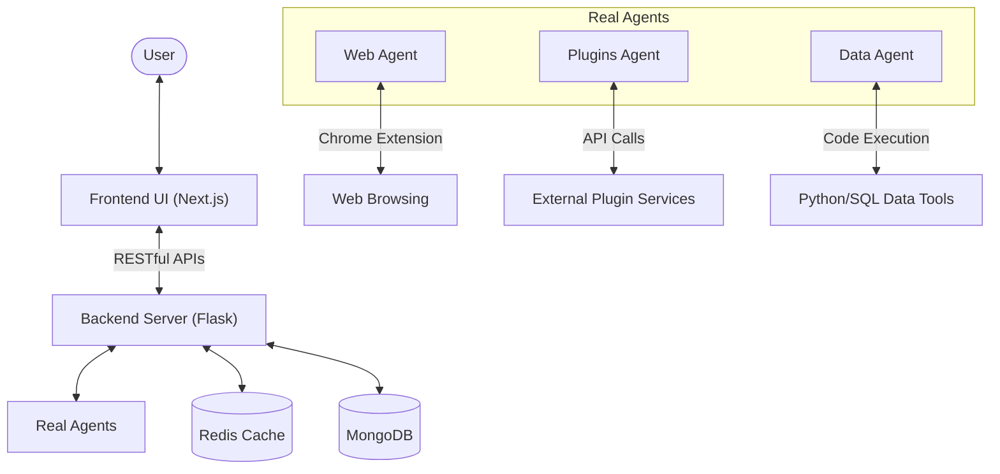
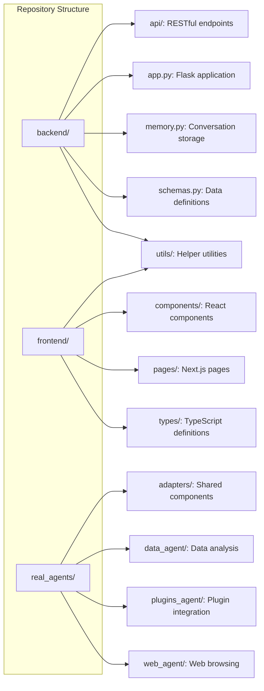
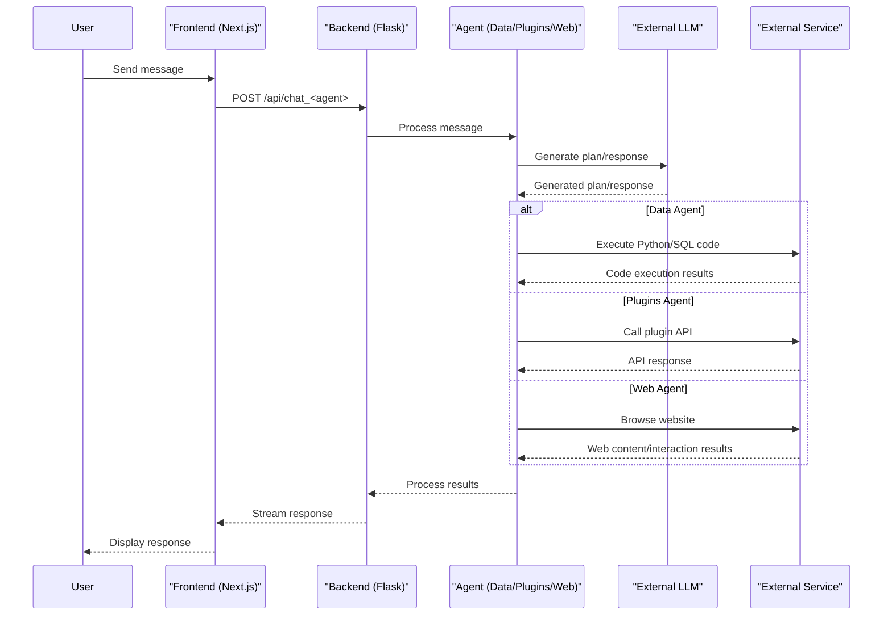
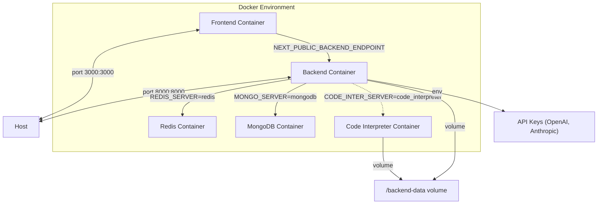

<!-- source: DeepWiki mcp.deepwiki.com · repo xlang-ai/OpenAgents · page 1 Overview · fetched 2026-10-26 -->

# Overview

Relevant source files

The following files were used as context for generating this wiki page:

- [README.md](README.md)
- [README_JA.md](README_JA.md)
- [README_KO.md](README_KO.md)
- [README_ZH.md](README_ZH.md)
- [pics/data_agent_demo.png](pics/data_agent_demo.png)
- [pics/openagents_overview.png](pics/openagents_overview.png)
- [pics/plugins_agent_demo.png](pics/plugins_agent_demo.png)
- [pics/system_design.png](pics/system_design.png)
- [pics/web_agent_demo.png](pics/web_agent_demo.png)

OpenAgents is an open platform for language agents in the wild of everyday life. This document provides a comprehensive overview of the OpenAgents system architecture, components, and how they interact to enable AI agents that can analyze data, call plugins, and autonomously browse the web.

The platform bridges the gap between proof-of-concept language agents and practical applications by providing a unified interface for both end users and developers. Unlike other language agent frameworks that focus solely on technical implementation, OpenAgents delivers a complete solution with a user-friendly web UI, backend services, and ready-to-use agent implementations.

For detailed information on getting started with local deployment, see [Getting Started](#2). For specific details about the agent implementations, see [Agents](#5).

Sources: [README.md:49-67]()

## System Architecture

OpenAgents employs a modular, service-oriented architecture that separates concerns between frontend, backend, and agent implementations. The following diagram illustrates the high-level architecture of the system:

The architecture consists of:

1. **Frontend UI**: A Next.js-based web application providing chat interface, file management, and agent selection.
2. **Backend Server**: A Flask-based server handling API requests, memory management, and communication with agents.
3. **Real Agents**: Implementations of the three agent types with their specialized capabilities.
4. **Storage**: MongoDB for persistence and Redis for caching.

Each component is designed to be independently deployable and scalable, with well-defined interfaces facilitating communication between them.

Sources: [README.md:171-174](), [backend/README.md](), [frontend/README.md]()

## Component Organization

The codebase is organized into three main directories that reflect the architecture:

This organization follows a "one agent, one folder" design principle, making it easier to understand and extend the system with new agents. The `adapters/` folder contains shared components like stream parsing, data models, memory, and callbacks that help integrate agents with the backend.

Sources: [README.md:212-253]()

## Agent Types

OpenAgents implements three main agent types, each with specific capabilities:

| Agent Type | Description | Key Capabilities | Source Code |
|------------|-------------|------------------|-------------|
| **Data Agent** | Comprehensive toolkit for efficient data operations | Search, handle, manipulate, and visualize data; execute Python/SQL code | [real_agents/data_agent/]()|
| **Plugins Agent** | Integration with 200+ third-party plugins | Shopping, weather, scientific exploration; auto plugin selection | [real_agents/plugins_agent/]()|
| **Web Agent** | Autonomous web browsing via Chrome extension | Navigate websites, extract information, interact with web pages | [real_agents/web_agent/]()|

Each agent type is implemented as a specialized class that handles specific types of tasks while sharing a common interface for integration with the backend.

Sources: [README.md:87-164]()

## Message Flow Sequence

The following diagram illustrates how messages flow through the system when a user interacts with an agent:

This sequence highlights the streaming nature of the system, which provides real-time feedback during long-running operations. The backend processes the initial request, routes it to the appropriate agent, which then interacts with external services as needed before streaming results back to the user.

Sources: [README.md:84-165](), [backend/api/](), [backend/display_streaming.py]()

## Deployment Architecture

OpenAgents can be deployed using Docker for a consistent environment across development and production:

The containers communicate through Docker's internal networking, with volumes used to persist data between restarts. The Code Interpreter container provides a sandboxed environment for executing code securely.

Sources: [README.md:185-207](), [Dockerfile](), [docker-compose.yml]()

## Extensibility

OpenAgents is designed to be extensible, allowing developers to add new agents, LLMs, and tools. The system follows a plugin architecture that makes it easy to extend its functionality.

### Extending with New Agents

To build a new agent beyond the three provided:

1. Create a new folder in `real_agents/` for the agent implementation
2. Implement the agent logic using components from the `adapters/` folder
3. Add a `chat_<new_agent>.py` file in `backend/api/` for the chat API
4. Register new constants in `backend/schemas.py`
5. Add a new `OpenAgentID` in frontend type definitions and corresponding API endpoints
6. Implement the agent UI in frontend components

Sources: [README.md:264-274]()

### Adding New Language Models

To extend with a new LLM as the agent backbone:

1. Register the new model in `backend/api/language_model.py`
2. If the LLM is not hosted yet, deploy it first and expose it as an API

Sources: [README.md:276-280]()

### Adding New Tools to Plugins Agent

To extend the Plugins Agent with new tools:

1. Create a new folder in `real_agents/plugins_agent/plugins/`
2. Implement the tool logic, including `ai-plugin.json` and `openapi.yaml`
3. Register the new tool name in `real_agents/plugins_agent/plugins/plugin_names.py`

Sources: [README.md:282-286]()

## Key Architectural Characteristics

The OpenAgents architecture has several notable characteristics:

1. **Clean Separation of Concerns**: The frontend handles user interaction, the backend manages communication and state, and real agents implement domain-specific logic.

2. **Modular Agent Design**: The three agent types (Data, Plugins, Web) are specialized for different tasks but share common adapters and interfaces.

3. **Containerized Deployment**: Docker containers provide a consistent environment across development and production.

4. **Streaming-First Design**: The system is built to handle streaming responses, enabling real-time feedback during long-running operations.

5. **Stateful Memory Management**: User conversations and agent states are persisted in MongoDB with Redis caching for performance.

This architecture balances flexibility and maintainability, making it suitable for both development and production environments while providing clear pathways for extending functionality.

Sources: [README.md:171-174](), [backend/memory.py]()

---

