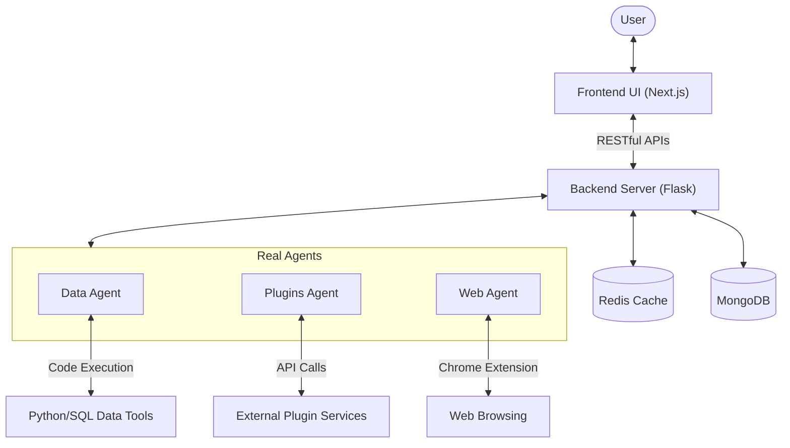
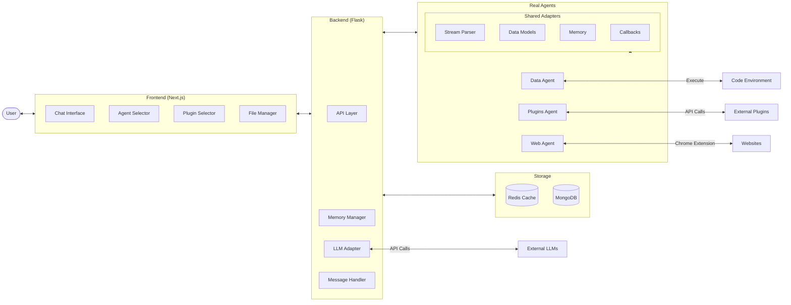
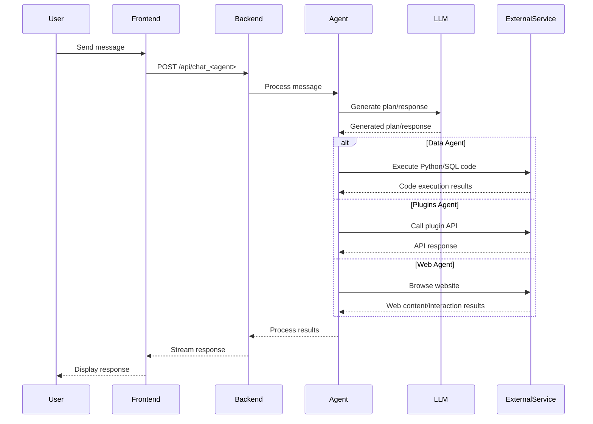
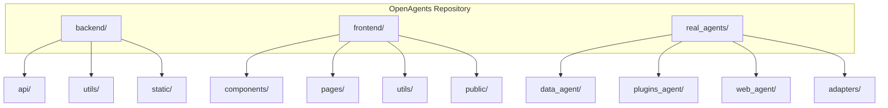
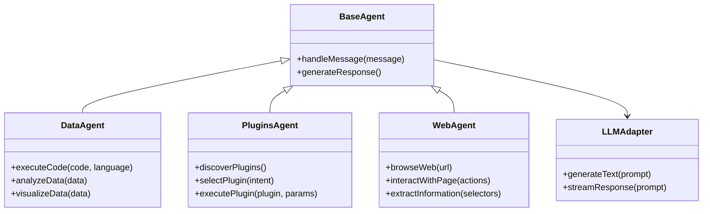
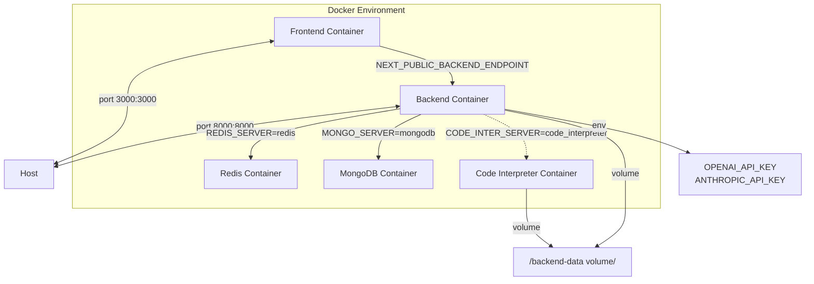

<!-- source: DeepWiki mcp.deepwiki.com · repo xlang-ai/OpenAgents · page 1.1 Architecture · fetched 2026-10-26 -->

# Architecture

Relevant source files

The following files were used as context for generating this wiki page:

- [README.md](README.md)
- [README_ZH.md](README_ZH.md)
- [pics/data_agent.png](pics/data_agent.png)
- [pics/data_agent_demo.png](pics/data_agent_demo.png)
- [pics/openagents_overview.png](pics/openagents_overview.png)
- [pics/plugins_agent.png](pics/plugins_agent.png)
- [pics/plugins_agent_demo.png](pics/plugins_agent_demo.png)
- [pics/system_design.png](pics/system_design.png)
- [pics/web_agent.png](pics/web_agent.png)
- [pics/web_agent_demo.png](pics/web_agent_demo.png)

This document provides a comprehensive overview of the OpenAgents system architecture, detailing the relationships between components, data flow patterns, and the technical implementation of the system. It covers the high-level architecture, component interactions, deployment model, and extension points.

For an introduction to OpenAgents and its purpose, see [Overview](#1). For detailed information about specific agent types, see [Agent Types](#1.2).

## System Overview

OpenAgents is designed with a modular, service-oriented architecture that separates concerns between the frontend user interface, backend services, and agent implementations. The system follows a client-server model with streaming capabilities to provide real-time feedback during long-running operations.

The architecture consists of five major components:

1. **Frontend UI**: A Next.js application providing the user interface
2. **Backend Server**: A Flask server handling requests, managing state, and coordinating agents
3. **Real Agents**: Three specialized agents for different tasks (Data, Plugins, Web)
4. **External Services**: Integration with web browsing, plugin APIs, and data tools
5. **Storage**: Redis for caching and MongoDB for data persistence

Sources: 
- [README.md:38-67](）
- [pics/system_design.png]()

## Component Architecture

The following diagram illustrates the detailed component architecture of OpenAgents, showing how the various subsystems interact:

### Frontend Components

The frontend is built with Next.js and includes the following key components:

- **Chat Interface**: Handles the conversation UI and message display
- **Agent Selector**: Allows users to choose which agent to interact with
- **Plugin Selector**: For selecting and configuring plugins (Plugins Agent)
- **File Manager**: For managing data files (Data Agent)

The frontend communicates with the backend through RESTful APIs defined in the `/frontend/utils/app/api.ts` file.

### Backend Components

The backend is implemented as a Flask server with these core components:

- **API Layer**: REST endpoints for agent interactions and system operations
- **Memory Manager**: Manages conversation history and system state
- **LLM Adapter**: Provides a unified interface to different language models
- **Message Handler**: Processes and routes messages between components

### Agent Implementation

The "Real Agents" are the core of the system's functionality, with three specialized agent types:

- **Data Agent**: For data analysis with Python/SQL execution capabilities
- **Plugins Agent**: For integrating with external services via plugin APIs
- **Web Agent**: For autonomous web browsing via Chrome extension

These agents share common components through adapters:

- **Stream Parser**: For parsing streaming responses
- **Data Models**: Shared data structures
- **Memory**: For maintaining agent state
- **Callbacks**: For event handling

Sources:
- [README.md:170-235](）
- [pics/system_design.png]()

## Data Flow and Message Processing

The following sequence diagram illustrates the typical message flow in the OpenAgents system:

1. The user sends a message through the frontend interface
2. The frontend forwards the message to the appropriate backend endpoint
3. The backend routes the message to the corresponding agent
4. The agent uses an LLM to generate a plan or response
5. Depending on the agent type, it may interact with external services:
   - Data Agent executes code in a sandboxed environment
   - Plugins Agent calls external APIs
   - Web Agent interacts with websites through a Chrome extension
6. Results are processed and streamed back to the user

This streaming design allows for real-time feedback during long-running operations, enhancing the user experience.

Sources:
- [README.md:84-96](）
- [README.md:102-108](）
- [README.md:126-132](）
- [README.md:144-156](）

## Code Organization

The OpenAgents codebase is organized into three main directories:

### Backend Structure

The backend code is organized as follows:

- `backend/app.py`: Main Flask application
- `backend/api/`: RESTful API endpoints
- `backend/memory.py`: Conversation history and state management
- `backend/schemas.py`: Data structure definitions
- `backend/utils/`: Utility functions

### Frontend Structure

The frontend code follows Next.js conventions:

- `frontend/components/`: React components
- `frontend/pages/`: Next.js pages
- `frontend/utils/`: Utility functions and API calls
- `frontend/public/`: Static assets
- `frontend/webot_extension.zip`: Chrome extension for Web Agent

### Agent Structure

The "real_agents" directory contains the implementation of the three agents:

- `real_agents/data_agent/`: Data Agent implementation
- `real_agents/plugins_agent/`: Plugins Agent implementation
- `real_agents/web_agent/`: Web Agent implementation
- `real_agents/adapters/`: Shared adapters used by all agents

This "one agent, one folder" design makes it easy to understand and extend the system with new agent types.

Sources:
- [README.md:212-253](）

## Agent System Design

The agent system follows an object-oriented design with inheritance for code reuse:

### BaseAgent

The BaseAgent class provides common functionality for all agent types, including message handling and response generation. It serves as the foundation for the specialized agent implementations.

### Specialized Agents

Each specialized agent extends the BaseAgent class with specific capabilities:

- **DataAgent**: Handles data analysis, code execution, and visualization
- **PluginsAgent**: Manages plugin discovery, selection, and execution
- **WebAgent**: Controls web browsing, page interaction, and information extraction

### LLM Integration

All agents interact with large language models through the LLMAdapter, which provides a unified interface to different LLM providers. This design makes it easy to switch between different LLMs or add support for new ones.

Sources:
- [README.md:262-287](）

## Deployment Architecture

OpenAgents is designed for deployment using Docker containers:

### Docker Containers

The system is composed of multiple containers:

- **Frontend Container**: Next.js application exposed on port 3000
- **Backend Container**: Flask server exposed on port 8000
- **Redis Container**: For caching
- **MongoDB Container**: For data persistence
- **Code Interpreter Container**: Sandboxed environment for code execution

### Container Communication

The containers communicate through Docker's internal networking:

- The frontend connects to the backend using the `NEXT_PUBLIC_BACKEND_ENDPOINT` environment variable
- The backend connects to Redis and MongoDB using the respective environment variables
- The backend communicates with the Code Interpreter container for secure code execution

### Data Persistence

Data persistence is handled through:

- MongoDB for storing conversation history and agent state
- Shared volumes for exchanging data between containers

### Environment Configuration

The system is configured using environment variables:

- LLM API keys (OPENAI_API_KEY, ANTHROPIC_API_KEY)
- Service endpoints and connection strings
- Feature flags and configuration parameters

Sources:
- [README.md:186-207](）

## Extension Points

OpenAgents is designed to be extensible in various ways:

### Adding New Agents

To add a new agent:

1. Create a new folder under `real_agents/` for your agent implementation
2. Implement the agent logic, extending the BaseAgent class
3. Add a new API endpoint in `backend/api/chat_<new_agent>.py`
4. Register constants in `backend/schemas.py`
5. Add the new agent ID in `frontend/types/agent.ts`
6. Update the frontend components to support the new agent

### Adding New LLMs

To add support for a new LLM:

1. Register the new model in `backend/api/language_model.py`
2. Implement the interface methods required by the LLMAdapter

### Adding New Plugins

To add a new plugin to the Plugins Agent:

1. Create a new folder under `real_agents/plugins_agent/plugins/`
2. Implement the plugin logic including `ai-plugin.json` and `openapi.yaml`
3. Register the plugin name in `real_agents/plugins_agent/plugins/plugin_names.py`

Sources:
- [README.md:264-287](）

## Conclusion

The OpenAgents architecture is designed to be modular, extensible, and maintainable. The clean separation of concerns between frontend, backend, and agent implementations makes it easy to understand and extend the system.

Key architectural characteristics include:

1. **Modular Design**: Clear separation between frontend, backend, and agent implementations
2. **Extensibility**: Well-defined extension points for adding new agents, LLMs, and plugins
3. **Streaming-First**: Designed for real-time feedback during long-running operations
4. **Containerized Deployment**: Docker-based deployment for consistent environments
5. **Stateful Memory Management**: Persistent conversation history and agent state
6. **Language Model Abstraction**: Unified interface to different LLM providers

This architecture provides a solid foundation for building and deploying language agents in real-world settings.

---

