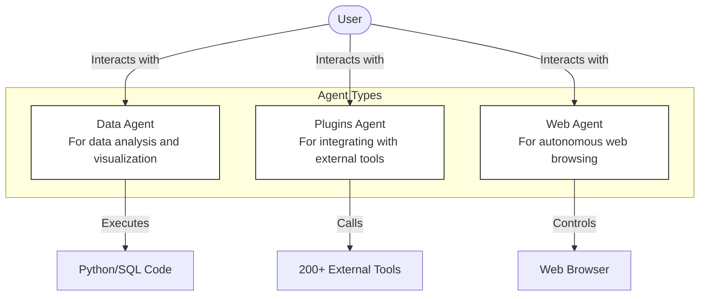
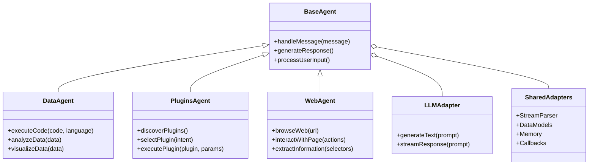
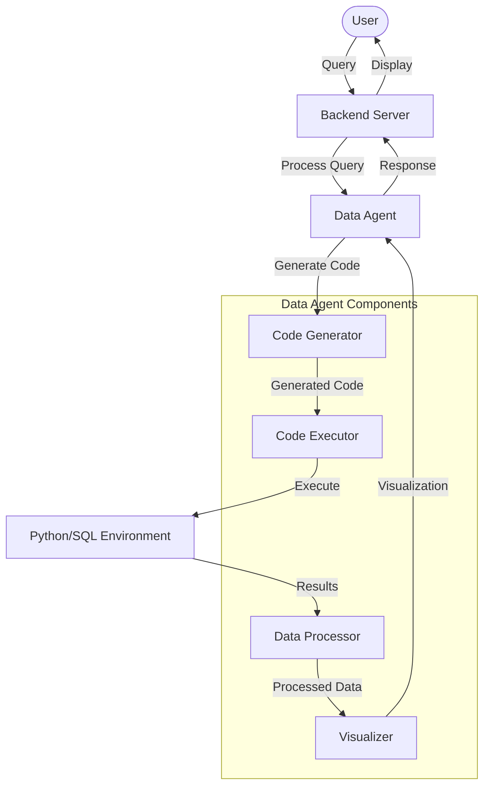
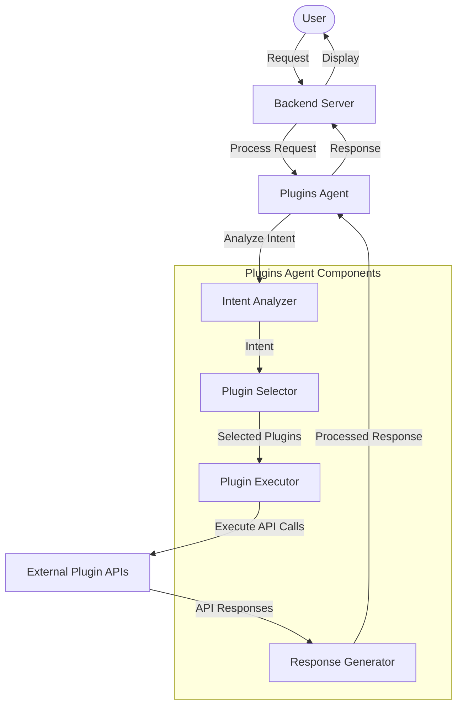
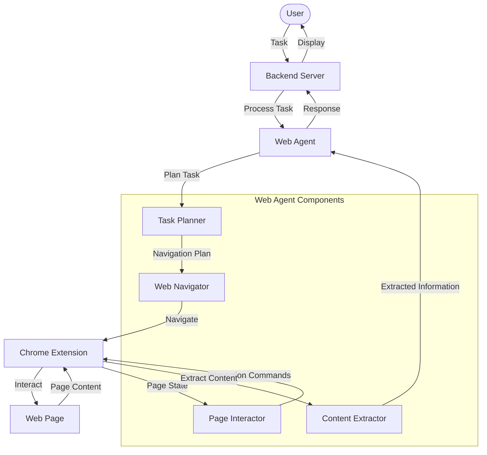
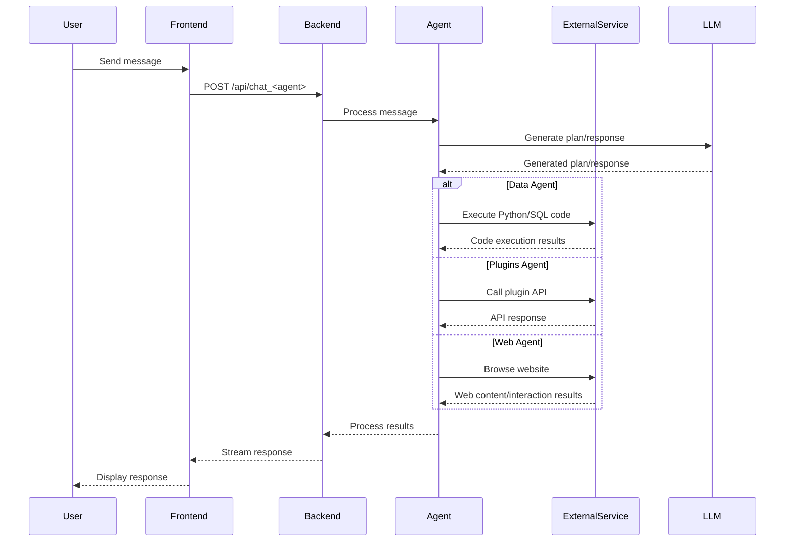
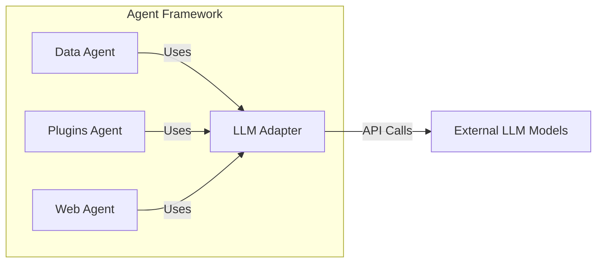

<!-- source: DeepWiki mcp.deepwiki.com · repo xlang-ai/OpenAgents · page 1.2 Agent Types · fetched 2026-10-26 -->

# Agent Types

Relevant source files

The following files were used as context for generating this wiki page:

- [README.md](README.md)
- [README_ZH.md](README_ZH.md)
- [pics/amazon.svg](pics/amazon.svg)
- [pics/data_agent.png](pics/data_agent.png)
- [pics/data_agent_demo.png](pics/data_agent_demo.png)
- [pics/google_research.svg](pics/google_research.svg)
- [pics/openagents_overview.png](pics/openagents_overview.png)
- [pics/plugins_agent.png](pics/plugins_agent.png)
- [pics/plugins_agent_demo.png](pics/plugins_agent_demo.png)
- [pics/salesforce.webp](pics/salesforce.webp)
- [pics/system_design.png](pics/system_design.png)
- [pics/web_agent.png](pics/web_agent.png)
- [pics/web_agent_demo.png](pics/web_agent_demo.png)

This page provides an overview of the three types of language agents implemented in the OpenAgents platform: Data Agent, Plugins Agent, and Web Agent. It covers their core capabilities, implementation structure, and how they interact with the rest of the system.

For information about the overall system architecture, see [Architecture](#1.1).

## Overview of Agent Types

OpenAgents implements three specialized agent types, each designed for different use cases while sharing a common framework:

Sources: `README.md`

## Agent Architecture and Framework

All three agent types are built on a common architecture, following the "one agent, one folder" design principle. The agents are located in the `real_agents` directory, with shared components in the `adapters` subdirectory.

Sources: `README.md`

### Common Components

The `real_agents/adapters` directory contains shared components used by all three agent types:

| Component | Purpose |
|-----------|---------|
| Stream Parser | Handles streaming responses from language models |
| Data Models | Defines common data structures used across agents |
| Memory | Manages conversation history and agent state |
| Callbacks | Implements event hooks for agent operations |

These adapters enable the agents to interact with the backend system in a consistent way while implementing their specialized capabilities.

Sources: `README.md`

## Data Agent

The Data Agent is designed for efficient data operations, providing comprehensive capabilities for data analysis and visualization.

### Core Capabilities

- 🔍 **Search**: Quickly locate data you need
- 🛠️ **Handle**: Streamline data acquisition and processing
- 🔄 **Manipulate**: Modify data to suit specific requirements
- 📊 **Visualize**: Represent data through charts and graphs

### Implementation Structure

The Data Agent is implemented in `real_agents/data_agent/` and can write and execute code to perform a wide range of data-centric tasks, from simple data manipulation to complex statistical analysis and visualization.

Sources: `README.md`

### Use Cases

The Data Agent excels at tasks such as:

- Data analysis with Python and pandas
- Database queries with SQL
- Statistical analysis and hypothesis testing
- Data visualization through charts and plots
- File format conversion and data extraction

Sources: `README.md`

## Plugins Agent

The Plugins Agent seamlessly integrates with over 200 third-party plugins, each selected to enhance various aspects of daily life.

### Core Capabilities

- 🔌 **Plugin Discovery**: Find and use appropriate plugins for tasks
- 🔄 **Multi-plugin Usage**: Combine multiple plugins for complex workflows
- 🔍 **Auto Plugin Selection**: Intelligently suggest the most suitable plugins
- 🌐 **API Integration**: Connect to external services through standardized APIs

### Implementation Structure

The Plugins Agent is implemented in `real_agents/plugins_agent/` and maintains a registry of available plugins, their capabilities, and instructions for interacting with them.

Sources: `README.md`

### Sample Plugins

The Plugins Agent can use a variety of plugins, including:

- 🛍️ **Shopping**: Klarna Shopping
- ☁️ **Weather**: XWeather
- 🔬 **Scientific Exploration**: Wolfram Alpha
- And 200+ more tools covering diverse domains

Sources: `README.md`

## Web Agent

The Web Agent harnesses the power of a Chrome extension to navigate and explore websites autonomously, streamlining the web browsing experience.

### Core Capabilities

- 🌐 **Web Navigation**: Browse websites and follow links automatically
- 🖱️ **Page Interaction**: Fill forms, click buttons, and interact with elements
- 📝 **Information Extraction**: Collect and summarize content from web pages
- ⚙️ **Task Automation**: Automate repetitive web-based workflows

### Implementation Structure

The Web Agent is implemented in `real_agents/web_agent/` and leverages a Chrome extension to control web browsing actions.

Sources: `README.md`

### Example Use Cases

The Web Agent can handle tasks such as:

- 📍 **Google Maps Navigation**: Finding routes between locations
- 🐦 **Social Media Posting**: Creating and submitting posts
- 📝 **Form Completion**: Filling out online forms with provided information
- 🔍 **Research Assistance**: Gathering information from multiple web sources

Sources: `README.md`

## Agent Interaction Flow

All three agent types follow a similar message flow pattern when processing user requests:

This diagram illustrates how:
1. User messages are sent to the backend via specific API endpoints
2. The appropriate agent processes the message
3. The agent generates a plan or response using a language model
4. Based on the agent type, different external services are called
5. Results are processed and streamed back to the user

Sources: `README.md`

## Integration with LLM Models

All agent types interface with Large Language Models to process natural language requests and generate appropriate responses. The agents use adapters to communicate with these models in a standardized way.

This architecture allows the system to be model-agnostic, supporting different language models as needed.

Sources: `README.md`

## Extending Agent Types

The OpenAgents platform is designed to be extensible, allowing developers to create new agent types beyond the three provided ones. To extend the system with a new agent type:

1. Create a new folder under `real_agents/` for your agent
2. Implement agent logic using components from the `adapters/` folder
3. Add a `chat_<new_agent>.py` file under `backend/api/`
4. Register new constants in `backend/schemas.py`
5. Add a new `OpenAgentID` in `frontend/types/agent.ts`
6. Implement the frontend components in `frontend/components/Chat/`

This modular design makes it straightforward to enhance the platform with additional specialized agents.

Sources: `README.md`

## Summary

The three agent types in OpenAgents provide complementary capabilities:

| Agent Type | Primary Purpose | Key Capabilities | External Integrations |
|------------|----------------|------------------|----------------------|
| Data Agent | Data analysis and visualization | Code execution, data manipulation, visualization | Python/SQL environments |
| Plugins Agent | Integration with external tools | Plugin discovery, selection, and execution | 200+ external APIs |
| Web Agent | Autonomous web browsing | Web navigation, page interaction, content extraction | Chrome extension |

All agents share a common architectural framework while implementing specialized functionality for their respective domains. This design allows for both consistency in implementation and flexibility in capabilities.

Sources: `README.md`

---

