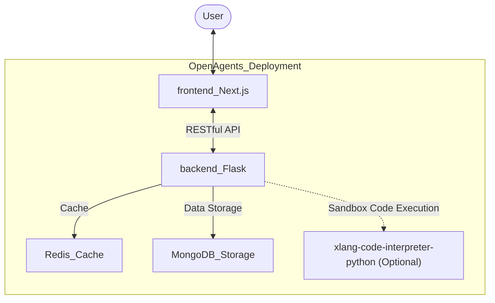
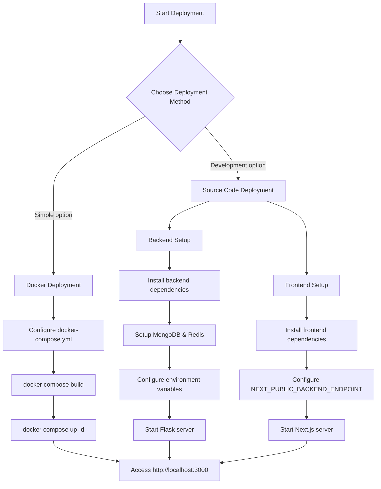
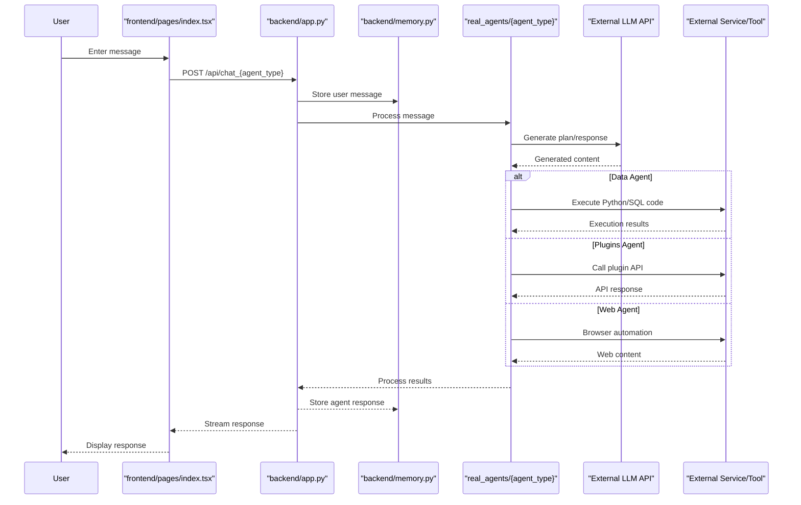

<!-- source: DeepWiki mcp.deepwiki.com · repo xlang-ai/OpenAgents · page 2 Getting Started · fetched 2026-10-26 -->

# Getting Started

<details>
<summary>Relevant source files</summary>

The following files were used as context for generating this wiki page:

- [Dockerfile](Dockerfile)
- [README.md](README.md)
- [README_ZH.md](README_ZH.md)
- [backend/README.md](backend/README.md)
- [backend/setup_script.sh](backend/setup_script.sh)
- [docker-compose.yml](docker-compose.yml)
- [frontend/Dockerfile](frontend/Dockerfile)
- [frontend/next.config.js](frontend/next.config.js)

</details>


This document provides step-by-step instructions for setting up and running OpenAgents on your local machine. It covers both Docker-based and source code deployment options, required prerequisites, and initial configuration. For information about extending the platform with custom functionality, see [Extending OpenAgents](#7).

## System Architecture Overview

Before diving into installation, let's understand the basic architecture of OpenAgents:



Sources: [README.md:165-166](), [docker-compose.yml:1-67]()

OpenAgents consists of:
- A Next.js frontend that provides the user interface
- A Flask backend that implements the agent logic and API endpoints
- Redis for caching conversation history and state
- MongoDB for persistent data storage
- An optional code interpreter container for sandboxed code execution

## Deployment Options

OpenAgents offers two deployment methods:



Sources: [README.md:167-197](), [backend/README.md:1-206](), [frontend/Dockerfile:1-38]()

### Docker Deployment

Docker deployment is the simplest option and requires Docker and Docker Compose to be installed.

1. Clone the repository:
   ```bash
   git clone https://github.com/xlang-ai/OpenAgents.git
   cd OpenAgents
   ```

2. Configure your OpenAI API key in `docker-compose.yml`:
   ```yaml
   environment:
     - OPENAI_API_KEY=your_key_here  # Required
   ```

3. If you're not running locally, modify the backend endpoint in `frontend/Dockerfile`:
   ```
   ENV NEXT_PUBLIC_BACKEND_ENDPOINT http://x.x.x.x:8000
   ```

4. Build and start the containers:
   ```bash
   docker compose build
   docker compose up -d
   ```

5. Access the web interface at `http://localhost:3000`

Sources: [README.md:180-197](), [docker-compose.yml:38-62](), [frontend/Dockerfile:15-16]()

### Source Code Deployment

Source code deployment gives you more flexibility and is recommended for development.

#### Backend Setup

1. Create and activate a conda environment:
   ```bash
   conda create -n openagents python=3.10
   conda activate openagents
   pip install -r backend/requirements.txt
   ```

2. Set up MongoDB and Redis:
   
   Using the setup script (recommended):
   ```bash
   bash backend/setup_script.sh
   ```
   
   Or follow the manual instructions in [backend/README.md:25-96]()

3. Configure environment variables:
   ```bash
   export VARIABLE_REGISTER_BACKEND=redis
   export MESSAGE_MEMORY_MANAGER_BACKEND=database
   export JUPYTER_KERNEL_MEMORY_MANAGER_BACKEND=database
   export MONGO_SERVER=127.0.0.1
   export OPENAI_API_KEY=your_key_here
   ```

4. Start the Flask server:
   ```bash
   export FLASK_APP=backend.main.py
   flask run -p 8000
   ```

Sources: [backend/README.md:1-206](), [backend/setup_script.sh:1-59]()

#### Frontend Setup

1. Install frontend dependencies:
   ```bash
   cd frontend
   npm install
   ```

2. Configure the backend endpoint if necessary (by default points to localhost:8000)

3. Start the Next.js development server:
   ```bash
   npm run dev
   ```

4. Access the web interface at `http://localhost:3000`

Sources: [frontend/next.config.js:1-20]()

## LLM Configuration

OpenAgents supports multiple Large Language Model providers:

| Provider | Required Environment Variables |
|----------|--------------------------------|
| OpenAI   | `OPENAI_API_KEY` |
| Azure OpenAI | `OPENAI_API_TYPE=azure`<br>`OPENAI_API_BASE=<endpoint>`<br>`OPENAI_API_VERSION=<version>`<br>`OPENAI_API_KEY=<key>` |
| Anthropic | `ANTHROPIC_API_KEY` |

Sources: [backend/README.md:125-143]()

## Optional Components

### Code Interpreter Container

For sandboxed code execution (recommended for security), set up the code interpreter container:

```bash
docker pull xlanglab/xlang-code-interpreter-python
docker run -d --rm \
    --name codeint \
    --env-file real_agents/data_agent/.code_interpreter_docker_env \
    --mount type=bind,source=$(pwd)/backend/data,target=/home \
    -p 8100:8100 \
    --ip=10.1.1.2 \
    --cap-add SYS_RESOURCE \
    --cap-add SYS_PTRACE \
    --cap-add NET_ADMIN \
    xlanglab/xlang-code-interpreter-python
```

Then configure the backend to use it:
```bash
export CODE_EXECUTION_MODE="docker"
```

If using Docker Compose, uncomment the `code_interpreter` service in [docker-compose.yml:27-37]()

Sources: [backend/README.md:172-194](), [docker-compose.yml:26-37]()

### Kaggle Integration

To use the Kaggle Search Tool in the Data Agent:

1. Follow [Kaggle's API documentation](https://www.kaggle.com/docs/api#installation) to get your API token
2. Save it to `~/.kaggle/kaggle.json`
3. If using Docker, update your Kaggle credentials in [Dockerfile:188-189]()

Sources: [backend/README.md:155-157](), [Dockerfile:187-192]()

### Auto Tool Selection

For the "Auto" plugin selection feature in the Plugins Agent:

```bash
git clone https://github.com/xlang-ai/instructor-embedding
cd instructor-embedding
pip install -r requirements.txt
pip install InstructorEmbedding
cd ..
```

Sources: [backend/README.md:159-169]()

## Component Interaction

The following diagram shows how the different components interact when processing a user query:



Sources: [README.md:84-157]()

## First-Time Usage

After setting up OpenAgents:

1. Navigate to `http://localhost:3000` in your web browser
2. You'll see the OpenAgents chat interface
3. Click on "New Chat" to start a conversation
4. Select one of the three agents:
   - **Data Agent**: For data analysis with Python/SQL
   - **Plugins Agent**: For using external tools and services
   - **Web Agent**: For browser automation (requires Chrome extension)
5. Enter your query and start interacting with the agent

## Troubleshooting

If you encounter issues during setup or usage:

1. Check that all required environment variables are properly set
2. Ensure MongoDB and Redis are running
3. Verify your API keys are valid
4. Check the logs for error messages:
   - Backend logs: `flask` output or Docker logs
   - Frontend logs: Browser console or Next.js development server

For detailed information about specific components, see:
- [Backend System](#3) for information about the backend architecture
- [Frontend System](#4) for information about the frontend architecture
- [Agents](#5) for information about the three agent types

Sources: [README.md:70-71]()

## Next Steps

Now that you have OpenAgents running, you might want to:

- Explore the capabilities of each agent in [Agent Types](#1.2)
- Learn how to develop custom agents in [Creating Custom Agents](#7.1)
- Add new plugins in [Adding New Plugins](#7.2)
- Integrate additional LLMs in [Integrating New LLMs](#7.3)

Sources: [README.md:210-287]()

---

