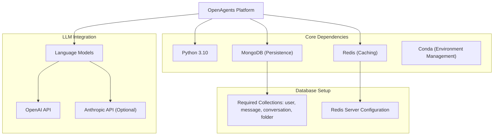
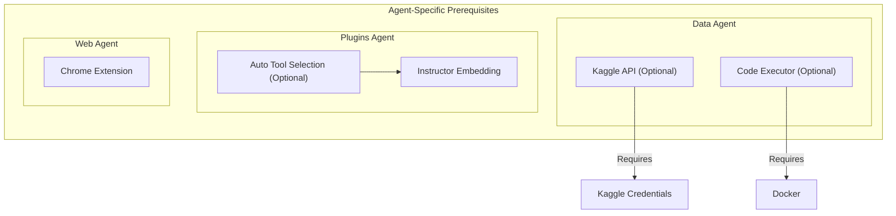

<!-- source: DeepWiki mcp.deepwiki.com · repo xlang-ai/OpenAgents · page 2.1 Prerequisites · fetched 2026-10-26 -->

# Prerequisites

<details>
<summary>Relevant source files</summary>

The following files were used as context for generating this wiki page:

- [Dockerfile](Dockerfile)
- [README.md](README.md)
- [README_ZH.md](README_ZH.md)
- [backend/README.md](backend/README.md)
- [backend/setup_script.sh](backend/setup_script.sh)

</details>


This page outlines all system requirements and dependencies needed before installing and running the OpenAgents platform. Meeting these prerequisites is essential for a successful deployment of the system.

For installation instructions, see [Installation](#2.2).

## System Requirements

### Hardware Requirements

- **CPU**: Any modern multi-core processor
- **Memory**: Minimum 8GB RAM (16GB+ recommended for running all agents)
- **Storage**: At least 10GB free disk space
- **GPU**: Optional but recommended for better performance with language models
  - If using GPU acceleration, requires NVIDIA GPU with CUDA support

### Operating System Compatibility

- **Linux**: Ubuntu recommended and most thoroughly tested
- **macOS**: Fully supported
- **Windows**: Not directly supported (use WSL or Docker)

## Software Dependencies Diagram



Sources: [backend/README.md:13-19](), [backend/README.md:30-40](), [backend/README.md:71-95](), [backend/README.md:125-143]()

## Core Software Prerequisites

### Python Environment

- **Python 3.10**
- **Conda** (recommended for environment management)
- Python packages from `backend/requirements.txt`

```bash
conda create -n openagents python=3.10
conda activate openagents
pip install -r backend/requirements.txt
```

Sources: [backend/README.md:16-19](), [backend/setup_script.sh:4-7]()

### Database Requirements

#### MongoDB

MongoDB is required for persistent data storage:
- **macOS**: MongoDB Community 6.0
- **Linux**: MongoDB 4.4

The following collections need to be created in a database named `xlang`:
- `user`
- `message`
- `conversation`
- `folder`

Sources: [backend/README.md:30-60](), [backend/setup_script.sh:14-40]()

#### Redis

Redis is required for caching and in-memory storage:
- Ensure Redis server is installed and running
- The maximum Redis memory is set to 500MB by default
- When memory is full, LRU data will be removed

Sources: [backend/README.md:71-95](), [backend/README.md:107-108](), [backend/setup_script.sh:24-48]()

## Agent-Specific Prerequisites

Each agent in OpenAgents may have additional specific requirements:



Sources: [README.md:53-56](), [backend/README.md:155-193]()

### Data Agent Prerequisites

- **Kaggle Integration** (Optional):
  - Required for Kaggle Search Tool
  - Kaggle API credentials configured in `~/.kaggle/kaggle.json`
  - Follow the [Kaggle Public API documentation](https://www.kaggle.com/docs/api#installation) to set up API token

- **Code Execution Environment** (Optional):
  - Docker for sandboxed code execution
  - Docker image: `xlanglab/xlang-code-interpreter-python`
  - Required if you want to execute Python code in a secure sandbox

Sources: [backend/README.md:155-158](), [backend/README.md:172-193]()

### Plugins Agent Prerequisites

- **Auto Tool Selection** (Optional):
  - Instructor Embedding package
  - Additional disk space for embedding models

Installation commands:
```bash
git clone https://github.com/xlang-ai/instructor-embedding
cd instructor-embedding
pip install -r requirements.txt
pip install InstructorEmbedding
```

Sources: [backend/README.md:160-169]()

### Web Agent Prerequisites

- **Chrome Browser**
- **WeBot Chrome Extension** (included in the repository at `frontend/webot_extension.zip`)

Sources: [README.md:56](), [README.md:143-145]()

## External Service Credentials

### LLM API Access

At least one of the following is required:

- **OpenAI API Key**
  ```bash
  export OPENAI_API_KEY=<your-openai-api-key>
  ```

- **Anthropic API Key** (Optional, for Claude models)
  ```bash
  export ANTHROPIC_API_KEY=<your-anthropic-api-key>
  ```

For Azure OpenAI users, additional variables are required:
```bash
export OPENAI_API_TYPE=azure
export OPENAI_API_BASE=<azure-endpoint>
export OPENAI_API_VERSION=<api-version>
export OPENAI_API_KEY=<azure-api-key>
```

Sources: [backend/README.md:125-143]()

## Environment Variables

Several environment variables must be configured for proper operation:

| Variable | Purpose | Required Value |
|----------|---------|----------------|
| `VARIABLE_REGISTER_BACKEND` | Storage for variable registration | `redis` |
| `MESSAGE_MEMORY_MANAGER_BACKEND` | Storage for message memory | `database` |
| `JUPYTER_KERNEL_MEMORY_MANAGER_BACKEND` | Storage for Jupyter kernel memory | `database` |
| `MONGO_SERVER` | MongoDB server address | `127.0.0.1` (or container name in Docker) |
| `CODE_EXECUTION_MODE` | Code execution environment | `local` (default) or `docker` |

Sources: [backend/README.md:105-114](), [backend/README.md:190-193](), [backend/setup_script.sh:52-56]()

## Docker-Specific Requirements

If deploying with Docker:

- Docker and Docker Compose installed
- For GPU support: [NVIDIA Container Toolkit](https://docs.nvidia.com/datacenter/cloud-native/container-toolkit/latest/install-guide.html)
- Configured environment variables in `docker-compose.yml`
- Optional: Kaggle credentials in the Dockerfile

```bash
# To build Docker images
docker compose build

# To start all services
docker compose up -d
```

Sources: [README.md:186-206](), [Dockerfile:187-192]()

## One-Click Setup Script

For convenience, a setup script is provided that will install and configure most prerequisites automatically:

```bash
backend/setup_script.sh
```

This script:
1. Creates a conda environment with Python 3.10
2. Installs required Python packages
3. Sets up MongoDB and creates needed collections
4. Installs and starts Redis
5. Sets up environment variables

After running the script, you still need to set up:
1. LLM API keys
2. Optional agent-specific prerequisites

Sources: [backend/README.md:5-9](), [backend/setup_script.sh:1-59]()

---

