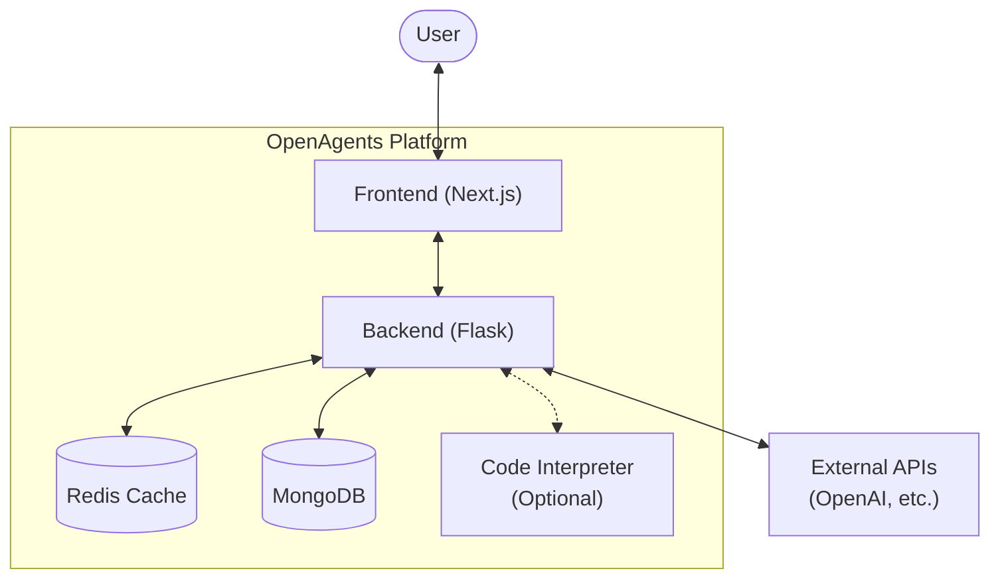
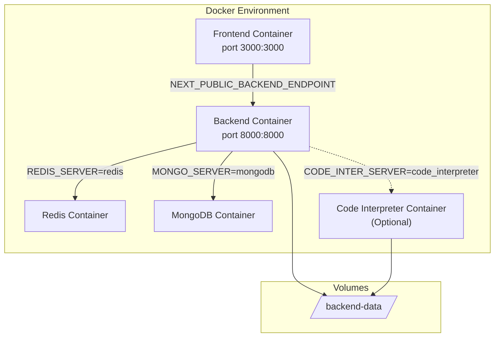

<!-- source: DeepWiki mcp.deepwiki.com · repo xlang-ai/OpenAgents · page 2.2 Installation · fetched 2026-10-26 -->

# Installation

<details>
<summary>Relevant source files</summary>

The following files were used as context for generating this wiki page:

- [Dockerfile](Dockerfile)
- [README.md](README.md)
- [README_ZH.md](README_ZH.md)
- [backend/README.md](backend/README.md)
- [backend/setup_script.sh](backend/setup_script.sh)
- [docker-compose.yml](docker-compose.yml)
- [frontend/Dockerfile](frontend/Dockerfile)
- [frontend/next.config.js](frontend/next.config.js)

</details>


This document provides comprehensive instructions for installing and deploying the OpenAgents platform. It covers both source code installation and Docker-based deployment options to get the system running on your local machine. For configuration options after installation, see [Configuration](#2.3).

## System Overview

Before diving into installation, let's understand what we're installing:



Sources: [README.md:158-166](), [docker-compose.yml:1-66]()

## Installation Options

OpenAgents can be installed using two primary methods:

| Method | Advantages | Use Case |
|--------|------------|----------|
| Source Code | More customizable, better for development | Development, research, customization |
| Docker | Easier setup, consistent environment | Quick testing, production deployment |

Sources: [README.md:167-183]()

## Prerequisites

Before installation, ensure you have:

1. **Hardware Requirements**:
   - CPU: 4+ cores recommended
   - RAM: 8GB+ (16GB+ recommended for data-intensive tasks)
   - Storage: At least 10GB of free space

2. **Software Requirements**:
   - Git
   - For source code installation:
     - Python 3.10
     - Node.js 18+
     - npm/yarn
   - For Docker installation:
     - Docker
     - Docker Compose

Sources: [backend/README.md:11-19](), [frontend/Dockerfile:1-2]()

## Source Code Installation

### One-Click Setup Script

For a streamlined installation experience, you can use the provided setup script:

```bash
# Clone the repository
git clone https://github.com/xlang-ai/OpenAgents.git
cd OpenAgents

# Run the setup script
./backend/setup_script.sh
```

The script automatically installs dependencies and sets up MongoDB and Redis for both macOS and Linux environments.

Sources: [backend/README.md:5-9](), [backend/setup_script.sh:1-59]()

### Manual Backend Setup

If you prefer to set up manually or encounter issues with the script, follow these steps:

1. **Create and Activate Conda Environment**:
   ```bash
   conda create -n openagents python=3.10
   conda activate openagents
   pip install -r backend/requirements.txt
   ```

2. **Set Up MongoDB**:
   
   For macOS:
   ```bash
   brew tap mongodb/brew
   brew update
   brew install mongodb-community@6.0
   brew services start mongodb-community@6.0
   ```
   
   For Linux:
   ```bash
   wget -qO - https://www.mongodb.org/static/pgp/server-4.4.asc | sudo apt-key add -
   echo "deb [ arch=amd64,arm64 ] https://repo.mongodb.org/apt/ubuntu bionic/mongodb-org/4.4 multiverse" | sudo tee /etc/apt/sources.list.d/mongodb-org-4.4.list
   sudo apt-get update
   sudo apt-get install -y mongodb-org
   sudo systemctl start mongod
   ```
   
   Create collections:
   ```bash
   mongosh
   > use xlang
   > db.createCollection("user")
   > db.createCollection("message")
   > db.createCollection("conversation")
   > db.createCollection("folder")
   > show collections
   ```

3. **Set Up Redis**:
   
   For macOS:
   ```bash
   brew install redis
   brew services start redis
   ```
   
   For Linux:
   ```bash
   curl -fsSL https://packages.redis.io/gpg | sudo gpg --dearmor -o /usr/share/keyrings/redis-archive-keyring.gpg
   echo "deb [signed-by=/usr/share/keyrings/redis-archive-keyring.gpg] https://packages.redis.io/deb $(lsb_release -cs) main" | sudo tee /etc/apt/sources.list.d/redis.list
   sudo apt-get update
   sudo apt-get install redis
   sudo systemctl start redis-server
   ```

4. **Configure Environment Variables**:
   ```bash
   export VARIABLE_REGISTER_BACKEND=redis
   export MESSAGE_MEMORY_MANAGER_BACKEND=database
   export JUPYTER_KERNEL_MEMORY_MANAGER_BACKEND=database
   export MONGO_SERVER=127.0.0.1
   ```

5. **Set Up LLM API Keys**:
   ```bash
   # For OpenAI API
   export OPENAI_API_KEY=<your-openai-api-key>
   
   # For Azure OpenAI (if using)
   export OPENAI_API_TYPE=azure
   export OPENAI_API_BASE=<azure-api-base>
   export OPENAI_API_VERSION=<azure-api-version>
   export OPENAI_API_KEY=<azure-api-key>
   
   # For Anthropic API (if using)
   export ANTHROPIC_API_KEY=<your-anthropic-api-key>
   ```

6. **Optional Components**:
   
   - For Kaggle Search Tool:
     ```bash
     # Set up Kaggle API credentials in ~/.kaggle/kaggle.json
     ```
   
   - For Auto Tool Selection:
     ```bash
     git clone https://github.com/xlang-ai/instructor-embedding
     cd instructor-embedding
     pip install -r requirements.txt
     pip install InstructorEmbedding
     cd ..
     ```
   
   - For Code Execution Docker:
     ```bash
     docker pull xlanglab/xlang-code-interpreter-python
     docker run -d --rm \
         --name codeint \
         --env-file real_agents/data_agent/.code_interpreter_docker_env \
         --mount type=bind,source=<PATH_TO_PROJECT>/backend/data,target=/home \
         -p 8100:8100 \
         --ip=10.1.1.2 \
         --cap-add SYS_RESOURCE \
         --cap-add SYS_PTRACE \
         --cap-add NET_ADMIN \
         xlanglab/xlang-code-interpreter-python
     
     export CODE_EXECUTION_MODE="docker"
     ```

7. **Start the Backend Server**:
   ```bash
   export FLASK_APP=backend.main.py
   flask run -p 8000
   ```

Sources: [backend/README.md:22-205]()

### Frontend Setup

1. **Navigate to the Frontend Directory**:
   ```bash
   cd frontend
   ```

2. **Install Dependencies**:
   ```bash
   npm install
   ```

3. **Configure Backend Endpoint** (if needed):
   Edit `frontend/.env.local` to point to your backend:
   ```
   NEXT_PUBLIC_BACKEND_ENDPOINT=http://localhost:8000
   ```

4. **Start the Frontend Development Server**:
   ```bash
   npm run dev
   ```

The frontend will be available at http://localhost:3000

Sources: [frontend/Dockerfile:1-37](), [frontend/next.config.js:1-20]()

## Docker Installation

### Basic Setup

1. **Clone the Repository**:
   ```bash
   git clone https://github.com/xlang-ai/OpenAgents.git
   cd OpenAgents
   ```

2. **Add Your API Keys**:
   Edit `docker-compose.yml` to add your API keys:
   ```yaml
   backend:
     environment:
       - OPENAI_API_KEY=your_openai_api_key
   ```

3. **Build the Docker Images**:
   ```bash
   docker compose build
   ```

4. **Start the Services**:
   ```bash
   docker compose up -d
   ```

5. **Access the Application**:
   Open http://localhost:3000 in your browser

Sources: [README.md:186-207](), [docker-compose.yml:1-66]()

### Advanced Docker Configuration

The Docker deployment can be customized for various scenarios:



#### Using Kaggle Dataset

To use Kaggle's dataset, modify the information in the Dockerfile:

```yaml
ENV KAGGLE_USER="your_kaggle_username" \
    KAGGLE_KEY="your_kaggle_key"
```

Sources: [README.md:190-195](), [Dockerfile:187-192]()

#### External Backend Access

If you're not running locally, modify the accessible IP to the backend service in `frontend/Dockerfile`:

```yaml
ENV NEXT_PUBLIC_BACKEND_ENDPOINT http://your_ip:8000
```

Sources: [README.md:196-198](), [frontend/Dockerfile:14-15]()

#### Using GPU Acceleration

To use GPU acceleration, install the [Nvidia Container Toolkit](https://docs.nvidia.com/datacenter/cloud-native/container-toolkit/latest/install-guide.html) and uncomment the GPU configuration in `docker-compose.yml`:

```yaml
deploy:
  resources:
    reservations:
      devices:
      - driver: nvidia
        device_ids: ['0']
        capabilities: [gpu]
```

Sources: [README.md:204-207](), [docker-compose.yml:55-62]()

#### Using Sandbox Code Execution

To use sandbox code execution instead of local execution, uncomment the code interpreter service in `docker-compose.yml` and set `CODE_EXECUTION_MODE=docker` in the backend environment.

Sources: [README.md:208](), [docker-compose.yml:26-36](), [docker-compose.yml:53]()

## Verification

To verify your installation works correctly:

1. **Check Backend Services**:
   - MongoDB is running
   - Redis is running
   - Flask server is running on port 8000

2. **Check Frontend**:
   - Next.js server is running on port 3000
   - You can access the UI at http://localhost:3000

3. **Test Agent Functionality**:
   - Try a simple chat with one of the agents
   - Verify API connectivity by checking responses

## Troubleshooting

### Common Issues

1. **MongoDB Connection Errors**:
   - Ensure MongoDB is running: `systemctl status mongod` or `brew services list`
   - Check MongoDB connection string: `MONGO_SERVER` environment variable

2. **Redis Connection Errors**:
   - Ensure Redis is running: `systemctl status redis-server` or `brew services list`
   - Check Redis connection string: `REDIS_SERVER` environment variable

3. **API Key Issues**:
   - Verify API keys are correctly set in environment variables or docker-compose.yml
   - Check if API keys have sufficient permissions and credits

4. **Docker Volume Problems**:
   - Delete the volume and recreate: `docker volume rm openagents_backend-data`
   - Check permissions on the host mount point

5. **Auto Plugin Selection Timeout**:
   - Network issues when downloading weights from Hugging Face
   - Consider using a VPN or proxy if in restricted regions

For more detailed troubleshooting, see the [Discord community](https://discord.gg/4Gnw7eTEZR) or open an [issue](https://github.com/xlang-ai/OpenAgents/issues).

Sources: [README.md:70-71]()

---

