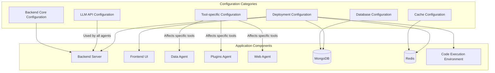
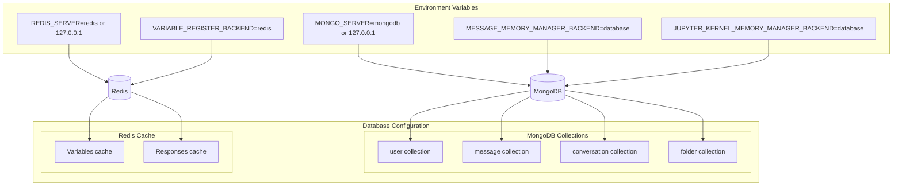
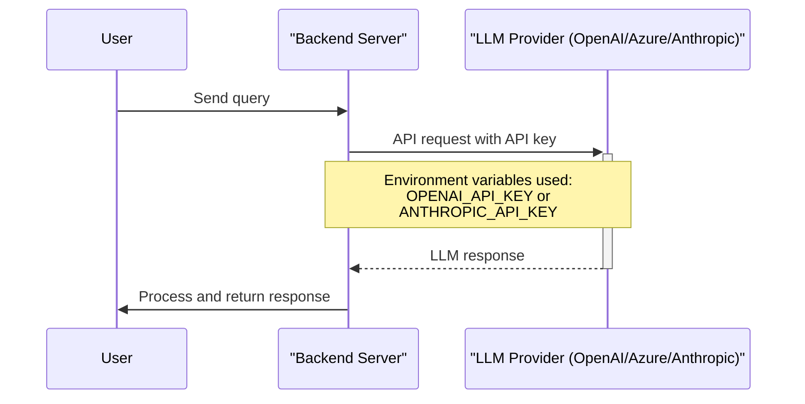
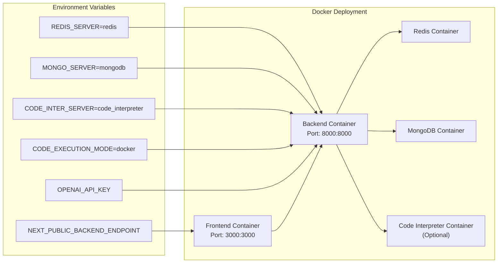

<!-- source: DeepWiki mcp.deepwiki.com · repo xlang-ai/OpenAgents · page 2.3 Configuration · fetched 2026-10-26 -->

# Configuration

<details>
<summary>Relevant source files</summary>

The following files were used as context for generating this wiki page:

- [Dockerfile](Dockerfile)
- [README.md](README.md)
- [README_ZH.md](README_ZH.md)
- [backend/README.md](backend/README.md)
- [backend/setup_script.sh](backend/setup_script.sh)
- [docker-compose.yml](docker-compose.yml)
- [frontend/Dockerfile](frontend/Dockerfile)
- [frontend/next.config.js](frontend/next.config.js)

</details>


This page documents the configuration options and environment variables for the OpenAgents platform. Configuration in OpenAgents spans multiple components, including backend services, databases, caching, LLM integrations, and deployment options. For information about installation procedures, see [Installation](#2.2).

## Configuration Overview

OpenAgents requires configuration across several components to function properly. The platform uses environment variables extensively to customize behavior without code changes. Configuration can be divided into the following categories:

1. Backend core configuration
2. Database and cache configuration
3. LLM API configuration
4. Tool-specific configuration
5. Deployment configuration



Sources: [backend/README.md:103-114](), [backend/setup_script.sh:52-56](), [docker-compose.yml:38-54]()

## Backend Core Configuration

The backend service relies on several environment variables to control its behavior. These variables define how data is managed and how the backend interacts with other services.

### Core Environment Variables

| Variable | Description | Default Value | Example |
|----------|-------------|---------------|---------|
| `VARIABLE_REGISTER_BACKEND` | Defines where variables are stored | `memory` | `redis` |
| `MESSAGE_MEMORY_MANAGER_BACKEND` | Backend for message storage | `memory` | `database` |
| `JUPYTER_KERNEL_MEMORY_MANAGER_BACKEND` | Backend for kernel storage | `memory` | `database` |
| `FLASK_APP` | Entry point for Flask application | - | `backend.main.py` |
| `CODE_EXECUTION_MODE` | Mode for code execution | `local` | `docker` |

Sources: [backend/README.md:109-113](), [docker-compose.yml:49-54](), [Dockerfile:183-186]()

## Database and Cache Configuration

OpenAgents uses MongoDB for persistent storage and Redis for caching. Both services need to be configured properly for optimal performance.

### MongoDB Configuration

MongoDB stores conversation history, user data, and other persistent information. The platform requires the following collections:

- `user` - User account information
- `message` - Individual messages in conversations
- `conversation` - Conversation metadata
- `folder` - Organization structure for conversations

The connection to MongoDB is configured through the `MONGO_SERVER` environment variable.

### Redis Configuration

Redis is used as a cache to improve performance. When memory usage exceeds the configured limit, the platform uses LRU (Least Recently Used) policy to remove data. The Redis connection is configured through the `REDIS_SERVER` environment variable.



Sources: [backend/README.md:28-62](), [backend/README.md:72-95](), [backend/README.md:109-113](), [docker-compose.yml:3-14]()

## LLM API Configuration

OpenAgents is designed to work with various LLM providers, including OpenAI, Azure OpenAI, and Anthropic. Configuration for these services is done through environment variables.

### OpenAI Configuration

| Variable | Description | Required |
|----------|-------------|----------|
| `OPENAI_API_KEY` | API key for OpenAI | Yes |
| `OPENAI_API_BASE` | Custom API base URL (for non-standard endpoints) | No |

### Azure OpenAI Configuration

| Variable | Description | Required |
|----------|-------------|----------|
| `OPENAI_API_TYPE` | Set to `azure` for Azure OpenAI | Yes |
| `OPENAI_API_BASE` | Azure API endpoint | Yes |
| `OPENAI_API_VERSION` | Azure API version | Yes |
| `OPENAI_API_KEY` | Azure API key | Yes |

### Anthropic Configuration

| Variable | Description | Required |
|----------|-------------|----------|
| `ANTHROPIC_API_KEY` | API key for Anthropic | Yes |



Sources: [backend/README.md:126-142](), [docker-compose.yml:49-51]()

## Tool-specific Configuration

### Kaggle Search Tool Configuration

The Data Agent includes a Kaggle Search Tool that requires Kaggle API credentials to function properly. These are configured either through environment variables or by creating a `~/.kaggle/kaggle.json` file:

```json
{
  "username": "YOUR_KAGGLE_USERNAME",
  "key": "YOUR_KAGGLE_API_KEY"
}
```

In Docker environments, this is configured through the `KAGGLE_USER` and `KAGGLE_KEY` environment variables in the Dockerfile.

### Auto Plugin Selection Configuration

The Plugins Agent includes an "Auto" option that requires the Instructor Embedding package to select appropriate plugins based on user queries. This needs to be installed separately:

```bash
git clone https://github.com/xlang-ai/instructor-embedding
cd instructor-embedding
pip install -r requirements.txt
pip install InstructorEmbedding
```

In Docker environments, this is automatically included in the backend container build.

### Code Execution Environment

The Data Agent can execute Python code either locally or in a Docker sandbox for improved security and isolation. The execution mode is controlled by the `CODE_EXECUTION_MODE` environment variable:

- `local` - (Default) Execute code directly on the host
- `docker` - Execute code in a Docker sandbox

When using Docker execution mode, you need to start the code interpreter Docker container:

```bash
docker pull xlanglab/xlang-code-interpreter-python
docker run -d --rm \
    --name codeint \
    --env-file real_agents/data_agent/.code_interpreter_docker_env \
    --mount type=bind,source=<PATH_TO_PROJECT>/backend/data,target=/home \
    -p 8100:8100 \
    --ip=10.1.1.2 \
    --cap-add SYS_RESOURCE \
    --cap-add SYS_PTRACE \
    --cap-add NET_ADMIN \
    xlanglab/xlang-code-interpreter-python
```

In Docker Compose environments, this can be configured by uncommenting the `code_interpreter` service in the `docker-compose.yml` file.

Sources: [backend/README.md:155-193](), [Dockerfile:187-192](), [docker-compose.yml:26-36]()

## Deployment Configuration

### Source Code Deployment Configuration

When deploying from source code, you need to configure the environment manually by setting environment variables. A setup script is provided for convenience:

```bash
backend/setup_script.sh
```

This script sets up MongoDB, Redis, and core environment variables. You'll still need to manually configure LLM API keys and any tool-specific configurations.

### Docker Deployment Configuration

When using Docker for deployment, configuration is primarily done through the `docker-compose.yml` file and environment variables:



The key configuration files for Docker deployment are:
- `docker-compose.yml` - Defines all services and their interconnections
- `Dockerfile` (root) - Configures the backend container
- `frontend/Dockerfile` - Configures the frontend container

Important configuration options in Docker deployment:

1. LLM API keys in `docker-compose.yml`:
   ```yaml
   environment:
     - OPENAI_API_KEY= #need your key here
     # - OPENAI_API_BASE=
   ```

2. Frontend backend endpoint in `frontend/Dockerfile`:
   ```
   # ENV NEXT_PUBLIC_BACKEND_ENDPOINT http://x.x.x.x:8000
   ```

3. GPU support in `docker-compose.yml`:
   ```yaml
   # deploy:
   #   resources:
   #     reservations:
   #       devices:
   #       - driver: nvidia
   #         device_ids: ['0']
   #         capabilities: [gpu]
   ```

4. Code interpreter configuration in `docker-compose.yml`:
   ```yaml
   # Necessary if you want the code executed in sandbox
   # code_interpreter:
   #   image: xlanglab/xlang-code-interpreter-python
   #   env_file:
   #     - ./real_agents/data_agent/.code_interpreter_docker_env
   ```

Sources: [docker-compose.yml:1-66](), [frontend/Dockerfile:13-15](), [README.md:186-195]()

## Frontend Configuration

The frontend configuration is mostly related to deployment settings and the connection to the backend server.

### Development Configuration

For local development, the frontend assumes the backend is running at `http://localhost:8000` by default. This can be customized in the frontend code if needed.

### Docker Configuration

In Docker environments, the frontend needs to know the backend endpoint URL, which is set through the `NEXT_PUBLIC_BACKEND_ENDPOINT` environment variable in the `frontend/Dockerfile`:

```
# If the backend is not running locally, it is important to uncomment and modify the following line
# ENV NEXT_PUBLIC_BACKEND_ENDPOINT http://x.x.x.x:8000
```

The Next.js build configuration can also be customized by setting the `DOCKER` environment variable to enable standalone output mode:

```javascript
output: buildWithDocker ? 'standalone' : undefined,
```

Sources: [frontend/Dockerfile:13-15](), [frontend/next.config.js:3-17]()

## Configuration Best Practices

1. **Securing API Keys**: Never commit API keys to your source code. Always use environment variables or secure configuration files.

2. **Docker Deployment**: When using Docker, ensure all services can communicate with each other by setting proper hostnames (`redis`, `mongodb`, etc.).

3. **Local Development**: For local development, consider using a `.env` file (not included in source control) to manage environment variables.

4. **Code Execution Security**: For production environments, it's recommended to use the Docker sandbox (`CODE_EXECUTION_MODE=docker`) for secure code execution in the Data Agent.

5. **Database Persistence**: For production deployments, ensure proper data persistence for MongoDB by configuring appropriate Docker volumes.

Sources: [README.md:168-205](), [docker-compose.yml:64-66](), [backend/README.md:195-205]()

---

