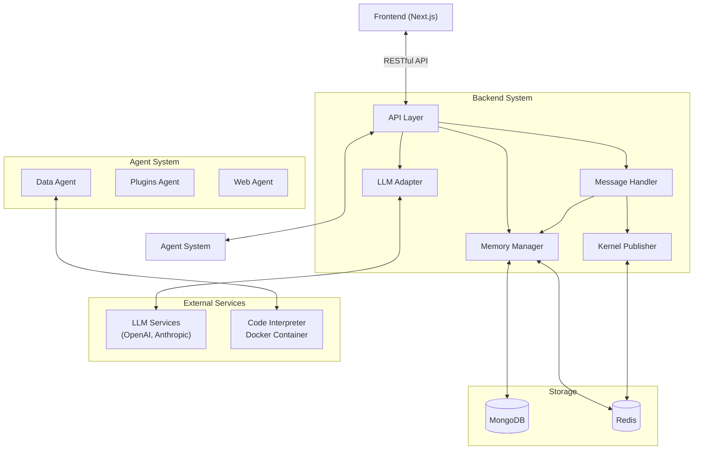
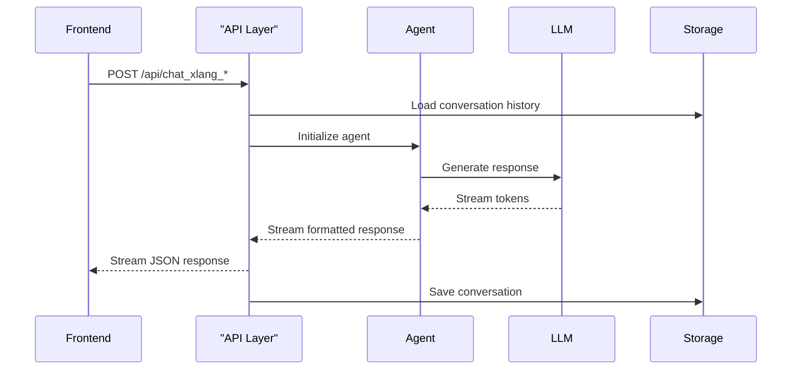
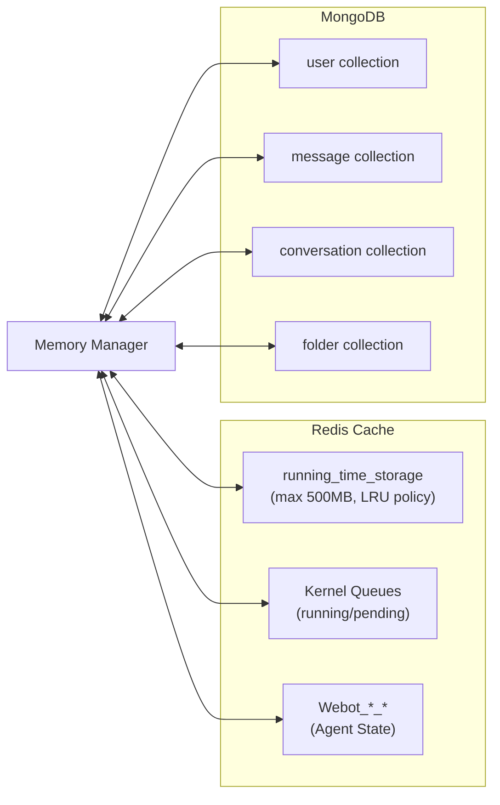
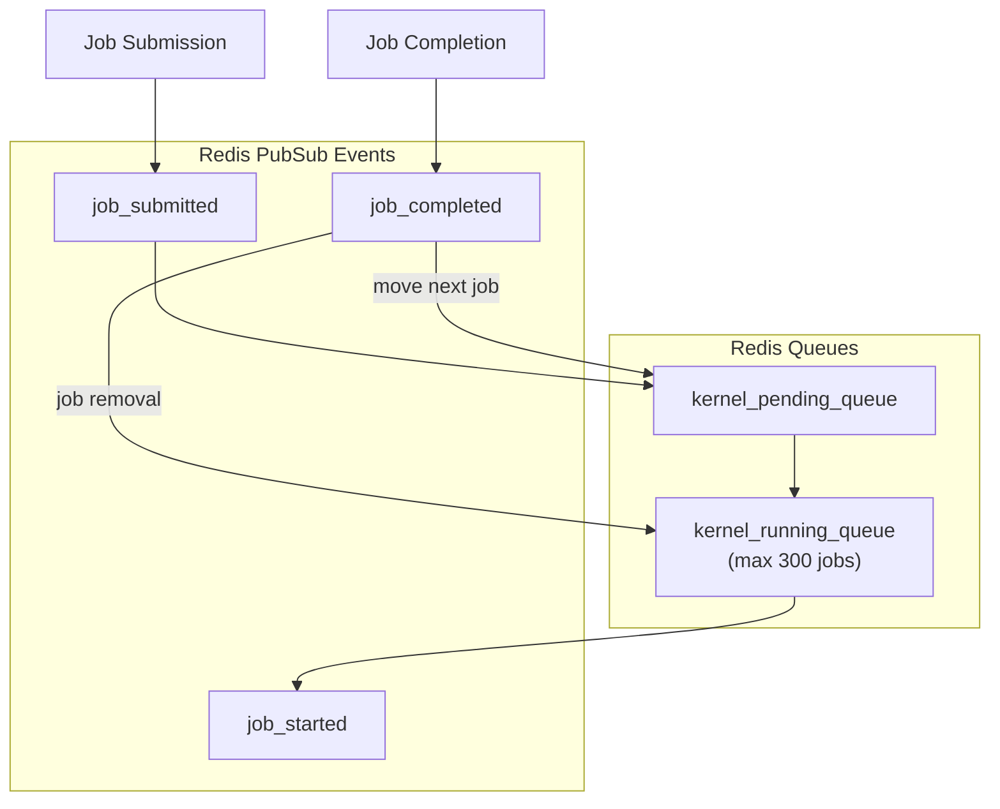
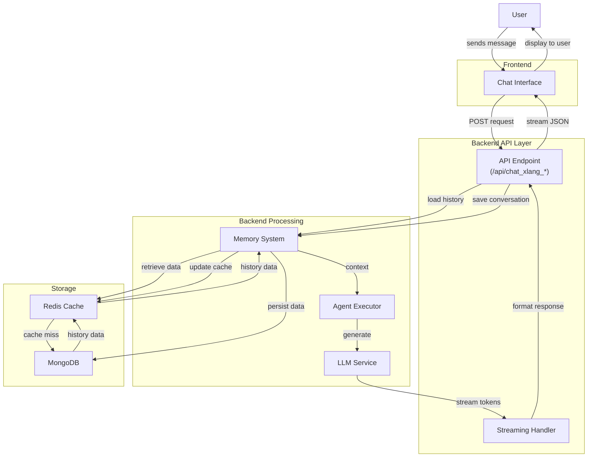
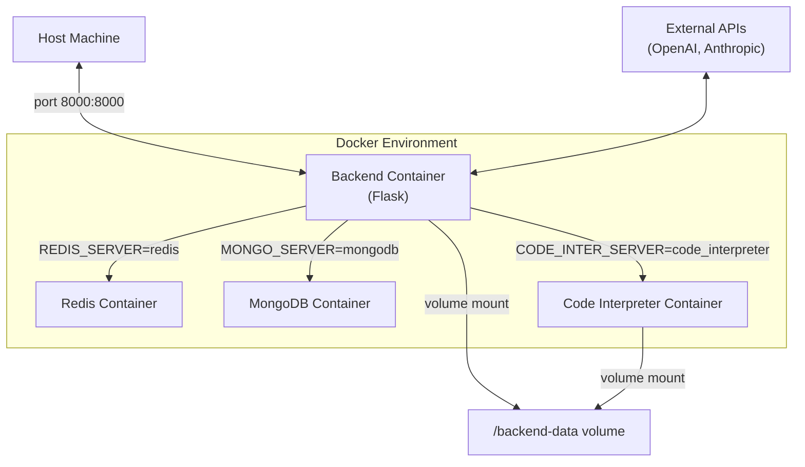
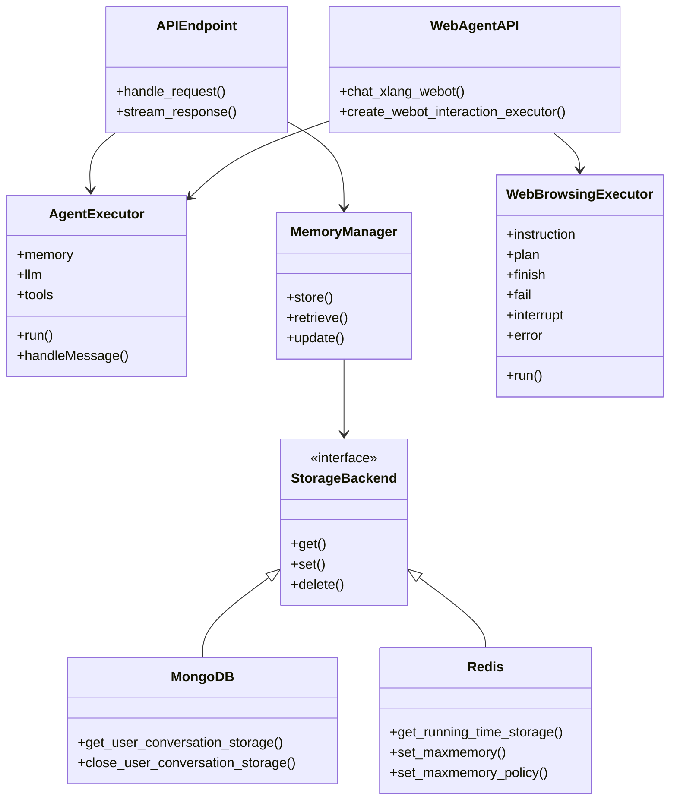

<!-- source: DeepWiki mcp.deepwiki.com · repo xlang-ai/OpenAgents · page 3 Backend System · fetched 2026-10-26 -->

# Backend System

<details>
<summary>Relevant source files</summary>

The following files were used as context for generating this wiki page:

- [backend/README.md](backend/README.md)
- [backend/api/chat_webot.py](backend/api/chat_webot.py)
- [backend/kernel_publisher.py](backend/kernel_publisher.py)
- [backend/setup_script.sh](backend/setup_script.sh)
- [backend/utils/running_time_storage.py](backend/utils/running_time_storage.py)
- [backend/utils/user_conversation_storage.py](backend/utils/user_conversation_storage.py)

</details>


The Backend System of OpenAgents serves as the central coordinator between the user-facing frontend and the intelligent agent systems. It handles API requests, manages conversation memory, integrates with language models, and provides data persistence services. This document details the architecture, components, and configuration of the backend system that powers OpenAgents.

For information about the frontend system, see [Frontend System](#4), and for details about specific agents, see [Agents](#5).

## Architecture Overview



Sources: [backend/README.md:1-210](), [backend/api/chat_webot.py:1-348](), [backend/kernel_publisher.py:1-71]()

## Key Components

### API Layer

The API Layer provides RESTful endpoints that the frontend uses to interact with the backend services. All user requests and agent responses flow through this layer.

Key API endpoints:

| Endpoint | Purpose | Agent |
|----------|---------|-------|
| `/api/chat_xlang_data` | Data analysis and visualization | Data Agent |
| `/api/chat_xlang_plugins` | Plugin integration and execution | Plugins Agent |
| `/api/chat_xlang_webot` | Web browsing and interaction | Web Agent |

Each endpoint follows a similar pattern:
1. Receives user input and context
2. Initializes the appropriate agent executor
3. Processes the request through the agent
4. Streams the response back to the client



Sources: [backend/api/chat_webot.py:276-347]()

### Memory Management

The Memory Management system maintains conversation history and agent state across user sessions. It employs a two-tier architecture:

1. **Redis** (In-memory cache): For fast access to recent conversations and runtime data
2. **MongoDB** (Persistent storage): For long-term storage of all user conversations



Sources: [backend/utils/user_conversation_storage.py:1-16](), [backend/utils/running_time_storage.py:1-14](), [backend/api/chat_webot.py:31-69]()

### LLM Adapter

The LLM Adapter provides a unified interface to various language models (OpenAI, Anthropic). It handles:
- API authentication
- Prompt formatting
- Response streaming
- Error handling

Models are configured via environment variables:
```
OPENAI_API_KEY=<key>
ANTHROPIC_API_KEY=<key>
```

For Azure OpenAI, additional variables are required:
```
OPENAI_API_TYPE=azure
OPENAI_API_BASE=<base_url>
OPENAI_API_VERSION=<api_version>
```

Sources: [backend/README.md:124-142]()

### Kernel Publisher

The Kernel Publisher manages concurrent code execution for the Data Agent. It implements a job queue system using Redis, with two primary queues:
- `kernel_running_queue`: Active kernel jobs
- `kernel_pending_queue`: Jobs waiting to be processed

The system enforces a maximum of 300 concurrent kernels (`MAX_CONCURRENT_KERNELS`).



Sources: [backend/kernel_publisher.py:1-71]()

## Data Flow

The following diagram illustrates the data flow for a typical user interaction with the backend system:



Sources: [backend/api/chat_webot.py:276-347](), [backend/utils/user_conversation_storage.py:1-16](), [backend/utils/running_time_storage.py:1-14]()

## Deployment Architecture

The backend system can be deployed using Docker containers for easy setup and scalability.



Sources: [backend/README.md:173-193]()

## Setup and Configuration

### Prerequisites

- Python 3.10
- Conda (recommended for environment management)
- Docker (optional, for containerized deployment)
- API keys for language models (OpenAI/Anthropic)

### Installation

The backend can be set up using the provided script or manually:

**Quick Setup (Recommended)**
```bash
backend/setup_script.sh
```

**Manual Setup**
1. Create and activate a conda environment:
   ```bash
   conda create -n openagents python=3.10
   conda activate openagents
   pip install -r backend/requirements.txt
   ```

2. Install and configure MongoDB:
   ```bash
   # For macOS
   brew tap mongodb/brew
   brew update
   brew install mongodb-community@6.0
   brew services start mongodb-community@6.0
   
   # For Linux
   wget -qO - https://www.mongodb.org/static/pgp/server-4.4.asc | sudo apt-key add -
   echo "deb [ arch=amd64,arm64 ] https://repo.mongodb.org/apt/ubuntu bionic/mongodb-org/4.4 multiverse" | sudo tee /etc/apt/sources.list.d/mongodb-org-4.4.list
   sudo apt-get update
   sudo apt-get install -y mongodb-org
   sudo systemctl start mongod
   ```

3. Initialize MongoDB collections:
   ```bash
   mongosh --eval 'db = db.getSiblingDB("xlang"); db.createCollection("user"); db.createCollection("message"); db.createCollection("conversation"); db.createCollection("folder"); db.getCollectionNames();'
   ```

4. Install and start Redis:
   ```bash
   # For macOS
   brew install redis
   brew services start redis
   
   # For Linux
   curl -fsSL https://packages.redis.io/gpg | sudo gpg --dearmor -o /usr/share/keyrings/redis-archive-keyring.gpg
   echo "deb [signed-by=/usr/share/keyrings/redis-archive-keyring.gpg] https://packages.redis.io/deb $(lsb_release -cs) main" | sudo tee /etc/apt/sources.list.d/redis.list
   sudo apt-get update
   sudo apt-get install redis
   sudo systemctl start redis-server &
   ```

5. Configure environment variables:
   ```bash
   export VARIABLE_REGISTER_BACKEND=redis
   export MESSAGE_MEMORY_MANAGER_BACKEND=database
   export JUPYTER_KERNEL_MEMORY_MANAGER_BACKEND=database
   export MONGO_SERVER=127.0.0.1
   export OPENAI_API_KEY=<your_key>
   # If using Anthropic
   export ANTHROPIC_API_KEY=<your_key>
   ```

6. Start the backend server:
   ```bash
   export FLASK_APP=backend.main.py
   flask run -p 8000
   ```

Sources: [backend/README.md:1-206](), [backend/setup_script.sh:1-59]()

## Integration with Real Agents

The backend system integrates with the three real agents (Data, Plugins, Web) through a common interface, with specialized handlers for each agent type.



Sources: [backend/api/chat_webot.py:138-273](), [backend/utils/user_conversation_storage.py:1-16](), [backend/utils/running_time_storage.py:1-14]()

## Performance Considerations

The backend system includes several features to ensure optimal performance:

1. **Redis Caching**: Uses LRU policy with a 500MB memory limit to cache frequently accessed data
2. **Streaming Responses**: All API endpoints stream responses to provide real-time feedback
3. **Concurrent Kernel Management**: Limits to 300 concurrent kernels to prevent resource exhaustion
4. **Containerized Deployment**: Isolates code execution in sandboxed environments for security and resource management

Sources: [backend/utils/running_time_storage.py:9-13](), [backend/kernel_publisher.py:17](), [backend/README.md:173-193]()

## Error Handling

The backend implements comprehensive error handling to ensure system stability:

1. **Request Overload Detection**: Returns appropriate status codes when the system is overloaded
2. **Exception Tracking**: Logs exceptions with traceback for debugging
3. **Graceful Degradation**: Falls back to simpler processing when advanced features fail
4. **Timeout Management**: Implements timeouts for external API calls and code execution

Sources: [backend/api/chat_webot.py:342-347]()

## Conclusion

The Backend System of OpenAgents provides a robust foundation for the agent-based architecture. It efficiently manages user conversations, integrates with language models, and coordinates the various agents while providing persistent storage and optimized caching. The system is designed for both development and production environments, with easy configuration options and containerized deployment support.

For more detailed information about specific components, refer to:
- [API Endpoints](#3.1) for detailed API documentation
- [Memory Management](#3.2) for conversation history and state management
- [LLM Integration](#3.3) for language model integration details

---

