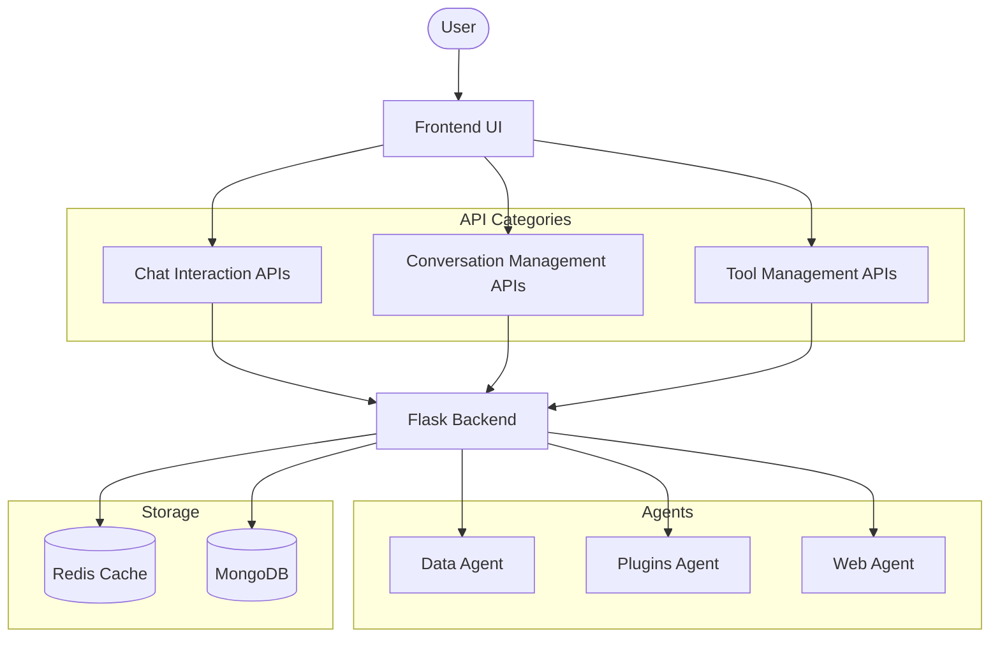
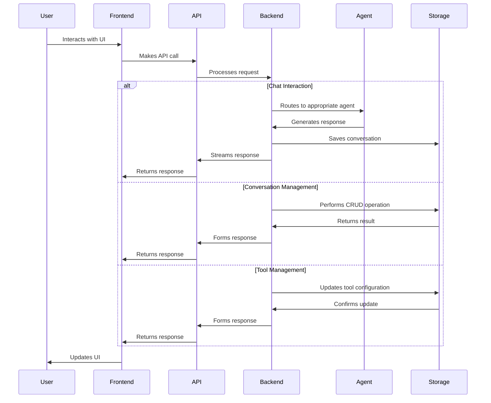
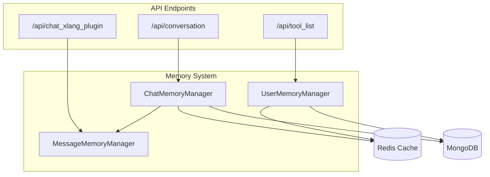

<!-- source: DeepWiki mcp.deepwiki.com · repo xlang-ai/OpenAgents · page 3.1 API Endpoints · fetched 2026-10-26 -->

# API Endpoints

<details>
<summary>Relevant source files</summary>

The following files were used as context for generating this wiki page:

- [backend/api/chat_plugin.py](backend/api/chat_plugin.py)
- [backend/api/conversation.py](backend/api/conversation.py)
- [backend/api/tool.py](backend/api/tool.py)
- [backend/memory.py](backend/memory.py)
- [frontend/components/Chat/AgentSelect.tsx](frontend/components/Chat/AgentSelect.tsx)

</details>


This document provides a comprehensive reference for the backend API endpoints in the OpenAgents platform. These REST APIs serve as the interface between the frontend application and the backend services, enabling communication with various agents and management of conversations.

For information about how these APIs fit into the overall system architecture, see [Architecture](#1.1). For details on how conversation history is maintained, see [Memory Management](#3.2).

## API Overview

The OpenAgents backend exposes three main categories of REST APIs:

1. **Chat Interaction APIs**: Endpoints for communicating with different agents (Data, Plugins, Web)
2. **Conversation Management APIs**: Endpoints for managing conversation history and folders
3. **Tool Management APIs**: Endpoints for managing plugins and their API keys

All API endpoints primarily use the POST HTTP method and accept/return JSON data.

### API Architecture



Sources: [backend/api/chat_plugin.py:188-270](), [backend/api/tool.py:7-68](), [backend/api/conversation.py:15-347]()

## API Endpoint Reference Table

The following table provides a quick reference to all available API endpoints:

| Endpoint | Method | Description |
|----------|--------|-------------|
| `/api/chat_xlang_plugin` | POST | Interact with the Plugins Agent |
| `/api/tool_list` | POST | Get list of available tools/plugins |
| `/api/api_key` | POST | Update API key for a tool |
| `/api/conversations/get_conversation_list` | POST | Get list of conversations |
| `/api/conversations/get_folder_list` | POST | Get list of folders |
| `/api/conversation` | POST | Get content of a specific conversation |
| `/api/conversations/update_conversation` | POST | Update a conversation |
| `/api/conversations/update_folder` | POST | Update a folder name |
| `/api/conversations/register_folder` | POST | Create a new folder |
| `/api/conversations/register_conversation` | POST | Create or update a conversation |
| `/api/conversations/delete_conversation` | POST | Delete a conversation |
| `/api/conversations/delete_folder` | POST | Delete a folder |
| `/api/conversations/clear` | POST | Clear all conversations |
| `/api/conversations/stop_conversation` | POST | Stop the current generation |

Sources: [backend/api/chat_plugin.py:188-270](), [backend/api/tool.py:7-68](), [backend/api/conversation.py:15-347]()

## Data Flow Through the API

The following sequence diagram illustrates how data flows through the API endpoints:



Sources: [backend/memory.py:17-296](), [backend/api/conversation.py:15-347]()

## Chat Interaction APIs

These endpoints handle communication between users and agents.

### POST /api/chat_xlang_plugin

This endpoint enables interaction with the Plugins Agent.

**Request Parameters:**
```json
{
  "user_id": "string",
  "chat_id": "string",
  "user_intent": "string",
  "parent_message_id": "string",
  "selected_plugins": ["string"],
  "llm_name": "string",
  "temperature": 0.4
}
```

Note: If `selected_plugins` contains only the value "auto", the system will automatically select relevant plugins based on the conversation.

**Response:**
- A streaming response containing the agent's actions and responses in real-time.

Sources: [backend/api/chat_plugin.py:188-277]()

## Tool Management APIs

These endpoints manage the available tools/plugins and their API keys.

### POST /api/tool_list

Returns a list of available plugins/tools.

**Request Parameters:**
```json
{
  "user_id": "string"
}
```

**Response:**
```json
[
  {
    "id": "string",
    "name": "string",
    "name_for_human": "string",
    "description": "string",
    "icon": "string",
    "require_api_key": boolean,
    "api_key": "string"
  }
]
```

Sources: [backend/api/tool.py:7-41]()

### POST /api/api_key

Updates an API key for a specific tool.

**Request Parameters:**
```json
{
  "user_id": "string",
  "tool_id": "string",
  "tool_name": "string",
  "api_key": "string"
}
```

**Response:**
- Status 200 with "Success" message if successful.

Sources: [backend/api/tool.py:44-68]()

## Conversation Management APIs

These endpoints handle the management of conversations, folders, and messages.

### POST /api/conversations/get_conversation_list

Returns a list of all conversations for a user.

**Request Parameters:**
```json
{
  "user_id": "string"
}
```

**Response:**
```json
[
  {
    "id": "string",
    "name": "string",
    "folderId": "string"
  }
]
```

Sources: [backend/api/conversation.py:15-37]()

### POST /api/conversations/get_folder_list

Returns a list of all folders for a user.

**Request Parameters:**
```json
{
  "user_id": "string"
}
```

**Response:**
```json
{
  "success": true,
  "data": [
    {
      "id": "string",
      "name": "string",
      "type": "chat"
    }
  ]
}
```

Sources: [backend/api/conversation.py:40-58]()

### POST /api/conversation

Returns the content of a specific conversation.

**Request Parameters:**
```json
{
  "chat_id": "string"
}
```

**Response:**
```json
{
  "id": "string",
  "name": "string",
  "messages": [
    {
      "id": "string",
      "parent_message_id": "string",
      "role": "string",
      "content": "string",
      "type": "string",
      "richContent": {
        "intermediateSteps": [],
        "finalAnswer": []
      }
    }
  ],
  "agent": "string",
  "prompt": "string",
  "temperature": number,
  "folderId": "string",
  "bookmarkedMessagesIds": ["string"],
  "selectedCodeInterpreterPlugins": ["string"],
  "selectedPlugins": ["string"]
}
```

Sources: [backend/api/conversation.py:79-154]()

### POST /api/conversations/update_conversation

Updates a conversation's properties.

**Request Parameters:**
```json
{
  "conversations": [
    {
      "id": "string",
      "name": "string",
      "folderId": "string"
    }
  ]
}
```

**Response:**
```json
{
  "success": boolean,
  "message": "string"
}
```

Sources: [backend/api/conversation.py:157-187]()

### POST /api/conversations/update_folder

Updates a folder name.

**Request Parameters:**
```json
{
  "folder_id": "string",
  "name": "string"
}
```

**Response:**
```json
{
  "success": boolean,
  "message": "string"
}
```

Sources: [backend/api/conversation.py:190-203]()

### POST /api/conversations/register_folder

Creates a new folder.

**Request Parameters:**
```json
{
  "user_id": "string",
  "folder": {
    "name": "string"
  }
}
```

**Response:**
```json
{
  "id": "string",
  "message": "string"
}
```

Sources: [backend/api/conversation.py:206-222]()

### POST /api/conversations/register_conversation

Creates or updates a conversation.

**Request Parameters:**
```json
{
  "user_id": "string",
  "conversation": {
    "id": "string",
    "name": "string",
    "agent": "string",
    "prompt": "string",
    "temperature": number,
    "folderId": "string",
    "bookmarkedMessagesIds": ["string"],
    "selectedCodeInterpreterPlugins": ["string"],
    "selectedPlugins": ["string"]
  }
}
```

**Response:**
```json
{
  "id": "string"
}
```

Sources: [backend/api/conversation.py:225-273]()

### POST /api/conversations/delete_conversation

Deletes a conversation.

**Request Parameters:**
```json
{
  "chat_id": "string"
}
```

**Response:**
```json
{
  "success": boolean,
  "message": "string"
}
```

Sources: [backend/api/conversation.py:277-291]()

### POST /api/conversations/delete_folder

Deletes a folder.

**Request Parameters:**
```json
{
  "folder_id": "string"
}
```

**Response:**
```json
{
  "success": boolean,
  "message": "string"
}
```

Sources: [backend/api/conversation.py:294-307]()

### POST /api/conversations/clear

Clears all conversations for a user.

**Request Parameters:**
```json
{
  "user_id": "string"
}
```

**Response:**
```json
{
  "success": boolean,
  "message": "string"
}
```

Sources: [backend/api/conversation.py:310-325]()

### POST /api/conversations/stop_conversation

Stops the current generation/response streaming.

**Request Parameters:**
```json
{
  "chat_id": "string"
}
```

**Response:**
- An empty response with appropriate status code.

Sources: [backend/api/conversation.py:328-346]()

## Memory Management Integration

The API endpoints interact with memory management classes to store and retrieve conversation data:



The memory system supports both local storage and database persistence:

- `UserMemoryManager`: Manages user-level data (e.g., API keys)
- `ChatMemoryManager`: Manages chat-level data (e.g., messages)
- `MessageMemoryManager`: Specialized class for message handling

Sources: [backend/memory.py:17-296]()

## Error Handling

The API endpoints include standardized error handling with these status codes:

- **INTERNAL** (500): Internal server error
- **UNFOUND** (404): Resource not found
- **OVERLOAD** (429): System is overloaded

Errors are returned as JSON responses with appropriate status codes and error messages.

Sources: [backend/api/conversation.py:35-36](), [backend/api/conversation.py:151-152](), [backend/api/chat_plugin.py:276-277]()

## Authentication

The current implementation uses a simplified authentication approach with a default user ID (`DEFAULT_USER_ID`). This appears in many API endpoints as an optional parameter that defaults to this value when not explicitly provided.

Sources: [backend/api/tool.py:23](), [backend/api/conversation.py:19](), [backend/api/chat_plugin.py:194]()

---

