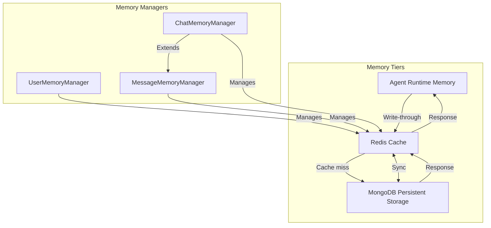
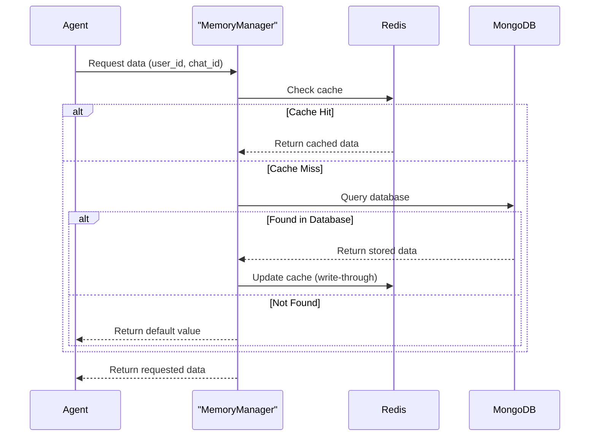
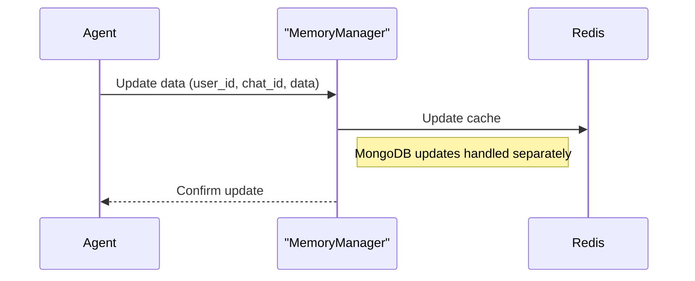
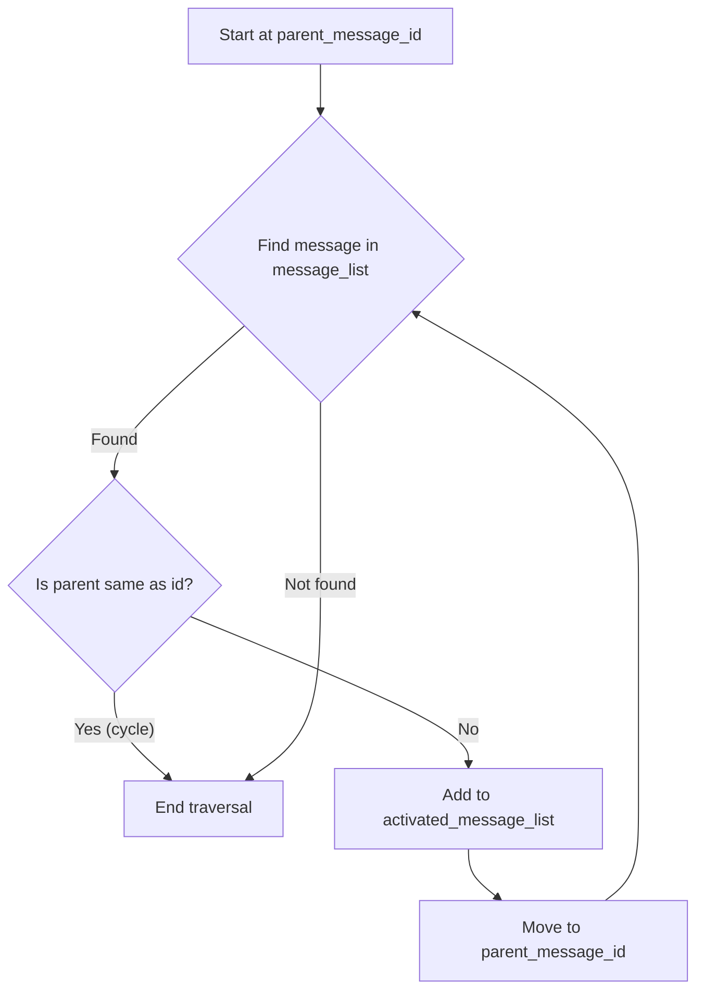

<!-- source: DeepWiki mcp.deepwiki.com · repo xlang-ai/OpenAgents · page 3.2 Memory Management · fetched 2026-10-26 -->

# Memory Management

<details>
<summary>Relevant source files</summary>

The following files were used as context for generating this wiki page:

- [backend/api/chat_webot.py](backend/api/chat_webot.py)
- [backend/api/tool.py](backend/api/tool.py)
- [backend/kernel_publisher.py](backend/kernel_publisher.py)
- [backend/memory.py](backend/memory.py)
- [backend/utils/running_time_storage.py](backend/utils/running_time_storage.py)
- [backend/utils/user_conversation_storage.py](backend/utils/user_conversation_storage.py)

</details>


This document explains how OpenAgents manages conversation history, user preferences, and stateful information across the platform. Memory management in OpenAgents employs a multi-tier storage architecture that combines in-memory caching, Redis-based temporary storage, and MongoDB-based persistent storage.

For information about LLM integration, see [LLM Integration](#3.3).

## Overview

The memory management system in OpenAgents serves several critical functions:

1. Storing and retrieving message histories between users and agents
2. Maintaining stateful information required by agents
3. Managing user-specific data such as API keys
4. Organizing conversation threads with message parent-child relationships

## Architecture

The memory system uses a tiered approach to balance performance and persistence:



Sources: [backend/memory.py:17-95](), [backend/utils/running_time_storage.py:6-14](), [backend/utils/user_conversation_storage.py:5-9]()

## Memory Managers

OpenAgents implements three main memory manager classes to handle different memory scopes:

### UserMemoryManager

Manages memory at the user level, including API keys and user preferences.

```mermaid
classDiagram
    class "UserMemoryManager" {
        +String backend
        +String name
        +Dict memory_pool
        +get_pool_info_with_id(user_id, default_value)
        +set_pool_info_with_id(user_id, info)
        +__iter__()
    }
```

Sources: [backend/memory.py:17-95]()

### ChatMemoryManager

Manages memory at the chat level, storing conversation data for specific chat sessions.

```mermaid
classDiagram
    class "ChatMemoryManager" {
        +String backend
        +String name
        +Dict memory_pool
        +get_pool_info_with_id(user_id, chat_id, default_value)
        +set_pool_info_with_id(user_id, chat_id, info)
        +drop_item_with_id(user_id, chat_id)
        +__iter__()
    }
```

Sources: [backend/memory.py:97-225]()

### MessageMemoryManager

Extends `ChatMemoryManager` with specific methods for handling message history and agent memory.

```mermaid
classDiagram
    class "ChatMemoryManager" {
        +get_pool_info_with_id(user_id, chat_id, default_value)
        +set_pool_info_with_id(user_id, chat_id, info)
    }
    
    class "MessageMemoryManager" {
        +load_agent_memory_from_list(agent_memory, message_list)
        +save_agent_memory_to_list(agent_memory)
        +get_activated_message_list(user_id, chat_id, default_value, parent_message_id)
    }
    
    ChatMemoryManager <|-- MessageMemoryManager
```

Sources: [backend/memory.py:228-296]()

## Storage Backends

Memory managers support two backend options:

1. **LOCAL**: In-memory storage primarily used for development and testing
2. **DATABASE**: Production storage using Redis for caching and MongoDB for persistence

### Redis Configuration

Redis is configured as a caching layer with:

- Memory limit of 500MB
- LRU (Least Recently Used) eviction policy for managing space

Sources: [backend/utils/running_time_storage.py:10-13]()

### MongoDB Integration

MongoDB serves as the persistent storage layer, maintaining collections for:

- User information
- Conversation history
- Message data

Sources: [backend/utils/user_conversation_storage.py:5-9]()

## Memory Data Structures

### Message Pool

The message pool stores conversation histories with message chains:

```
{
  user_id: {
    chat_id: [
      {
        "message_id": unique identifier for the message,
        "parent_message_id": id of the parent message,
        "message_type": "human_message" or "ai_message",
        "message_content": the actual content of the message
      }
    ]
  }
}
```

Sources: [backend/memory.py:100-109]()

### API Key Pool

Stores user-specific API keys for external tools and services:

```
{
  "user_id": [
    {
      "tool_id": identifier for the tool,
      "tool_name": name of the tool,
      "api_key": API key for the tool
    }
  ]
}
```

Sources: [backend/memory.py:21-28](), [backend/api/tool.py:43-68]()

## Core Memory Operations

### Reading from Memory

The memory system follows this process when retrieving data:



Sources: [backend/memory.py:131-187]()

### Writing to Memory

When storing data, the system uses a write-through policy:



Sources: [backend/memory.py:189-199]()

## Message History Traversal

The `MessageMemoryManager` provides a method to retrieve the active conversation thread by traversing the message history from a specified parent message to the root:



Sources: [backend/memory.py:270-296]()

## Agent Memory Integration

The memory system provides utilities to convert between agent memory format and the storage format:

### Loading Agent Memory

`load_agent_memory_from_list()` populates an agent's memory from stored messages:

1. Clear the agent's existing memory
2. Add each message to the agent memory based on its type (human or AI)
3. Apply token limit restrictions

Sources: [backend/memory.py:232-246]()

### Saving Agent Memory

`save_agent_memory_to_list()` saves an agent's memory to the storage format:

1. Extract messages from the agent's memory
2. Convert to the storage format with appropriate message types
3. Return as a list for storage

Sources: [backend/memory.py:248-268]()

## Usage Examples

### Managing Conversation Context

In chat endpoints, the system retrieves the active conversation thread based on the parent message ID and loads it into the agent's memory:

```python
# Get the active message thread
activated_message_list = message_pool.get_activated_message_list(
    user_id, chat_id, list(), parent_message_id
)

# Load the thread into the agent's memory
message_pool.load_agent_memory_from_list(
    interaction_executor.memory, activated_message_list
)
```

Sources: [backend/api/chat_webot.py:317-322]()

### Managing API Keys

When processing tool API keys, the system retrieves and updates the API key pool:

```python
# Get existing API keys
api_key_info = api_key_pool.get_pool_info_with_id(user_id, [])

# Update the API key information
api_key_info.append({"tool_id": tool_id, "tool_name": tool_name, "api_key": api_key})

# Store the updated information
api_key_pool.set_pool_info_with_id(user_id, api_key_info)
```

Sources: [backend/api/tool.py:59-67]()

## Conclusion

The memory management system in OpenAgents provides a robust foundation for stateful agent interactions. By combining multiple storage tiers with specialized memory managers, it achieves a balance between performance and durability while handling the complex requirements of conversational agents.

---

