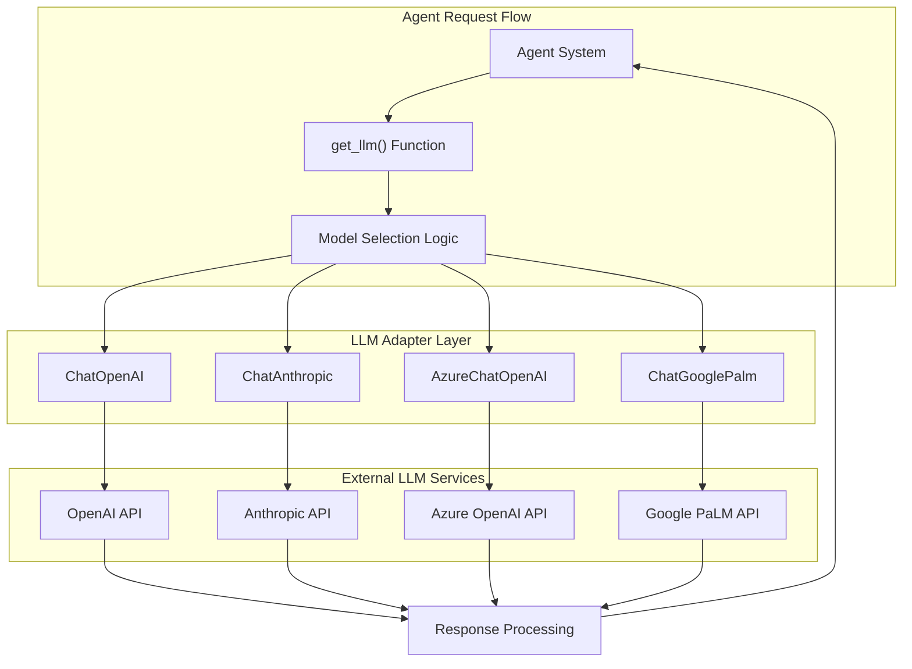
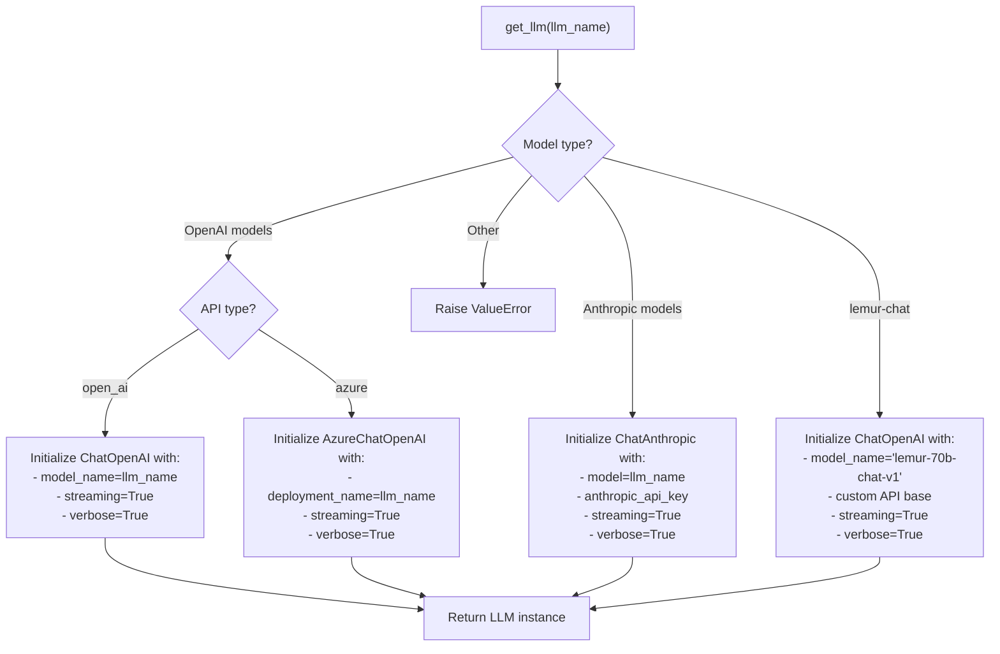
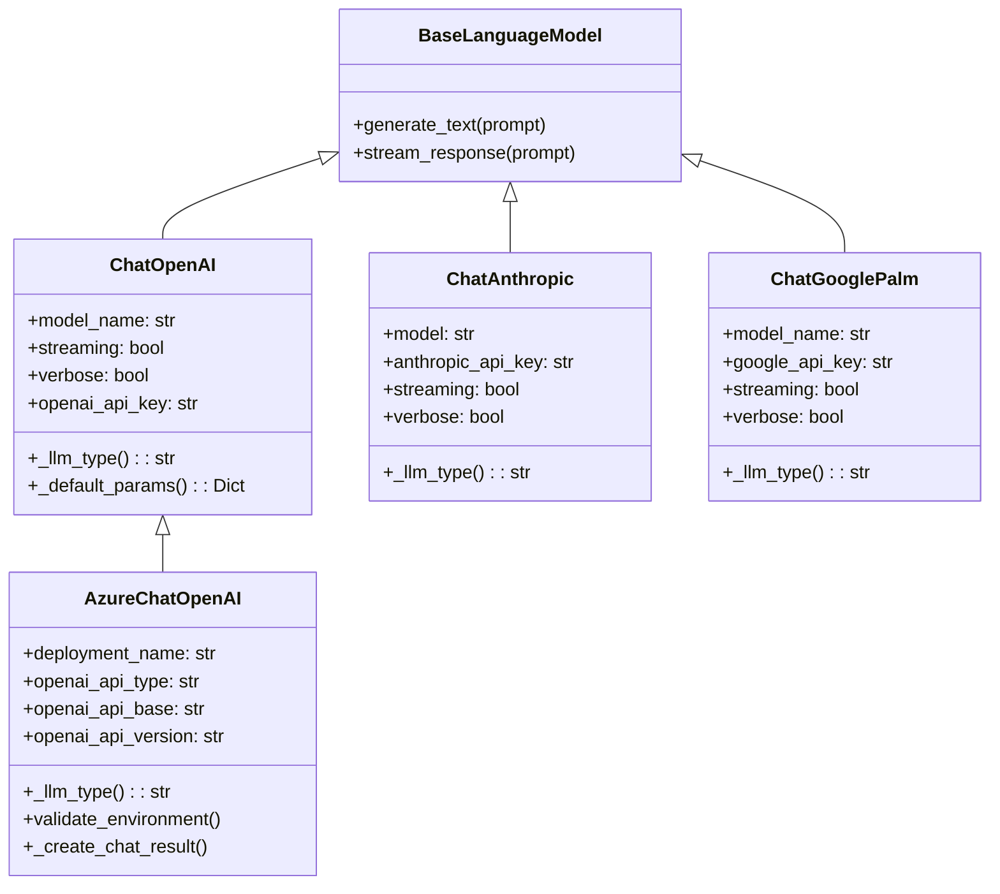
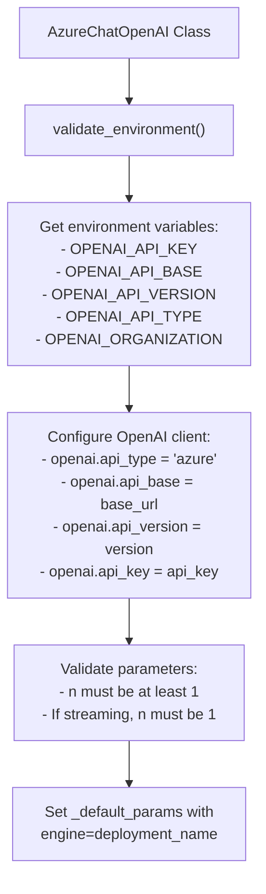
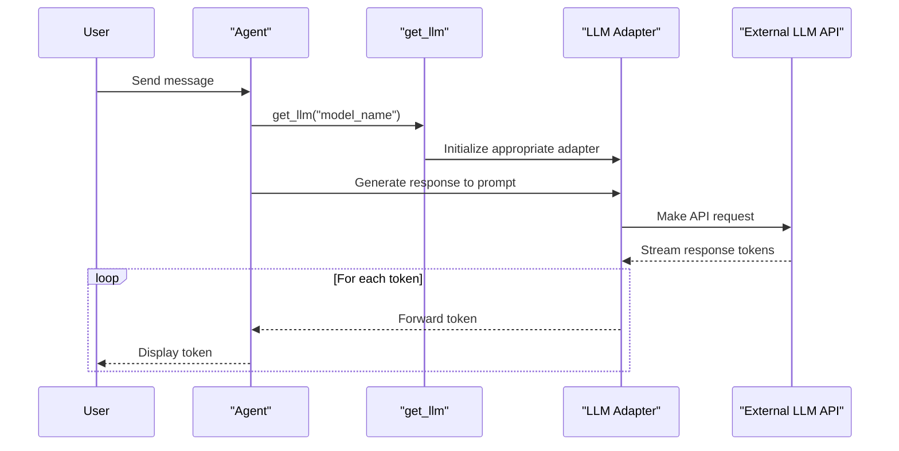

<!-- source: DeepWiki mcp.deepwiki.com · repo xlang-ai/OpenAgents · page 3.3 LLM Integration · fetched 2026-10-26 -->

# LLM Integration

<details>
<summary>Relevant source files</summary>

The following files were used as context for generating this wiki page:

- [backend/api/language_model.py](backend/api/language_model.py)
- [real_agents/adapters/models/__init__.py](real_agents/adapters/models/__init__.py)
- [real_agents/adapters/models/azure_openai.py](real_agents/adapters/models/azure_openai.py)

</details>


## Purpose and Scope

This document details how OpenAgents integrates and configures various Language Models (LLMs) from different providers like OpenAI, Anthropic, Azure, and Google. It covers the model selection process, initialization flow, and adapter architecture used to provide a unified interface across different LLM providers. For information about how agents utilize these LLMs, see [Agents](#5).

## LLM Integration Architecture

OpenAgents employs an adapter-based architecture to integrate multiple LLM providers while presenting a consistent interface to the agent system.



Sources: [real_agents/adapters/models/__init__.py](real_agents/adapters/models/__init__.py), [backend/api/language_model.py](backend/api/language_model.py)

## Supported LLM Models

OpenAgents supports multiple LLM providers and specific models through its adapter system.

| Provider | Model | Adapter Class | Configuration Key |
|----------|-------|---------------|------------------|
| OpenAI | gpt-3.5-turbo-16k | ChatOpenAI | OPENAI_API_KEY |
| OpenAI | gpt-4 | ChatOpenAI | OPENAI_API_KEY |
| Anthropic | claude-v1 | ChatAnthropic | ANTHROPIC_API_KEY |
| Anthropic | claude-2 | ChatAnthropic | ANTHROPIC_API_KEY |
| Azure OpenAI | Various deployments | AzureChatOpenAI | OPENAI_API_KEY, OPENAI_API_BASE, etc. |
| Custom | lemur-chat | ChatOpenAI (custom base) | OPENAI_API_KEY |

Sources: [backend/api/language_model.py:13-21](backend/api/language_model.py:13-21), [real_agents/adapters/models/__init__.py:14-19](real_agents/adapters/models/__init__.py:14-19)

## LLM Selection and Initialization

The central component of LLM integration is the `get_llm` function, which handles model selection and initialization based on the requested model name.



Sources: [backend/api/language_model.py:24-58](backend/api/language_model.py:24-58)

## LLM Adapter Class Structure

OpenAgents implements an adapter pattern for LLM integration, where different models share a common interface through adapter classes.



Sources: [real_agents/adapters/models/__init__.py:1-19](real_agents/adapters/models/__init__.py:1-19), [real_agents/adapters/models/azure_openai.py:16-132](real_agents/adapters/models/azure_openai.py:16-132)

## API Endpoint for LLM Selection

The system provides an API endpoint that returns the list of available LLMs to the frontend:

| Endpoint | Method | Description | Response |
|----------|--------|-------------|----------|
| `/api/llm_list` | POST | Returns available LLMs | JSON array of LLM objects |

Example response:
```json
[
  {"id": "gpt-3.5-turbo-16k", "name": "gpt-3.5-turbo-16k"},
  {"id": "gpt-4", "name": "gpt-4"},
  {"id": "claude-v1", "name": "claude-v1"},
  {"id": "claude-2", "name": "claude-2"},
  {"id": "lemur-chat", "name": "lemur-chat"}
]
```

Sources: [backend/api/language_model.py:10-21](backend/api/language_model.py:10-21)

## Azure OpenAI Integration

The `AzureChatOpenAI` class extends the regular `ChatOpenAI` adapter to support Azure-hosted OpenAI models. It has special configuration requirements and validation logic.



Sources: [real_agents/adapters/models/azure_openai.py:50-105](real_agents/adapters/models/azure_openai.py:50-105)

## Common Configuration Parameters

All LLM adapters in OpenAgents share certain configuration parameters:

| Parameter | Default Value | Description |
|-----------|---------------|-------------|
| streaming | True | Enable streaming for real-time responses |
| verbose | True | Enable verbose logging for debugging |

For specific model types, additional parameters are required:

| Model Type | Required Parameters |
|------------|---------------------|
| OpenAI | `model_name`, `openai_api_key` |
| Anthropic | `model`, `anthropic_api_key` |
| Azure OpenAI | `deployment_name`, `openai_api_type`, `openai_api_base`, `openai_api_version`, `openai_api_key` |
| Lemur | `model_name`, `openai_api_base`, `openai_api_key` |

Sources: [backend/api/language_model.py:34-37](backend/api/language_model.py:34-37), [backend/api/language_model.py:41-47](backend/api/language_model.py:41-47), [backend/api/language_model.py:52-55](backend/api/language_model.py:52-55)

## LLM Usage Flow

This sequence diagram illustrates how LLMs are used in the OpenAgents system:



Sources: [backend/api/language_model.py:24-58](backend/api/language_model.py:24-58)

## Model Registry

The system maintains a registry of available model types in the `type_to_cls_dict` dictionary:

```python
type_to_cls_dict = {
    "chat_anthropic": ChatAnthropic,
    "chat_google_palm": ChatGooglePalm,
    "chat_openai": ChatOpenAI,
    "azure_chat_openai": AzureChatOpenAI,
}
```

This registry maps model type identifiers to their corresponding adapter classes, enabling dynamic model selection and initialization.

Sources: [real_agents/adapters/models/__init__.py:14-19](real_agents/adapters/models/__init__.py:14-19)

## Environment Configuration

To use different LLM providers, specific environment variables must be configured:

| Provider | Required Environment Variables |
|----------|-------------------------------|
| OpenAI | `OPENAI_API_KEY` |
| Anthropic | `ANTHROPIC_API_KEY` |
| Azure OpenAI | `OPENAI_API_TYPE=azure`, `OPENAI_API_KEY`, `OPENAI_API_BASE`, `OPENAI_API_VERSION` |
| Custom (Lemur) | `OPENAI_API_KEY` (uses custom API base) |

Sources: [backend/api/language_model.py:27-27](backend/api/language_model.py:27-27), [backend/api/language_model.py:40-40](backend/api/language_model.py:40-40), [real_agents/adapters/models/azure_openai.py:44-48](real_agents/adapters/models/azure_openai.py:44-48)

---

