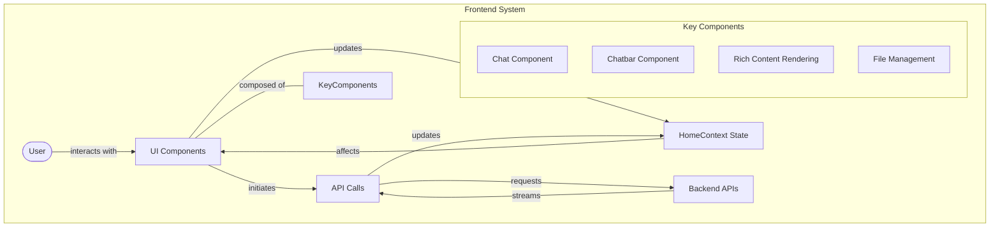
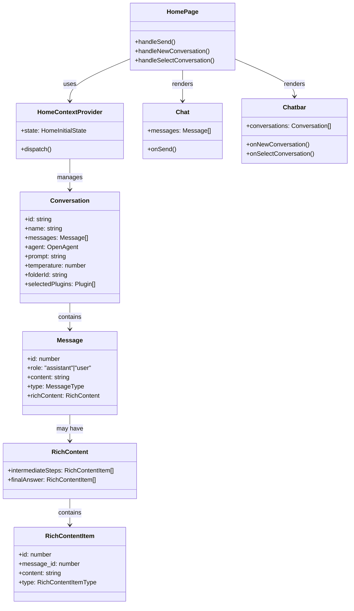
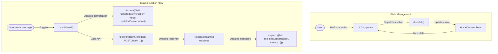
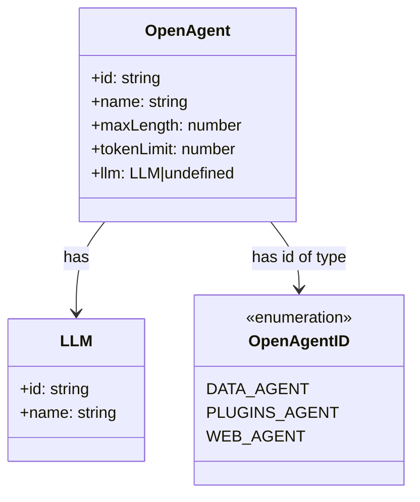
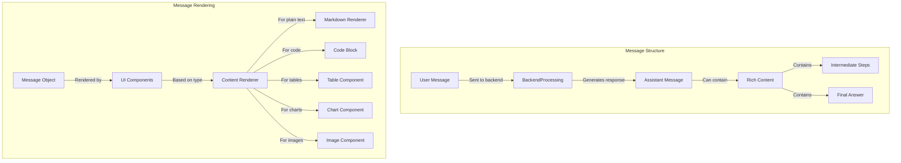
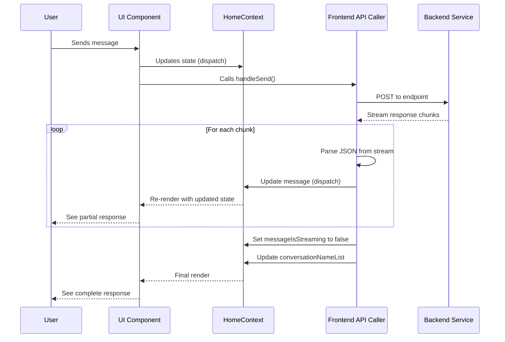
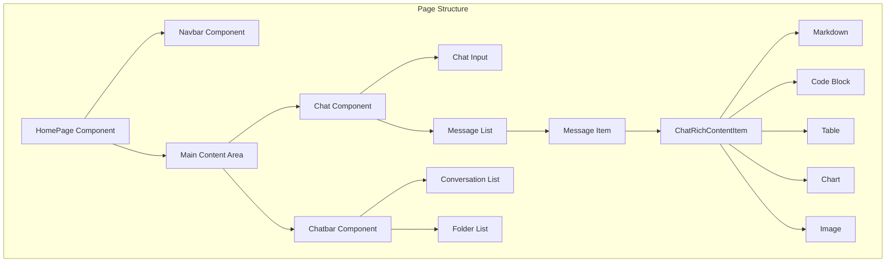
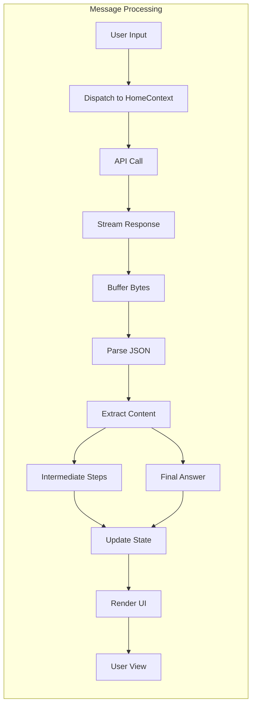

<!-- source: DeepWiki mcp.deepwiki.com · repo xlang-ai/OpenAgents · page 4 Frontend System · fetched 2026-10-26 -->

# Frontend System

Relevant source files

The following files were used as context for generating this wiki page:

- [frontend/components/Chat/ChatRichContentItem.tsx](frontend/components/Chat/ChatRichContentItem.tsx)
- [frontend/package-lock.json](frontend/package-lock.json)
- [frontend/pages/api/home/home.tsx](frontend/pages/api/home/home.tsx)
- [frontend/types/agent.ts](frontend/types/agent.ts)
- [frontend/types/chat.ts](frontend/types/chat.ts)

This document provides a comprehensive overview of OpenAgents' frontend architecture, components, and communication patterns. The frontend is built using Next.js and serves as the user interface for interacting with the various AI agents in the system. For information about the backend implementation that supports this frontend, see [Backend System](#3).

## Overview

The OpenAgents frontend system provides a user interface for interacting with different agent types (Data Agent, Web Agent, and Plugins Agent). The frontend handles user interactions, manages application state, communicates with the backend API, and renders the responses from agents in a user-friendly manner.

The frontend is built with Next.js as the React framework, utilizing TypeScript for type safety. It employs a context-based state management approach and component-based architecture to maintain a clean separation of concerns.

### High-Level Architecture

Sources:
- [frontend/pages/api/home/home.tsx:67-68](frontend/pages/api/home/home.tsx:67-68)
- [frontend/components/Chat/ChatRichContentItem.tsx:21-23](frontend/components/Chat/ChatRichContentItem.tsx:21-23)

## Frontend Architecture

The frontend architecture follows a component-based design with centralized state management through React Context API. The application state is managed using a reducer pattern, allowing for predictable state transitions.

### Key Architectural Patterns

1. **Context-based State Management**: The application uses `HomeContext` to manage and share state across components.
2. **Reducer Pattern**: State modifications are handled through actions dispatched to a reducer.
3. **Streaming Response Handling**: The frontend can process streamed responses from the backend.
4. **Rich Content Rendering**: Specialized components for rendering different types of content.

### Component Architecture

Sources:
- [frontend/pages/api/home/home.tsx:58-59](frontend/pages/api/home/home.tsx:58-59)
- [frontend/pages/api/home/home.tsx:84-109](frontend/pages/api/home/home.tsx:84-109)
- [frontend/types/chat.ts:5-28](frontend/types/chat.ts:5-28)
- [frontend/types/chat.ts:54-66](frontend/types/chat.ts:54-66)

## State Management

The frontend uses React's Context API for state management, with the `HomeContext` serving as the central state container. State is managed using the reducer pattern through the `useCreateReducer` hook.

### State Structure

The application's state is organized in the `HomeInitialState` interface, which includes:

- Current conversation state
- List of conversations
- Agent configurations
- UI state (light/dark mode, loading indicators)
- Plugin selections
- API credentials

### State Management Flow

Sources:
- [frontend/pages/api/home/home.tsx:84-109](frontend/pages/api/home/home.tsx:84-109)
- [frontend/pages/api/home/home.tsx:114-777](frontend/pages/api/home/home.tsx:114-777)

## Agent Integration

The frontend supports multiple agent types, each with specific capabilities and settings. The agent types are defined in the `OpenAgentID` enum and include:

- `DATA_AGENT`: For data analysis and visualization
- `PLUGINS_AGENT`: For interacting with external plugins
- `WEB_AGENT`: For web browsing capabilities

### Agent Configuration Structure

Sources:
- [frontend/types/agent.ts:3-15](frontend/types/agent.ts:3-15)
- [frontend/types/agent.ts:17-21](frontend/types/agent.ts:17-21)
- [frontend/types/agent.ts:26-48](frontend/types/agent.ts:26-48)

## Chat Interface and Message Handling

The chat interface is the primary point of interaction for users. It handles sending messages, displaying responses, and rendering rich content.

### Message Structure and Flow

Sources:
- [frontend/types/chat.ts:5-44](frontend/types/chat.ts:5-44)
- [frontend/components/Chat/ChatRichContentItem.tsx:39-199](frontend/components/Chat/ChatRichContentItem.tsx:39-199)

### Rich Content Rendering

The frontend supports multiple types of rich content in chat responses:

| Content Type | Component | Description |
|--------------|-----------|-------------|
| `plain` | Markdown | Plain text rendered as Markdown |
| `tool` | Custom Tool UI | UI for interacting with tools |
| `echarts` | EChartsChart | Data visualizations using ECharts |
| `table` | XLangTable | Tabular data |
| `image` | Image | Images generated by or used by agents |
| `html` | iframe | HTML content rendered in an iframe |
| `code` | CodeBlock | Code snippets with syntax highlighting |
| `error` | Alert | Error messages |

Sources:
- [frontend/components/Chat/ChatRichContentItem.tsx:99-194](frontend/components/Chat/ChatRichContentItem.tsx:99-194)
- [frontend/types/chat.ts:30-44](frontend/types/chat.ts:30-44)

## Frontend-Backend Communication

The frontend communicates with the backend through RESTful API calls. The communication includes request-response patterns for routine operations and streaming responses for chat messages.

### Message Streaming Architecture

Sources:
- [frontend/pages/api/home/home.tsx:114-777](frontend/pages/api/home/home.tsx:114-777)
- [frontend/pages/api/home/home.tsx:339-346](frontend/pages/api/home/home.tsx:339-346)
- [frontend/pages/api/home/home.tsx:347-680](frontend/pages/api/home/home.tsx:347-680)

### API Endpoints

The frontend communicates with several backend endpoints for different operations:

| Endpoint Purpose | Constant | Operation |
|------------------|----------|-----------|
| Chat APIs | `getEndpoint(chatBody.agent)` | POST request for agent chat |
| Recommendation API | `getRecommendationEndpoint()` | GET follow-up questions |
| Data APIs | `API_GET_DATA` | GET data for visualization |
| Folder Management | `API_REGISTER_FOLDER`, `API_DELETE_FOLDER`, `API_UPDATE_FOLDER` | Manage folders |
| File Management | `API_UPLOAD`, `API_UPDATE_FILE`, `API_DELETE_FILE` | Manage files |
| Conversation Management | `registerConversation()`, `getConversation()` | Manage conversations |

Sources:
- [frontend/pages/api/home/home.tsx:18-35](frontend/pages/api/home/home.tsx:18-35)
- [frontend/pages/api/home/home.tsx:204-264](frontend/pages/api/home/home.tsx:204-264)
- [frontend/pages/api/home/home.tsx:727-764](frontend/pages/api/home/home.tsx:727-764)

## Main Components and Their Interactions

The frontend consists of several key components that interact with each other to provide the complete user experience.

### Component Structure

Sources:
- [frontend/pages/api/home/home.tsx:56-69](frontend/pages/api/home/home.tsx:56-69)
- [frontend/pages/api/home/home.tsx:76-1010](frontend/pages/api/home/home.tsx:76-1010)
- [frontend/components/Chat/ChatRichContentItem.tsx:38-201](frontend/components/Chat/ChatRichContentItem.tsx:38-201)

## User Interaction Flow

The main user interaction flow involves sending messages and receiving responses from agents:

```mermaid
flowchart TD
    subgraph "User Interaction Flow"
        Start([User starts]) --> SelectAgent["Select Agent Type"]
        SelectAgent --> TypeMessage["Type Message"]
        TypeMessage --> SendMessage["Send Message"]
        
        SendMessage --> FirstMessage{"First message?"}
        FirstMessage -->|"Yes"| CreateConversation["Create new conversation"]
        FirstMessage -->|"No"| UpdateConversation["Update existing conversation"]
        
        CreateConversation --> CallBackend["Call Backend API"]
        UpdateConversation --> CallBackend
        
        CallBackend --> ReceiveStream["Receive Streaming Response"]
        ReceiveStream --> ParseChunks["Parse Response Chunks"]
        ParseChunks --> RenderRichContent["Render Rich Content"]
        RenderRichContent --> ShowResponse["Show Response to User"]
        
        ShowResponse --> GetFollowUp["Get Follow-up Suggestions"]
        GetFollowUp --> ReadyForNext["Ready for next interaction"]
        ReadyForNext --> TypeMessage
    end
```

Sources:
- [frontend/pages/api/home/home.tsx:114-777](frontend/pages/api/home/home.tsx:114-777)
- [frontend/pages/api/home/home.tsx:951-1008](frontend/pages/api/home/home.tsx:951-1008)

## Message Processing Pipeline

A key aspect of the frontend is how it processes and renders messages, especially handling streaming responses from the backend:

Sources:
- [frontend/pages/api/home/home.tsx:339-680](frontend/pages/api/home/home.tsx:339-680)
- [frontend/components/Chat/ChatRichContentItem.tsx:98-194](frontend/components/Chat/ChatRichContentItem.tsx:98-194)

## Error Handling and Edge Cases

The frontend implements various error handling mechanisms to ensure a smooth user experience even when issues occur:

1. **API Call Failures**: Handled with toast notifications and state resets
2. **Streaming Response Errors**: Detected and presented as alert messages
3. **Connection Issues**: Managed with appropriate error states
4. **Message Stopping**: Users can stop generating responses mid-stream

Sources:
- [frontend/pages/api/home/home.tsx:266-286](frontend/pages/api/home/home.tsx:266-286)
- [frontend/pages/api/home/home.tsx:405-459](frontend/pages/api/home/home.tsx:405-459)

## Conclusion

The frontend system of OpenAgents provides a robust, responsive interface for users to interact with various AI agents. Its architecture ensures clean separation of concerns, efficient state management, and rich content rendering capabilities. The frontend-backend communication is designed to handle streaming responses, enabling real-time interaction with the AI agents.

The frontend leverages modern React patterns and Next.js features to deliver a performant and maintainable codebase. The component-based architecture and context-based state management allow for easy extension and modification of the system.

---

