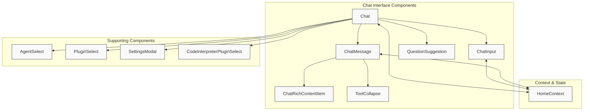
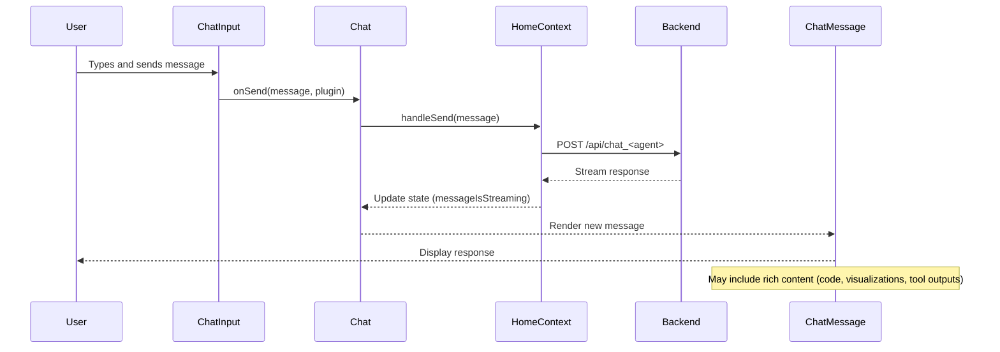
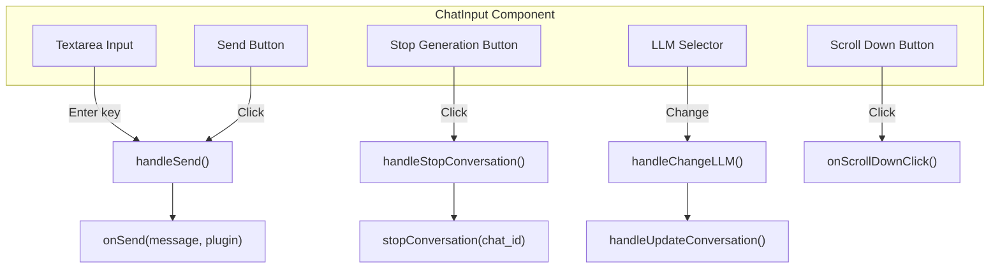
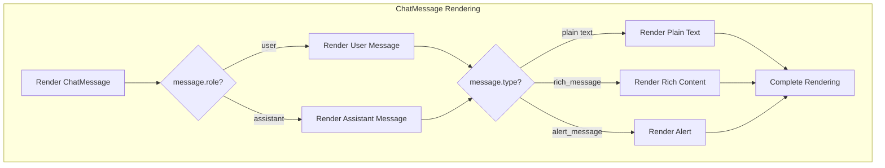
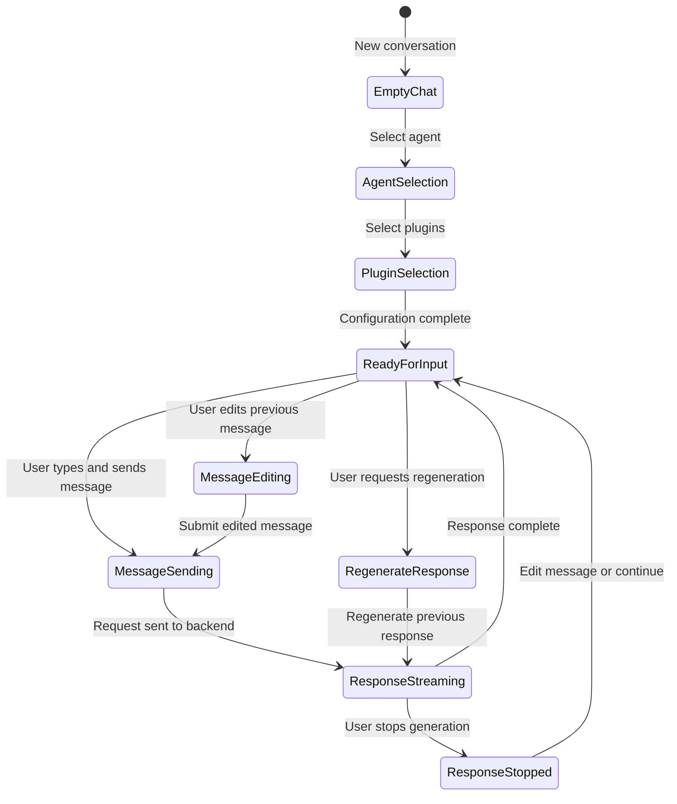

<!-- source: DeepWiki mcp.deepwiki.com · repo xlang-ai/OpenAgents · page 4.1 Chat Interface · fetched 2026-10-26 -->

# Chat Interface

Relevant source files

The following files were used as context for generating this wiki page:

- [frontend/components/Chat/Chat.tsx](frontend/components/Chat/Chat.tsx)
- [frontend/components/Chat/ChatInput.tsx](frontend/components/Chat/ChatInput.tsx)
- [frontend/components/Chat/ChatMessage.tsx](frontend/components/Chat/ChatMessage.tsx)

This document provides a technical overview of the Chat Interface components in the OpenAgents system. The Chat Interface handles user-agent interactions, message rendering, input handling, and the display of rich content generated by agents. For information about the broader frontend architecture, see [Frontend System](#4).

## Component Architecture

The Chat Interface consists of several React components that work together to create a seamless conversational experience:

Sources: [frontend/components/Chat/Chat.tsx:1-553](), [frontend/components/Chat/ChatInput.tsx:1-275](), [frontend/components/Chat/ChatMessage.tsx:1-535]()

## Chat Message Flow

The diagram below illustrates how messages flow through the system from user input to display:

Sources: [frontend/components/Chat/Chat.tsx:90-102](), [frontend/components/Chat/ChatInput.tsx:77-97]()

## Main Components

### Chat Component

The Chat component is the container for the entire chat interface. It manages:

1. Message rendering and scrolling
2. Message streaming state
3. Message editing and regeneration
4. Auto-scrolling behavior
5. Web agent status polling

**Key Properties:**
- `stopConversationRef`: Reference to signal conversation stopping
- `messageIsStreaming`: Whether a message is currently streaming
- `selectedConversation`: The current conversation
- `followUpQuestions`: Suggested follow-up questions

**Key Methods:**
- `handleSend`: Sends messages to the backend
- `handleRegenerate`: Regenerates the last assistant message
- `handleScrollDown`: Scrolls to the bottom of the chat
- `pollingWebotStatus`: Polls for web agent status

Sources: [frontend/components/Chat/Chat.tsx:40-554]()

### ChatInput Component

The ChatInput component renders the text input area where users type their messages.

**Key Features:**
- Text input with auto-resizing
- Message character limit validation
- Send button with streaming state indication
- Stop generation button while streaming
- LLM selection dropdown
- Scroll down button when not at bottom

Sources: [frontend/components/Chat/ChatInput.tsx:20-275]()

### ChatMessage Component

The ChatMessage component renders individual messages in the chat, handling both user and assistant messages with various content types.

**Message Types:**
1. Plain text messages
2. Rich messages with intermediate steps
3. Rich messages with final answers
4. Rich messages with card information
5. Alert messages

**Key Features:**
- Message editing for user messages
- Message copying
- Message regeneration for assistant messages
- Rich content rendering
- Tool output collapsing

Sources: [frontend/components/Chat/ChatMessage.tsx:40-535]()

## Rich Content Handling

The Chat Interface handles various types of rich content:

1. **Intermediate Steps**: Content produced during agent thinking/execution
   - Tool usage steps (e.g., API calls, web navigation)
   - Code execution
   - Calculation results

2. **Final Answers**: The conclusion of agent processing
   - Formatted text
   - Tables
   - Images
   - Cards

3. **Tool Outputs**: Results from specific tools and plugins
   - Web search results
   - Code execution results
   - Data analysis outputs

Rich content is rendered through the `ChatRichContentItem` component and organized using the `ToolCollapse` component for tool outputs.

Sources: [frontend/components/Chat/ChatMessage.tsx:144-293]()

## User Interaction Model

The Chat Interface provides several ways for users to interact with the system:

**Key Interactions:**
1. **Agent & Plugin Selection**: Users select an agent and optional plugins
2. **Message Input**: Users type and send messages
3. **Message Editing**: Users can edit their previous messages
4. **Stop Generation**: Users can stop message generation while streaming
5. **Regenerate Response**: Users can request regeneration of the last response
6. **Scroll Navigation**: Users can scroll through the conversation and jump to bottom
7. **Copy Messages**: Users can copy message content

Sources: [frontend/components/Chat/Chat.tsx:321-551](), [frontend/components/Chat/ChatInput.tsx:146-274](), [frontend/components/Chat/ChatMessage.tsx:313-532]()

## Settings & Configuration

The Chat Interface provides several configurable settings:

1. **Agent Selection**: Users can choose between different agents
   - Data Agent
   - Plugins Agent
   - Web Agent

2. **Plugin Selection**: Users can enable or disable specific plugins
   - For Plugins Agent: External service integrations
   - For Data Agent: Code interpreter plugins

3. **LLM Selection**: Users can choose different language models
   - Changes the underlying LLM for the selected agent

4. **Temperature Control**: Adjusts the randomness of responses

These settings are accessible through dropdown selectors and a settings modal.

Sources: [frontend/components/Chat/Chat.tsx:333-428](), [frontend/components/Chat/ChatInput.tsx:170-207]()

## Response Streaming

The Chat Interface implements streaming responses to provide real-time feedback:

1. **Message Streaming**: Assistant responses are streamed in real-time
2. **Stop Generation**: Users can stop generation mid-stream
3. **Tool Collapse**: Shows tools being used during streaming
4. **Web Agent Polling**: Special handling for web agent status

The streaming state is managed through the `messageIsStreaming` flag in the `HomeContext`.

Sources: [frontend/components/Chat/Chat.tsx:137-208](), [frontend/components/Chat/ChatInput.tsx:99-103]()

## Technical Implementation Details

### Message Structure

Messages in the system have the following structure:

| Property | Description |
|----------|-------------|
| `role` | Either 'user' or 'assistant' |
| `content` | Plain text content of the message |
| `type` | Message type (plain text, rich_message, alert_message) |
| `richContent` | Object containing structured rich content |
| `id` | Unique message identifier |

The `richContent` object can contain:
- `intermediateSteps`: Steps taken by agent during processing
- `finalAnswer`: Final formatted response
- Additional metadata for specific plugins

Sources: [frontend/components/Chat/ChatInput.tsx:87-90](), [frontend/components/Chat/ChatMessage.tsx:13-535]()

### Component Communication

Components communicate primarily through:
1. **Props**: Direct parent-child communication
2. **Context**: Global state management via `HomeContext`
3. **Event Handlers**: Callback functions for user interactions

The `HomeContext` stores conversation state, message streaming status, selected agents/plugins, and provides methods for updating conversations and sending messages.

Sources: [frontend/components/Chat/Chat.tsx:52-70](), [frontend/components/Chat/ChatInput.tsx:39-52](), [frontend/components/Chat/ChatMessage.tsx:65-75]()

## Error Handling

The Chat Interface includes several error handling mechanisms:

1. **Input Validation**: Checks for empty messages and character limits
2. **Error Display**: Dedicated error message component for model errors
3. **Streaming Error States**: Special handling for errors during streaming
4. **Toast Notifications**: User feedback for operations like copying and errors
5. **Web Agent Error Handling**: Special error handling for web agent operations

These mechanisms ensure a robust user experience even when errors occur.

Sources: [frontend/components/Chat/Chat.tsx:80-134](), [frontend/components/Chat/ChatInput.tsx:77-96]()

---

