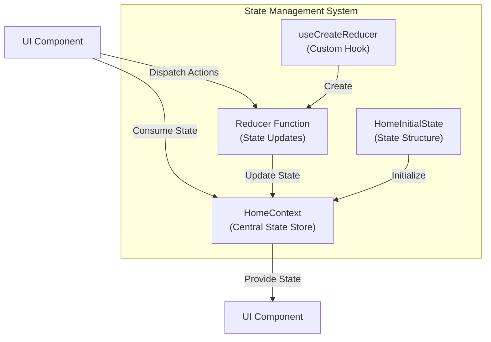
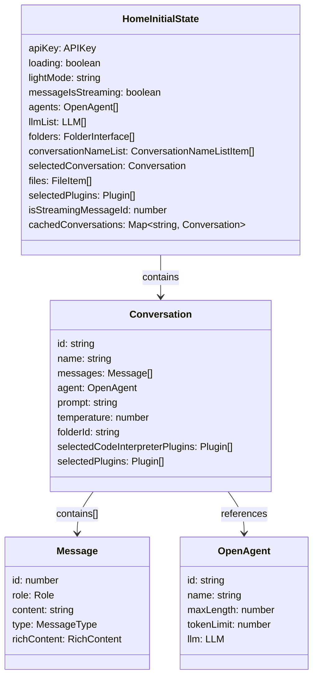
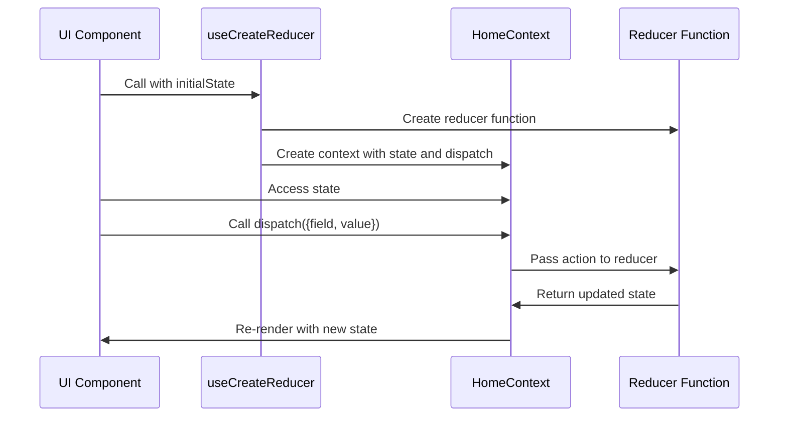
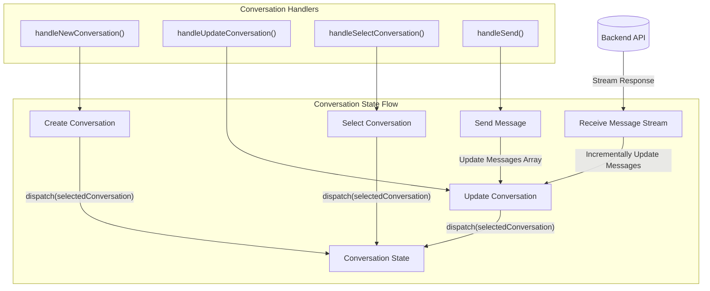
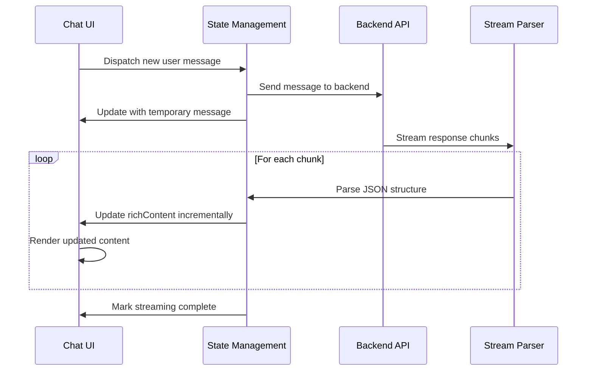
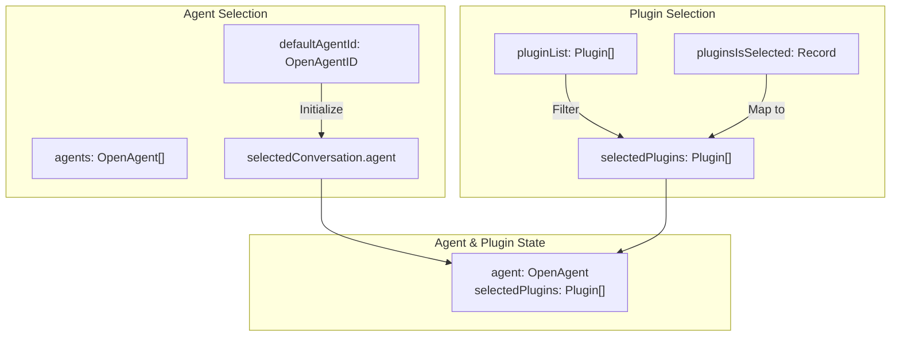
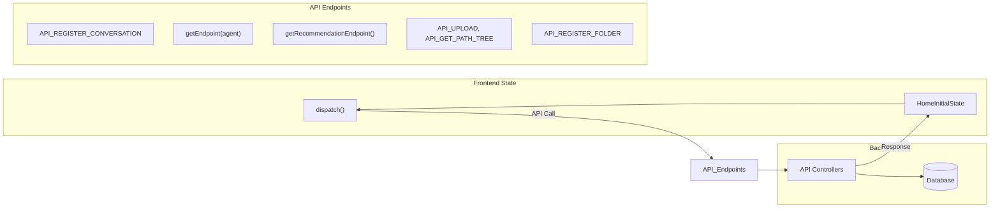

<!-- source: DeepWiki mcp.deepwiki.com · repo xlang-ai/OpenAgents · page 4.2 State Management · fetched 2026-10-26 -->

# State Management

<details>
<summary>Relevant source files</summary>

The following files were used as context for generating this wiki page:

- [frontend/components/Chat/ChatRichContentItem.tsx](frontend/components/Chat/ChatRichContentItem.tsx)
- [frontend/package-lock.json](frontend/package-lock.json)
- [frontend/pages/api/home/home.state.tsx](frontend/pages/api/home/home.state.tsx)
- [frontend/pages/api/home/home.tsx](frontend/pages/api/home/home.tsx)
- [frontend/types/agent.ts](frontend/types/agent.ts)
- [frontend/types/chat.ts](frontend/types/chat.ts)

</details>


This page documents the frontend state management system in OpenAgents, explaining how application state is structured, updated, and consumed throughout the UI. The state management architecture provides a centralized way to handle complex state interactions across the chat interface, agent configurations, conversation management, and UI controls.

For information about backend state management and memory systems, see [Memory Management](#3.2).

## Overview

The OpenAgents frontend uses a React Context-based state management system with a reducer pattern similar to Redux. This approach centralizes state in a single store while providing a structured way to update it through dispatched actions. The state management system handles everything from chat conversations and messages to UI controls, file management, and agent configurations.



Sources: [frontend/pages/api/home/home.tsx:84-86](). [frontend/pages/api/home/home.state.tsx:19-65]()

## State Structure

The application state is structured as a single object with multiple categories of data, defined by the `HomeInitialState` interface. This comprehensive state object includes the following key areas:

1. **Authentication & API Keys** - LLM API keys and verification status
2. **Conversations & Messages** - Chat history, selected conversations, and message streaming
3. **Agent Configuration** - Available agents, models, and their settings
4. **UI Controls** - Loading states, themes, and visibility toggles
5. **Files & Resources** - Uploaded files and their metadata
6. **Plugins** - Available and selected plugins for each agent



Sources: [frontend/pages/api/home/home.state.tsx:19-65](), [frontend/types/chat.ts:5-77](), [frontend/types/agent.ts:3-48]()

## State Initialization

The application initializes with a default state defined in `initialState`. This provides baseline values for all state properties and ensures the application starts in a consistent state.

| Key State Element | Initial Value | Purpose |
|-------------------|---------------|---------|
| `apiKey` | Empty object | Stores API keys for OpenAI, Anthropic |
| `loading` | `false` | Global loading indicator |
| `lightMode` | `'dark'` | UI theme setting |
| `agents` | `OpenAgentList` | Available agent options |
| `selectedConversation` | `undefined` | Currently selected conversation |
| `defaultLLMId` | `'gpt-3.5-turbo-16k'` | Default LLM for new conversations |
| `files` | Basic home structure | File system initialization |
| `cachedConversations` | Empty Map | Conversation cache for better performance |

Sources: [frontend/pages/api/home/home.state.tsx:67-118]()

## State Management Implementation

The state management system is implemented using a custom hook called `useCreateReducer` that wraps React's `useReducer` with additional functionality. This pattern provides a Redux-like experience while remaining fully integrated with React's component lifecycle.



Sources: [frontend/pages/api/home/home.tsx:84-86](), [frontend/pages/api/home/home.tsx:107-109]()

## State Update Patterns

State updates follow a consistent pattern using the dispatch function provided by the context. The dispatch function accepts an object with `field` and `value` properties, where `field` specifies which part of the state to update and `value` provides the new data.

Common update patterns include:

1. **Simple Value Updates** - For primitive values or replacements:
   ```javascript
   dispatch({ field: 'loading', value: true });
   ```

2. **Object Updates** - For updating nested structures:
   ```javascript
   dispatch({ field: 'selectedConversation', value: updatedConversation });
   ```

3. **Collection Updates** - For arrays and maps:
   ```javascript
   dispatch({ field: 'conversationNameList', value: updatedConversationNameList });
   ```

Sources: [frontend/pages/api/home/home.tsx:145-175](), [frontend/pages/api/home/home.tsx:650-675]()

## Conversation State Management

Conversation state management is one of the most complex aspects of the system, handling message streams, conversation creation, updates, and selection.



Sources: [frontend/pages/api/home/home.tsx:114-775](), [frontend/pages/api/home/home.tsx:781-803](), [frontend/pages/api/home/home.tsx:951-1008]()

Key conversation operations include:

1. **Creating Conversations** - Initialized with default values and then registered with the backend
2. **Selecting Conversations** - Loading existing conversations (from cache when available)
3. **Updating Conversations** - Modifying conversation properties or appending messages
4. **Streaming Message Responses** - Incrementally updating the UI as messages arrive from the backend

## Message Streaming and Rich Content Handling

OpenAgents implements a sophisticated message streaming system that handles rich content (code, tables, charts) in real-time as it's generated by the backend.



The system:
1. Parses binary stream chunks into JSON structures
2. Differentiates between intermediate steps and final answers
3. Updates the conversation state incrementally for each chunk
4. Handles special content types (code, tables, charts, images)

Sources: [frontend/pages/api/home/home.tsx:317-673](), [frontend/components/Chat/ChatRichContentItem.tsx:38-199]()

## Agent and Plugin State

The application manages state for different agent types (Data, Plugins, Web) and their associated plugins. This includes:

1. Available agents and their configurations
2. Selected agent for the current conversation
3. Available plugins for each agent type
4. Selected plugins for the current conversation



Sources: [frontend/types/agent.ts:3-48](), [frontend/pages/api/home/home.state.tsx:53-60]()

## Caching Mechanism

To improve performance, the system implements a conversation caching mechanism using a Map structure:

```typescript
cachedConversations: Map<string | null, Conversation | undefined>
```

This cache:
1. Stores previously loaded conversations
2. Reduces backend API calls when switching between conversations
3. Uses a basic LRU (Least Recently Used) pattern - most recently accessed conversations remain in the cache
4. Immediately updates the cache when conversations are modified

Sources: [frontend/pages/api/home/home.state.tsx:62](), [frontend/pages/api/home/home.tsx:784-798]()

## Interaction with Backend

The state management system interacts with the backend through RESTful API calls. Key interactions include:

1. **Conversation Registration** - When creating new conversations
2. **Message Sending** - When sending user messages
3. **Conversation Loading** - When retrieving conversation history
4. **File Operations** - When working with data files
5. **Plugin Operations** - When listing or using plugins



Sources: [frontend/pages/api/home/home.tsx:187-240](), [frontend/pages/api/home/home.tsx:257-272]()

## Error Handling

The state management system includes specific state properties for error handling:

1. `modelError` - For errors related to language models
2. `isStreamingError` - Flag indicating errors during message streaming
3. `isStreamingErrorChatID` - Identifies which conversation experienced an error

When errors occur, the system:
1. Updates error state properties
2. Adds error messages to the conversation
3. Shows toast notifications
4. Resets loading states

Sources: [frontend/pages/api/home/home.tsx:273-285](), [frontend/pages/api/home/home.tsx:403-458]()

## Key Challenges and Solutions

The state management system addresses several complex challenges:

| Challenge | Solution |
|-----------|----------|
| Real-time message streaming | Binary protocol with chunk parsing and incremental UI updates |
| Rich content rendering | Type-based rendering system with specialized components |
| Performance with large conversations | Conversation caching mechanism |
| Multiple agent types | Flexible state structure accommodating different agent requirements |
| Complex UI state | Comprehensive state object with clear categorization |
| Backend synchronization | Consistent API interaction patterns |

Sources: [frontend/pages/api/home/home.tsx:317-673](), [frontend/components/Chat/ChatRichContentItem.tsx:98-194]()

## UI State Integration

The state management system closely integrates with the UI, providing controls for:

1. Light/dark theme toggling
2. Loading indicators
3. Sidebar visibility
4. Modal dialogs
5. Progress indicators

Each UI component can:
1. Access relevant state via the HomeContext
2. Update state through the dispatch function
3. React to state changes through standard React rendering

Sources: [frontend/pages/api/home/home.tsx:81-109]()

## Conclusion

The state management system in OpenAgents provides a comprehensive solution for managing complex application state in a React frontend. By centralizing state in a context-based store and providing structured update patterns, it enables the various UI components to share state and coordinate their behavior. The sophisticated handling of message streaming and rich content demonstrates the system's ability to manage complex real-time data flows while maintaining a responsive user experience.

---

